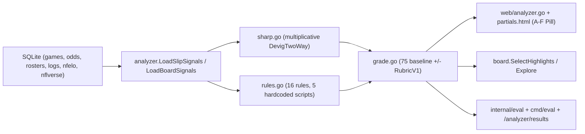
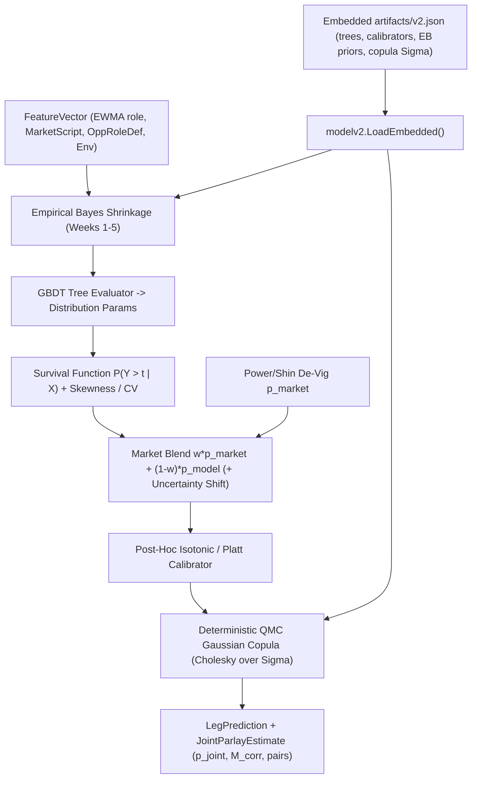
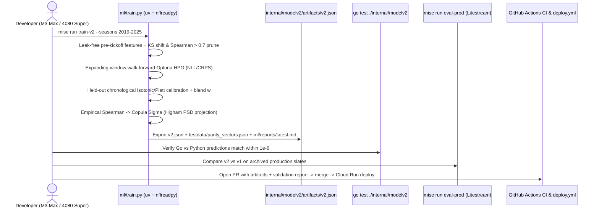

# Design: Calibrated v2 grading and prediction model

## Context

Today's analyzer and evaluation stack live across six Go packages backed by one SQLite database in a single pure-Go
Cloud Run container (`CGO_ENABLED=0`, Alpine image + Litestream, no Python runtime):

- `internal/parlay/parlay.go` provides American/decimal odds conversion, `CombinedOdds`, `ImpliedProb`, multiplicative
  two-way `DevigTwoWay` (`pA / (pA + pB)`), and `PriceEdge`.
- `internal/analyzer/` holds pure, deterministic rules (`AnalyzeSlip` in `rules.go`), additive rubric scoring
  (`ScoreLegWithRubric`, `ScoreSlipWithRubric`, `EvaluateSlipWithRubric` in `grade.go` + `rubric.go`), tiered de-vigged
  sharp benchmarks (`BuildSharpBenchmarks` in `sharp.go`), and SQLite signal loaders (`LoadSlipSignals`,
  `LoadBoardSignals` in `signals.go`).
- `internal/progress/math.go` already implements standard normal `normCDF` ($\Phi$) and Acklam's `normInv` ($\Phi^{-1}$)
  for live win-probability modeling.
- `internal/ingest/nflverse/` and `internal/refresh/nflverse.go` sync free weekly nflverse CSVs (`players`,
  `stats_team_week`, `stats_player_week`, `snap_counts`) into `nflverse_player_ids`, `nflverse_team_weeks`, and
  `nflverse_player_weeks` (latest migration: `0018_live_game_state.sql`).
- `internal/eval/` replays historical weeks read-only from SQLite (`ModeSlips` and `ModeMarket`) using pre-kickoff
  archived API responses and strictly prior-week nflverse rows, surfaced via `cmd/eval` and `GET /analyzer/results`.
- `internal/web/analyzer.go` and `web/templates/partials.html` render clickable A–F grade pills (`GradeView`) with
  inline `<details>` factor lists on slips, pick trays, highlights, and research views.



Constraints and invariants:

- **Single binary, pure Go at runtime:** Cloud Run runs one static Go binary with zero external ML sidecars, zero LLM
  calls, and deterministic output (same slip + data always yields the exact same grade and warnings).
- **Free-tier credit guardrails:** Zero new paid odds calls. Game-script features (spread, total, implied team totals)
  derive strictly from already-cached `odds` rows; prop opportunity enrichment uses free `nflverse-data` GitHub
  releases.
- **Friendly, never blocking, phone-first:** Every pick remains allowed, explanations read like a sharp friend (no raw
  "+EV %" lectures), and grade breakdowns must stay compact at 375px phone width.
- **Zero future leakage:** Every training, calibration, and replay feature for `(Season S, Week W)` must read only games
  completed before kickoff of `Week W`.

## Approach

### 1. Power/Shin de-vigging and cached game-script anchors (`internal/parlay`, `internal/analyzer`)

Retail player props and Anytime TD lines exhibit favorite-longshot bias that multiplicative de-vigging under-corrects.
Extend `internal/parlay/devig.go` while keeping existing `DevigTwoWay` intact for v1 parity:

```go
// DevigTwoWayPower solves pA^k + pB^k = 1 via bisection on k in (0.05, 20)
// and returns (pA^k, pB^k, vigPct, ok).
func DevigTwoWayPower(priceA, priceB int) (probA, probB, vig float64, ok bool)

// DevigTwoWayShin solves Shin's insider-trading two-way model for z in (0, 1)
// and returns fair probabilities and overround vig.
func DevigTwoWayShin(priceA, priceB int) (probA, probB, vig float64, ok bool)

// FairEV returns fairProb * AmericanToDecimal(retailAmerican) - 1 (internal
// scoring signal; never rendered as raw "+EV %" copy).
func FairEV(fairProb float64, retailAmerican int) float64
```

Extend `analyzer.SharpQuote` with `PowerFairProb`, `VigPct`, and `BookCount`, and add `MarketScript` to `analyzer.Game`
populated in `LoadSlipSignals` / `LoadBoardSignals` from cached `SPREAD` and `TOTAL` rows:

```go
type MarketScript struct {
    HomeSpread       float64 // consensus home spread (negative = home favored)
    GameTotal        float64 // consensus game over/under
    HomeImpliedTotal float64 // (GameTotal - HomeSpread) / 2
    AwayImpliedTotal float64 // (GameTotal + HomeSpread) / 2
    HasSpread        bool
    HasTotal         bool
}
```

### 2. Free opportunity sync and role-archetype features (`internal/ingest/nflverse`, `internal/db`, `internal/refresh`)

Extend `internal/ingest/nflverse` with `FFOpportunity(ctx, season)` reading nflverse's free weekly expected-opportunity
CSV (`ffverse/ffopportunity` `latest-data/ep_weekly_{season}.csv` on `DefaultBaseURL`, or
`/ff_opportunity/ep_weekly_{season}.csv` on custom base URLs), failing soft on HTTP/parse error so core nflverse sync
never breaks. Add migration `internal/db/migrations/0019_v2_opportunity_signals.sql` adding expected opportunity and
efficiency columns on `nflverse_player_weeks`:

- `exp_pass_yds REAL NOT NULL DEFAULT 0`
- `exp_rush_yds REAL NOT NULL DEFAULT 0`
- `exp_rec_yds REAL NOT NULL DEFAULT 0`
- `exp_receptions REAL NOT NULL DEFAULT 0`
- `exp_pass_tds REAL NOT NULL DEFAULT 0`
- `exp_rush_tds REAL NOT NULL DEFAULT 0`
- `exp_rec_tds REAL NOT NULL DEFAULT 0`
- `carry_share REAL NOT NULL DEFAULT 0` (player carries divided by team carries in that game)
- `cpoe REAL NOT NULL DEFAULT 0`

In `internal/analyzer/signals.go`, derive each player's **role archetype** (`QB`, `WR1`, `WR2`, `TE1`, `RB1`, `RB2`)
deterministically from position plus trailing team rank of EWMA target share (WR/TE) or carry/snap share (RB), and
derive **role-specific opponent defense allowed** (yards, receptions, and EPA allowed per game to that position, using
the existing `idx_nflverse_player_weeks_opp_pos` index).

### 3. Versioned artifact contract and pure-Go inference + copula engine (`internal/modelv2`)

Create a pure-Go, zero-I/O package `internal/modelv2` that embeds versioned JSON model artifacts via
`//go:embed artifacts/*.json` and validates schema/PSD invariants at init/load time.



Core artifact types in `internal/modelv2/artifact.go`:

```go
type ArtifactBundle struct {
    Version              string                       `json:"version"`
    FeatureSchemaVersion int                          `json:"feature_schema_version"`
    TrainedSeasons       []int                        `json:"trained_seasons"`
    BuiltAt              string                       `json:"built_at"`
    Validation           ValidationSummary            `json:"validation"`
    PropModels           map[string]DistModelArtifact `json:"prop_models"`
    Priors               map[string]RolePrior         `json:"priors"` // key: "MARKET:ROLE"
    Copula               CopulaArtifact               `json:"copula"`
}

type DistModelArtifact struct {
    Market            string               `json:"market"`
    Family            string               `json:"family"` // zero_adj_gamma, zero_adj_lognormal, negbin, poisson, bernoulli
    FeatureNames      []string             `json:"feature_names"`
    ParamModels       map[string]GBDTModel `json:"param_models"`
    Calibrator        CalibratorArtifact   `json:"calibrator"`
    MarketBlendWeight float64              `json:"market_blend_weight"` // tuned in [0.70, 0.85]
}

type FlatTree struct {
    Nodes []TreeNode `json:"nodes"` // Feature (-1=leaf), Threshold, Left, Right, Missing, Leaf
}

type GBDTModel struct {
    BaseScore float64    `json:"base_score"`
    Trees     []FlatTree `json:"trees"`
}

type CalibratorArtifact struct {
    Method string    `json:"method"` // "isotonic" | "platt"
    KnotsX []float64 `json:"knots_x,omitempty"`
    KnotsY []float64 `json:"knots_y,omitempty"`
    PlattA float64   `json:"platt_a,omitempty"`
    PlattB float64   `json:"platt_b,omitempty"`
}

type CopulaArtifact struct {
    Nodes          []string               `json:"nodes"` // e.g. TEAM_MARGIN, GAME_TOTAL, QB_PASS_YDS, WR1_REC_YDS, OPP_WR1_REC_YDS...
    DefaultMatrix  [][]float64            `json:"default_matrix"`
    RegimeMatrices map[string][][]float64 `json:"regime_matrices,omitempty"` // heavy_favorite, shootout, neutral
    WithinPlayer   map[string]float64     `json:"within_player"`             // e.g. "RECEPTIONS:REC_YDS": 0.84
}
```

#### Distribution survival functions (`internal/modelv2/dist.go`)

| Market family | Distribution | Parameters predicted | Survival function $P(Y > t \mid X)$ & tail risk |
| --- | --- | --- | --- |
| `PASS_YDS`, `RUSH_YDS`, `REC_YDS` | Zero-Adjusted Gamma (or Log-Normal) | $\pi_0 = \sigma(\eta_0)$, $\mu = e^{\eta_\mu}$, $k = e^{\eta_k}$ | $(1-\pi_0) Q(k, t k / \mu)$ via regularized upper incomplete gamma (series + Lentz continued fraction); skewness $2/\sqrt{k}$ |
| `RECEPTIONS`, `RUSH_ATT` | Negative Binomial | $\mu = e^{\eta_\mu}$, $r = e^{\eta_r}$ | $1 - \sum_{j=0}^{\lfloor t \rfloor} \text{PMF}_{\text{NB}}(j; \mu, r)$ in log-space via `math.Lgamma`; CV $\sqrt{1/\mu + 1/r}$ |
| `PASS_TDS` | Poisson / NegBin | $\lambda = e^{\eta_\lambda}$ (and optional $r$) | $1 - \sum_{j=0}^{\lfloor t \rfloor} \text{PMF}(j)$ |
| `ANYTIME_TD` | Calibrated Bernoulli / NegBin $P(Y \ge 1)$ | $p = \sigma(\eta_p)$ | $p$ (binary variance $\sqrt{p(1-p)}$ flagged as high swing) |

#### Deterministic Gaussian copula (`internal/modelv2/copula.go`)

1. Group slip legs by `GameID`. Independent games multiply: $p_{\text{joint}} = \prod_g p_{\text{joint}, g}$.
2. For each game with $m \ge 2$ legs, assign every leg its canonical node (`TEAM_MARGIN` for spread/ML, `GAME_TOTAL` for
   total, `<ROLE>_<MARKET>` for offensive props relative to the first leg's team, and `OPP_<ROLE>_<MARKET>` for the
   opposing team) plus signed direction $s_i \in \{+1, -1\}$ (`+1` when higher stat/margin helps, `-1` for Unders).
3. Assemble the $m \times m$ submatrix $\Sigma_{\text{sub}}$ from the active regime matrix (`heavy_favorite` when
   $|\text{spread}| \ge 7$, `shootout` when $\text{total} \ge 48$, else `neutral`), overriding same-player pairs from
   `WithinPlayer`, then apply directional sign flips: $\tilde{\Sigma}_{ij} = s_i s_j \Sigma_{ij}$.
4. Run Cholesky factorization $\tilde{\Sigma} = L L^T$ (with a tiny diagonal jitter fallback $\epsilon I$ + re-scaling
   if floating-point rounding breaks PSD).
5. Map each calibrated leg probability $p_i \in [10^{-4}, 1-10^{-4}]$ to cutoff $z_i = \Phi^{-1}(p_i)$ via Acklam's
   inverse normal approximation.
6. Evaluate $p_{\text{joint}} = \frac{1}{N} \sum_{r=1}^{N} \mathbf{1}\{\forall i,\ (L \mathbf{u}_r)_i \le z_i\}$ over
   $N = 8{,}192$ precomputed deterministic quasi-Monte-Carlo (Sobol/Halton-transformed) standard normal vectors. Because
   draws are fixed and low-discrepancy, evaluation is 100% deterministic, runs in <0.5 ms per slip, and beats 20,000
   pseudo-random draws in Monte Carlo error.
7. Emit `JointProb`, `IndependentProb`, `CorrMultiplier = JointProb / IndependentProb`, and sorted `PairCorrelations`
   (signed $\tilde{\Sigma}_{ij}$) for script explanations.

### 4. Offline Python training, calibration, and parity pipeline (`ml/`)

Keep all ML tooling under `ml/` (excluded from `Dockerfile` and Cloud Run), managed with `uv` (`ml/pyproject.toml`,
`ml/uv.lock`) and triggered locally via `mise run train-v2`:



Mandatory pipeline checks enforced before writing `v2.json`:

1. **Zero future leakage:** For every `(season, week)` row, rolling EWMA features, team EPA, opponent position defense,
   and Empirical Bayes priors strictly exclude week $\ge W$ of that season.
2. **Walk-forward multi-season backtest:** Minimum 3 full held-out NFL seasons using expanding windows (train on prior
   seasons $\to$ calibrate on next chronological slice $\to$ test on following season).
3. **Covariate shift & collinearity:** Log KS-test drift across seasons and drop redundant features with pairwise
   Spearman $|\rho| > 0.7$.
4. **Calibration collapse & baseline gates:** Assert $\ge 80\%$ of probability bins populated, blended model Log Loss
   and Brier Score $\le$ de-vigged market baseline, Gaussian copula SGP Log Loss $<$ naive independence $\prod p_i$, and
   stability check (perturbing EWMA half-life $\pm 1$ week stays within tolerance).
5. **Go/Python parity fixture:** Export 100+ diverse test vectors (all stat families, alt lines, Weeks 1–5 shrinkage,
   multi-leg SGPs with Overs/Unders) to `internal/modelv2/testdata/parity_vectors.json` asserted in `go test`.

Training cadence: pre-season full retrain (August), optional mid-season/pre-playoff check via `mise run eval-prod`
(retrain only if drift or Log Loss gain warrants it), and ad-hoc on feature changes.

### 5. Extensible context/injury overlays and four-pillar v2 grading (`internal/analyzer`)

Introduce a versioned grading engine seam so `v1` and `v2` coexist cleanly in `internal/analyzer` until `v2` clears all
eval gates:

```go
type GradingEngine interface {
    Name() string
    ScoreLeg(leg Leg, games map[string]Game, stats map[string]PlayerStats) LegGrade
    EvaluateSlip(legs []Leg, games map[string]Game, stats map[string]PlayerStats) SlipEvaluation
}
```

#### Extensible context, injury, and news overlay layer (`internal/analyzer/overlays.go`)

```go
// ContextSignal is an optional structured external context event (e.g. breaking
// injury update, inactive report, sharp steam, or future structured news item)
// attached to a Game or PlayerStats without retraining model artifacts.
type ContextSignal struct {
    Kind                  string // "injury", "news", "line_move", "inactive"
    Team                  string
    PlayerID              string
    Label                 string
    Detail                string
    Severity              Severity
    ScoreDelta            int
    HeightenedUncertainty bool
}

type OverlayFinding struct {
    Rule                  string
    Label                 string
    Detail                string
    Severity              Severity
    ScoreDelta            int
    HeightenedUncertainty bool
    LegIDs                []int64
}

type ContextOverlay func(leg Leg, game Game, stats map[string]PlayerStats, pred *modelv2.LegPrediction) []OverlayFinding
```

Built-in deterministic overlays registered in `v2`:

- **Retained v1 intelligence:** player injury status (`Out`/`Doubtful`/`Questionable`), same-position teammate-out
  volume bump (`teammate_out_bump`, which also marks `HeightenedUncertainty` on trailing stats), `qb_drag` (nfelo),
  `wind` (>15 / >20 mph) & `fake_weather`, `hook` & `total_key_number`, `shrinking_role` (2–3 week snap/target drop),
  `td_spike_risk`.
- **New v2 trap overlays:**
  - `narrative_streak_trap`: player cleared last 5 games, *but* the current line sits materially above their recent
    average/median or model fair probability is $< 0.50$ (book already moved the line past the streak).
  - `model_market_divergence`: $|p_{\text{model}} - p_{\text{market}}| \ge 0.08$ — emits a sharp-friend check flag
    (*"Model and market see this differently — double-check late injury, weather, or role news"*) rather than claiming
    blind alpha.
  - `external_context_signals`: consumes any structured `ContextSignal` attached to `Game.ContextSignals` or
    `PlayerStats.ContextSignals`, giving future news/inactive/line-movement feeds a zero-retrain integration seam.

When any overlay sets `HeightenedUncertainty = true`, `EngineV2` raises the market blend weight toward the live market
anchor ($w_{\text{eff}} = \min(0.95, w + 0.15)$) and sets `Uncertain = true` on `LegGrade` so the UI flags elevated
uncertainty instead of false precision.

#### Four-pillar sub-scores and explainable A–F rollup (`internal/analyzer/grade_v2.go`)

Extend `LegGrade` and `SlipGrade` with optional v2 fields (leaving `Letter`, `Score`, `Summary`, `Factors` populated for
full backwards compatibility with `board.SelectHighlights`, `board.Explore`, and `v1`):

```go
type PillarScore struct {
    Key     string   // "price_vig", "script_fit", "stability_risk", "context_traps"
    Label   string   // "Price & Vig", "Script Fit", "Stability & Tail Risk", "Context & Traps"
    Score   int      // 0..100
    Tone    string   // "good", "neutral", "warn", "bad"
    Summary string   // concise sharp-friend takeaway
    Reasons []string // 1-3 approximate plain-English reasons
}

// Added to LegGrade and SlipGrade (empty/zero on v1):
// Pillars         []PillarScore
// CalibratedProb  float64 // calibrated fair leg prob or joint slip prob
// MarketProb      float64 // Power-devigged market anchor (0 if unavailable)
// CorrMultiplier  float64 // SlipGrade only: M_corr = p_joint / prod(p_i)
// Uncertain       bool    // heightened uncertainty from role/injury/news shifts
```

Sub-score mapping (pure, monotonic, deterministic, tunable via `V2Config`):

1. **Price & Vig (`price_vig`):**
   - Leg: maps `FairEV(p_leg, leg.Odds)` and per-leg vig vs. sharp/consensus into `0..100` (e.g., `FairEV = 0` maps to
     ~85, standard -110 `-4.5%` maps to ~74, bad `-10%` juice maps to ~48, `-15%+` maps to `<35`).
   - Slip: maps joint `EV% = p_joint * combinedDecimal - 1` plus SGP correlation tax detection (when
     $M_{\text{corr}} > 1.05$ yet offered SGP odds imply higher probability than $p_{\text{joint}}$). Plain-English
     reasons cite actual odds (*"Paying -130 vs. fair price near -105"*, *"5 legs of book juice shrink the payout"*),
     never "+EV %".
2. **Script Fit (`script_fit`):**
   - Slip: maps $M_{\text{corr}}$ into `0..100` ($M_{\text{corr}} \ge 1.10 \to 90\text{–}98$,
     $1.05\text{–}1.10 \to 82\text{–}89$, $0.95\text{–}1.05 \to 75$, $0.85\text{–}0.95 \to 45\text{–}62$,
     $< 0.85 \to 15\text{–}44$), naming the strongest positive or negative leg pair from `PairCorrelations`.
   - Leg: checks single-leg script alignment against `MarketScript` (e.g., RB rush over on a heavy underdog vs. heavy
     favorite), defaulting to neutral `75`.
3. **Stability & Tail Risk (`stability_risk`):**
   - Combines leg count, weakest leg calibrated $p_i$, and distributional tail risk (CV/skewness from `modelv2`, plus
     explicit high-swing penalty for `ANYTIME_TD` and extreme longshot alt lines with $p_i < 0.25$).
4. **Context & Traps (`context_traps`):**
   - Starts at `75` and applies clamped deltas from active `ContextOverlay` findings (injuries, teammate-out, weather,
     QB drag, snap drops, recency traps, divergence, structured news).

Weighted rollup (`Score = clamp(round(sum(w_k * pillar_k)), 0, 100)`):

- **Single leg:** Price & Vig 40%, Stability & Tail Risk 25%, Context & Traps 35% (or 30/25/15/30 when single-leg script
  signal applies).
- **Slip:** Price & Vig 35%, Script Fit 25%, Stability & Tail Risk 20%, Context & Traps 20%, with a hard cap so a severe
  Danger conflict ($M_{\text{corr}} < 0.85$) or extreme vig trap cannot sneak into an `A`.
- Letter bands map `A >= 85`, `B >= 73`, `C >= 60`, `D >= 48`, `F < 48` (matching v1 cutoffs for familiar UI semantics).

### 6. Calibration-first eval harness (`internal/eval`, `cmd/eval`, `internal/web/eval_results.go`)

Extend `internal/eval` to evaluate any registered `GradingEngine` (`v1`, `v2`) alongside rubrics and compute proper
scoring + calibration metrics over settled legs and slips:

```go
type ReliabilityBin struct {
    BinLow       float64 `json:"bin_low"`
    BinHigh      float64 `json:"bin_high"`
    Count        int     `json:"count"`
    MeanPredProb float64 `json:"mean_pred_prob"`
    EmpiricalHit float64 `json:"empirical_hit"`
}

type CalibrationMetrics struct {
    LogLoss             float64          `json:"log_loss"`
    BrierScore          float64          `json:"brier_score"`
    ClasswiseECE        float64          `json:"classwise_ece"`
    PopulatedBins       int              `json:"populated_bins"`
    TotalBins           int              `json:"total_bins"`
    BinSpreadOK         bool             `json:"bin_spread_ok"` // >= 80% bins populated
    MarketLogLoss       float64          `json:"market_log_loss,omitempty"`
    MarketBrier         float64          `json:"market_brier,omitempty"`
    SGPLogLoss          float64          `json:"sgp_log_loss,omitempty"`
    NaiveIndepLogLoss   float64          `json:"naive_indep_log_loss,omitempty"`
    SGPCount            int              `json:"sgp_count,omitempty"`
    Reliability         []ReliabilityBin `json:"reliability,omitempty"`
}
```

Add `Calibration CalibrationMetrics` to `eval.Report`, emit it in `cmd/eval` (text, Markdown, JSON), and render a
compact Calibration Summary + Reliability section on `GET /analyzer/results` alongside the existing v1-vs-v2 switcher
and diff view.

### 7. Phone-first four-pillar UI presentation (`internal/web`, `web/templates/`)

Preserve the compact `Grade A`–`F` pill on every leg row, slip banner, pick tray, and highlight. Extend `GradeView` in
`internal/web/analyzer.go` with `Pillars []PillarView`, `Uncertain bool`, and `CorrSummary string`:

- Inside the `<details>` popover (max width 375px-friendly):
  - Show the overall letter + score and an optional subtle `"High uncertainty"` badge when breaking injury/role/news
    context is active.
  - Render the **4 pillar rows** (`Price & Vig`, `Script Fit`, `Stability & Tail Risk`, `Context & Traps`), each with a
    compact tonal meter/badge and its 1-line sharp-friend takeaway.
  - Under the pillars, list up to 3 concise plain-English **"Why"** bullets (from the strongest contributing drivers).
  - Keep the existing `See full rubric` link to `/analyzer/guide`, updated to document the four v2 pillars, Power
    de-vigging, copula script scoring, and extensible context/injury overlays.
- When `GradeView.Pillars` is empty (v1 engine), templates seamlessly fall back to the existing `Factors` list.

### Trade-offs and rejected options

- **Embedded flat decision trees vs. ONNX/CGO runtime:** Embedding flat GBDT JSON trees keeps `CGO_ENABLED=0`, builds in
  seconds on Alpine, adds zero binary bloat or native shared libraries, and executes in microseconds. Rejected ONNX
  Runtime due to CGO and container complexity.
- **Deterministic QMC Cholesky draws vs. random Monte Carlo or closed-form bivariate approximations:** Closed-form
  formulas break past 2 legs; pseudo-random MC causes jittery grades on reload. Precomputed low-discrepancy Sobol/Halton
  normal draws ($N = 8{,}192$) give exact determinism, sub-millisecond latency, and handle arbitrary 2–10 leg SGPs.
- **Market-anchored blending ($w \in [0.70, 0.85]$) vs. standalone model probabilities:** Sportsbook consensus absorbs
  late news and sharp action faster than weekly nflverse tables. Anchoring to Power-devigged consensus prevents false
  "+EV" claims while using the distributional model for one-way/alt lines, variance/tail risk, and divergence flags.
- **Pluggable overlay seam vs. baking injury/news into the GBDT only:** Breaking Sunday morning injuries, teammate-out
  bumps, and future news signals arrive after weekly stats freeze. Keeping them as explicit deterministic overlays
  retains v1's injury intelligence and lets new context feeds ship without retraining.

## Verification

- Standard checks across every phase: `go test -short -race ./...`, `golangci-lint run ./...`, `good-vibes docs lint`,
  and `rumdl check` (plus `uv run pytest` inside `ml/` for Phase 4).
- **Math & de-vig invariants:** Unit-test Power and Shin de-vigging on symmetric lines (`-110/-110`), heavy
  favorite-longshot lines (`-400/+300`), and invalid overrounds; verify probabilities sum to 1 within `1e-9` and Power
  allocates proportionally more vig to longshots than multiplicative normalization.
- **Distributional & copula invariants:** Verify survival functions (Zero-Adjusted Gamma, Log-Normal, NegBin, Poisson)
  against analytical/reference values across extreme thresholds (`0.5`, median, `99th` percentile alt lines), verify
  copula determinism (identical outputs across repeated runs), verify positive stack ($M_{\text{corr}} > 1.05$),
  conflicting script ($M_{\text{corr}} < 0.95$), Under sign flips, cross-game independence ($M_{\text{corr}} == 1.0$),
  and PSD jitter recovery.
- **Go/Python parity:** `internal/modelv2/parity_test.go` loads `testdata/parity_vectors.json` generated by
  `ml/export.py` and asserts Go raw parameters, survival probabilities, calibrated probabilities, and copula
  $p_{\text{joint}}$ match Python within `1e-6`.
- **Zero-leakage & walk-forward gates:** `ml/` unit tests verify that mutating week $\ge W$ outcomes leaves all week $W$
  features byte-identical; walk-forward validation report confirms ≥3 seasons, bin spread $\ge 80\%$, blended model
  beats or matches market Log Loss, copula beats naive independence on SGP Log Loss, and EWMA window perturbations stay
  stable.
- **Overlay & uncertainty behavior:** Unit-test every retained v1 overlay (teammate-out bump, injury status, QB drag,
  wind, hooks, shrinking role, TD spike), new trap overlays (narrative streak trap, model-vs-market divergence),
  structured external `ContextSignal` injection, and verify `HeightenedUncertainty` shifts blend weight toward
  $p_{\text{market}}$.
- **UI, eval, and promotion verification:** Integration-test slip panel, pick tray, highlights, `/analyzer/guide`, and
  `/analyzer/results` rendering at phone width with both v1 and v2 engines; run `mise run eval-prod` against archived
  production data to verify v2 outperforms v1 before switching `ActiveEngine`.

## Risks

- **Feature drift between Python training and Go serving:** Subtle differences in EWMA decay, division-by-zero handling,
  or Weeks 1–5 shrinkage between `ml/features.py` and `internal/modelv2/features.go` would silently miscalibrate live
  predictions. Mitigated by a versioned `feature_schema_version`, ordered `feature_names` validation on load, and
  automated Go/Python parity tests in CI.
- **Upstream `ff_opportunity` availability or schema change:** nflverse occasionally updates column names or lags
  publishing expected opportunity for week 1. Mitigated by fail-soft ingestion in `refresh/nflverse.go`, optional
  missing-value splits in GBDT trees (`Missing` branch), and Empirical Bayes fallback priors.
- **Over-penalizing or over-praising SGP stacks:** If a sportsbook already taxes a positively correlated stack heavily,
  praising `Script Fit` alone could mislead users. Mitigated by decoupling `Script Fit` from `Price & Vig` (so a
  coherent stack with bad SGP odds shows green Script Fit + red Price & Vig) and surfacing an explicit SGP-tax warning.
- **Latency regression on full-slate scoring (`SelectHighlights` / Research Explorer):** Evaluating GBDTs across
  hundreds of board rows per render could slow page loads if allocations or copula runs happen unnecessarily. Mitigated
  by running single-leg inference with zero heap allocations per tree walk (skipping copula for single legs) and adding
  a Go benchmark verifying full-slate scoring stays under 15 ms.
- **Premature promotion before real multi-season artifact validation:** Shipping placeholder/untrained weights would
  hurt real Sunday picks. Mitigated by keeping `ActiveEngine = EngineV1` during Phases 1–6 and gating the switch to
  `EngineV2` in Phase 7 on passing real multi-season walk-forward and `eval-prod` calibration checks.

## TODO

### Phase 1: Power/Shin de-vigging and cached game-script anchors

Complexity: low (focused math in `internal/parlay` and small extensions to `sharp.go` and `signals.go` following
existing patterns) Risk: low (pure functions with backwards-compatible `DevigTwoWay` kept intact; fully covered by unit
tests)

- [x] Add `DevigTwoWayPower`, `DevigTwoWayShin`, `VigPct`, and `FairEV` in `internal/parlay/devig.go` with unit tests in
      `internal/parlay/devig_test.go` covering symmetric, favorite-longshot, and invalid-overround inputs.
- [x] Extend `analyzer.SharpQuote` (`PowerFairProb`, `VigPct`, `BookCount`) in `internal/analyzer/sharp.go` and derive
  `Game.MarketScript` (consensus spread, total, implied team totals) from cached `odds` rows in
  `internal/analyzer/signals.go`, with tests verifying zero extra DB queries or API calls.
- [x] Docs: update `docs/reference/odds-math.md` with Power and Shin de-vigging and `FairEV` formulas.

### Phase 2: Free nflverse opportunity sync and role-archetype enrichment

Complexity: medium (coordinates nflverse CSV parsing, SQLite migration `0019`, transactional refresh upsert with
fail-soft behavior, and position/role aggregation in `analyzer`) Risk: low (additive nullable/defaulted columns and
fail-soft fetch ensure existing nflverse sync cannot break)

- [x] Add `Client.FFOpportunity` in `internal/ingest/nflverse/opportunity.go` (plus fixtures and parser tests), add
  migration `internal/db/migrations/0019_v2_opportunity_signals.sql`, and wire fail-soft opportunity + `carry_share`
  ingestion through `internal/db/nflverse.go` and `internal/refresh/nflverse.go` with unit/integration tests.
- [x] Compute deterministic player role archetypes (`QB`, `WR1`, `WR2`, `TE1`, `RB1`, `RB2`), EWMA usage/opportunity
  features, and role-specific opponent defense allowed profiles in `internal/analyzer/signals.go` (respecting strict
  pre-kickoff replay in `internal/eval/replay.go`), with tests covering early-season sparse data and replay leakage.
- [x] Docs: update `docs/reference/data-sources.md` and `docs/reference/schema.md` for `ff_opportunity` and migration
  `0019`.

### Phase 3: Portable artifact contract and pure-Go distributional + copula engine

Complexity: high (implements numerical survival functions for Zero-Adjusted Gamma/Log-Normal/NegBin/Poisson, GBDT tree
evaluator, isotonic/Platt calibrator, Empirical Bayes shrinkage, and deterministic QMC Cholesky Gaussian copula in pure
Go) Risk: medium (numerical stability in incomplete gamma, log-space PMFs, Acklam inverse normal, and PSD Cholesky
factorization require tight mathematical verification)

- [x] Create `internal/modelv2` with `ArtifactBundle` schema validation, `//go:embed` artifact loader (seeded with a
  valid baseline artifact), flat GBDT tree evaluator, Weeks 1–5 Empirical Bayes shrinkage, and isotonic/Platt
  calibrator, with unit tests and benchmarks.
- [x] Implement pure-Go survival functions and variance/skewness estimators (`internal/modelv2/dist.go`) for
  Zero-Adjusted Gamma, Zero-Adjusted Log-Normal, Negative Binomial, Poisson, and Bernoulli markets, verified against
  known analytical quantiles and edge thresholds.
- [x] Implement the deterministic QMC Gaussian copula engine (`internal/modelv2/copula.go`) supporting multi-game
      factorization, same-game regime matrices, within-player overrides, Under sign flips, PSD jitter fallback,
      $p_{\text{joint}}$, $M_{\text{corr}}$, and ranked pairwise correlations, with tests and latency benchmarks.

### Phase 4: Offline Python walk-forward training, calibration, and Go parity pipeline

Complexity: high (multi-season leak-free feature engineering over `nflreadpy`, distributional GBDT + Optuna TPE HPO,
chronological post-hoc calibration, Higham PSD copula estimation, and exact Go/Python parity) Risk: medium (subtle
leakage or feature mismatch between Python and Go would silently skew probabilities; gated by automated leakage tests
and `1e-6` parity checks)

- [x] Build the `uv`-managed Python pipeline under `ml/` (`data.py`, `features.py`, `train.py`, `copula.py`,
  `export.py`) with strict expanding-window walk-forward splits across ≥3 NFL seasons, KS covariate-shift checks,
  Spearman > 0.7 collinearity pruning, distributional GBDT + Optuna HPO, held-out isotonic/Platt calibration, market
  blend weight tuning, and PSD copula estimation, plus `pytest` leakage and stability tests.
- [x] Add `mise run train-v2` in `mise.toml`, export real trained artifacts to `internal/modelv2/artifacts/v2.json` and
      parity fixtures to `internal/modelv2/testdata/parity_vectors.json`, and add `internal/modelv2/parity_test.go`
      asserting Go inference and copula outputs match Python within `1e-6`.
- [x] Docs: update `docs/guides/local-dev.md` with local `mise run train-v2` workflow, cadence, and PR verification
  steps.

### Phase 5: Extensible context/injury overlays and four-pillar v2 grading engine

Complexity: high (coordinates Components A–D, pluggable injury/news/trap overlays, uncertainty dampening, four-pillar
scoring and plain-English explanation synthesis, and backwards-compatible `GradingEngine` coexistence with v1) Risk:
medium (touches core slip and highlight grading paths; keeping `ActiveEngine = EngineV1` until Phase 7 isolates
production while unit tests verify all v2 behaviors)

- [x] Implement the pluggable `ContextOverlay` layer in `internal/analyzer/overlays.go` retaining all existing
      non-box-score rules (teammate-out bumps, injury status, nfelo QB drag, wind/fake weather, key numbers, shrinking
      role, TD spike), adding `narrative_streak_trap`, `model_market_divergence`, and structured `ContextSignal`
      ingestion, with `HeightenedUncertainty` blending tests.
- [x] Implement `EngineV2` in `internal/analyzer/grade_v2.go` behind the `GradingEngine` registry alongside `EngineV1`,
      computing the four decomposed `PillarScore` values (`Price & Vig`, `Script Fit`, `Stability & Tail Risk`,
      `Context & Traps`), calibrated `CalibratedProb` / `CorrMultiplier`, approximate sharp-friend plain-English
      reasons, and backwards-compatible `GradeFactor` entries, with full unit tests and highlight/explorer benchmarks.

### Phase 6: Calibration eval metrics and side-by-side v1/v2 comparison

Complexity: medium (extends `internal/eval` with proper scoring rules, classwise ECE, reliability bins, market baseline,
and SGP-vs-independence comparison across CLI and web views) Risk: low (read-only offline and cached eval reporting;
does not mutate live betting state)

- [x] Extend `internal/eval` (`metrics.go`, `replay.go`, `cache.go`) and `cmd/eval` to evaluate all registered
      `GradingEngine` implementations side-by-side and emit `CalibrationMetrics` (Log Loss, Brier, classwise ECE, ≥80%
      bin spread, market baseline, SGP joint Log Loss vs. naive independence, and reliability bins) in text, Markdown,
      and JSON, with unit tests on synthetic and SGP replay fixtures.
- [x] Update `internal/web/eval_results.go` and `web/templates/analyzer_results.html` to display v1 vs. v2 engine
      selection, calibration summary tiles, reliability table, and SGP correlation lift cleanly at phone width, with
      handler and rendering tests.

### Phase 7: Phone-first four-pillar UI, living docs, and v2 promotion

Complexity: medium (updates leg/slip grade popovers across slip panel, pick tray, highlights, and guide page, then
validates and promotes `EngineV2` to active) Risk: medium (switches live grading from v1 to v2 across all screens; gated
by passing `eval-prod` calibration checks and full-suite regression tests)

- [x] Update `internal/web/analyzer.go`, `web/templates/partials.html`, and `web/templates/analyzer_guide.html` to
      render the four-pillar breakdown, approximate sharp-friend "Why" bullets, uncertainty badge, and updated v2 guide
      documentation cleanly at 375px phone width (falling back cleanly to factor lists for v1), with template and
      handler tests.
- [x] Run `mise run eval-prod` (and CI benchmark eval) to confirm `EngineV2` meets calibration, Log Loss, ECE, and SGP
      gates against `EngineV1`, then switch `ActiveEngine = EngineV2` in `internal/analyzer` and update any
      snapshot/golden tests.
- [x] Docs: update `docs/concepts/analyzer.md` and `docs/reference/analyzer-rules.md` to describe the v2 calibrated
      four-pillar architecture, copula script scoring, and extensible context/injury overlays, and run
      `good-vibes docs lint`.

## Reviews

- [x] Final review: agy@gemini-4-neon-high
