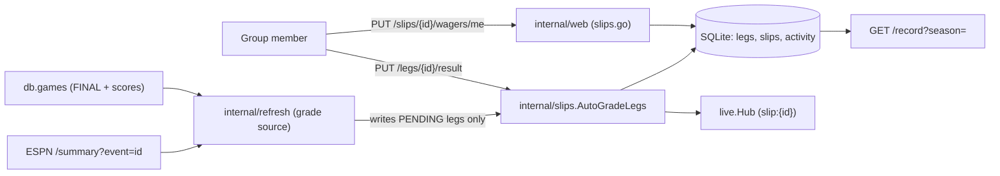
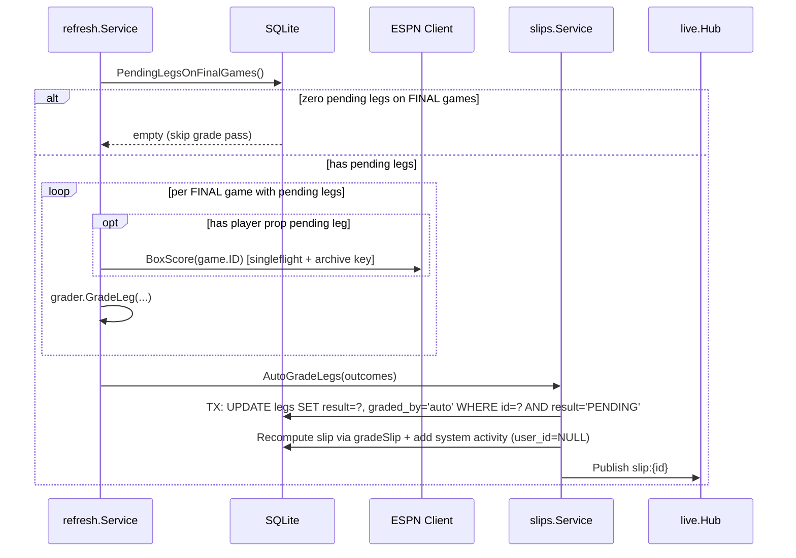

# Design: Auto-grading and Record Book

## Context

Most of the grading foundation is already in place, spread across four packages:

- `internal/parlay` defines `Result` (`PENDING`, `NEEDS_GRADING`, `WON`, `LOST`, `PUSH`, `VOID`), `CombinedOdds`, `AmericanToDecimal`, `DecimalToAmerican`, `Payout`, and `Units`.
- `internal/slips` exposes `Service.SetLegResult(ctx, actorID, legID, result)`, which updates a leg's result and `graded_by`, recomputes the slip's `result` and `status` via `gradeSlip`, logs slip activity, and notifies the live hub.
- `internal/db/migrations/0001_init.sql` already defines `wagers (slip_id, user_id, book, stake, odds, boost_pct)` and `legs (result, graded_by)`, plus `sandbox.resetStatements` already clears `wagers`.
- `internal/web` wires `PUT /legs/{id}/result` (`setLegResult`), `TabRecord` (`GET /record`), and `web/templates/record.html` (currently a two-line stub).



What is missing:

1. An ESPN box score parser in `internal/ingest/espn` and a pure market grader in `internal/grader`.
2. A lazy `grade` source in `internal/refresh` plus an auto-grade entry point on `slips.Service` that never overwrites manual grades.
3. Leg attribution (`graded_by`) and `NEEDS_GRADING` visual handling in `LegView` and `partials.html`.
4. `internal/db/wagers.go`, `PUT`/`DELETE /slips/{id}/wagers/me`, and the slip wager form.
5. `internal/record`, season queries, `GET /record?season=`, and the phone-first `record.html` view.

## Approach

### 1. ESPN box score parsing (`internal/ingest/espn`)

Add `BoxScore(ctx context.Context, eventID string) (BoxScore, error)` on `*espn.Client` targeting the existing `/summary?event={id}` endpoint. Parsing follows the same key-lookup rule as `gamelog.go` (`keys[]` name, never column index) and reuses slash/hyphen splitting (`2/2` and `2-2`) for kicking stats.

```go
type BoxScore struct {
	Completed bool
	HasStats  bool // true when len(boxscore.players) > 0
	Players   []PlayerBoxStats
}

type PlayerBoxStats struct {
	PlayerID    string
	DisplayName string
	TeamAbbrev  string
	Passing     PassingStats     // PassingYards, PassingTDs
	Rushing     RushingStats     // RushingAttempts, RushingYards, RushingTDs
	Receiving   ReceivingStats   // Receptions, ReceivingYards, ReceivingTDs
	OtherTDs    int              // kickReturn + puntReturn + interception + defensive TDs
	Kicking     KickingStats     // FieldGoalsMade, ExtraPointsMade, TotalKickingPoints
}
```

Two boundary rules keep DNP voids distinct from feed failures:

- **Player played in another stat group:** if a player appears anywhere in `boxscore.players[]` (e.g., an RB logged carries in `rushing` and has zero rows in `receiving`), all missing categories default to `0` (`Played = true`), never `VOID`.
- **Empty box score on a final game:** if `HasStats == false`, `grader` returns `NEEDS_GRADING` for every player prop on that game instead of `VOID`. Only when `HasStats == true` and the player appears in zero categories does a player prop grade `VOID` (DNP).

Legs match players by `player_id` first, then case-insensitive normalized `player_name` within the game (narrowed by `leg.Team` when set) so older or manually entered legs still auto-grade.

### 2. Pure grader (`internal/grader`)

Keep `internal/grader` free of DB and HTTP imports, matching `internal/analyzer` and `internal/parlay`. It exports `GradeLeg(leg LegInput, game GameScore, box *espn.BoxScore) parlay.Result` implementing every market rule in `plan/product.md`:

- **Game and team markets (`SPREAD`, `ML`, `TOTAL`, `TEAM_TOTAL`):** grade directly from `game.HomeScore` and `game.AwayScore` once the game is `FINAL`. Return `NEEDS_GRADING` if scores are missing, `leg.Team` does not match either team on a side/spread/team-total leg, or `leg.Line == nil` on a line market.
- **Player yards, attempts, receptions, passing TDs, kicker points:** compare the player's stat against `*leg.Line` (`>` wins, `<` loses, `==` pushes for `OVER`; inverted for `UNDER`). Kicking uses `TotalKickingPoints`, falling back to `FieldGoalsMade*3 + ExtraPointsMade` if that key is omitted.
- **Anytime TD (`ANYTIME_TD`):** sums `RushingTDs + ReceivingTDs + OtherTDs` (excluding `PassingTDs`). `td >= 1` wins (or loses when `side == "NO"`).
- **`OTHER`:** always returns `NEEDS_GRADING` so a friend grades it manually.

We considered storing grading rules inside `internal/slips` directly, but separating pure rule evaluation into `internal/grader` keeps tests table-driven without SQLite setup and honors the module layout in `plan/architecture.md`.

### 3. Refresh `grade` pass and safe write seam



Key behaviors:

- **Zero wasted fetches:** `PendingLegsOnFinalGames()` joins `legs` and `games` where `games.status = 'FINAL'` and `legs.result = 'PENDING'`. Once every pending leg on final games resolves (even to `NEEDS_GRADING` or `VOID`), the query returns zero rows and future refreshes do zero work.
- **Game-line optimization:** if a `FINAL` game only has `PENDING` game/team legs (`SPREAD`, `ML`, `TOTAL`, `TEAM_TOTAL`, `OTHER`) and already has scores in `games`, `refresh` grades them directly without calling `ESPN.BoxScore`.
- **Manual override lock:** `AutoGradeLegs` updates legs with `WHERE id = ? AND result = 'PENDING'` inside a single SQLite write transaction. It never overwrites `WON`, `LOST`, `PUSH`, `VOID`, or `NEEDS_GRADING`, whether set manually or by a previous pass.
- **Backoff on ESPN error:** failed `BoxScore` calls record in-memory per-game backoff (`5m`, matching `refresh.Service` error backoff) so repeated page loads do not hammer ESPN on a bad event ID, while still logging to `activity` only when at least one leg actually changes state.
- **Slip UI clarity:** add `GradedBy` to `LegView`, color `NEEDS_GRADING` amber in `resultClass` (`border-amber-700 bg-amber-950 text-amber-300`), label the chip (`Auto` vs grader name or `Needs grading`), and keep all five result buttons (`PENDING`, `WON`, `LOST`, `PUSH`, `VOID`) available in the existing override menu.

### 4. Per-member wagers (`PUT` / `DELETE /slips/{id}/wagers/me`)

`internal/db/wagers.go` exposes `UpsertWager`, `DeleteWager`, `WagersForSlip`, and `WagersForGroupSeason`. `slips.Service` adds `SetWager(ctx, actorID, slipID int64, input WagerInput)` and `DeleteWager(ctx, actorID, slipID int64)`:

- Access check matches other slip actions: `actor` must belong to `slip.GroupID` (any friend in the group who tailed or picked on the slip can log their bet).
- Validation: `Stake > 0` (finite), valid non-zero American `Odds` (`<= -100 || >= 100`), `BoostPct >= 0`, `Book` trimmed (`<= 40` chars).
- On `slip.html` / `partials.html`, keep the existing stateless what-if payout calculator (`slip-payout`) untouched for quick checks, and add a compact **"My wager"** form in the slip panel (pre-filled with the user's saved wager or defaulting `odds` to the slip's current `CombinedOdds` and `boost` to `0%`) with save and clear controls via HTMX. Saving publishes `slip:{id}` or swaps the wager fragment cleanly.

### 5. Record Book (`internal/record` + `GET /record?season=`)

Pure package `internal/record` takes a group's `GRADED` slips, their legs, their week coordinates (`Season`, `SeasonType`, `WeekNum`), members, and wagers for one NFL season, returning a `Book` struct:

- **Season ordering & streaks:** sort slips chronologically by `(week.Season, week.SeasonType, week.WeekNum, slip.CreatedAt, slip.ID)`. `LongestWin` and `LongestLoss` track the longest consecutive runs of `WON` and `LOST` slips. A `PUSH` slip resets both running streak counters to `0`.
- **Group totals:** `Won-Lost-Push` slip counts plus net `UnitsPL`, summing `parlay.Units(slip.Result, parlay.CombinedOdds(legSlice))` across all `GRADED` slips.
- **Member leaderboard:** includes every user with `>= 1` leg on a `GRADED` slip in that group and season:
  - **Hit%:** `WON / (WON + LOST) * 100` when `decided = WON + LOST >= 6`; otherwise nil (renders `"–"` and sorts after all qualified members).
  - **Avg leg odds:** arithmetic mean of `parlay.AmericanToDecimal(leg.Odds)` across the member's `WON`, `LOST`, and `PUSH` legs (excluding `VOID`, `PENDING`, `NEEDS_GRADING`), converted back with `parlay.DecimalToAmerican`.
  - **Parlay Terrorist:** counts `GRADED` slips with `slip.Result == LOST` that have *exactly one* `LOST` leg and that leg belongs to this member. The badge marks every member tied for the highest count when `max > 0`.
  - **Dollar P/L:** sums net wager outcome over the member's wagers on `GRADED` slips (`WON -> parlay.Payout(stake, parlay.AmericanToDecimal(w.Odds), w.BoostPct) - stake`, `LOST -> -stake`, `PUSH -> 0`). Members with zero logged wagers show `"–"`, distinct from `"$0.00"`.
- **Route & phone-first template:** `GET /record?season=` queries distinct seasons with slips for the active group (defaulting to the latest season with `GRADED` slips, or the active week's season), loads the season's graded slips, legs, and wagers, computes `record.Build(...)`, and renders `web/templates/record.html` (season dropdown/pills, summary cards, mobile member cards stacking cleanly below `sm:` and table at `sm:+`, plus an empty state when no slips are graded yet).

## Verification

- Run `go test ./...`, `go vet ./...`, and `good-vibes docs lint` after code and doc edits.
- **Auto-grading all 13 markets:** table-driven unit tests in `internal/grader` plus box score parsing tests against `summary_week9_featured.json` and `summary_empty.json` fixtures covering exact wins, losses, integer pushes, `ANYTIME_TD` excluding passing TDs, kicker `2/2` + `4/4` / `totalKickingPoints`, player active in another category = `0` (not `VOID`), absent player with `HasStats == true` = `VOID`, and empty box score = `NEEDS_GRADING`.
- **Override durability and zero-waste refresh:** integration tests showing `AutoGradeLegs` skips manually graded or `NEEDS_GRADING` legs even when a subsequent refresh runs, `WHERE result = 'PENDING'` blocks races, and final games with zero pending legs emit zero ESPN `/summary` calls.
- **Wagers:** handler and DB tests verifying group isolation, validation (`stake <= 0`, invalid odds, negative boost), upsert idempotency, and `DELETE /slips/{id}/wagers/me`.
- **Record Book math & screen:** unit tests covering chronological streaks (including `PUSH` resetting streaks), `<6` decided legs threshold displaying `"–"` and sorting last, multi-loser slips not counting for Parlay Terrorist, tied Parlay Terrorist badges, `$0.00` vs `"–"` when unlogged, cross-group isolation, and HTML rendering at mobile layout structure.

## Risks

- **ESPN `boxscore.players` shape changes:** ESPN occasionally alters category names or omits `totalKickingPoints`. Parsing by `keys[]` name with explicit `fg*3 + xp` fallback and returning `NEEDS_GRADING` (never `VOID`) on missing keys/boxscores avoids silent false grades.
- **Sandbox `summary_empty.json` fallback:** in `sandbox` mode, non-featured games use `summary_empty.json`. Checking `summaryStale` / `sandboxRuntime.applyPlan` during Phase 4 ensures staged `AllClear` / `SundayComplete` scenarios stay deterministic whether prop legs come from `summary_week9_featured.json` or sandbox stage scripts.
- **Odds basis for units vs dollar P/L:** group `Units P/L` uses `CombinedOdds` of active legs (consistent with `odds-math.md` and `slips.go`), whereas personal `Dollar P/L` uses each user's logged `wagers.odds` and `boost_pct`; the Record Book subtext should make that distinction explicit so members aren't confused when personal odds beat or trail reference odds.

## TODO

Effort: medium (clear seams across existing packages, one pure grader + boxscore parser + wager CRUD + record screen)

### Phase 1: ESPN BoxScore parser and pure auto-grader

- [x] Add `Client.BoxScore` (`internal/ingest/espn`) parsing `boxscore.players[]` by key name and handling DNP vs empty box scores, alongside fixture tests using `summary_week9_featured.json` and `summary_empty.json`
- [x] Create `internal/grader` implementing all 13 markets in `plan/product.md` (`SPREAD`, `ML`, `TOTAL`, `TEAM_TOTAL`, props, `ANYTIME_TD`, `KICKER_PTS`, `OTHER`) with table-driven tests for wins, losses, pushes, DNPs, and missing stats

### Phase 2: Lazy `grade` refresh and manual override UI

- [x] Add `PendingLegsOnFinalGames` in `internal/db`, `slips.Service.AutoGradeLegs` (`WHERE result = 'PENDING'`, `graded_by = "auto"`, system activity, `slip:{id}` notify), and the `grade` source in `internal/refresh` (with game-only score optimization, error backoff, and integration tests proving manual overrides survive re-runs)
- [x] Surface `GradedBy` and `NEEDS_GRADING` amber styling on `LegView` in `internal/web/slips.go` and `web/templates/partials.html`, with handler/render tests
- [x] Docs: update `docs/concepts/data-refresh.md` and `docs/concepts/slips.md` for `grade` and auto-grading behavior

### Phase 3: Per-member wager logging

- [x] Add `internal/db/wagers.go`, `slips.Service.SetWager` / `DeleteWager`, `PUT` / `DELETE /slips/{id}/wagers/me` in `internal/web`, and the **"My wager"** form in `partials.html`, covered by DB, service, and HTTP tests
- [ ] Docs: update `docs/reference/routes.md` and `docs/concepts/slips.md` for wager endpoints and behavior

### Phase 4: Record Book calculation and `/record` screen

- [ ] Create `internal/record` and season query methods in `internal/db` for `GRADED` slips, streaks, leaderboard (`<6` leg threshold, avg leg odds, Parlay Terrorist badge), and wager dollar P/L, with unit tests covering ties, pushes, and group isolation
- [ ] Wire `GET /record?season=` in `internal/web` and replace `web/templates/record.html` with the phone-first Record Book view, verify `sandbox` week 9 stages (`AllClear` / `SundayComplete`), and cover routes/templates with tests
- [ ] Docs: update `docs/reference/routes.md` and `docs/` (`good-vibes docs lint`, `good-vibes docs index`) for the Record Book screen and grading/wager specs
