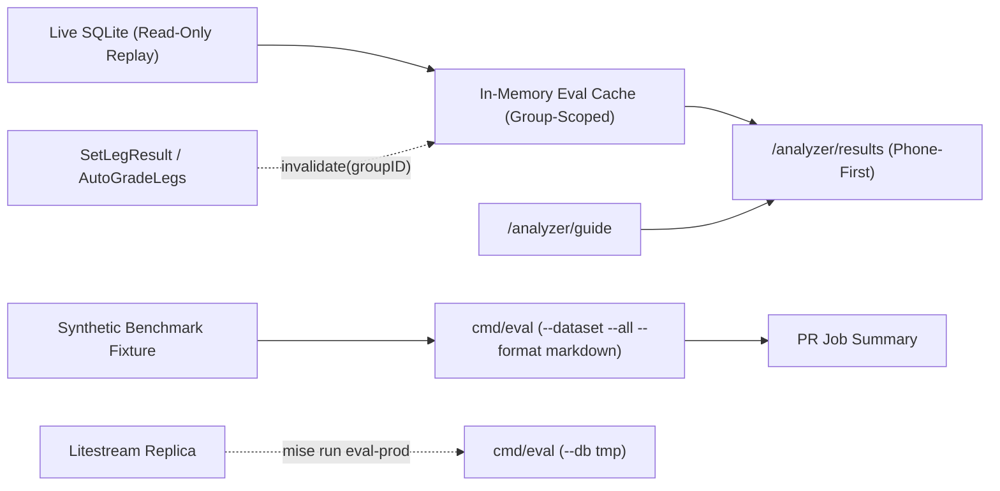

# Close-out

## Overview

## Consequences

- **Easier:** Checking whether A–F grades calibrate over a group's season inside the app, without restoring production databases or running CLI tools.
- **Easier:** Comparing future rubric versions side by side; adding a rubric to `analyzer.BuiltInRubrics()` enables comparison in both `/analyzer/results` and CI without extra wiring.
- **Easier:** Running local baseline-vs-candidate comparisons against production snapshots with a single `mise run eval-prod` command that cleans up its temporary DB on exit.
- **Harder:** Keeping cached eval reports fresh if SQLite is modified outside `slips.Service` (`SetLegResult` or `AutoGradeLegs`), since direct DB edits bypass `InvalidateGroup`.
- **Revisit:** Adding bounded capacity or eviction to `eval.Cache` if active group and season counts grow enough to pressure single-instance memory.
- **Revisit:** Pre-warming or optimizing `All seasons` replay if large multi-season groups hit slow first-load misses (currently mitigated by defaulting to the latest graded season).

## Alternatives considered

- **Publishing static eval reports from CI:** Rejected because it would either require production database credentials in CI or limit the app to synthetic numbers. Serving from SQLite through an in-memory cache preserves group privacy and updates as slips settle.
- **Persisting eval reports in SQLite:** Rejected to avoid schema migrations and keep grades and evals derived and idempotent. Pure-Go replay over a group's season is fast and caches in memory until settlement.
- **Running evals in git `pre-push` hooks:** Rejected because snapshot restores need network access and credentials, and extra CLI runs slow local pushes. Keeping `pre-push` to `go test -short ./...` and running fixture evals in CI keeps pushes fast.

## Implementation notes

- **Generation-guarded cache writes:** `eval.Cache` tracks global and per-group invalidation generations so an in-flight cache miss cannot write stale metrics back after a concurrent settlement invalidation.
- **Single-rubric state:** With only `v1` registered today, `SuiteReport.Diffs` is empty and `/analyzer/results` shows a placeholder note until a second rubric is added.
- **Synthetic CI benchmark:** The CI summary runs against a deterministic 4-week, 24-slip, 72-leg synthetic fixture to catch regressions and verify formatting; it does not reflect live production hit rates.
- **Docs lint adjustment:** `good-vibes docs lint` promotes `names-path` warnings to errors on modified docs, which required removing backticks from six pre-existing runtime paths in `docs/guides/local-dev.md`.

## Follow-ups

- Propose and register a `v2` analyzer rubric in `analyzer.BuiltInRubrics()` informed by `mise run eval-prod` production replays to activate side-by-side comparison in `/analyzer/results` and CI.
- Add size-bounded eviction (LRU or TTL) to `eval.Cache` if single-instance memory usage grows with many active groups and seasons.
