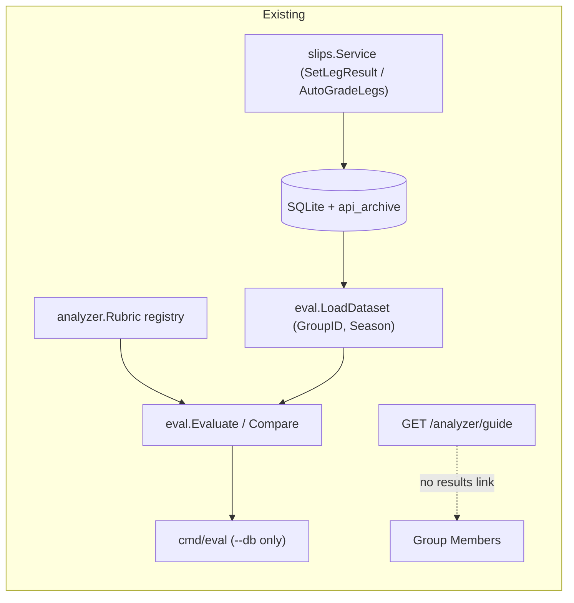
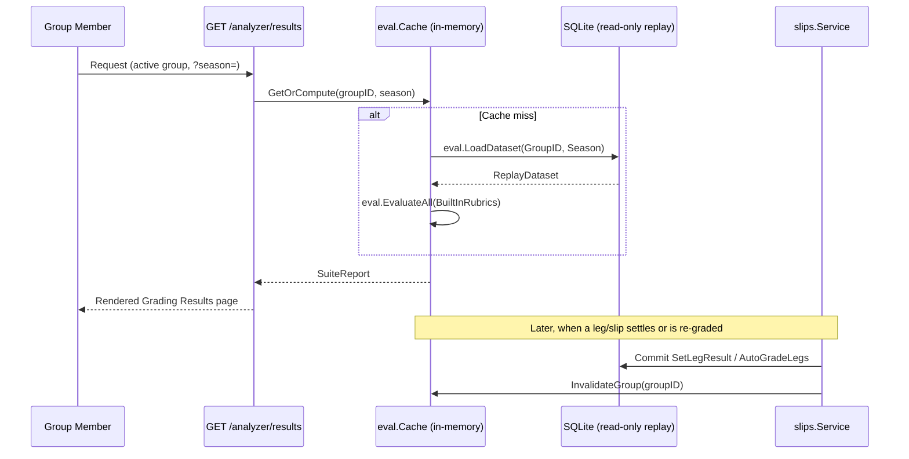
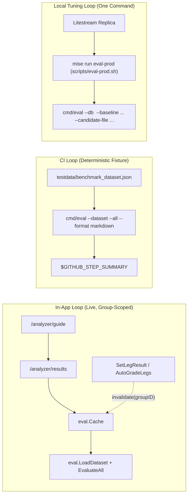

# Design: Automated grading evals and in-app results page

## Context

`internal/eval` already provides leak-free historical replay (`LoadDataset` with
`ReplayFilter{Season, FromWeek, ToWeek, GroupID}`), single-rubric calibration (`Evaluate`), and baseline-vs-candidate
comparison (`Compare`). `internal/analyzer/rubric.go` holds the versioned `Rubric` registry (`RubricV1`, `ActiveRubric`,
`RubricByName`, `RubricNames`). `cmd/eval` exposes single-rubric and comparison CLI reports over a read-only SQLite
`--db` path.

On the web side, `internal/web/analyzer.go` serves `GET /analyzer/guide` (`web/templates/analyzer_guide.html`) inside
`RequireUser` and `groups.Scope`. `internal/web/record.go` (`GET /record`) establishes the group-scoped, season-filtered
page pattern. Every leg and slip settlement—both manual (`PUT /legs/{id}/result`) and automatic
(`internal/refresh/grade.go`)—flows through `internal/slips/rules.go` (`SetLegResult` and `AutoGradeLegs`).

**Key constraints:**

- **Single instance & free tier:** SQLite and in-memory state live in one Cloud Run instance. No new SQLite tables for
  derived eval snapshots, no scheduled Cloud Run cron jobs, and zero external API calls.
- **Group privacy:** In-app calibration must strictly scope to the viewer's active group via `ReplayFilter.GroupID`,
  never leaking slips or legs across groups.
- **No prod data in CI:** `.github/workflows/ci.yml` must never access Litestream buckets, production snapshots, or real
  user slips. `lefthook.yml` `pre-push` (`go test -short ./...`) stays untouched.
- **Phone first:** The results page must be readable and free of horizontal page overflow at 375px width before
  widening.



## Approach

### 1. Multi-rubric suite, weekly progression, and fixture replay (`internal/analyzer`, `internal/eval`, `cmd/eval`)

Extend `internal/analyzer/rubric.go` with `BuiltInRubrics() []Rubric` returning a copy of all registered rubrics in
registry order (`v1`, `v2`, ...).

Extend `internal/eval/types.go` and `internal/eval/metrics.go`:

```go
type WeekSummary struct {
    Season      int         `json:"season"`
    WeekNum     int         `json:"week_num"`
    WeekType    string      `json:"week_type,omitempty"`
    LegBands    []BandStats `json:"leg_bands"`
    SlipBands   []BandStats `json:"slip_bands"`
    DecidedLegs int         `json:"decided_legs"`
    LegWinRate  float64     `json:"leg_win_rate"`
    LegLift     float64     `json:"leg_lift"`
    LegFlatROI  float64     `json:"leg_flat_roi"`
}

// Add Weekly []WeekSummary `json:"weekly"` to eval.Report.

type SuiteReport struct {
    ActiveRubric string       `json:"active_rubric"`
    Coverage     DataCoverage `json:"coverage"`
    Reports      []Report     `json:"reports"` // one per rubric in input order
    Diffs        []DiffReport `json:"diffs"`   // Reports[1..] compared against Reports[0]
}

func EvaluateAll(dataset ReplayDataset, rubrics []analyzer.Rubric) SuiteReport
func LoadDatasetJSON(path string) (ReplayDataset, error)
```

- `Evaluate` computes `Weekly` in chronological `(Season, WeekNum)` order by reusing the same band accumulators per
  `ReplayedWeek`.
- `EvaluateAll` evaluates every rubric in `rubrics` against the same `ReplayDataset` and runs
  `Compare(Reports[0], Reports[i])` for every subsequent rubric. When only `RubricV1` is registered, `Reports` has 1
  item and `Diffs` is empty; registering `RubricV2` automatically lights up side-by-side comparison in both the app and
  CI.
- Add a deterministic synthetic benchmark fixture at `internal/eval/testdata/benchmark_dataset.json` (4+ weeks, ~60–80
  decided legs across ~20–25 slips spanning spreads, totals, moneylines, and player props with weather, injury, nfelo,
  nflverse, stack, and conflict signals—zero real user data).
- Extend `cmd/eval/main.go`:
  - `--dataset <path>`: load a JSON `ReplayDataset` via `eval.LoadDatasetJSON` (mutually exclusive with `--db`).
  - `--all`: evaluate all built-in rubrics via `eval.EvaluateAll` and emit calibration + diffs.
  - `--format markdown`: render concise GitHub-flavored Markdown tables (coverage, per-rubric leg/slip calibration,
    rubric diffs when >1 rubric, and top factor attribution) suitable for `$GITHUB_STEP_SUMMARY`.

### 2. In-memory group-scoped cache and settlement invalidation (`internal/eval/cache.go`, `internal/slips`, `cmd/server`)

Add `eval.Cache` in `internal/eval/cache.go`:

```go
type Cache struct {
    mu      sync.RWMutex
    entries map[cacheKey]SuiteReport // key: {groupID int64, season int}
}

func NewCache() *Cache
func (c *Cache) GetOrCompute(
    ctx context.Context,
    store *db.Store,
    groupID int64,
    season int,
) (SuiteReport, error)
func (c *Cache) InvalidateGroup(groupID int64)
func (c *Cache) InvalidateAll()
```

- On a cache hit, `GetOrCompute` returns the cached `SuiteReport` without touching SQLite.
- On a miss, it calls `LoadDataset(ctx, store, ReplayFilter{GroupID: groupID, Season: season})` and
  `EvaluateAll(dataset, analyzer.BuiltInRubrics())`, stores the result under `c.mu.Lock()`, and returns it.
- To invalidate without coupling `internal/slips` to `internal/eval`, add `SetOnGradeChange(fn func(groupID int64))` on
  `slips.Service`:
  - `SetLegResult`: after committing a changed leg result, invoke `onGradeChange(updated.GroupID)`.
  - `AutoGradeLegs`: collect distinct `groupID`s for updated slips inside the transaction and invoke
    `onGradeChange(groupID)` for each after commit.
- In `cmd/server/main.go`: construct `evalCache := eval.NewCache()`, wire
  `slipService.SetOnGradeChange(evalCache.InvalidateGroup)`, pass `EvalCache: evalCache` in `web.Dependencies`, and call
  `evalCache.InvalidateAll()` on sandbox stage transitions/resets (`cmd/server/sandbox.go`).



### 3. Phone-first Grading Results page (`internal/web/eval_results.go`, `web/templates/analyzer_results.html`)

- Mount `GET /analyzer/results` on `slipHandlers.Routes(mux)` in `internal/web/slips.go` (inherits `RequireUser` and
  `groups.Scope`).
- Query parameters:
  - `?season=`: `all` (or `0`) for all seasons, or a specific season year. Defaults to the latest season with graded
    slips for the active group (reusing `Store.GradedSeasonsForGroup`, matching `recordBook`), returning `400` on
    invalid values.
  - `?rubric=`: selects which built-in rubric to highlight (defaults to `analyzer.ActiveRubric.Name`).
  - `?from=`: safe return path validated by `safeReturnPath`.
- Navigation links:
  - Add a `"Grading results"` link in `web/templates/analyzer_guide.html` pointing to `/analyzer/results` (preserving
    `?from=`).
  - Include a `"How grading works"` link on `web/templates/analyzer_results.html` pointing back to `/analyzer/guide`.
- Register `"analyzer-results": "templates/analyzer_results.html"` in `internal/web/render.go` and regenerate
  `web/static/app.css` via `go generate ./...`.
- Page sections (phone-first at 375px, widening cleanly with Tailwind responsive grids):
  1. **Header & controls:** Group name, season selector pills (`All seasons` + graded seasons), rubric switcher (when >1
     built-in rubric exists), and clean empty state when no settled slips exist.
  2. **Leg & Slip Calibration (A–F):** Grade-colored A–F badges with W-L-P, Hit %, Implied %, Lift, and Flat ROI, plus a
     plain-language monotonicity status ("A-grade legs are outperforming lower bands" vs. early-sample note).
  3. **Rubric Comparison:** Shown when `len(suite.Reports) > 1`, displaying band-by-band deltas (`WinRateDelta`,
     `LiftDelta`, `FlatROIDelta`) and notable band migrations; when only `v1` exists, shows a single-line note that
     side-by-side comparison appears automatically when additional rubrics are registered.
  4. **Week-over-week Progression:** Chronological weekly cards/table showing decided legs, overall win rate, lift, flat
     ROI, and A/B vs. C–F breakdown.
  5. **Factor Attribution:** Ranked list of triggered analyzer factors with label, sample count `N`, W-L, Hit %, Lift,
     and Avg Delta.
  6. **Data Coverage:** Compact breakdown of how many replayed legs had pre-kickoff game logs, injuries, nflverse,
     nfelo, and archived odds.

### 4. CI benchmark workflow & local snapshot task (`.github/workflows/ci.yml`, `mise.toml`, `scripts/eval-prod.sh`)

- **CI (`.github/workflows/ci.yml`):** Add a fast step in the `check` job after `Test`:

  ```yaml
  - name: Grading eval benchmark summary
    run: |
      go run ./cmd/eval \
        --dataset internal/eval/testdata/benchmark_dataset.json \
        --all \
        --format markdown >> "$GITHUB_STEP_SUMMARY"
  ```

  Always uses the committed synthetic fixture; zero secrets, zero network, milliseconds runtime. `lefthook.yml`
  `pre-push` is not modified.

- **Local production-snapshot task (`mise.toml` + `scripts/eval-prod.sh`):**
  - Add `[tasks.eval-prod]` in `mise.toml` running `./scripts/eval-prod.sh`.
  - `scripts/eval-prod.sh` checks that `litestream` and `LITESTREAM_REPLICA_URL` (or `LITESTREAM_BUCKET`) are set,
    restores a read-only snapshot into a temporary file under `./data/` using `deploy/litestream.yml`, removes the temp
    file on exit via `trap`, and invokes `go run ./cmd/eval --db "$tmpdb" "$@"` (defaulting to `--all` when no flags are
    passed, so `mise run eval-prod -- --baseline v1 --candidate-file ./rubric-v2.json` works in one command).



### Trade-offs & rejected options

- **Rejected: Publishing static eval HTML/JSON from CI:** Would require either production DB credentials in CI (violates
  security/privacy non-goal) or only showing synthetic numbers in the app. Serving directly from SQLite through an
  in-memory cache keeps group data private and always current after settlement.
- **Rejected: Persisting eval reports in SQLite:** Adds schema migrations and violates the `grading-evals` ADR decision
  to keep grades and evals derived and idempotent. Pure-Go replay over a group's season takes milliseconds and caches in
  memory until settlement.
- **Rejected: Adding evals to git `pre-push` hooks:** Restoring production snapshots requires network and credentials,
  and running extra CLI binaries on push slows local iteration. Keeping `pre-push` to `go test -short ./...` and putting
  fixture evals in CI preserves fast pushes.

## Verification

- Standard checks: `go generate ./...`, `golangci-lint run ./...`, `go test -short -race ./...`, `actionlint`, and
  `good-vibes docs lint`.
- `internal/eval` unit tests:
  - `Evaluate` populates `Weekly` in chronological order and sums consistently with overall `LegBands`/`SlipBands`.
  - `EvaluateAll` handles both single-rubric (`Diffs` empty) and multi-rubric suites (populated `Diffs`).
  - `LoadDatasetJSON` parses `internal/eval/testdata/benchmark_dataset.json` cleanly and produces non-empty A–F band and
    factor coverage.
  - `Cache.GetOrCompute` caches per `(groupID, season)`, serves hits without re-querying, and `InvalidateGroup` clears
    only the target group while leaving other groups cached.
- `cmd/eval` tests:
  - `--dataset ... --all --format markdown` produces valid Markdown tables with coverage, bands, diffs (when >1 rubric),
    and factors; rejects passing both `--db` and `--dataset`.
- `internal/web` & `internal/slips` integration tests:
  - `GET /analyzer/results` requires auth, strictly isolates calibration to the viewer's active group (other groups'
    settled slips never appear), handles empty state, season filtering, invalid `?season=` (`400`), and safe `?from=`.
  - Settling or re-grading a leg via `slips.Service.SetLegResult` or `AutoGradeLegs` invalidates the group's cached
    `SuiteReport` so the next `GET /analyzer/results` reflects the new outcome.
  - `GET /analyzer/guide` links to `/analyzer/results` and `internal/web/render_test.go` compiles `analyzer_results`.
- Manual/script check: `scripts/eval-prod.sh` fails cleanly with a helpful usage error when `LITESTREAM_BUCKET` /
  `LITESTREAM_REPLICA_URL` is unset and cleans up temp files on exit.

## Risks

- **Stale cache after manual DB edits or sandbox resets:** Normal app mutations all flow through `SetLegResult` and
  `AutoGradeLegs`, which trigger `InvalidateGroup`; wiring `InvalidateAll()` into sandbox stage/reset handles local
  sandbox transitions.
- **Slow first-load replay on large multi-season groups:** `LoadDataset` replays only the selected season by default
  (matching `GET /record`), keeping SQLite reads bounded to one season per group; the in-memory cache eliminates repeat
  replays until the next settlement.
- **Mobile horizontal overflow on calibration and factor tables:** Using compact stacked cards or `overflow-x-auto`
  table wrappers in `web/templates/analyzer_results.html` prevents page-level overflow at 375px width.

## TODO

### Phase 1: Multi-rubric suite, weekly progression, and benchmark CLI

Complexity: medium (extends `internal/eval` report types with weekly aggregation and multi-rubric suite evaluation,
builds a realistic synthetic benchmark fixture, and adds `--dataset`/`--all`/`--format markdown` to `cmd/eval`) Risk:
low (pure Go package and CLI additions with no live request-path impact, fully verified by deterministic unit tests)

- [x] Add `BuiltInRubrics()` to `internal/analyzer/rubric.go`, add `WeekSummary`, `Report.Weekly`, `SuiteReport`,
      `EvaluateAll`, and `LoadDatasetJSON` in `internal/eval/`, and add unit tests in `internal/eval/metrics_test.go`
      and `internal/eval/replay_test.go`.
- [x] Add the deterministic synthetic fixture `internal/eval/testdata/benchmark_dataset.json`, extend `cmd/eval/main.go`
      with `--dataset`, `--all`, and `--format markdown` output, and cover all new CLI modes and error cases in
      `cmd/eval/main_test.go`.

### Phase 2: In-memory eval cache, settlement invalidation, and Grading Results page

Complexity: medium (coordinates `eval.Cache` invalidation through `slips.Service`, wires `cmd/server` and sandbox
lifecycle, and builds the phone-first group-scoped `/analyzer/results` handler and template) Risk: low (read-only
queries over existing SQLite tables with no schema changes or external calls; group isolation, cache invalidation, and
rendering are covered by handler and service tests)

- [x] Implement `eval.Cache` in `internal/eval/cache.go` with concurrency/invalidation tests in
      `internal/eval/cache_test.go`, add `SetOnGradeChange` to `internal/slips/rules.go` (invoked on `SetLegResult` and
      `AutoGradeLegs` commits) with tests in `internal/slips/grade_test.go`, and wire both in `cmd/server/main.go` and
      `cmd/server/sandbox.go`.
- [ ] Add `GET /analyzer/results` in `internal/web/eval_results.go` and `internal/web/slips.go`, create
      `web/templates/analyzer_results.html`, link it from `web/templates/analyzer_guide.html`, register the template in
      `internal/web/render.go` and `internal/web/render_test.go`, run `go generate ./...`, and add handler tests in
      `internal/web/eval_results_test.go` covering auth, group isolation, empty state, season/rubric filters, and cache
      invalidation after settlement.

### Phase 3: CI benchmark summary, local snapshot task, and living docs

Complexity: low (wires the existing `cmd/eval` CLI into GitHub Actions and a small `mise` shell task, plus updating
living docs) Risk: low (CI runs strictly offline on the committed fixture, verified by `actionlint`, and the local
script only restores to a temp file under `data/`)

- [ ] Add the offline benchmark eval summary step to `.github/workflows/ci.yml` (publishing to `$GITHUB_STEP_SUMMARY`)
      and verify with `actionlint`, leaving `lefthook.yml` `pre-push` unchanged.
- [ ] Add `scripts/eval-prod.sh` and `[tasks.eval-prod]` in `mise.toml` for one-command read-only Litestream snapshot
      restore and rubric comparison with automatic temp-file cleanup.
- [ ] Docs: update `docs/concepts/analyzer.md`, `docs/reference/routes.md`, and `docs/guides/local-dev.md` to document
      `GET /analyzer/results`, in-memory eval caching, the CI benchmark summary, and `mise run eval-prod`, then run
      `good-vibes docs lint`.
