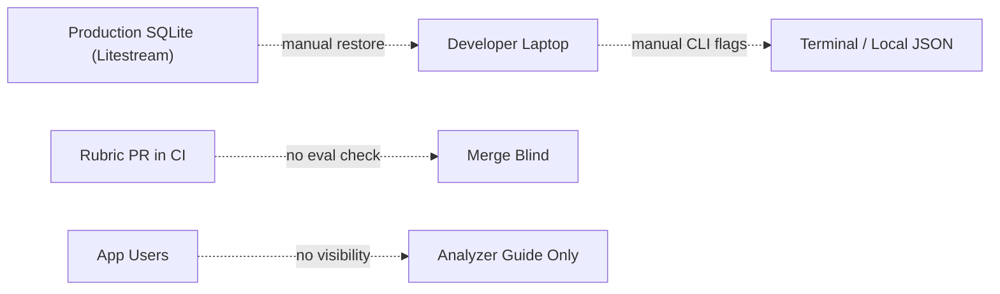
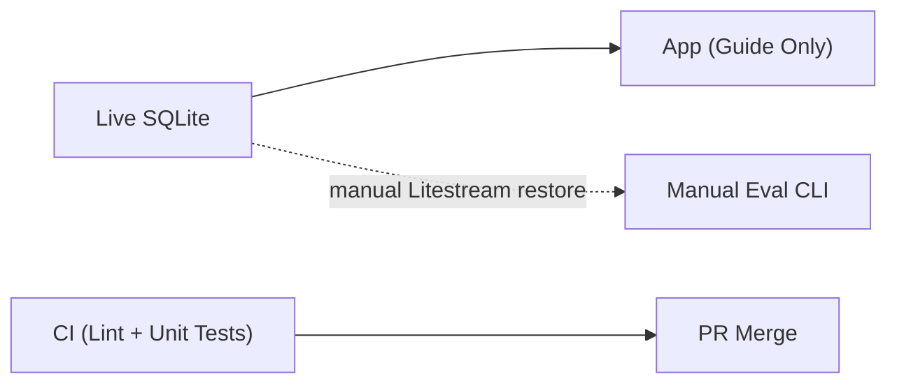
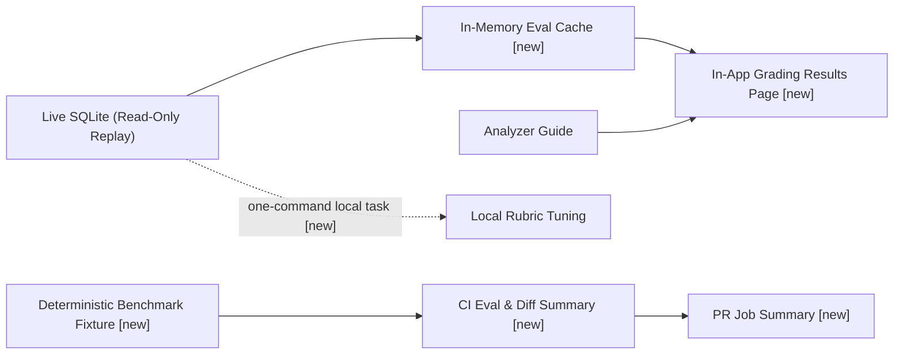

# Automated grading evals and in-app results page

## Context

The offline eval runner can replay settled slips and compare rubric versions without post-kickoff leakage, but using it
today is entirely manual. Checking how grades perform requires restoring a Litestream copy of production, running the
CLI by hand, and saving JSON files to compare across runs.

Because results stay trapped on a developer's machine, nobody in the app can see whether A-grade legs actually beat C-
or F-grade legs over the season, and pull requests that tweak analyzer weights get no automatic calibration feedback.

## Goals and non-goals

**Goals:**

- Publish a phone-first **Grading Results** page in the app, linked from the analyzer guide, showing live, leak-free
  calibration for the active group: A–F leg and slip hit rates, lift over implied odds, flat ROI, factor attribution,
  data coverage, side-by-side comparison across built-in rubrics, and week-over-week progression.
- Keep the in-app results page fast and free-tier safe by reading the app's existing SQLite database and caching
  computed reports in memory until a slip settles.
- Add an automatic CI eval step that runs all built-in rubrics against a deterministic synthetic benchmark fixture and
  publishes a calibration and rubric-diff summary on pull requests, without touching pre-push speed.
- Add a single local task command for restoring a read-only production snapshot and running a baseline-vs-candidate
  rubric comparison in one step.

**Non-goals:**

- Pulling production databases or Litestream credentials into CI, or committing real user slip history into git.
- Persisting computed eval snapshots or derived grade rows in SQLite.
- Adding a scheduled Cloud Run cron job to precompute evals.
- Running slow or network-dependent eval restores in git pre-push hooks.
- Auto-tuning rubric weights or changing the friendly, non-blocking analyzer tone.

## Decision

### Before

### After

Split eval automation into two clean loops: serve live, group-scoped calibration directly inside the app from its own
SQLite database, and run deterministic fixture evals in CI while keeping a one-command local task for
production-snapshot tuning.

Serving the Grading Results page directly from the app's existing database beats publishing static reports from CI
because results stay automatically up to date as slips settle, group privacy stays enforced inside normal auth and group
scoping, and CI never needs production database credentials or user data; keeping pre-push limited to fast unit tests
avoids slowing down local pushes or requiring network access.

`complexity: medium` fits because the change coordinates across the group-scoped web UI and cache invalidation boundary,
multi-rubric and weekly trend aggregation in the eval layer, and CI workflow plus local task automation while respecting
single-instance and group-privacy invariants. `risk: low` fits because all eval queries are read-only with no schema
changes, external API calls, or impact on live picking and grading, and deterministic unit and handler tests cover
aggregation, cache invalidation, and group scoping.
