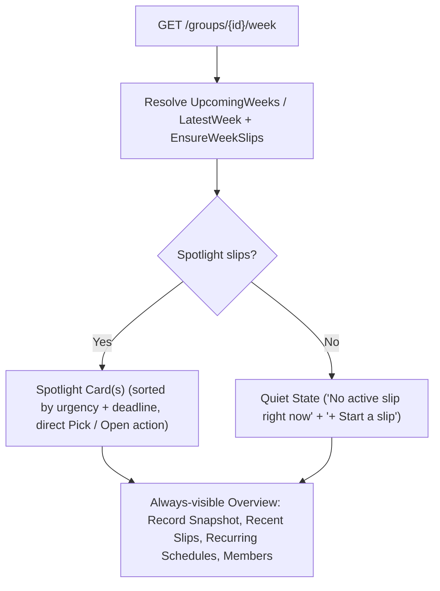

# Close-out

## Overview

## Consequences

- **Easier:** Members always land on a consistent per-group home with one-tap access to live picks (`Pick N more` or `Open slip`), record stats, recent results, and recurring schedules.
- **Easier:** Joining `weeks` in `RecentSlipsForGroup` and exposing `CurrentWin`/`CurrentLoss` on `record.Book` keeps overview assembly free of N+1 queries and duplicated streak math.
- **Harder:** Every `GET /groups/{id}/week` load now reads recent slips, graded season slips, recurring schedules, and members rather than short-circuiting with a 303 redirect.
- **Revisit:** The recent slips list caps at 5 non-spotlight slips and the record snapshot scopes to the active week's season (`overviewRecordSeason`), which may need an all-time or expanded view later.

## Alternatives considered

- **Redirect on 1 active slip, overview on 0 slips:** Rejected because members lose quick access to group record, schedules, and starting another slip during live weeks, and the changing destination feels jarring.
- **Separate tabs instead of inline summaries:** Rejected because a group's record, recent slips, schedules, and members fit cleanly on one phone-first screen.
- **Keep inline schedule creation on the landing page:** Rejected in favor of linking `+ Add recurring slip` to `/slips/new?mode=recurring` to avoid duplicating the creation form.

## Implementation notes

- `Store.RecentSlipsForGroup` returns all slips for the group regardless of spotlight status, so the handler fetches `5 + len(weekSlips)` rows and excludes spotlight IDs before capping the recent list at 5.
- `GroupRecordSnapshot` formats `"W-L"` when pushes are zero and `"W-L-P"` when pushes are positive, and displays `"–"` when there is no active streak.

## Follow-ups

None.
