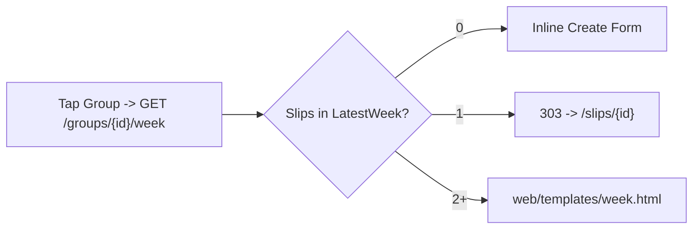
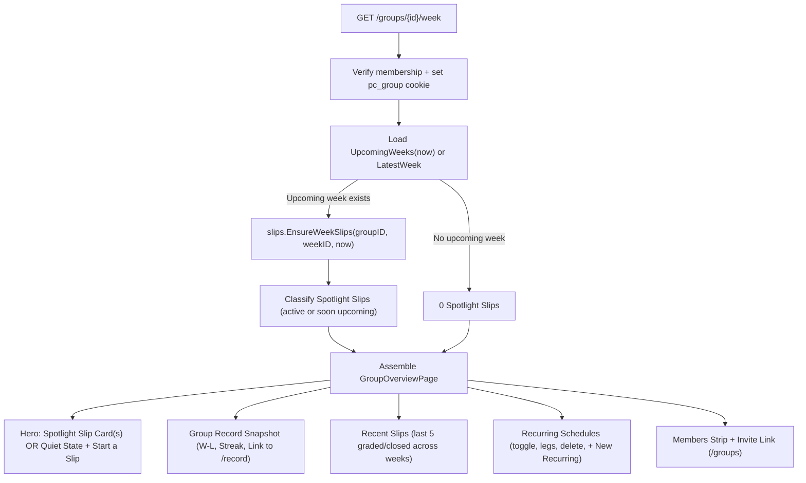

# Design: Redesign per-group landing page

## Context

`GET /groups/{id}/week` (`internal/web/home.go:groupWeek`) is the per-group entry point linked from every group card on
`/` and from the bottom navigation bar. Today it branches aggressively:

- 0 slips in `LatestWeek` → renders the create-slip form inline (`renderCreate`).
- 1 slip in `LatestWeek` → HTTP redirects straight to `/slips/{id}` (even if that slip is already `GRADED` or `CLOSED`).
- ≥2 slips in `LatestWeek` → renders `web/templates/week.html` with slip cards and recurring schedules.

The app already has `internal/record` for computing group W–L records and streaks, `Store.GroupSlipSchedules` for
recurring schedules, `Store.Members` for group members, and `slips.NextStep` + `betterStep` for evaluating slip urgency.
This change builds on `slip-creation-ux` (which supplies `UpcomingWeeks`, custom game scope badges, and
`/slips/new?mode=recurring`).

## Approach

### 1. Spotlight classification and overview data (`internal/db`, `internal/web/home.go`)

Always render the Group Overview page on `GET /groups/{id}/week` (no unconditional redirect to `/slips/{id}` and no
inline create-slip dump).

- **New thin store query (`internal/db/slips.go`)**:
  - `Store.RecentSlipsForGroup(ctx context.Context, groupID int64, limit int) ([]RecentSlipRow, error)` (or `[]Slip`
    joined with `weeks` info): returns the group's most recent slips ordered by `week_id DESC, id DESC` (excluding
    spotlight slips already shown in the hero, capped at `limit`, e.g., 5).
- **Spotlight eligibility rule (`isSpotlightSlip` in `internal/web/home.go`)**:
  - Given a slip in the current/upcoming week, its `slips.Next` step, and its eligible games
    (`slips.FilterGamesForSlip(games, slip)`):
  - Spotlight = `true` when:
    - `slip.Status != db.SlipGraded` AND `next.Step` is one of `StepPick`, `StepLockIn`, `StepJoin`, `StepWaiting`,
      `StepExport` (i.e., actively being built, waiting on locks, or ready to place/watch); OR
    - `slip.Status == db.SlipLocked` and at least one eligible game is `GameLive` or upcoming (`now.Before(g.Kickoff)`).
  - Spotlight slips are ordered using the existing `betterStep` priority (actionable viewer steps first, then earliest
    upcoming deadline).
- **Spotlight card actions**:
  - Each spotlight card displays: slip name, scope badge, status/next-step pill, member lock/pick progress, earliest
    upcoming deadline (`<time>`), and a direct primary action button (`Pick N more` → `/slips/{id}/pick` when
    `StepPick`, otherwise `Open slip` → `/slips/{id}`).
- **Quiet-state hero (when 0 spotlight slips exist)**:
  - Shows a calm summary ("No active slip right now"), notes the next upcoming NFL week/game day if one is loaded in
    `UpcomingWeeks`, and offers a primary **+ Start a slip** button linking to `/slips/new`.
- **Group Overview sections (always visible below the hero)**:
  - **Record snapshot**: compact 3-metric card (Group W–L, active streak, graded slips count) reusing existing
    `internal/record` calculations, with a `"Full record book →"` link to `/record`.
  - **Recent slips**: compact list of recent graded/closed slips with week label, slip name, result pill (`Won`, `Lost`,
    `Push`, `Closed`), and link to `/slips/{id}`.
  - **Recurring schedules**: lists active/paused schedules with existing HTMX controls (active toggle, legs selector,
    delete) and a `+ Add recurring slip` link to `/slips/new?mode=recurring` (removing the duplicate inline
    schedule-creation form from this page since `/slips/new` now handles recurring creation cleanly).
  - **Members**: compact member list/avatars with a link to `/groups` for invites.

**Trade-off / rejected option:** Redirecting to `/slips/{id}` when 1 active slip exists and showing the overview only
when 0 slips exist was rejected because members lose easy access to group context (record, schedules, recent results,
starting a second slip) during live weeks, and the unpredictable navigation target feels jarring. A full-width spotlight
card with a one-tap primary button keeps live-week friction near zero while keeping the landing page consistent.

### 2. Template and navigation polish (`web/templates/week.html`, `internal/web/home.go`)

- Reuse `web/templates/week.html` (renamed or refactored in place as the group overview template) with
  `GroupOverviewPage` view model.
- Phone-first single column (`space-y-4`), with clear visual hierarchy:
  1. Group header (Group name + `+ New slip` link)
  2. Hero section (Active/Upcoming Spotlight card(s) with accent border, or Quiet-state CTA)
  3. Record snapshot strip
  4. Recent slips list
  5. Recurring schedules section
  6. Members strip

## Verification

- `go test ./internal/db/... ./internal/web/...` and `golangci-lint run`.
- **Active / upcoming week scenario** (`internal/web/home_test.go`):
  - Opening `GET /groups/{id}/week` with 1 open slip returns `200 OK` (not a 303 redirect), highlights that slip in the
    spotlight with its next-step action and deadline, and renders the group record snapshot, recent slips, recurring
    schedules, and members below it.
  - With 2 active slips (e.g., Thursday + Sunday), both appear in the spotlight ordered by urgency/deadline.
- **Quiet / completed week scenario**:
  - When all slips in the latest week are `GRADED` or `CLOSED` (or no slips exist yet), `GET /groups/{id}/week` renders
    `200 OK` with the quiet-state hero ("No active slip right now" + `+ Start a slip` link), and shows the finished slip
    under Recent Slips rather than in the spotlight.
- **Access control**: non-members still receive `404 Not Found`; members switch `pc_group` cookie to `groupID`.
- **Phone-first UI check**: verify `GET /groups/{id}/week` at 375px and desktop widths in both active-slip and
  quiet-week states.

## Risks

- **Existing tests expecting `303` redirect on 1-slip `GET /groups/{id}/week`:** Tests in `internal/web/home_test.go`
  that assert single-slip redirect or inline create-slip rendering will need updating to match the new overview
  contract.
- **Extra read queries on group landing:** Loading record snapshot + recent slips + schedules + members adds a few
  lightweight indexed SQLite reads per page load; SQLite local reads take <1ms and make zero external API calls.

## TODO

### Phase 1: Group overview data queries and spotlight classification

Complexity: medium (wires `RecentSlipsForGroup`, `internal/record` summary, and `isSpotlightSlip` classification across
`internal/db` and `internal/web`) Risk: low (read-only queries and pure classification helpers with focused unit tests)

- [x] Add `Store.RecentSlipsForGroup(ctx, groupID, limit)` in `internal/db/slips.go` (returning recent slips with their
      week metadata) with store tests.
- [x] Add `GroupOverviewPage` view model and pure `isSpotlightSlip` classifier in `internal/web/home.go` that separates
      active/upcoming spotlight slips from recent/completed slips and assembles the group record snapshot, recurring
      schedules, and members, with unit tests covering open, locked-live, closed, graded, and empty states.

### Phase 2: Group landing page template and route migration

Complexity: medium (replaces the branching redirect/inline-create behavior in `groupWeek` and redesigns
`web/templates/week.html` phone-first) Risk: low (presentation and route-rendering change with zero mutation or
API-budget impact; verified by handler and template tests)

- [x] Update `groupWeek` in `internal/web/home.go` and redesign `web/templates/week.html` to always render the group
      overview with the conditional active/upcoming slip spotlight, quiet-state CTA, record snapshot, recent slips,
      recurring schedules (linking to `/slips/new?mode=recurring`), and members strip; update
      `internal/web/home_test.go` for active, multi-slip, quiet, and non-member cases.
- [ ] Docs: update `docs/concepts/groups.md` and `docs/concepts/slips.md` to describe the per-group overview landing
      page and spotlight behavior.
