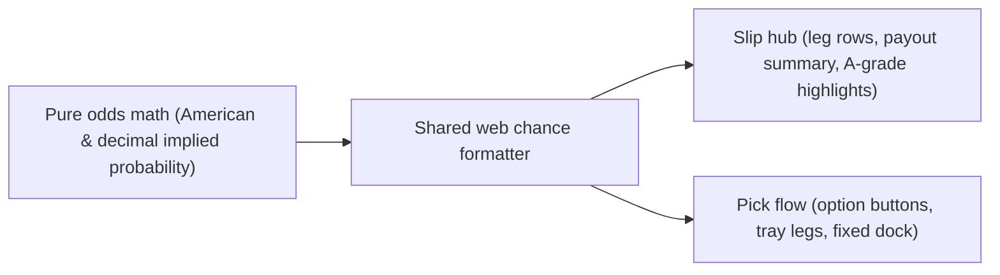

# Close-out

## Overview

## Consequences

- `Easier:` Friends can read the market-implied chance of any leg or parlay at a glance beside its odds on both the slip hub and the pick flow.
- `Easier:` Any new surface that needs an implied percentage can reuse one pure decimal probability helper and one boundary-tested formatter.
- `Harder:` Phone-width rows and two-column pick buttons have less horizontal room, especially on moneyline legs that also show an `nfelo` model chip.
- `Revisit:` Revisit raw implied probability if two-way market quotes become available for all prop and custom leg types and users want vig-free fair chances.

## Alternatives considered

- **Two-way de-vigged probabilities:** Rejected because one-sided props, custom picks, and historical slips often lack an opposite-side quote, and de-vigged percentages would not match the displayed price.
- **Formatting percentage strings in the odds math package:** Rejected to keep `internal/parlay` pure math and match existing odds formatting in the web layer.
- **Persisting implied percentages in SQLite:** Rejected because computing them from existing odds avoids schema state and stays accurate as lines move or legs push and void.
- **Adding a new row to the slip payout summary grid:** Rejected in favor of inline text beside Combined and Reference odds so the 2x2 payout grid stays compact on phones.

## Implementation notes

- The implementation followed the design without deviations.
- Displayed percentages are raw market-implied probabilities (`1 / decimal`), so they include sportsbook vig and assume independent legs rather than modeling same-game parlay correlation.
- Empty or all-pushed/voided slips omit the implied percentage instead of showing `100%` when combined odds equal `1.0`.

## Follow-ups

None.
