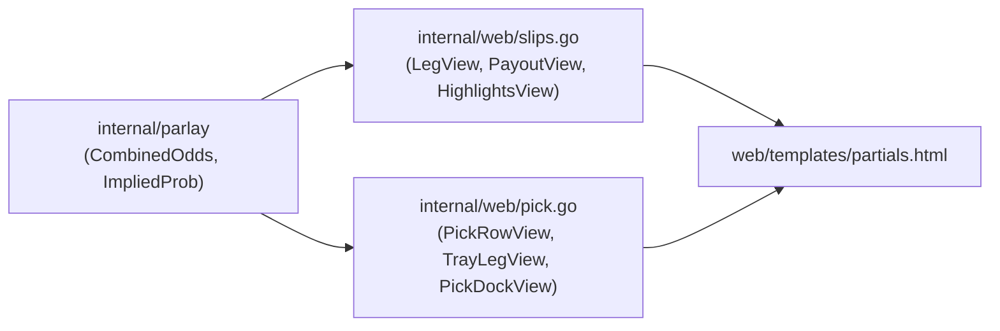
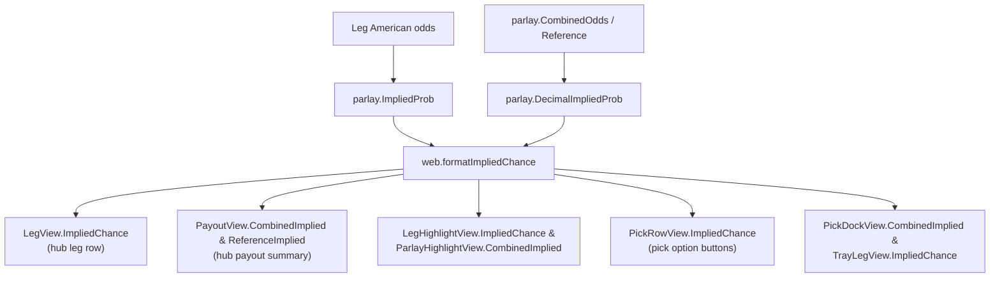

# Design: Implied percentage chances on legs and parlays

## Context

`internal/parlay` holds all pure odds math for Sunday Parlay Club: `AmericanToDecimal`, `DecimalToAmerican`, `CombinedOdds`, `ReferencePrice`, `Payout`, `Units`, `ImpliedProb`, `DevigTwoWay`, and `PriceEdge`. `ImpliedProb` currently converts an American integer price into a raw implied probability (`0..1`), and is used only by `internal/analyzer` and `internal/eval`.

User-facing odds formatting lives in `internal/web` (`formatOdds` in `internal/web/slips.go`), which populates view structs rendered by `web/templates/partials.html`:

- **Slip hub:** `LegView` (per-leg row), `PayoutView` (combined and reference parlay odds), and `HighlightsView` (`LegHighlightView` and `ParlayHighlightView`).
- **Pick flow:** `PickRowView` (pick-board option buttons), `TrayLegView` (viewer's legs in the tray sheet), and `PickDockView` (fixed bottom dock combined price).



Constraints:

- `internal/parlay` stays pure (no database, no display strings).
- Pushed and voided legs drop out of `parlay.CombinedOdds`; when no legs count, `CombinedOdds` returns `1.0`.
- Every screen is phone-first; added text must fit cleanly inside single-column leg rows, side-by-side pick option buttons, and the fixed pick dock without wrapping or pushing actions off-screen.
- Implied percentages are purely informative and must never alter analyzer grades, warnings, payouts, or Record Book units.

## Approach

### 1. Pure decimal implied probability (`internal/parlay`)

Add `DecimalImpliedProb(decimal float64) float64` in `internal/parlay/parlay.go`:

```go
// DecimalImpliedProb returns the raw implied probability (0..1) for decimal
// odds greater than 1, or 0 for non-betting values (<= 1, NaN, or Inf).
func DecimalImpliedProb(decimal float64) float64 {
	if decimal <= 1 || math.IsNaN(decimal) || math.IsInf(decimal, 0) {
		return 0
	}
	return 1 / decimal
}
```

`ImpliedProb(american int)` delegates to `DecimalImpliedProb(AmericanToDecimal(american))`, keeping identical behavior for valid and invalid American prices. For parlays, `DecimalImpliedProb(combined)` computes `1 / combined` directly from `parlay.CombinedOdds`, which equals the product of each counting leg's raw implied probability and automatically returns `0` when a slip has no legs or all legs are `PUSH`/`VOID` (`combined == 1.0`).

### 2. Display formatting (`internal/web`)

Add a single helper `formatImpliedChance(prob float64) string` in `internal/web/slips.go` (package-private, shared by `slips.go` and `pick.go`):

| Condition (`pct = prob * 100`)   | Output    | Examples                            |
| -------------------------------- | --------- | ----------------------------------- |
| `prob <= 0`, `>= 1`, `NaN`, `Inf` | `""`      | empty / invalid / all-voided slip   |
| `pct < 0.1`                      | `"<0.1%"` | `+200000` long-shot parlay          |
| `math.Round(pct*10) < 100`       | `"%.1f%"` | `+1200` -> `"7.7%"`, `+5000` -> `"2.0%"` |
| `math.Round(pct) >= 100`         | `">99%"`  | `-50000` extreme heavy favorite     |
| otherwise (`10` to `99`)         | `"%.0f%"` | `-110` -> `"52%"`, `+150` -> `"40%"` |

Checking `math.Round(pct*10) < 100` avoids rendering `"10.0%"` at the boundary (`9.96%` rounds cleanly to `"10%"`). Returning `""` for non-positive or non-finite values lets templates guard with `{{if .ImpliedChance}}` and omit the display cleanly.

### 3. View-model and template wiring



Surface placements in `web/templates/partials.html`:

- **Slip hub leg row (`LegView`):** Render muted percentage beside `.Odds` (e.g., `-110 (52%)`). Keep the `nfelo` model chip (`nfelo 76%`) as its own separate bordered pill so market-implied chance and model win probability remain visually distinct.
- **Slip hub payout card (`PayoutView`):** Keep the existing 2x2 `<dl>` grid (`Combined`, `Reference`, `Return`, `Profit`) and append the implied chance on `Combined` (e.g., `6.50x (+550) · 15% chance`) and `Reference` (e.g., `6.40x (+540) · 16%`).
- **A-grade highlights (`LegHighlightView`, `ParlayHighlightView`):** Render muted percentage beside `.Price` on single-leg cards and combo leg items, and beside `.CombinedOdds` on parlay combo headers.
- **Pick board options (`PickRowView`):** Render beside `.Price` in the button's secondary line (e.g., `-110 (52%) · tap to add` / `tap to remove` / `tap to switch` / `swap in`), keeping `tabular-nums` and muted styling so two-column buttons stay compact at phone width.
- **Pick dock and tray (`PickDockView`, `TrayLegView`):** Append `· 27%` to the dock summary line when `.CombinedImplied` is non-empty, and render `({{.ImpliedChance}})` beside `.Odds` on each tray leg row.

### Trade-offs and rejected options

- **Raw implied probability vs. two-way de-vigged probability:** Rejected de-vigging for display because one-sided props (`ANYTIME_TD`), custom `OTHER` legs, and historical slips lack opposite-side quotes, and de-vigged percentages would not match the displayed price.
- **Formatting in `internal/parlay` vs. `internal/web`:** Rejected formatting strings in `internal/parlay` to preserve its pure-math boundary (`formatOdds` already lives in `internal/web`).
- **New row in the payout `<dl>` vs. inline with Combined/Reference:** Kept inline so the 2x2 grid stays balanced on phone screens without pushing `Return` and `Profit` down.

## Verification

- Standard suite: `go generate ./... && golangci-lint run ./... && go test -short -race ./...`
- **Unit tests (`internal/parlay`):** `DecimalImpliedProb` across standard decimals (`1.909…`, `2.0`, `2.5`, `13.0`), `CombinedOdds` with counting legs vs. pushed/voided legs, and invalid inputs (`0`, `1.0`, negative, `NaN`, `+Inf`).
- **Formatting unit tests (`internal/web`):** `formatImpliedChance` boundary table covering invalid (`0`, `1`, `NaN`), `<0.1%`, `0.1%`–`9.9%` one-decimal formatting, `9.96%` -> `10%` transition, `10%`–`99%` whole-percent formatting, and `>99%` cap.
- **Handler / rendered HTML tests (`internal/web`):**
  - Slip hub (`GET /slips/{id}` and `GET /slips/{id}/payout`): leg rows show implied `%`, payout card shows combined and reference implied `%`, all-voided/empty slips omit implied `%` cleanly, and A-grade highlight legs/parlays show implied `%`.
  - Pick board (`GET /slips/{id}/pick`, `/pick/detail`, `/pick/dock`, `/tray`, and pair-row swap/add responses): option buttons, tray leg rows, and dock summary render implied `%`, and an empty dock omits it.

## Risks

- **Phone-width overflow on pick option buttons or dock:** Two-column option buttons and the single-line dock have tight horizontal budgets. Mitigated by using compact formatting (`52%`, `7.7%`), `tabular-nums`, and keeping existing truncation classes on the dock line; verified by checking rendered markup and keeping labels short.
- **Confusing implied chance with `nfelo` model win % on moneylines:** A moneyline leg can show both `-150 (60%)` and `nfelo 76%`. Mitigated by keeping implied chance inline in muted text with the odds and `nfelo` in its distinct bordered model chip, plus a descriptive `title` attribute on the implied chance span.
- **Misleading `100%` on empty or all-voided slips:** `CombinedOdds` returns `1.0` when no legs count. Mitigated by `DecimalImpliedProb` returning `0` for `decimal <= 1`, which `formatImpliedChance` maps to `""` so templates omit it.

## TODO

### Phase 1: Odds math helper and slip hub display

Complexity: low (pure math helper, formatting function, and mechanical view/template wiring in two packages with no new state)
Risk: low (read-only display addition with no persistence or payout changes, fully covered by deterministic unit and handler tests)

- [x] Add `parlay.DecimalImpliedProb` in `internal/parlay` (with `ImpliedProb` delegating to it) and `formatImpliedChance` in `internal/web`, with unit tests covering standard prices, pushed/voided combined odds, and formatting boundaries (`<0.1%`, `0.1%`–`9.9%`, `10%`–`99%`, `>99%`, and empty/invalid inputs).
- [x] Populate and render implied percentage chances on slip hub leg rows (`LegView`), the payout calculator (`PayoutView` combined and reference odds), and A-grade highlights (`LegHighlightView` and `ParlayHighlightView`) in `internal/web/slips.go` and `web/templates/partials.html`, with handler tests verifying rendered output and empty/all-voided omission.
- [x] Docs: update `docs/reference/odds-math.md` for `DecimalImpliedProb` and implied chance display, and update `docs/concepts/slips.md` for slip hub leg, payout, and highlight implied chances.

### Phase 2: Pick board, dock, and tray display

Complexity: low (follows the exact Phase 1 view-model and template pattern inside `internal/web/pick.go` and `web/templates/partials.html`)
Risk: low (display-only changes on pick flow partials with no mutation or state changes, verified by existing pick handler tests)

- [x] Populate and render implied percentage chances on pick board option buttons (`PickRowView`), tray leg rows (`TrayLegView`), and the fixed pick dock (`PickDockView`) in `internal/web/pick.go` and `web/templates/partials.html`, with handler tests covering add/remove/switch/swap option rows, tray legs, and dock combined chance (including empty dock omission).
- [ ] Docs: update `docs/concepts/slips.md` to document implied percentage chances on the pick board, dock, and tray.
