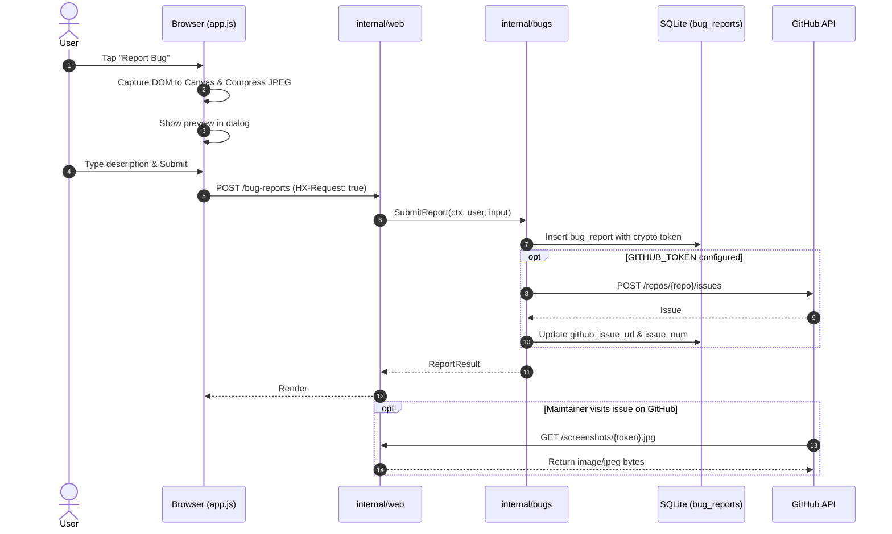
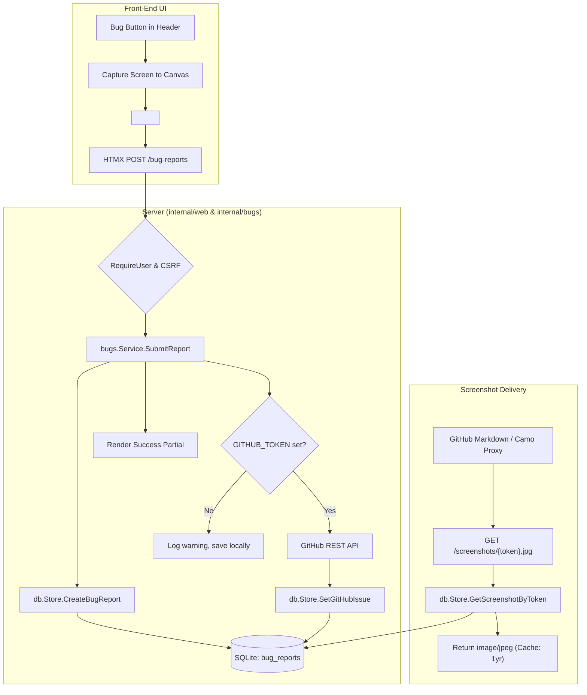

# Design: In-App Bug Reports

## Context

Today, Sunday Parlay Club provides no in-app bug reporting or diagnostic intake:

- `web/templates/layout.html`: Renders the common shell (header with group switcher, week label, slip selector, avatar
  link, and bottom tabs), but has no feedback or issue trigger.
- `internal/config/config.go`: Parses environment variables for Google OAuth, database path, session keys, and Odds API
  providers, but has no configuration for repository or issue management.
- `internal/db`: Stores users, groups, slips, legs, and API archives in SQLite, but has no persistence for member bug
  reports or diagnostic captures.
- `cmd/server/main.go`: Wraps authenticated routes with `handlers.RequireUser(scope(app))` and enforces CSRF via
  `handlers.CSRF`, which expects `HX-Request: true` on non-GET actions.

Because the app operates on a single Cloud Run instance with a 512 MiB memory limit and Litestream SQLite replication,
any screenshot storage must remain bounded in size. Bug submissions must never block the member or fail fatally if
outside services are unreachable.

Read before starting:

- [docs/reference/config.md](file:///Users/adamhamrick/Projects/parlay-club/docs/reference/config.md) — Environment
  variables, dev defaults, and config parsing.
- [docs/reference/routes.md](file:///Users/adamhamrick/Projects/parlay-club/docs/reference/routes.md) — Route
  registration, middleware wrappers, and HTMX partial patterns.
- [docs/concepts/persistence.md](file:///Users/adamhamrick/Projects/parlay-club/docs/concepts/persistence.md) — SQLite
  schema, migrations, and Litestream persistence.
- [docs/runbooks/deploy.md](file:///Users/adamhamrick/Projects/parlay-club/docs/runbooks/deploy.md) — Production
  environment variables and Cloud Run deployment.

## Approach

### 1. In-App Trigger and Client Screen Capture

Add an accessible bug button to the top header in `web/templates/layout.html`, placed alongside the user avatar.

```html
<button
  type="button"
  id="bug-report-trigger"
  class="flex shrink-0 items-center justify-center rounded-md border border-slate-700 bg-slate-800 p-1.5 text-slate-300 hover:bg-slate-700 hover:text-slate-100"
  title="Report a bug"
  aria-label="Report a bug"
>
  <svg class="h-4 w-4" fill="none" viewBox="0 0 24 24" stroke-width="1.5" stroke="currentColor">
    <path stroke-linecap="round" stroke-linejoin="round" d="M12 12.75c1.242 0 2.25-1.008 2.25-2.25s-1.008-2.25-2.25-2.25-2.25 1.008-2.25 2.25 1.008 2.25 2.25 2.25Z" />
    <path stroke-linecap="round" stroke-linejoin="round" d="M7.5 10.5c0-.966.386-1.842 1.015-2.482A4.48 4.48 0 0 1 12 6.75c1.326 0 2.518.574 3.34 1.488.423.47.66.97.66 1.762v.5h.5a2 2 0 0 1 2 2v.25a2 2 0 0 1-2 2h-.5v.5a4.49 4.49 0 0 1-1.315 3.182A4.48 4.48 0 0 1 12 19.5a4.48 4.48 0 0 1-3.185-1.318A4.49 4.49 0 0 1 7.5 15v-.5h-.5a2 2 0 0 1-2-2v-.25a2 2 0 0 1 2-2h.5v-.5Z" />
  </svg>
</button>
```

When tapped, client JavaScript (`web/static/app.js`):

1. Clones or renders the current document into a `<canvas>` element using a vendored, lightweight copy of
   `html2canvas.min.js`.
2. Encodes the canvas as a compressed JPEG (`canvas.toDataURL("image/jpeg", 0.8)`) constrained to a maximum width of
   1280px to keep blob sizes below 200 KB. If capture fails or is unsupported, the flow continues with an empty
   screenshot rather than blocking the user.
3. Populates a modal preview image `` and sets hidden form inputs (`screenshot`, `page_url`,
   `screen_size`, `user_agent`).
4. Opens the modal `<dialog id="bug-report-dialog" class="leg-sheet">`.

The dialog provides a textarea for the user's description, the captured thumbnail preview, and a submit button driven by
HTMX:

```html
<form hx-post="/bug-reports" hx-target="#bug-report-body" hx-swap="innerHTML">
  <input type="hidden" name="screenshot" id="bug-input-screenshot">
  <input type="hidden" name="page_url" id="bug-input-page-url">
  <input type="hidden" name="screen_size" id="bug-input-screen-size">
  <input type="hidden" name="user_agent" id="bug-input-user-agent">
  <textarea name="description" required rows="3" placeholder="What broke or looks wrong?"></textarea>
  <button type="submit">Submit Bug Report</button>
</form>
```

### 2. Database Storage and Capability Screenshot URL

Create migration `0010_bug_reports.sql`:

```sql
CREATE TABLE IF NOT EXISTS bug_reports (
    id INTEGER PRIMARY KEY AUTOINCREMENT,
    token TEXT NOT NULL UNIQUE,
    user_id INTEGER NOT NULL REFERENCES users(id) ON DELETE CASCADE,
    page_url TEXT NOT NULL,
    description TEXT NOT NULL,
    user_agent TEXT NOT NULL,
    screen_size TEXT NOT NULL,
    screenshot BLOB,
    screenshot_mime TEXT NOT NULL DEFAULT 'image/jpeg',
    github_issue_url TEXT,
    github_issue_num INTEGER,
    created_at TEXT NOT NULL DEFAULT (strftime('%Y-%m-%dT%H:%M:%SZ', 'now'))
);

CREATE INDEX IF NOT EXISTS idx_bug_reports_token ON bug_reports(token);
```

- Each bug report receives an unguessable 16-byte cryptographically secure random token (32 hex characters).
- Screenshots are served via `GET /screenshots/{token}.jpg`. This route is registered as a public capability URL outside
  `RequireUser` so GitHub's markdown image proxy (`camo.githubusercontent.com`) can fetch and render the screenshot
  within GitHub issue threads.
- The handler verifies the token, sends `Content-Type: image/jpeg`, and adds
  `Cache-Control: public, max-age=31536000, immutable`.

### 3. Server-Side GitHub Issue Integration

Add package `internal/bugs` to encapsulate issue creation and token handling:

```go
type GitHubClient interface {
    CreateIssue(ctx context.Context, repo string, req CreateIssueRequest) (*IssueResult, error)
}

type CreateIssueRequest struct {
    Title  string   `json:"title"`
    Body   string   `json:"body"`
    Labels []string `json:"labels"`
}

type IssueResult struct {
    Number  int    `json:"number"`
    HTMLURL string `json:"html_url"`
}
```

The service constructs the GitHub issue markdown body:

```markdown
### Description
{description}

### Context
- **Reporter:** {user.Name} ({user.Email})
- **Page:** `{page_url}`
- **Screen:** `{screen_size}`
- **Device:** `{user_agent}`
- **Time:** {created_at}

### Screenshot

```

Configuration in `internal/config`:

- `GITHUB_TOKEN`: Personal access token or GitHub App token. Optional in dev; if unset in prod, issue creation logs a
  warning and the bug report remains recorded locally in SQLite.
- `GITHUB_REPO`: Target repository (e.g. `kalverra/parlay-club`, default `kalverra/parlay-club`).





### Trade-offs and Alternatives

- **Server-side token vs User GitHub OAuth:** Requiring members to connect a GitHub account adds friction and fails
  because most betting club members do not maintain GitHub accounts. A server-side token posts issues on behalf of
  members transparently.
- **SQLite capability URLs vs Third-party object storage:** Cloud Run has no persistent disk, but SQLite is replicated
  to Cloud Storage via Litestream. Serving images directly from SQLite capability URLs avoids configuring and paying for
  a separate S3/GCS asset bucket.
- **Client DOM capture vs MediaDevices screen sharing:** `navigator.mediaDevices.getDisplayMedia` prompts the user with
  an invasive OS-level permission dialogue that fails on iOS Safari. In-page canvas capture runs smoothly on mobile
  without extra system permissions.

## Verification

- **Config tests (`internal/config`):** Verify `GITHUB_TOKEN` and `GITHUB_REPO` parse from environment with dev defaults
  and do not block startup if unset.
- **Database store tests (`internal/db`):** Verify inserting bug reports, finding reports by capability token, and
  updating GitHub issue fields.
- **GitHub client tests (`internal/bugs`):** Mock GitHub REST API using `httptest.Server`; verify request headers
  (`Authorization: Bearer ...`, `Accept: application/vnd.github+json`), JSON payload structure, issue markdown
  formatting, and graceful degradation when GitHub is unreachable.
- **HTTP endpoint tests (`internal/web`):**
  - Verify `POST /bug-reports` requires authenticated user and `HX-Request: true`.
  - Verify valid submissions return 200 with the success partial containing the GitHub issue link.
  - Verify invalid payloads (missing description, oversized image) return 400 with a descriptive error partial.
  - Verify `GET /screenshots/{token}.jpg` serves raw image bytes with `Content-Type: image/jpeg` and
    `Cache-Control: public, max-age=31536000, immutable`, and returns 404 for unknown tokens.
- **Template and asset verification:** Verify the header bug trigger button and modal dialog render across layouts
  without affecting existing mobile layout widths.
- **Full test and lint suite:** `go test ./... && golangci-lint run`.

## Risks

- **SQLite database growth from screenshot blobs:** Large screenshots could inflate database size against the 512 MiB
  Cloud Run memory ceiling. *Mitigation:* Client downsizes canvas to max 1280px width and compresses to JPEG at 0.8
  quality (~80–180 KB). Server limits request body size to 2 MiB using `http.MaxBytesReader`.
- **GitHub API rate limiting or temporary outage:** GitHub API downtime could cause submissions to fail. *Mitigation:*
  Bug reports are persisted in SQLite *before* calling GitHub. If the GitHub API returns an error or times out, the
  report remains safely stored in the database, a warning is logged, and the user receives confirmation that their
  report was saved.
- **Token enumeration and unauthorized image access:** Attackers could guess capability URLs to view member screens.
  *Mitigation:* Tokens use 16 bytes of cryptographic entropy (`crypto/rand`), yielding a 32-character hex string that
  cannot be brute-forced.
- **Mobile Safari canvas capture quirks:** CSS transforms or complex SVG icons can occasionally cause canvas export
  exceptions. *Mitigation:* The capture script wraps canvas rendering in a `try/catch` block; if capture fails, the bug
  reporting modal opens normally with the screenshot field omitted.

## TODO

Effort: medium (adds client-side screen capture across views, a database migration for diagnostic storage, public
capability image serving, and server-side GitHub issue creation)

### Phase 1: Bug Report Storage, Configuration, and GitHub Client

- [ ] Add migration `0010_bug_reports.sql` and database store methods in `internal/db` to create, query by token, and
      record GitHub issue results.
- [ ] Add `GITHUB_TOKEN` and `GITHUB_REPO` to `internal/config`, and implement `internal/bugs` with the GitHub REST API
      client, markdown body builder, and unit tests.
- [ ] Docs: update `docs/reference/config.md` with GitHub issue reporting environment variables.

### Phase 2: Web API Endpoints and Screenshot Delivery

- [ ] Implement public `GET /screenshots/{token}.jpg` capability route to serve screenshot bytes with content headers,
      with unit tests.
- [ ] Implement authenticated `POST /bug-reports` handler with HTMX partial rendering, input validation, and unit tests.
- [ ] Docs: update `docs/reference/routes.md` with `/bug-reports` and `/screenshots/{token}.jpg`.

### Phase 3: Client UI, Screen Capture, and Modal Workflow

- [ ] Vendor `html2canvas.min.js` in `web/static/` and add the bug trigger button and `<dialog id="bug-report-dialog">`
      to `web/templates/layout.html` and `partials.html`.
- [ ] Implement screen capture, preview rendering, and form submission in `web/static/app.js`, with web handler
      integration tests.
