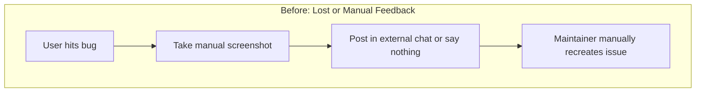
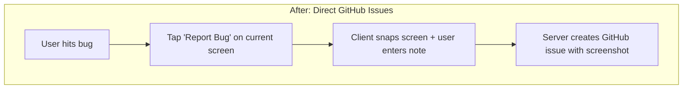

# In-App Bug Reports

## Context

When members hit a bug while building parlays, there is no easy way to report it. Someone has to take a manual
screenshot, switch to an external chat, and try to describe what went wrong. Often they say nothing at all, so bugs go
unnoticed.

When someone does report an issue in chat, key details are missing: the exact URL, screen size, user account, and
visible state of the page. Turning those messages into tracked bugs requires manual back-and-forth and extra work for
the maintainer.

## Goals and non-goals

**Goals:**

- Add a bug report trigger accessible from every screen.
- Capture a screenshot of the current page automatically when opening the report form.
- Let the user write a short description of what broke before sending.
- Post the bug report directly as an issue in the GitHub repository via the server.
- Allow any logged-in club member to submit reports without signing into GitHub.
- Include helpful context with the issue: screenshot, current route, logged-in user, and browser details.

**Non-goals:**

- Two-way comment threads or in-app issue management for members.
- Video recording or session replays.
- Supporting user-specific GitHub accounts or OAuth.
- Sending bug reports to third-party issue trackers other than GitHub.

## Decision

Add a bug report button to the shared app layout so it appears on every screen. Tapping the button takes a snapshot of
the current view, shows a quick preview, and provides a text field for the user's description.

Submitting the report sends the note, image, and page metadata to an authenticated server endpoint. The server
authenticates against the GitHub API with a repository token, uploads the image, and opens a new issue labeled as a bug
report.

This beats asking friends to file issues on GitHub directly, which fails because most members do not have GitHub
accounts. It also beats embedding an external feedback widget that adds tracking scripts and heavy dependencies.

The `effort: medium` rating fits because the change coordinates client-side screen capture across all views with
server-side GitHub issue creation and image handling, without changing existing betting logic.
