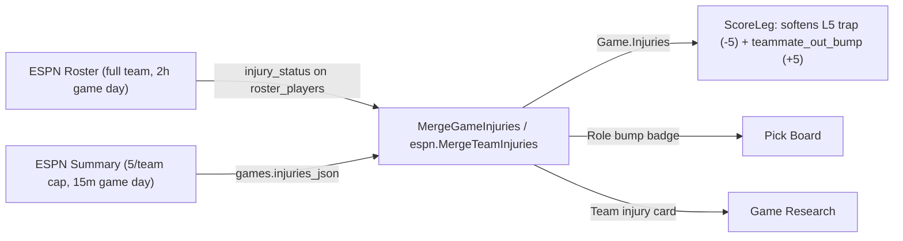

# Close-out

## Overview

## Consequences

- **Easier:** Surfacing truncated `Out` players across slip grading, the pick board, and Game Research through one shared merge seam (`MergeGameInjuries` and `espn.MergeTeamInjuries`).
- **Easier:** Keeping injury state self-cleaning, since each roster upsert overwrites `roster_players` and clears `injury_status` when ESPN returns an empty `injuries` array.
- **Harder:** Diagnosing short-lived discrepancies between feeds on game days, when summaries refresh every 15 minutes and rosters refresh every 2 hours.
- **Revisit:** Weighting teammate absences by snap share or depth-chart order if depth-player `Out` statuses create noisy `+5` bumps for starters.

## Alternatives considered

- **Relying only on ESPN summaries or adding a paid injury API:** Rejected because ESPN's summary endpoint silently truncates teams at 5 players, while an external injury feed adds recurring cost and failure modes.
- **Adding a `player_injuries` table:** Rejected because `roster_players` already holds one row per athlete and upserts on every sync; two `TEXT` columns avoid extra joins and clear recovered players automatically.
- **Treating `Injured Reserve` the same as `Out`:** Rejected because long-term IR absences are already reflected in a teammate's L5 game logs, which would double-count old injuries.
- **Suppressing `L5 median trap` completely when a teammate is `Out`:** Rejected in favor of softening it from `-15` to `-5` alongside a `+5` `teammate_out_bump` (net `0`) so the grade pill explains both the low L5 median and the offsetting absence.

## Implementation notes

- All three phases shipped without plan deviations.
- **Game-day roster refresh lag:** Roster syncs run every 2 hours on game days compared to 15 minutes for game summaries, so a late inactive who falls outside ESPN's 5-player summary cap can take up to 2 hours to appear.
- **No depth-chart ranking:** Any same-team, same-position (`WR`, `TE`, `RB`) `Out` teammate triggers the adjustment on Over and Anytime TD Yes props, so a depth receiver being `Out` can boost a starter (capped within `scoreFormAndUsage`'s `+15` ceiling and named in the factor detail).
- **Intentional exclusions:** `Questionable`, `Doubtful`, and `Injured Reserve` statuses, `QB` props, self-injuries, and Under props do not trigger teammate-out adjustments.

## Follow-ups

- Weight `teammate_out_bump` by nflverse snap/target share or depth-chart order so backup-of-backup `Out` players do not boost high-volume starters.
- Increase pre-kickoff roster sync frequency on game days if late inactive announcements continue to overflow ESPN's 5-player summary cap.
