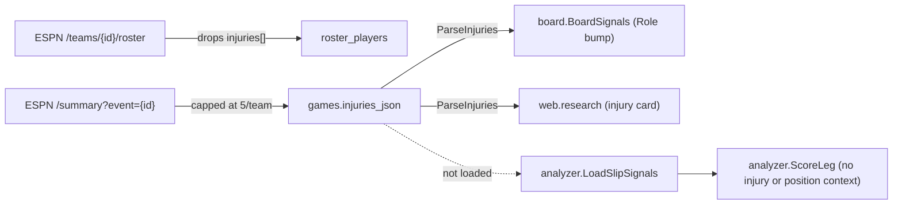
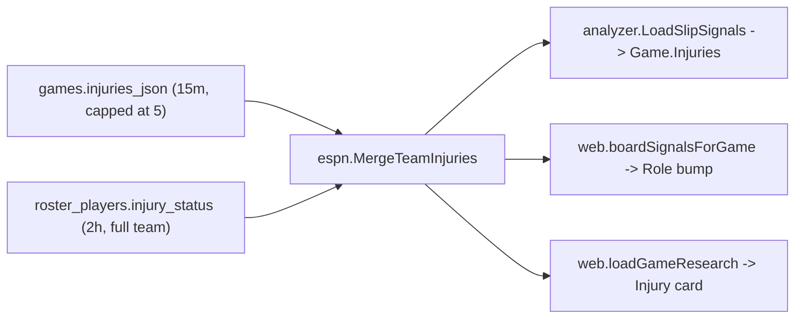
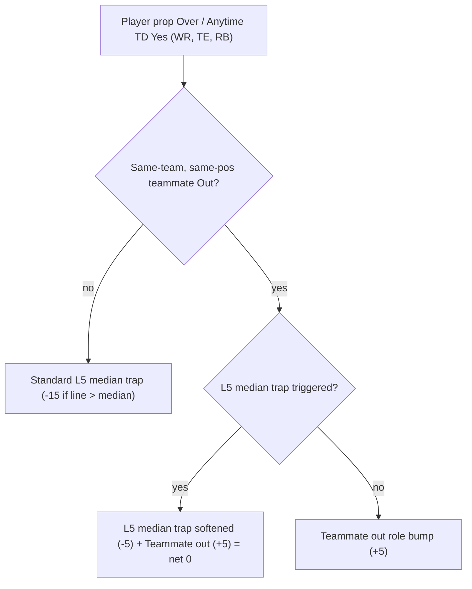

# Design: Include roster injuries in leg grading

## Context

Injury data and leg grading span six packages:

- `internal/ingest/espn` fetches team rosters (`roster.go` -> `/teams/{id}/roster`) and game summaries (`summary.go` ->
  `/summary?event={id}`). `SummaryInjuries` returns raw `injuries` JSON capped by ESPN at 5 players per team. `Roster`
  parses athlete ID, name, position, and headshot, and currently ignores each athlete's `injuries` array
  (`[{"status":"Out","date":"..."}]`).
- `internal/db` stores team rosters in `roster_players` (`players.go`) and raw summary injuries in `games.injuries_json`
  (`games.go`). Schema migrations live in `internal/db/migrations/` (latest is `0013_canonical_players.sql`).
- `internal/refresh` syncs `espn:roster:{teamID}` (2h on game days, 6h otherwise) and `espn:summary:{gameID}` (15m on
  game days, 1h otherwise) in `research.go`, both promoted into `Kick()`, `RunPrefill()`, and `RunOnce()`.
- `internal/analyzer` runs pure deterministic warnings (`rules.go`) and A–F leg/slip grading (`grade.go`) over
  `analyzer.Game` and `analyzer.PlayerStats`. `LoadSlipSignals` (`signals.go`) hydrates those inputs from SQLite.
  `GradeRubric()` (`docs.go`) powers `/analyzer/guide`.
- `internal/board` consumes `espn.Injury` slices in `BoardSignals.Injuries` for the `Role bump` badge (`signals.go`).
- `internal/web` calls `analyzer.LoadSlipSignals` in `slips.go` and `pick.go`, and parses `games.injuries_json` in
  `pick.go` (`parseGameInjuries`) and `research.go` (`buildInjuryViews`).



Key invariants to preserve:

1. **Pure, deterministic analyzer:** `internal/analyzer` rules and `ScoreLeg` run plain Go logic with no I/O, no clock,
   and no LLM calls.
2. **Package boundaries:** `internal/ingest/espn` does not import `internal/db`. `internal/analyzer` already imports
   `internal/db` for `signals.go` loaders, while `ScoreLeg` and `AnalyzeSlip` operate strictly on `analyzer` value
   types.
3. **Category caps:** `scoreFormAndUsage` clamps its cumulative delta to `[-20, +15]` and keeps `sum(factor.Delta)`
   equal to the bounded category total.

## Approach

### 1. Capture and persist ESPN roster injury status

Extend `espn.RosterPlayer` in `internal/ingest/espn/roster.go`:

```go
type RosterPlayer struct {
    ID           string
    FullName     string
    Position     string
    HeadshotURL  string
    InjuryStatus string
    InjuryDate   string
}
```

- Decode `Injuries []struct { Status string; Date string }` on each `rosterResponse` athlete item.
- Select the highest-priority non-empty status (`Out` > `Doubtful` > `Questionable` > `Injured Reserve` > first
  non-empty) and its `Date`. When `injuries` is empty, both fields are `""`.
- Add migration `internal/db/migrations/0014_roster_injuries.sql`:

```sql
ALTER TABLE roster_players ADD COLUMN injury_status TEXT NOT NULL DEFAULT '';
ALTER TABLE roster_players ADD COLUMN injury_date   TEXT NOT NULL DEFAULT '';
```

- Add `InjuryStatus` and `InjuryDate` to `db.RosterPlayer`, update `rosterColumns`, `UpsertRosterPlayers`, and
  `scanRosterPlayer` in `internal/db/players.go`. Because `syncRoster` upserts the full team roster on every refresh, a
  player who returns to healthy (`injuries: []`) automatically clears `injury_status` back to `""`.
- Update `syncRoster` in `internal/refresh/research.go` to pass `InjuryStatus` and `InjuryDate` through to
  `db.RosterPlayer`.

### 2. Unify summary and roster injuries into one team injury list

Add a pure merge helper in `internal/ingest/espn/summary.go` so summary injuries (which carry richer `Detail` text and
refresh every 15 minutes on game days) stay primary while roster injuries backfill any key-position player truncated
past ESPN's 5-per-team summary cap:

```go
// IsKeyInjuryPosition reports whether pos is one of the tracked injury positions.
func IsKeyInjuryPosition(pos string) bool

// MergeTeamInjuries combines summary injuries with fallback roster injuries for
// one team, keeping summary entries first and appending key-position roster
// entries not already present (matched by AthleteID, then case-insensitive name).
func MergeTeamInjuries(summary, extra []Injury) []Injury
```

In `internal/analyzer/signals.go`, add a shared store-backed loader
`MergeGameInjuries(game db.Game, rosters []db.RosterPlayer) map[string][]espn.Injury`:

- Parses `game.InjuriesJSON` via `espn.ParseInjuries`.
- Filters `rosters` for `game.HomeTeam` and `game.AwayTeam` where `InjuryStatus != ""` and
  `espn.IsKeyInjuryPosition(p.Position)`, converting each to `espn.Injury`.
- Merges per team via `espn.MergeTeamInjuries`.
- Reused in three places:
  1. `analyzer.LoadSlipSignals` (loads `store.RosterForTeams` once for all teams in `games`, attaches merged injuries
     onto `analyzer.Game.Injuries`, and populates `PlayerStats.Position` from the same roster map).
  2. `web.slipHandlers.boardSignalsForGame` (`internal/web/pick.go`) so `Role bump` badges on the pick board also see
     roster-only `Out` teammates.
  3. `web.researchHandlers.loadGameResearch` (`internal/web/research.go`) so the Game Research injury panel displays
     truncated players like Dalton Kincaid instead of hiding them.



### 3. Deterministic teammate-injury grading in `ScoreLeg`

Extend `internal/analyzer/analyzer.go` with minimal pure fields:

```go
// Injury is one player's injury status on a game's team injury list.
type Injury struct {
    AthleteID string
    FullName  string
    Position  string
    Status    string
}

// Game gains:
//   Injuries map[string][]Injury // keyed by team abbreviation (e.g. "BUF")

// PlayerStats gains:
//   Position string // ESPN position abbreviation (e.g. "TE", "WR", "RB")
```

In `internal/analyzer/grade.go`, pass `game` into `scoreFormAndUsage(leg, game, stats)` and evaluate same-team,
same-position `Out` teammates:

- **Eligibility helper `outSamePositionTeammate(leg Leg, game Game, position string) (Injury, bool)`:**
  - Applies only to skill positions that share offensive volume: `WR`, `TE`, `RB`.
  - Applies only to offensive prop Overs and Anytime TD Yes (`REC_YDS`, `RECEPTIONS`, `RUSH_YDS`, `RUSH_ATT`,
    `ANYTIME_TD`).
  - Scans `game.Injuries[leg.Team]` for a player with `strings.EqualFold(status, "Out")`, matching `Position`
    (case-insensitive), and not the picked player themselves (checking `AthleteID` when present and case-insensitive
    `FullName`).
  - Deliberately ignores `Questionable`, `Doubtful`, and `Injured Reserve`: `Questionable`/`Doubtful` players often suit
    up, and long-term `Injured Reserve` players were already absent during the picked player's L5 game log window.
- **Scoring adjustments in `scoreFormAndUsage`:**
  - When `L5 median trap` fires (`*leg.Line > median` on yardage Over with `>= 3` games) **and** an eligible
    same-position teammate is `Out`:
    - Soften `L5 median trap` from **`-15`** to **`-5`** (mirroring how `Spread on hook` softens from `-10` to `-4` when
      nfelo disagrees), with detail noting the `Out` teammate (e.g.,
      `"Line 21 sits above last-5 median of 7, softened with TE teammate Dalton Kincaid Out."`).
  - Whenever an eligible same-position teammate is `Out` (whether or not `L5 median trap` fired):
    - Add
      `GradeFactor{Rule: "teammate_out_bump", Label: "Teammate out (role bump)", Delta: +5, Detail: "<TEAM> <POS> <Name> is Out, opening extra volume."}`.
  - Existing category clamping (`formUsageMin = -20`, `formUsageMax = +15`) continues to govern the total.
- Update `GradeRubric()` in `internal/analyzer/docs.go` to document the softened `L5 median trap`
  (`-15 (-5 w/ teammate Out)`) and the `teammate_out_bump` (`+5`) factor so `/analyzer/guide` stays locked to
  `ScoreLeg`.



### Trade-offs and rejected options

- **New `player_injuries` table:** Rejected. `roster_players` already stores one row per athlete and is upserted on
  every roster sync; two `TEXT` columns avoid extra joins and automatically clear stale statuses when ESPN clears
  `injuries: []`.
- **Treating `Injured Reserve` the same as `Out`:** Rejected. Archived ESPN roster fixtures show players on IR since
  August; their teammates' L5 medians already reflect that absence, so crediting a role bump for months-old IR players
  would inflate grades.
- **Suppressing `L5 median trap` completely when a teammate is `Out`:** Rejected. Keeping a softened `-5` beside a `+5`
  role bump (net `0`) makes both facts visible in the grade breakdown pill so the group sees why a low-median backup
  isn't penalized.

## Verification

- **Unit & integration tests:** Run `go test ./...` and `golangci-lint run`.
- **ESPN roster injury parsing:** Test `Client.Roster` against existing `internal/ingest/espn/testdata/roster.json`,
  `roster_bengals.json`, and `roster_falcons.json` fixtures; verify `Out`, `Doubtful`, `Questionable`,
  `Injured Reserve`, and healthy (`[]`) players parse accurately.
- **Migration & persistence:** Test migration `0014_roster_injuries.sql` applies cleanly on existing and fresh
  databases, `UpsertRosterPlayers` writes `injury_status` / `injury_date`, and a subsequent upsert with `""` clears a
  recovered player's injury status.
- **Summary + roster merge:** Test `espn.MergeTeamInjuries` and `analyzer.MergeGameInjuries` with a summary capped at 5
  players plus a 6th `Out` player (Dalton Kincaid) on `roster_players`: verify Kincaid appears in the merged list,
  summary players keep their richer `Detail` without duplication, and non-key positions (e.g., `LB`, `G`) are filtered
  out.
- **Dawson Knox / Dalton Kincaid grading scenario:**
  - Knox (`TE`, L5 receiving yards median 7) picked for `Over 21 Rec Yds` with no injuries -> `L5 median trap (-15)`,
    score `60` (`C`).
  - Same pick with BUF `TE` Dalton Kincaid `Out` -> `L5 median trap (-5)` + `Teammate out (role bump) (+5)`, net `0`,
    score `75` (`B`).
  - Same pick with Kincaid `Questionable`, `Doubtful`, or `Injured Reserve` -> full `L5 median trap (-15)` (no bump).
  - Same pick with a BUF `WR` `Out` (different position) -> full `L5 median trap (-15)` (no bump).
  - Picked player themselves `Out` -> does not self-trigger a teammate bump.
  - `QB` prop with backup `QB` `Out` -> does not trigger a teammate bump.
  - Under prop (`REC_YDS Under`) with same-position teammate `Out` -> does not trigger a teammate bump.
- **Board & Research integration:** Verify `boardSignalsForGame` surfaces `Role bump` and `loadGameResearch` displays a
  roster-only `Out` player when `games.injuries_json` omitted them.

## Risks

- **Roster refresh lag (2h on game days vs 15m for summaries):** A late inactive announced 90 minutes before kickoff
  might appear in summary first or roster first. *Mitigation:* Merging both sources ensures whichever feed has the
  player surfaces immediately, and summary remains primary for the 5 players it includes.
- **Backup-of-backup noise (WR4 `Out` boosting WR1):** Matching any same-position `Out` player without depth-chart rank
  could award `+5` when a depth receiver is `Out`. *Mitigation:* The bonus is modest (`+5`, capped within
  `formUsageMax = 15`), and the factor's `Detail` names the specific `Out` teammate so the bettor can judge relevance at
  a glance.
- **`LoadSlipSignals` extra query:** Adding one `RosterForTeams` call per slip render reads at most `2 * len(games)`
  teams from indexed SQLite. *Mitigation:* Single batched `IN (...)` query, already fast enough for `research.go` and
  `refresh`.

## TODO

### Phase 1: Ingest and persist ESPN roster injuries

Complexity: low (straightforward JSON struct extension, SQLite migration, and column plumbing across `ingest/espn`,
`db`, and `refresh`) Risk: low (additive nullable-default columns with full unit and migration test coverage)

- [x] Parse `injuries` (`status`, `date`) into `espn.RosterPlayer` in `internal/ingest/espn/roster.go` and add unit
      tests against real fixtures in `internal/ingest/espn/roster_test.go`.
- [x] Add migration `internal/db/migrations/0014_roster_injuries.sql`, extend `db.RosterPlayer` queries in
      `internal/db/players.go`, and wire `syncRoster` in `internal/refresh/research.go`, with tests in
      `internal/db/players_test.go`, `internal/db/migrate_test.go`, and `internal/refresh/research_test.go`.
- [x] Docs: update `docs/reference/schema.md` and `docs/reference/data-sources.md` for `roster_players.injury_status` /
      `injury_date` and ESPN roster injury ingestion.

### Phase 2: Merge summary + roster injuries and wire into analyzer, board, and research

Complexity: medium (coordinates injury merging across `ingest/espn`, `analyzer`, `board`, and `web` while preserving
package boundaries and zero duplicate entries) Risk: low (additive merge that preserves existing summary injuries and
degrades gracefully when rosters are empty)

- [x] Add `espn.IsKeyInjuryPosition` and `espn.MergeTeamInjuries` in `internal/ingest/espn/summary.go` with unit tests
      in `internal/ingest/espn/summary_test.go`.
- [ ] Add `analyzer.Injury`, `Game.Injuries`, `PlayerStats.Position`, and `analyzer.MergeGameInjuries`, and populate
      them in `analyzer.LoadSlipSignals` (`internal/analyzer/signals.go`) from `games.injuries_json` + `roster_players`,
      with tests in `internal/analyzer/signals_test.go`.
- [ ] Reuse `analyzer.MergeGameInjuries` in `web.slipHandlers.boardSignalsForGame` (`internal/web/pick.go`) and
      `web.researchHandlers.loadGameResearch` (`internal/web/research.go`) so both the pick board's `Role bump` badge
      and Game Research see truncated roster injuries, with tests in `internal/web/pick_test.go` and
      `internal/web/research_test.go`.

### Phase 3: Add deterministic teammate-injury adjustments to `ScoreLeg`

Complexity: medium (adds position-scoped teammate-out softening and role-bump scoring in `ScoreLeg` while keeping
category clamping, rubric docs, and existing grades intact) Risk: low (pure deterministic Go rules with comprehensive
unit tests covering edge cases and the Knox/Kincaid regression scenario)

- [ ] Update `scoreFormAndUsage` in `internal/analyzer/grade.go` to soften `L5 median trap` from `-15` to `-5` and award
      `teammate_out_bump` (`+5`) when a same-team, same-position (`WR`/`TE`/`RB`) teammate is `Out` on an Over/Anytime
      TD prop, and update `GradeRubric()` in `internal/analyzer/docs.go`, with unit tests in
      `internal/analyzer/analyzer_test.go` and `internal/analyzer/nflverse_grade_test.go`.
- [ ] Docs: update `docs/concepts/analyzer.md` and `docs/reference/analyzer-rules.md` to document the roster+summary
      injury merge and the teammate-out `ScoreLeg` adjustments.
