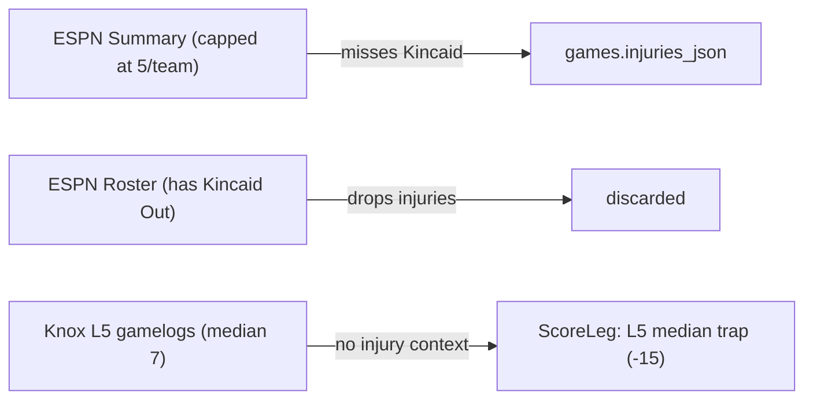
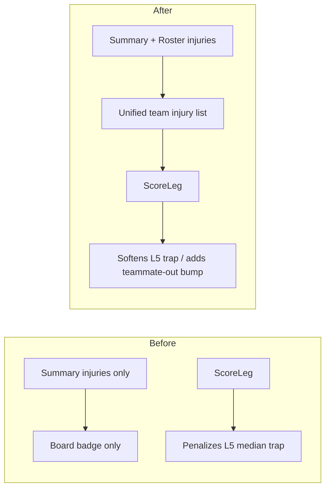

# Include roster injuries in leg grading

## Context

On November 22, 2026, Buffalo TE1 Dalton Kincaid was `Out` (updated on ESPN's roster feed at `16:34Z`, before the 1:00
PM ET kickoff), and Buffalo TE2 Dawson Knox was picked for `Over 21 Rec Yds`.

Two gaps caused the app to miss this context:

1. **ESPN's summary endpoint truncated Kincaid:** All 15 archived `espn:summary:401873070` responses capped `injuries`
   at 5 players per team and omitted Dalton Kincaid. Meanwhile, ESPN's team roster response (`espn:roster:2`) *did*
   include Kincaid's `Out` injury status, but roster ingestion currently drops the `injuries` field.
2. **Leg grading ignores injuries:** `ScoreLeg` only inspects player game logs, nflverse usage, weather, matchup EPA,
   nfelo, and line price. Because Knox's last 5 games with Kincaid active had a median of 7 receiving yards, `ScoreLeg`
   penalized `Dawson Knox Over 21 Rec Yds` with `L5 median trap (-15)` without accounting for Kincaid being `Out`.

## Goals and non-goals

**Goals:**

- Parse and persist player injury status from ESPN team rosters alongside summary injuries so `Out` / `Doubtful` /
  `Questionable` players are not lost to summary truncation.
- Factor same-team, same-position `Out` teammates into `ScoreLeg` deterministically (softening or offsetting
  `L5 median trap` and/or awarding a role-bump adjustment when a key teammate is `Out`).
- Keep all grading 100% deterministic plain Go rules with no LLM calls.

**Non-goals:**

- Adding paid injury feeds or scraping beat-writer social posts.
- Changing how `Role bump` badges work on the pick board beyond sharing the fuller injury data.

## Decision

We will capture player injury status during ESPN roster ingestion, merge it with game summary injuries when building
analyzer inputs, and add a deterministic teammate-injury adjustment in `ScoreLeg` so backup/secondary pass-catchers and
runners are not penalized for historical low-volume games played behind an `Out` starter.

This beats relying solely on ESPN's summary endpoint (which silently drops players beyond 5 per team) or adding a new
external injury API (which would add cost and failure modes).

- **Complexity: medium** — Spans ESPN roster ingestion, SQLite storage, web/board signal loading, and deterministic
  analyzer scoring rules.
- **Risk: low** — Purely additive deterministic rules backed by unit tests against archived ESPN payloads and existing
  analyzer test suites.
