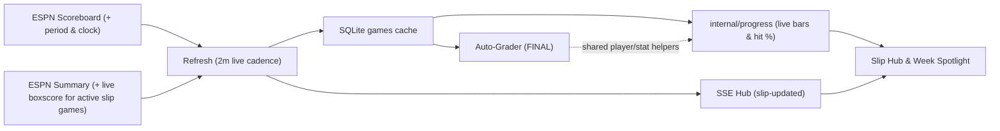

# Close-out

## Overview

## Consequences

- **Easier:** Computing live leg and parlay progress without extra writes, because `boxscore_json` is cached once per live game and `internal/progress` evaluates legs purely on read.
- **Easier:** Keeping live prop progress and final grading consistent, since both share `FindPlayer`, `PlayerMarketStat`, and `AnytimeTDCount` from `internal/grader`.
- **Harder:** Tuning or debugging live probability swings on edge-case games, because `internal/progress` models remaining production with Normal and Poisson approximations anchored to pre-game odds rather than live market prices.
- **Revisit:** The 2-minute `espn:summary:{gameID}` live cadence and hardcoded market coefficients of variation if live Sunday traffic hits ESPN rate limits or late-game probabilities feel noisy.

## Alternatives considered

- **Polling live sportsbook odds (Parlay API / The Odds API):** Rejected because it spends scarce monthly free-tier credits, breaks during suspended live markets, and tracks different lines than those locked on the slip.
- **Storing per-leg live stats in a new database table:** Rejected in favor of storing `boxscore_json` once per `LIVE` game on `games`, keeping writes to one row per game and computing leg progress on read.
- **Adding a background polling job for live games:** Rejected because it violates the Cloud Run single-instance free-tier guardrail; riding on `Kick()` with 2-minute staleness and SSE fan-out lets idle instances scale to zero.

## Implementation notes

- `internal/ingest/espn/boxscore.go` needed no changes because its internal `rawSummaryBoxScore` and `parseBoxScore` helpers were reused directly by `Client.Summary`.
- Yardage props (`PASS_YDS`, `RUSH_YDS`, `REC_YDS`) stay `LIVE` (capped at `99%`) until `FINAL` because negative plays can reduce totals, while monotonic markets settle early as soon as `cur > line`.
- Unpopulated live box scores (`!box.HasStats`) degrade to pre-game probability (`"Live · stats pending"`), and absent players in a populated live box score evaluate at `0` rather than `VOID`.
- Unlinked legs, `OTHER` market legs, and missing or unparseable live clocks fall back to pre-game probability or a `0.50` remaining-time fraction.

## Follow-ups

None.
