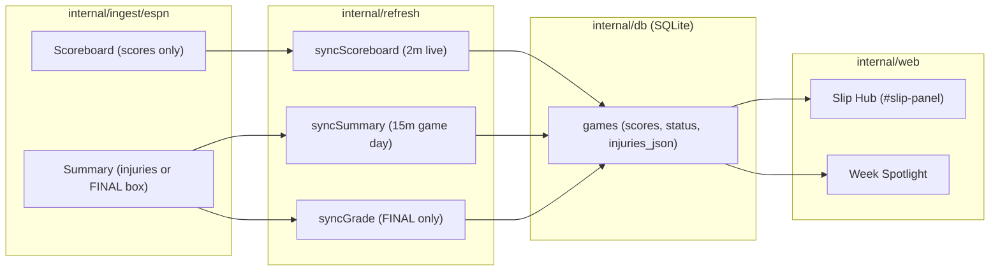
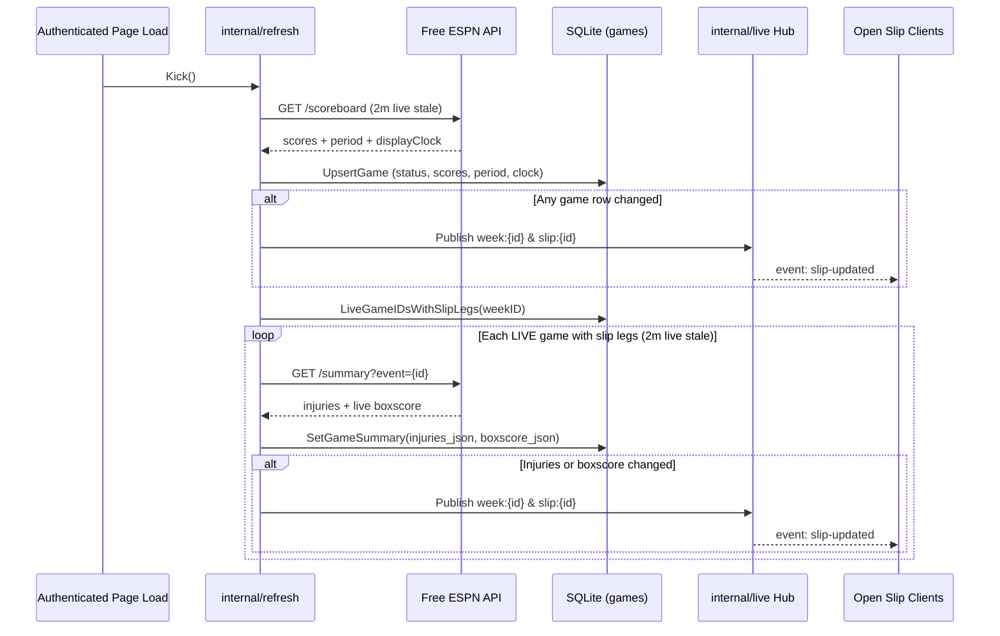
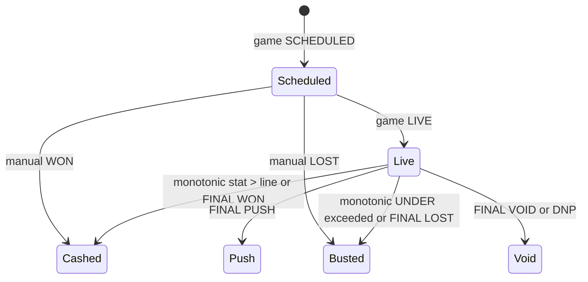

# Design: Live parlay and leg progress bars with live hit probability

## Context

Today the app splits live game state and player stats across four packages:

- `internal/ingest/espn` fetches the free ESPN `/scoreboard` (scores and `SCHEDULED`/`LIVE`/`FINAL` status, dropping `period` and `displayClock`) and `/summary?event={id}` (exposed separately as `SummaryInjuries` for pre-game injury research and `BoxScore` for final auto-grading).
- `internal/db` stores `games` rows in SQLite (`home_score`, `away_score`, `status`, `injuries_json`), with no columns for live quarter, game clock, or cached box scores.
- `internal/refresh` syncs `espn:scoreboard` every 2 minutes while any game is `LIVE` (`scoreboardLiveAge`) and publishes `week:{weekID}` plus `slip:{id}` via `internal/live` whenever `UpsertGame` detects a changed row. `espn:summary:{gameID}` runs every 15 minutes on game days and stores only `injuries_json`; `grade` fetches `BoxScore` only once a game reaches `FINAL`.
- `internal/parlay` computes pre-game implied probabilities (`ImpliedProb`, `DecimalImpliedProb`) from static American/decimal odds. `internal/grader` maps each supported market (`SPREAD`, `ML`, `TOTAL`, `TEAM_TOTAL`, `PASS_YDS`, `PASS_TDS`, `RUSH_YDS`, `RUSH_ATT`, `REC_YDS`, `RECEPTIONS`, `ANYTIME_TD`, `KICKER_PTS`) to final outcomes.
- `internal/web` renders `#slip-panel` (`web/templates/partials.html`) and group week spotlight cards (`web/templates/week.html`), refreshing `#slip-panel` automatically when `slip-updated` arrives over SSE (`GET /slips/{id}/events`).

Constraints that shape this design:

- **Zero paid odds credits:** Live tracking must use only free ESPN endpoints and never call Parlay API or The Odds API.
- **No new scheduled jobs:** Live updates ride on the existing authenticated full-page `Kick()` refresh path and SSE fan-out.
- **Deterministic plain Go:** No LLM calls and no external math libraries; all probabilities use standard library `math`.
- **Phone-first:** Progress bars and live percentages must stay readable in a single column at phone width.



## Approach

### 1. Capture live clock and box scores with zero extra endpoints

Extend `internal/ingest/espn`:

- **`scoreboard.go`:** Parse `status.period`, `status.displayClock`, and `status.type.shortDetail` into `Game.Period *int` and `Game.Clock *string`. Populate them only when `status == Live` (`nil` for `Scheduled` and `Final` so pre-game and final rows remain idempotent). Normalize halftime/end-of-period strings (`"Halftime"`, `"End of 1st"`, etc.) when ESPN reports `shortDetail` for a break.
- **`summary.go` / `boxscore.go`:** Add `Client.Summary(ctx, eventID) (GameSummary, error)` returning both `InjuriesJSON string` and `BoxScore BoxScore` from a single `GET /summary?event={id}` request. Keep `SummaryInjuries` and `BoxScore` intact for existing callers and sandbox tests.

Extend `internal/db`:

- **Migration `0018_live_game_state.sql`:** Add nullable columns `period INTEGER`, `clock TEXT`, and `boxscore_json TEXT` to `games`.
- **`games.go`:** Add `Period *int`, `Clock *string`, and `BoxScoreJSON *string` to `db.Game`. Update `UpsertGame` to own `period` and `clock` alongside `status` and scores (preserving `boxscore_json` and `injuries_json`). Add `SetGameSummary(ctx, gameID, injuriesJSON, boxscoreJSON)` returning `changed bool` only when either JSON payload changed. Add `LiveGameIDsWithSlipLegs(ctx, weekID) (map[string]bool, error)` to identify `LIVE` games referenced by at least one slip leg.

Extend `internal/refresh`:

- **`rules.go`:** Add `summaryLiveAge = 2 * time.Minute`. When `game.Status == db.GameLive` and the game has at least one active slip leg, `summaryStale` uses `summaryLiveAge`; otherwise it keeps the existing 15m game-day / 1h idle cadence.
- **`research.go`:** Update `syncSummary` to call `Summary` when the client implements it (falling back to `SummaryInjuries` for existing narrow test doubles). When `game.Status == db.GameLive`, persist both `injuries_json` and marshaled `boxscore_json` in one transaction via `SetGameSummary`; when `SCHEDULED`, persist `injuries_json` only. When `changed` is true, `publishWeek` emits `slip:{id}` so open SSE streams refresh `#slip-panel`.



### 2. Pure deterministic live progress and hit probability (`internal/progress`)

Export `FindPlayer` and `PlayerMarketStat` (plus `AnytimeTDCount`) from `internal/grader` so live stat extraction and final auto-grading share one canonical mapping and can never disagree.

Create `internal/progress` with zero database, HTTP, or wall-clock dependencies:

```go
type State string

const (
    StateScheduled   State = "SCHEDULED"
    StateLive        State = "LIVE"
    StateCashed      State = "CASHED"
    StateBusted      State = "BUSTED"
    StatePush        State = "PUSH"
    StateVoid        State = "VOID"
    StateUnavailable State = "UNAVAILABLE"
)

type LegProgress struct {
    State       State
    ProgressPct float64 // 0..100 fill width
    Tone        string  // "won", "on_track", "trailing", "lost", "neutral"
    StatLabel   string  // e.g. "182 / 245.5 yds", "BUF 21-17 (+7.5)"
    ClockLabel  string  // e.g. "Q3 8:42", "Halftime", "Final"
    PreGameProb float64 // 0..1 from parlay.ImpliedProb(leg.Odds)
    LiveProb    float64 // 0..1 updated hit probability
    Counts      bool    // false for PUSH/VOID
    HasLive     bool    // true when live/settled progress UI should show
}

type SlipProgress struct {
    Show        bool
    State       State   // LIVE, CASHED, BUSTED, PUSH, SCHEDULED
    ProgressPct float64 // 0..100 aggregate fill width
    Tone        string  // "won", "on_track", "trailing", "lost", "neutral"
    Summary     string  // e.g. "2/4 hit · 1 live"
    PreGameProb float64 // product of counting pre-game implied probs
    LiveProb    float64 // product of counting live probs
    HitCount    int
    LiveCount   int
    LostCount   int
    TotalCount  int
}
```

#### Time-remaining model

Regulation is 3,600 seconds (4 × 15 min):

- `SCHEDULED`: `remFrac = 1.0`.
- `FINAL`: `remFrac = 0.0`.
- `LIVE`:
  - Halftime (`"Halftime"` or end of Q2): `remFrac = 0.50`.
  - Quarter `1..4` with `MM:SS`: `remSec = (4-period)*900 + clockSec`, clamped to `[0.005, 1.0]` while still live.
  - Overtime (`period >= 5`): `remFrac = clamp(clockSec/3600, 0.005, 0.167)`.
  - Missing/unparseable clock on a `LIVE` game: fallback `remFrac = 0.50`.

#### Market probability and progress rules

Every live formula anchors to the leg's pre-game implied probability `p0 = clamp(parlay.ImpliedProb(leg.Odds), 0.02, 0.98)` at `remFrac = 1.0`, so live probability starts at `p0` at kickoff and converges smoothly toward `0` or `1` as time runs out.

- **Settled legs (`leg.Result != PENDING`):** `WON` → `StateCashed` (`1.0`, `100%`), `LOST` → `StateBusted` (`0.0`, `0%`), `PUSH` → `StatePush` (`Counts = false`), `VOID` → `StateVoid` (`Counts = false`).
- **Scheduled / unlinked / `OTHER` legs:** keep `LiveProb = PreGameProb`, `HasLive = false` (scheduled legs still contribute `PreGameProb` to the parlay product).
- **Monotonic early settlement while `LIVE`:** Points (`TOTAL`, `TEAM_TOTAL`), `ANYTIME_TD`, `PASS_TDS`, `RUSH_ATT`, `RECEPTIONS`, and `KICKER_PTS` cannot decrease. When `cur > line` (or `curTDs >= 1` for `ANYTIME_TD`), `OVER`/`YES` immediately transitions to `StateCashed` (`LiveProb = 1.0`, `100%`) and `UNDER`/`NO` transitions to `StateBusted` (`LiveProb = 0.0`, `0%`). Yardage markets (`PASS_YDS`, `RUSH_YDS`, `REC_YDS`) can lose yards on sacks or negative plays, so when `cur > line` while `LIVE` they show a full `100%` bar and high live probability (capped at `0.99`) until `FINAL`.
- **`SPREAD` and `ML` (`line = 0`):** Normal model with full-game margin standard deviation `σ_full = 13.5` points. Anchor `μ_full = -line + σ_full * Φ⁻¹(p0)`, remaining mean `μ_rem = μ_full * remFrac`, remaining std dev `σ_rem = σ_full * sqrt(remFrac)`, effective margin `cur = (teamScore - oppScore) + line`, `LiveProb = clamp(Φ((cur + μ_rem) / σ_rem), 0.01, 0.99)`. Bar fill maps `LiveProb * 100`.
- **`TOTAL` and `TEAM_TOTAL`:** Normal model (`σ_full = 13.5` game total, `9.5` team total) anchored to `line` and `p0`. Bar fill shows `clamp(cur / line * 100, 0, 100)` for `OVER` and remaining cushion `clamp((line - cur) / line * 100, 0, 100)` for `UNDER`.
- **Yardage and volume props (`PASS_YDS`, `RUSH_YDS`, `REC_YDS`, `RUSH_ATT`, `RECEPTIONS`, `KICKER_PTS`):** Normal remaining-production model with market-specific coefficient of variation (`0.30` passing yds / rush att, `0.40` receptions, `0.45` rush yds / kicker pts, `0.50` rec yds) anchored to `line` and `p0`. Absent player in a populated live box score evaluates with `cur = 0` (never voided while `LIVE`). Missing/unpopulated box score (`box == nil || !box.HasStats`) keeps `LiveProb = PreGameProb` and labels `"Live · stats pending"`.
- **Touchdown props (`ANYTIME_TD`, `PASS_TDS`):** Poisson model. `ANYTIME_TD` uses `λ_full = -ln(1 - p0_yes)` and `P(YES) = 1 - exp(-λ_full * remFrac)`. `PASS_TDS` solves `λ_full` matching `p0` via bounded binary search (20 iterations) and computes exact Poisson tail `P(X_rem >= ceil(line - cur))` with `λ_rem = λ_full * remFrac`.
- **Combined parlay (`EvaluateSlip`):** Multiplies `LiveProb` across all counting legs (`0` if any leg is `LOST`/`StateBusted`; `1` if all counting legs are `WON`/`StateCashed`). `ProgressPct` averages each counting leg's progress (`StateCashed = 100`, `StateBusted = 0`, `StateLive = leg.ProgressPct`, `StateScheduled = 0`), with `Tone = "lost"` as soon as any leg busts, `"won"` when all counting legs are cashed, `"on_track"` when `LiveProb >= PreGameProb`, and `"trailing"` otherwise.



### 3. Phone-first UI on slip hub and week spotlight

- **Slip hub (`internal/web/slips.go`, `web/templates/partials.html`):**
  - Decode each `LIVE` (and `FINAL`) game's `BoxScoreJSON` once when building `SlipView`, evaluate every leg with `progress.EvaluateLeg`, and aggregate with `progress.EvaluateSlip`.
  - Format live hit percentages with the existing `formatImpliedChance` helper (plus explicit `"100%"` for `StateCashed` and `"0%"` for `StateBusted`).
  - Render a compact **Live parlay progress** bar card near the top of `#slip-panel` whenever `Slip.Live.Show` is true (any leg is `LIVE` or settled on a non-empty slip): parlay status summary, horizontal progress bar (`role="progressbar"`), and `"Live chance X%"` beside muted `"Pre-game Y%"`.
  - Render a slim per-leg progress strip directly inside each leg row when `Leg.Live != nil`: horizontal progress bar, stat/score + clock readout on the left, and live hit chance on the right.
- **Week spotlight (`internal/web/home.go`, `web/templates/week.html`):**
  - Populate `SpotlightSlipCard.Live` using the same `progress.EvaluateSlip` helper when a spotlight slip has live or settled legs, rendering a compact single-row progress bar and live hit percentage inside the card.

### Trade-offs and rejected options

- **Rejected: Polling live sportsbook odds from Parlay API / The Odds API.** Would burn monthly free-tier credits rapidly, suffer from suspended live props between plays, and price different lines than the exact line locked on the slip.
- **Rejected: Storing per-leg live stats in a new database table.** Storing `boxscore_json` once per `LIVE` game on `games` (mirroring `injuries_json`) keeps writes to one row per game and computes leg progress purely on read.
- **Rejected: Background ticker/cron for live games.** Violates the Cloud Run single-instance free-tier guardrail (`AGENTS.md`); reusing `Kick()` + 2m staleness + SSE fan-out keeps idle instances scaled to zero.

## Verification

- **Unit & integration suite:** `go test -race ./... && go vet ./... && good-vibes check live-parlay-progress`
- **ESPN ingest & DB:** Verify live/halftime/OT/pre/final scoreboard parsing (`period`, `clock`), combined `Summary` parsing (`injuries` + `boxscore`), migration `0018_live_game_state.sql` up/down cleanliness, and `UpsertGame`/`SetGameSummary` no-op change detection.
- **Refresh & SSE:** Verify `summaryStale` uses 2m only for `LIVE` games with active slip legs, leaves other games at 15m/1h, deduplicates via `singleflight`, and publishes `slip:{id}` only when live score, clock, or box score changes.
- **Probability model invariants:** Verify kickoff continuity (`LiveProb ≈ PreGameProb` at `remFrac = 1.0`), monotonic convergence as `remFrac -> 0`, early cash/bust for monotonic markets, non-early-cash for yardage markets while `LIVE`, absent-player-as-zero during `LIVE` (never `VOID`), `PUSH`/`VOID` exclusion from parlay product, `OTHER` fallback, and busted parlay collapsing to `0%`.
- **UI & phone layout:** Verify `#slip-panel` and week spotlight HTML render accessible progress bars (`role="progressbar"`), live stat/clock labels, and live vs. pre-game percentages across live, cashed, busted, and scheduled states without breaking existing slip or sandbox tests.

## Risks

- **ESPN summary payload shape changes or missing live box scores:** ESPN's unofficial `/summary` endpoint can temporarily omit `boxscore.players` early in Q1. *Mitigation:* `BoxScore.HasStats == false` degrades cleanly to `"Live · stats pending"` and pre-game probability rather than showing 0% or failing the page; existing `archive.Transport` captures raw payloads for debugging.
- **Higher ESPN `/summary` call volume on live Sundays:** Shortening `espn:summary` from 15m to 2m for live games increases free ESPN requests. *Mitigation:* Scope the 2m cadence strictly to `LIVE` games that have at least one active slip leg, keep `singleflight` + 5m failure backoff, and never touch paid odds providers.
- **Unrealistic probability jumps on edge cases (garbage time, OT, missing clock):** A bad clock parse or extreme line could produce `NaN`, `0%`, or `100%` prematurely. *Mitigation:* Clamp all live non-settled probabilities to `[0.01, 0.99]`, guard against `NaN`/`Inf` and zero-sigma division, and cover OT, halftime, and missing-clock inputs in table-driven tests.

## TODO

### Phase 1: Capture live game clock and box scores from ESPN

Complexity: medium (coordinates ESPN ingest parsing, SQLite migration/store methods, and refresh staleness + SSE fan-out across three packages)
Risk: low (additive nullable columns and free ESPN read path; existing pre-game and final grading behavior remains unchanged and covered by unit tests)

- [x] Extend `internal/ingest/espn` (`scoreboard.go`, `summary.go`, `boxscore.go`) to parse live `period`, `displayClock` / break detail, and combined `Summary` (`injuries` + `boxscore`) from one `/summary` request, with unit tests for pre-game, live regulation, halftime, overtime, and final payloads.
- [x] Add `internal/db/migrations/0018_live_game_state.sql` (`period`, `clock`, `boxscore_json` on `games`) and update `internal/db/games.go` (`Game`, `UpsertGame`, `SetGameSummary`, `LiveGameIDsWithSlipLegs`) with migration and store tests verifying idempotent change detection.
- [x] Update `internal/refresh` (`rules.go`, `research.go`, `refresh.go`, `sources.go`) so `espn:summary:{gameID}` refreshes every 2 minutes for `LIVE` games with active slip legs, persists live `boxscore_json` alongside `injuries_json`, and publishes `week:{weekID}` / `slip:{id}` on changes, with staleness and publish tests.
- [ ] Docs: update `docs/reference/data-sources.md`, `docs/reference/schema.md`, and `docs/concepts/data-refresh.md` for live clock/period fields, `boxscore_json`, and live summary cadence.

### Phase 2: Build deterministic live progress and hit probability engine

Complexity: medium (designs a new pure-Go statistical model across all 12 supported game and player markets with kickoff anchoring, monotonic settlement, and parlay aggregation)
Risk: low (pure functions with zero I/O or database side effects, fully verifiable through deterministic table-driven tests)

- [ ] Export shared player lookup and market stat extraction from `internal/grader` and create `internal/progress` with game-clock parsing (`RemainingFraction`) and live evaluation for game/team markets (`SPREAD`, `ML`, `TOTAL`, `TEAM_TOTAL`), with unit tests covering kickoff anchoring, halftime, OT, missing clock, and monotonic early cash/bust.
- [ ] Add live evaluation for all player prop markets (`PASS_YDS`, `RUSH_YDS`, `REC_YDS`, `RUSH_ATT`, `RECEPTIONS`, `KICKER_PTS`, `PASS_TDS`, `ANYTIME_TD`), `OTHER`/unlinked fallbacks, and full-parlay aggregation (`EvaluateSlip`) in `internal/progress`, with tests covering yardage non-monotonicity, absent players during live games, pushes/voids, and busted parlays.
- [ ] Docs: document the live progress and hit probability formulas in `docs/reference/odds-math.md`.

### Phase 3: Render live progress bars and hit chances in the UI

Complexity: medium (wires cached live game state and `internal/progress` into both the slip hub and week overview view models and phone-first templates)
Risk: low (read-only template additions inside existing SSE-refreshed partials, verified by web handler and HTML tests)

- [ ] Wire `SlipLiveView` and `LegLiveView` in `internal/web/slips.go` and render the parlay live progress card and per-leg progress bars with live hit chances in `web/templates/partials.html`, with handler and HTML tests covering live, cashed, busted, scheduled, and SSE-refreshed states.
- [ ] Wire compact live parlay progress bars and live hit chances into `SpotlightSlipCard` in `internal/web/home.go` and `web/templates/week.html`, with overview handler tests and phone-width layout checks.
- [ ] Docs: update `docs/concepts/slips.md` to document live parlay and leg progress bars and live hit chance display.
