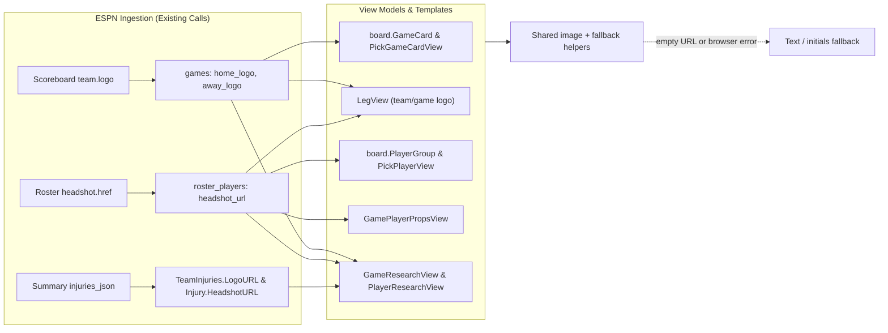

# Design: Team Logos and Player Portraits

## Context

Read before starting:

- [docs/reference/data-sources.md](../../docs/reference/data-sources.md) — ESPN scoreboard, roster, and summary injury
  parsing.
- [docs/reference/schema.md](../../docs/reference/schema.md) — `games` and `roster_players` tables and migration rules.
- [docs/concepts/slips.md](../../docs/concepts/slips.md) — slip hub, pick board (`pick-slate`, `pick-detail`), and
  research screens.

This change introduces no `plan/` deliverables; it adds visual identity to existing ESPN-backed views.

Today:

- `internal/ingest/espn/scoreboard.go` reads `team.id`, `team.abbreviation`, and `team.displayName` from
  `competitors[].team`, ignoring `team.logo`.
- `internal/ingest/espn/roster.go` reads `id`, `fullName`, and `position.abbreviation`, ignoring `headshot.href`.
- `internal/ingest/espn/summary.go` reads team names and athlete IDs/names/positions from `injuries_json`, ignoring
  `team.logo` and `athlete.headshot.href`.
- `web/templates/avatar.html` already implements a circular photo-or-initials pattern for club members, and
  `web/static/app.js` hooks `DOMContentLoaded`, `htmx:afterSwap`, and `htmx:oobAfterSwap` for progressive DOM
  enhancements.

Constraints from `AGENTS.md`:

- Phone-first at 375 px width; keep tap targets readable and avoid crowding compact buttons or dropdowns.
- No extra external requests or Odds API credit spend; reuse existing ESPN syncs and preserve `UpsertGame` idempotency.
- Offline Sunday sandbox (`SUNDAY_SANDBOX=1`) replays fixtures without live network calls; UI must stay clean if remote
  CDN images fail to load.

## Approach

### 1. Ingestion & Storage (`internal/ingest/espn`, `internal/db`, `internal/refresh`)

- **Scoreboard:** Extend `espn.Team` with `Logo string` populated from `competitors[].team.logo`.
- **Roster:** Extend `espn.RosterPlayer` with `HeadshotURL string` populated from `athletes[].items[].headshot.href`.
- **Summary:** Extend `espn.TeamInjuries` with `LogoURL string` (`team.logo`) and `espn.Injury` with
  `HeadshotURL string` (`athlete.headshot.href`), parsed from the existing `games.injuries_json` column without extra
  fetches or schema changes.
- **URL validation:** Normalize logo and headshot URLs in `internal/ingest/espn` by trimming whitespace and accepting
  only `https://` URLs (returning `""` otherwise) so bad payloads never reach templates.
- **Migration `0011_logos_portraits.sql`:**
  - `ALTER TABLE games ADD COLUMN home_logo TEXT;`
  - `ALTER TABLE games ADD COLUMN away_logo TEXT;`
  - `ALTER TABLE roster_players ADD COLUMN headshot_url TEXT NOT NULL DEFAULT '';`
- **Store updates (`internal/db`):**
  - Update `db.Game` (`HomeLogo`, `AwayLogo *string`), `gameColumns`, `scanGame`, and `UpsertGame` (including
    `home_logo` and `away_logo` in the `WHERE ... IS NOT ...` dirty check so identical reruns keep `updated_at`
    untouched).
  - Update `db.RosterPlayer` (`HeadshotURL string`), `rosterColumns`, `scanRosterPlayer`, and `UpsertRosterPlayers`.
  - Add `Store.RosterPlayersByIDs(ctx, []string) (map[string]RosterPlayer, error)` for single-query portrait lookups on
    slip legs, and `Store.TeamLogos(ctx) (map[string]string, error)` (or derive from stored games) so legs on past-week
    or cross-scope games can still resolve team logos when available.
- **Refresh wiring (`internal/refresh`):** Map `HomeLogo`/`AwayLogo` in `slateGame` and `HeadshotURL` in `syncRoster`.
  Existing `board.Build` and `syncSummary` need no extra external requests.

### 2. Board & View Models (`internal/board`, `internal/web`)

- **`internal/board`:**
  - Add `AwayLogo`, `HomeLogo` to `GameCard`; `HeadshotURL` to `Row` and `PlayerGroup`.
  - Extend `matchPlayer` to return `(athleteID, position, headshotURL)` directly from the already-loaded
    `roster []db.RosterPlayer` slice.
- **Pick board (`internal/web/pick.go`):**
  - Thread `AwayLogo`, `HomeLogo` onto `PickGameCardView` and `PickDetailView`.
  - Thread `HeadshotURL`, `Initials` (derived from player name) onto `PickPlayerView` (and `TeamLogo` from the game's
    away/home team).
  - Keep `PickRowView` (`pick-option`) buttons text-only so 2-column line rows stay uncrowded on 375 px screens.
- **Slip hub (`internal/web/slips.go`):**
  - Extend `LegView` with optional visual fields (`PlayerHeadshot`, `PlayerInitials`, `TeamLogo`, `MatchupAwayLogo`,
    `MatchupHomeLogo`, or a small `LegBadge` struct):
    - Matched player leg (`leg.PlayerID` set): show player portrait (with initials fallback if a portrait URL fails, or
      team logo fallback when headshot is empty).
    - Team-scoped leg (`SPREAD`, `ML`, `TEAM_TOTAL`, or `OTHER` with `leg.Team`): show team logo when available.
    - Game `TOTAL` leg (`leg.GameID` set, `leg.Team` empty): show paired away/home logos.
    - Custom/historical leg without game, team, or player: render plain text with no broken placeholder.
- **Research & standalone props (`internal/web/research.go`, `internal/web/games.go`):**
  - `GameResearchView`: carry `AwayLogo`, `HomeLogo`; `TeamInjuriesView` carries `LogoURL`; `InjuryView` carries
    `HeadshotURL`, `Initials`; `PropMatchView` carries `HeadshotURL`, `Initials` for matched athletes.
  - `PlayerResearchView`: carry `HeadshotURL`, `Initials`, and `TeamLogo` (resolved from stored games when available).
  - `GamePlayerPropsView`: carry `HeadshotURL`, `Initials` from `board.Row`.

### 3. Shared UI Helpers & Fallback Behavior (`web/templates`, `web/static`)

- Add reusable template helpers (in `web/templates/avatar.html` or a dedicated `web/templates/media.html` included in
  `Renderer.parse` and `RenderPartial`):
  - `team-logo`: `h-5 w-5` (or sized per slot) `object-contain shrink-0` `` with `loading="lazy"` and
    `referrerpolicy="no-referrer"`, wrapped with `data-fallback-img` when `LogoURL != ""`; renders nothing extra on
    error when adjacent text already names the team, or reveals an optional `[data-fallback-badge]` when a visual slot
    needs one.
  - `player-portrait`: circular `rounded-full object-cover object-top bg-slate-800 shrink-0` `` matching
    `avatar.html` style, paired with an initials `` (initially `hidden` when an `` is
    rendered, visible immediately when `HeadshotURL == ""`).
- In `web/static/app.js`, register a single capturing `error` listener on `document`
  (`document.addEventListener("error", ..., true)`) for `img[data-fallback-img]`: on load failure, hide the failed
  `` and unhide the sibling `[data-fallback-badge]` inside its `[data-media]` wrapper. This avoids inline `onerror`
  handlers and works automatically across initial loads and HTMX swaps.
- Run `go generate ./web` whenever Tailwind utility classes change so `web/static/app.css` stays in sync.

### Trade-offs & Rejected Alternatives

- **Storing URLs in `games` and `roster_players` vs. a new `teams` table:** Adding `home_logo`/`away_logo` to `games`
  and `headshot_url` to `roster_players` keeps scoreboard and roster upserts single-table and avoids joins or stale
  team-table synchronization. A tiny `TeamLogos` query over `games` covers cross-game lookups with 32 NFL teams.
- **Direct ESPN CDN URLs vs. server-side image proxy/bundling:** Direct `https://` URLs with browser lazy loading and
  graceful fallback avoid copyrighted asset storage, binary growth, and Cloud Run egress/CPU overhead.
- **Capturing `error` listener in `app.js` vs. inline `onerror`:** A single document-level capturing handler stays
  CSP-clean and covers HTMX partial swaps without duplicating JS snippets in templates.

## Verification

- **Unit & integration tests:**
  - `internal/ingest/espn`: verify real fixtures (`scoreboard_week.json`, `scoreboard_live.json`, `roster.json`,
    `roster_falcons.json`, `summary.json`) parse team logos and player headshots, handle athletes with missing headshots
    (`roster_falcons.json`), and reject non-`https://` URLs.
  - `internal/db`: verify migration `0011_logos_portraits.sql` applies cleanly on fresh and existing DBs, `UpsertGame`
    persists `home_logo`/`away_logo` and keeps `updated_at` unchanged on identical reruns, `UpsertRosterPlayers`
    persists `headshot_url`, and `RosterPlayersByIDs` / `TeamLogos` return expected maps.
  - `internal/refresh`: verify `syncScoreboard` and `syncRoster` store logos and headshots through `Store`.
  - `internal/board`: verify `GameCard` carries `AwayLogo`/`HomeLogo` and `PlayerGroup` carries `HeadshotURL` from
    `roster` without extra lookups.
  - `internal/web`: verify `pick` (`pick-slate`, `pick-detail`), `slip-panel`, `game-props`, `research-game`, and
    `research-player` render `` tags when URLs exist and fall back cleanly to initials/text when URLs are empty
    (e.g., unlinked historical leg, missing roster headshot).
- **Phone-width & sandbox check:**
  - Verify `SUNDAY_SANDBOX=1` boots cleanly and rendered templates keep 375 px layouts uncrowded, with `app.js` hiding
    any broken `` and showing `[data-fallback-badge]`.
- **Standard suite:** Run
  `go generate ./... && go test -short ./... && golangci-lint run ./... && rumdl check . && good-vibes check logos-and-portraits`
  after each phase.

## Risks

- **Broken or missing ESPN CDN images (e.g., rookies, offline sandbox):** Handled by empty-URL rendering of
  `[data-fallback-badge]` on the server and the capturing `error` fallback in `app.js` so no broken-image icon appears.
- **Dark-on-dark team logos (e.g., NYJ, BAL, JAX):** Using a subtle neutral backing or border on logo badges where
  needed keeps dark crests legible on `bg-slate-900`/`bg-slate-950`.
- **Template partial parsing:** Adding a new shared template file requires updating both `Renderer.parse` and
  `Renderer.RenderPartial` in `internal/web/render.go`; missing it would fail `render_test.go` immediately.

## TODO

Effort: easy (the image URLs already exist in our current ESPN payloads and follow established ingestion, DB, and
template patterns)

### Phase 1: Ingest, store, and wire logo and portrait metadata

- [x] Parse `team.logo` in `espn.Scoreboard`, `headshot.href` in `espn.Roster`, and injury
      `team.logo`/`athlete.headshot.href` in `espn.ParseInjuries` (normalizing to `https://` only), with fixture tests
      covering present and missing URLs.
- [x] Add `0010_logos_portraits.sql` (`games.home_logo`, `games.away_logo`, `roster_players.headshot_url`), update
      `db.Game`, `db.RosterPlayer`, `UpsertGame` idempotency, `RosterPlayersByIDs`/`TeamLogos`, `refresh` syncs, and
      `board` (`GameCard`, `Row`, `PlayerGroup`) with tests.
- [x] Docs: update `docs/reference/data-sources.md` and `docs/reference/schema.md` for the new logo and headshot fields
      and migration `0010`.

### Phase 2: Render logos and portraits on the pick board and slip hub

- [x] Add shared `media.html` template helpers (`team-logo`, `player-portrait`, `matchup-logos`) wired in
      `internal/web/render.go`, plus the capturing `error` fallback in `web/static/app.js` and regenerated
      `web/static/app.css`.
- [ ] Render team logos and player portraits on `pick-slate` cards, `pick-detail` headers and `PickPlayerView` cards,
      and `slip-panel` legs (`LegView`) with graceful fallbacks for missing or unlinked legs, with handler/render tests.

### Phase 3: Render logos and portraits on research and standalone props

- [ ] Render team logos and player portraits on `research-game` (matchup header, injury team headers, injury rows,
      matched players), `research-player` (header portrait and team logo), and `game-props` player headers, with
      handler/render tests.
- [ ] Docs: update `docs/concepts/slips.md` to describe team logos and player portraits across the pick board, slip
      legs, and research views.
