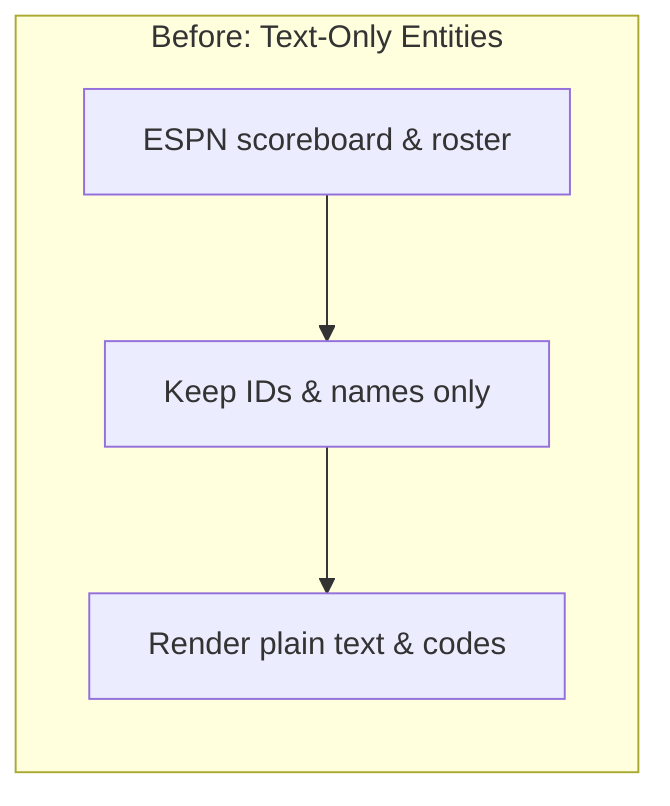
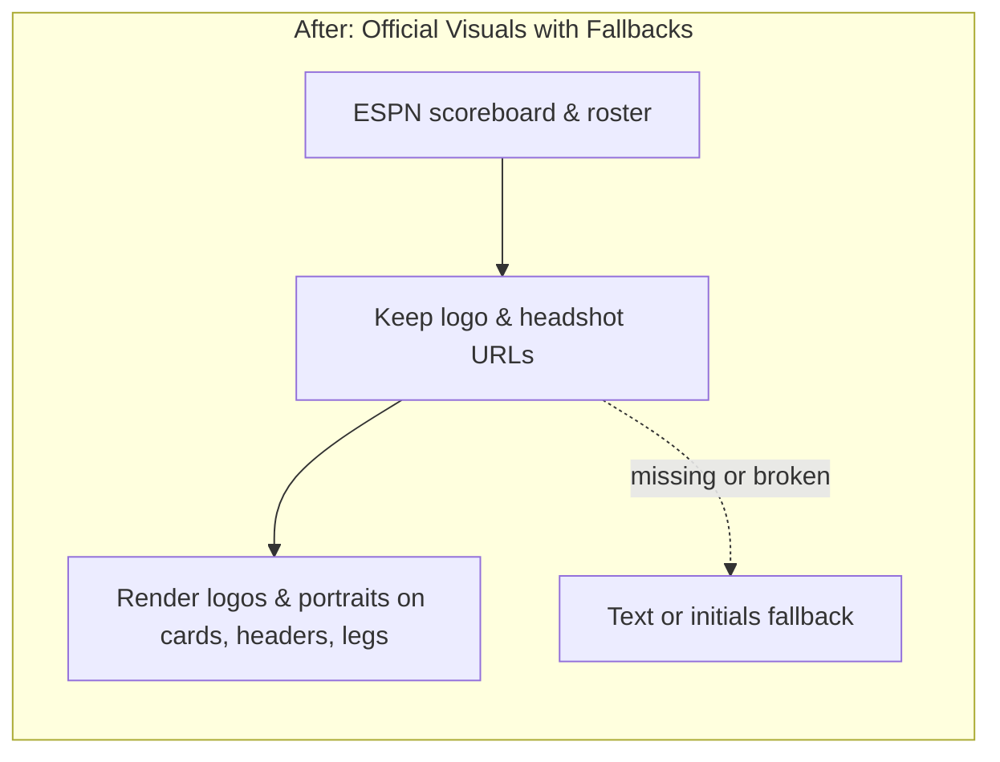

# Team Logos and Player Portraits

## Context

Every NFL team and player across the app renders as plain text today. Pick-board slate cards show bare abbreviations
like `BUF @ MIA`, prop tabs and research headers show unstyled player names, and slip legs list text only—even though
member rows already show user profile photos with a clean fallback.

On a phone screen, walls of three-letter team codes and player names are slower to scan when browsing a full Sunday
slate, comparing player props, or reviewing a friend's slip. Official team logos and player headshots are already
included in the ESPN scoreboard and roster responses the app fetches, but we currently discard them during ingestion.

## Goals and non-goals

**Goals:**

- Show official team logos where games, matchups, and team picks appear, including pick-board slate cards, game headers,
  slip legs, and game research.
- Show official player portraits where a player is the subject, including player prop groups, player research headers,
  and matched player legs.
- Source logos and portraits from the existing ESPN scoreboard and roster syncs without adding new API calls or spending
  extra credits.
- Fall back cleanly to text or initials when an image is missing, fails to load, or belongs to a custom or unlinked
  historical pick, keeping phone-width layouts uncluttered.

**Non-goals:**

- Bundling, mirroring, or proxying copyrighted NFL logos or player photos from the app server.
- Crowding dense inline elements—such as quick-add prop pills, sort chips, or dropdown options—with thumbnails that
  break phone-width alignment.
- Scraping extra sites or adding a new data provider to backfill missing headshots.
- Changing odds math, player matching rules, or slip behavior.

## Decision

Capture official team logo and player headshot URLs from the existing ESPN scoreboard and roster syncs, store them
alongside our game and roster records, and surface them in view models for screens where visual identity aids scanning.
Render logos and portraits through reusable UI helpers that degrade cleanly to initials or plain text when a URL is
absent or fails to load, reserving images for cards, headers, and legs rather than compact buttons.

Reading the URLs directly from the ESPN responses we already fetch beats hardcoding static team maps or guessing CDN
paths by ID, because ESPN stays the source of truth when teams rebrand or players change photos without adding any extra
network calls. It also beats self-hosting or proxying images, avoiding asset licensing headaches, repository bloat, and
Cloud Run bandwidth use.

The `effort: easy` rating fits because the image URLs already live in existing ESPN payloads and the work follows
established ingestion, storage, and template patterns with minimal architectural uncertainty.
