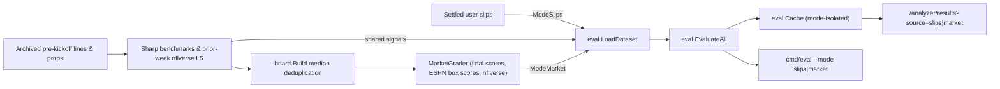

# Close-out

## Overview

## Consequences

- **Easier:** Measure A–F leg calibration, lift, flat ROI, Brier score, and factor attribution across the full NFL slate via `cmd/eval --mode market` or `/analyzer/results?source=market` without waiting for user slips.
- **Easier:** Exercise sharp-book (`sharp_line_edge`, `sharp_price_edge`) and recent-form (`hit_rate`, `median_trap`) rules in replay, since both `ModeSlips` and `ModeMarket` now reconstruct `Game.Sharp` from archived odds and fall back to prior-week `nflverse_player_weeks` when pre-kickoff ESPN game logs are absent.
- **Harder:** Diagnose missing player-prop coverage when sportsbook player names do not match pre-kickoff rosters or `nflverse` crosswalks; unmatched props lose L5 and usage signals during scoring and are dropped from market grading.
- **Harder:** Reason about cache freshness across two independent invalidation paths in `eval.Cache`, where slip settlement evicts per-group entries and newly `FINAL` games or `nflverse` updates evict market entries.
- **Revisit:** Cold-cache replay latency once multi-season archives grow, or whether `ModeMarket` should support closing-line-only or per-book sampling alongside median consensus.

## Alternatives considered

- **Synthesizing at replay time vs. persisting synthetic market slips:** Replaying read-only from archived snapshots keeps `slips`, `legs`, and Record Book tables clean, avoids schema migrations, and lets deduplication or grading rules change without rewriting stored rows.
- **Median consensus via `board.Build` vs. scoring every sportsbook row:** Scoring every book row inflates sample size 6–10x with correlated copies of the same outcome and skews calibration. Reusing `board.Build` with `homeBook == ""` emits one representative line per selection side, matching the pick board and highlights.
- **Separate `ModeSlips` and `ModeMarket` vs. merging into one report:** Mixing synthetic single-leg market candidates with user parlays would dilute parlay-level slip grades and blur user-selected vs. league-wide leg metrics. Separate modes reuse `eval.Evaluate` and `eval.Compare` while keeping slip-only sections hidden in market mode.
- **Archived box scores + `nflverse` vs. polling ESPN for every final game:** Combining already-archived `espn:summary:{gameID}` box scores with league-wide `nflverse_player_weeks` covers finished games offline with zero new API calls or background polling.
- **Dropping unmatched `nflverse` props (`NeedsGrading`) vs. marking `Void`:** A missing `nflverse` row can reflect an unmapped crosswalk rather than a DNP, so dropping unmatched props avoids inflating void counts while completed ESPN box scores still record true DNPs as `Void`.

## Implementation notes

- All three phases shipped without plan deviations.
- **Archived event matching:** When `games.odds_event_id` is unset or overwritten, `odds:lines` matching falls back to team names and kickoff time (`odds.MatchEvents`); unmatched events are skipped and appear as lower `WithOdds` and `WithSharp` coverage counts.
- **Player identity limits:** Props whose names fail to match pre-kickoff archived rosters or prior-week `nflverse_player_weeks` lose `PlayerID` (disabling L5 and usage rules) and are dropped by `MarketGrader` if no completed ESPN box score is archived for that game.
- **L5 fallback scope:** Prior-week `nflverse_player_weeks` fallback covers `PASS_YDS`, `PASS_TDS`, `RUSH_YDS`, `RUSH_ATT`, `REC_YDS`, `RECEPTIONS`, `ANYTIME_TD`, and `KICKER_PTS` when no pre-kickoff `espn:gamelog:{id}` exists, tracked separately from `WithGameLogs` via `WithL5Fallback`.
- **CLI flag constraint:** `cmd/eval` rejects `--mode` when `--dataset` is set because JSON fixtures already encode a fixed dataset.

## Follow-ups

- Tune and evaluate a `v2` grading rubric using `ModeMarket` sample sizes across finished weeks (`cmd/eval --mode market` and `eval.Compare`).
- Audit player-name mismatches between archived `odds:props:{gameID}` payloads, pre-kickoff rosters, and `nflverse_player_weeks` to reduce dropped props and raise `WithL5Fallback` coverage.
- Consider adding a closing-line-only or sharp-book-only sampling option to `ModeMarket` if `v2` tuning needs to separate consensus pricing from closing-line value.
