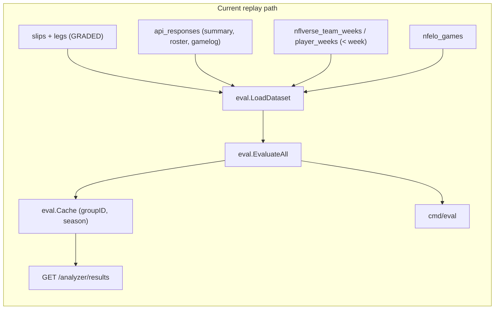
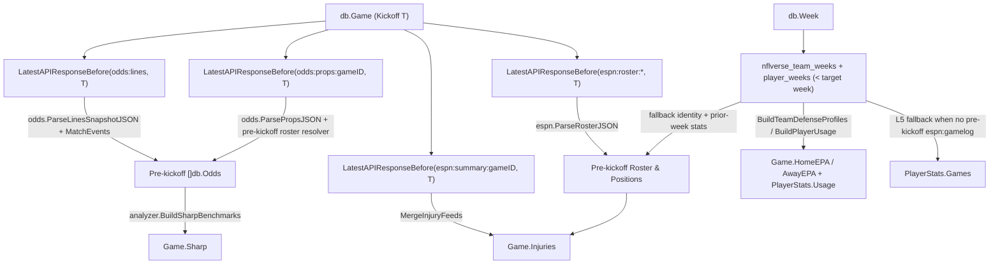
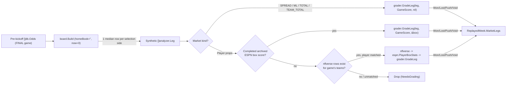
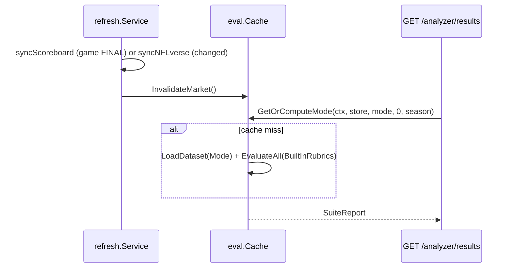

# Design: Market-wide grading evaluation

## Context

`internal/eval` replays historical weeks read-only from SQLite to evaluate `analyzer.Rubric` calibration without
post-kickoff leakage. Today it only loads settled user slips (`db.SlipGraded`) via `eval.LoadDataset`
(`internal/eval/replay.go`), evaluates them with `eval.Evaluate` / `eval.EvaluateAll` (`internal/eval/metrics.go`), and
exposes results through two surfaces:

- Offline CLI (`cmd/eval/main.go`) reading either a SQLite database (`--db`, opened read-only) or a JSON fixture
  (`--dataset`).
- In-app page `GET /analyzer/results` (`internal/web/eval_results.go`, `web/templates/analyzer_results.html`) backed by
  the in-memory `eval.Cache` (`internal/eval/cache.go`).



Key codebase seams and constraints:

- **Pre-kickoff archive**: `api_responses` + `api_bodies` store raw responses keyed by `db.ArchiveOddsLinesKey`
  (`odds:lines`), `db.ArchiveOddsPropsKey(gameID)` (`odds:props:{gameID}`), `db.ArchiveSummaryKey(gameID)`
  (`espn:summary:{gameID}`), `db.ArchiveRosterKey(teamID)` (`espn:roster:{teamID}`), and
  `db.ArchiveGameLogKey(athleteID)` (`espn:gamelog:{id}`). `Store.LatestAPIResponseBefore` enforces `fetched_at <= t`
  with 2xx status.
- **Parsers already exist**: `odds.ParseLinesJSON`, `odds.ParsePropsJSON`, `espn.ParseGameLogJSON`,
  `espn.ParseRosterJSON`, and `espn.ParseInjuries` already parse archived bodies offline. Two small gaps exist:
  `odds.ParseLinesJSON` discards the event metadata (`home_team`, `away_team`, `commence_time`) needed to match events
  when `games.odds_event_id` is absent, and `espn` parses box scores via HTTP (`Client.BoxScore`) without an exported
  `ParseBoxScoreJSON`.
- **Board deduplication**: `board.Build` (`internal/board/board.go`) already collapses multi-book `[]db.Odds` into one
  canonical `board.Row` per `(game, market, player/team, side)` using median line and median price when `homeBook == ""`
  and skips the kickoff cutoff when `now.IsZero()`.
- **Deterministic grading**: `grader.GradeLeg` (`internal/grader/grader.go`) grades `SPREAD`, `ML`, `TOTAL`, and
  `TEAM_TOTAL` from `grader.GameScore` and player props from `*espn.BoxScore`.
- **Two existing replay signal gaps**:
  1. `eval.LoadDataset` never builds `Game.Sharp` (`analyzer.BuildSharpBenchmarks`) from archived pre-kickoff odds, so
     sharp-book line and price rules stay silent in replay.
  2. `eval.LoadDataset` only populates `PlayerStats.Games` from archived `espn:gamelog:{id}`, leaving L5 median-trap and
     L5 hit-rate rules silent for players whose game logs were never fetched before kickoff.
- **Invariants**: zero external API calls during evaluation; no writes to `slips`, `legs`, or Record Book tables; single
  in-memory `eval.Cache` per Cloud Run instance; phone-first UI on `/analyzer/results`.

## Approach

### 1. Replay modes and dataset shape

Extend `internal/eval/types.go` with a `ReplayMode` (`ModeSlips`, `ModeMarket`) while keeping existing `ReplayDataset`
JSON fixtures and `ModeSlips` callers backwards-compatible:

```go
type ReplayMode string

const (
    ModeSlips  ReplayMode = "slips"
    ModeMarket ReplayMode = "market"
)

type ReplayFilter struct {
    Season   int
    FromWeek int
    ToWeek   int
    GroupID  int64
    Mode     ReplayMode // "" defaults to ModeSlips
}
```

- `ReplayedWeek` gains `MarketLegs []ReplayedLeg \`json:"market_legs,omitempty"\``.
- `DataCoverage` gains `WithSharp int \`json:"with_sharp,omitempty"\`` and
  `WithL5Fallback int \`json:"with_l5_fallback,omitempty"\``.
- `eval.Evaluate` scores `week.Slips` via `analyzer.ScoreSlipWithRubric` (updating both leg and slip bands/factors) and
  scores `week.MarketLegs` via `analyzer.ScoreLegWithRubric` (updating leg bands, weekly leg progression, leg factors,
  and leg outcomes, never touching `SlipBands` or `SlipFactors`).
- `legOutcomeKey` in `internal/eval/metrics.go` adds `(season, weekType, weekNum, isMarket, legIdx)` when `slipID == 0`
  and `legID == 0`, so `eval.Compare` computes exact band migrations between rubrics for market-wide legs.

### 2. Pre-kickoff signal reconstruction (shared by slips and market modes)



- **Archived lines & props to `[]db.Odds`**:
  - Add `odds.ParseLinesSnapshotJSON(raw []byte) ([]Event, []Line, error)` in `internal/ingest/odds/lines.go` so one
    decode yields both event metadata and priced lines.
  - Cache decoded `odds:lines` payloads by `resp.BodySHA256` per week so Sunday's 1:00 PM games decode the shared slate
    body once.
  - Match each event to `g` by `g.OddsEventID` first, then `odds.MatchEvents` against `weekGames`. Map display team
    names (`HomeName` / `AwayName`) to ESPN abbreviations (`HomeTeam` / `AwayTeam`).
  - Parse `odds:props:{g.ID}` (strictly `fetched_at < g.Kickoff`) with `odds.ParsePropsJSON`. Resolve `TEAM_TOTAL` team
    names to `HomeTeam`/`AwayTeam`, and resolve player prop `Team` and `PlayerID` using a `db.BatchPlayerResolver`
    constructed strictly from pre-kickoff archived rosters for `{HomeTeam, AwayTeam}` plus strictly prior-week
    `nflverse_player_weeks` rows for those two teams (never reading overwritten live `roster_players` or `odds`).
  - Feed the combined pre-kickoff `[]db.Odds` into `analyzer.BuildSharpBenchmarks` and attach `converted.Sharp`.
- **Prior-week nflverse L5 fallback**:
  - When `latestArchivedBodyBefore(ctx, store, db.ArchiveGameLogKey(id), kickoff)` finds no pre-kickoff ESPN game log,
    construct `PlayerStats.Games` from that player's strictly prior-week `db.NFLversePlayerWeek` rows in the same season
    (`isPriorNFLverseWeek`, already ordered most-recent-first):
    - `PASS_YDS` (`PassYds`), `PASS_TDS` (`PassTDs`), `RUSH_YDS` (`RushYds`), `RUSH_ATT` (`Carries`),
      `REC_YDS` (`RecYds`), `RECEPTIONS` (`Receptions`), `ANYTIME_TD` (`RushTDs + RecTDs`), `KICKER_PTS` (`KickerPts`).
  - Backfill `PlayerStats.Position` from the latest prior-week nflverse row when pre-kickoff archived rosters do not
    carry the player.
  - Keep `DataCoverage.WithGameLogs` for pre-kickoff ESPN game logs, and increment `DataCoverage.WithL5Fallback` when
    prior-week nflverse rows supply `PlayerStats.Games`. Increment `DataCoverage.WithSharp` when `game.Sharp` contains a
    benchmark for the leg's `SharpKey` (via a small helper `analyzer.HasSharpBenchmark(game, leg)`).

### 3. Market-wide candidate builder and deterministic grader



- **Deduplication**: For each `FINAL` game with pre-kickoff archived `[]db.Odds`, call
  `board.Build([]db.Game{preKickoffGame}, gameOdds, preKickoffRoster, "", nil, time.Time{})`. Using `homeBook == ""`
  produces one representative `board.Row` per `(game, market, player/team, side)` at the median line and median
  sportsbook price, matching the pick board and highlights without book-specific bias or multi-book inflation. Drop
  rows with `Odds == 0`, `parlay.AmericanToDecimal(Odds) <= 1`, `Market == "OTHER"`, or missing lines on line-based
  markets.
- **Offline outcome grading**:
  - Export `espn.ParseBoxScoreJSON(raw []byte) (BoxScore, error)` in `internal/ingest/espn/boxscore.go` and
    `Store.LatestAPIResponse(ctx, key)` in `internal/db/archive_read.go`.
  - Game lines and `TEAM_TOTAL` grade directly via `grader.GradeLeg` using `g.HomeScore` and `g.AwayScore`.
  - Player props check `g.BoxScoreJSON` (if populated) or the latest 2xx archived `espn:summary:{g.ID}` parsed with
    `espn.ParseBoxScoreJSON`. If `box.Completed && box.HasStats`, grade with `grader.GradeLeg(leg, gameScore, &box)`.
  - Otherwise, fall back to `nflverse_player_weeks` for `(week.Season, week.SeasonType, week.WeekNum)` loaded once per
    week. Only grade from nflverse if at least one row exists for `{g.HomeTeam, g.AwayTeam}` in that week (preventing
    false voids before nflverse publishes). Match the player by `ESPNID` first, then normalized `PlayerName` + `Team`,
    adapt the `db.NFLversePlayerWeek` row to `espn.PlayerBoxStats`, and grade through `grader.GradeLeg` so O/U, Push,
    and Anytime TD semantics stay in one place. Drop any candidate returning `Pending` or `NeedsGrading`.

### 4. Cache invalidation, CLI, and `/analyzer/results`



- **`eval.Cache`**: Key entries by `(mode, groupID, season)`. Keep `GetOrCompute` delegating to
  `GetOrComputeMode(ctx, store, ModeSlips, groupID, season)`. Add `InvalidateMarket()` (tracks `marketGen` separately
  from `groupGen` so user-slip settlement does not evict market cache entries and market data updates do not evict
  user-slip entries; `InvalidateAll()` clears both). Add `SetOnMarketDataChange(func())` on `refresh.Service`, called
  when `syncScoreboard` sees a game newly reach `FINAL` or `syncNFLverse` commits changes, and wire it to
  `evalCache.InvalidateMarket` in `cmd/server/main.go`.
- **CLI (`cmd/eval/main.go`)**: Add `--mode` (`slips` default, or `market`). Reject invalid modes and reject `--mode`
  with `--dataset`. Append `sharp=%d l5_fallback=%d` to coverage output and omit `Slip Calibration` / `Slip Calibration
  Diff` sections when all `SlipBands` have `Total == 0`.
- **Web UI (`internal/web/eval_results.go`, `web/templates/analyzer_results.html`)**:
  - Add `?source=slips|market` (default `slips`; invalid values return `400 Bad Request`).
  - Render a phone-first source pill bar (`User slips` | `Market-wide`) alongside the season and rubric filters,
    preserving `?source=` on all season/rubric links.
  - In `Market-wide` mode, resolve the default season from seasons with `FINAL` games (falling back to `Seasons`), hide
    `Slip Calibration` / `Slip Factor Attribution` (showing a short note that parlay-level slip grades live under
    `User slips`), and display `Sharp benchmarks` and `nflverse L5 fallback` tiles in `Pre-Kickoff Data Coverage`.

### Trade-offs and rejected options

- **Median consensus via `board.Build` vs. scoring every book row**: Scoring every book multiplies sample size by 6–10x
  with correlated copies of the same game outcome and skews calibration. Reusing `board.Build` with `homeBook == ""`
  yields one deduplicated candidate per selection side and matches live pick-board/highlight pricing.
- **Separate `ModeSlips` and `ModeMarket` datasets vs. merging into one report**: Mixing synthetic single-leg market
  candidates with user slips would dilute slip-level stats and blur user-selected vs. league-wide leg metrics. Keeping
  two explicit modes reuses `eval.Evaluate`, `eval.Compare`, `eval.Cache`, and the report renderers with zero metric
  duplication.
- **Dropping unmatched nflverse prop players (`NeedsGrading`) vs. marking `Void`**: An absent row in `nflverse` can mean
  an unmapped ESPN crosswalk rather than a true DNP. Dropping unmatched nflverse prop players avoids inflating push/void
  counts while completed ESPN box scores still record true DNPs as `Void`.

## Verification

- Standard suite: `go test ./...`, `go generate ./...` (zero diff), and `mise run lint`.
- **Strict pre-kickoff isolation**: unit tests in `internal/eval` seed pre-kickoff and post-kickoff `odds:lines`,
  `odds:props:{gameID}`, `espn:gamelog:{id}`, `espn:roster:{team}`, and current-week vs. prior-week `nflverse` rows,
  verifying post-kickoff and same-week rows never leak into `Game.Sharp`, `PlayerStats.Games`, or `PlayerStats.Usage`.
- **Multi-book deduplication**: seed 5 books for the same spread/total/prop side and verify exactly 1 candidate leg is
  emitted at the median line and median price, while sharp benchmarks still use the full multi-book archive (Tier 1/2
  sharp books or Tier 3 consensus) to trigger `sharp_line_edge` / `sharp_price_edge` / fade rules.
- **Deterministic grading edge cases**:
  - Game lines (`SPREAD`, `ML`, `TOTAL`, `TEAM_TOTAL`) grade `Won`, `Lost`, `Push`; non-final games or nil scores are
    skipped.
  - Player props prefer completed archived ESPN box scores (including true DNP -> `Void`), fall back to same-week
    `nflverse_player_weeks` when no completed box score is archived, and drop candidates (`NeedsGrading`) when neither
    source has stats for that game yet.
  - Verify `ANYTIME_TD` excludes passing TDs and counts rushing + receiving TDs.
- **Metrics & migrations**: verify `Evaluate` and `Compare` compute leg bands, lift, flat ROI, Brier score, factor
  attribution, weekly summaries, and band migrations on `ModeMarket` datasets while leaving `SlipBands` and
  `SlipFactors` empty.
- **Cache, CLI, and HTTP**:
  - `eval.Cache` keeps `ModeSlips` and `ModeMarket` entries isolated; `InvalidateMarket` evicts market entries without
    dropping slip entries, and `InvalidateGroup` evicts slip entries without dropping market entries.
  - `cmd/eval --db ... --mode market` outputs text, Markdown, and JSON without slip calibration noise and rejects
    invalid `--mode` values.
  - `GET /analyzer/results?source=market` renders market-wide calibration, hides slip-only sections, preserves `?source=`
    on filter links, returns `400` on invalid `?source=`, and keeps default `GET /analyzer/results` (`source=slips`)
    intact.

## Risks

- **Archived `odds:lines` event matching drift**: If a historical game's `odds_event_id` was overwritten or unset, team
  name + kickoff matching via `odds.MatchEvents` recovers it; unmatched events are skipped cleanly and show up as lower
  `WithOdds` / `WithSharp` counts in coverage.
- **Player name mismatch on archived props**: Sportsbook names that do not match pre-kickoff archived rosters or
  prior-week nflverse rows lose `PlayerID` (and thus L5/usage signals) and may not match nflverse grading rows. Mitigated
  by `db.NewBatchPlayerResolver` normalization and visible in `WithGameLogs` / `WithL5Fallback` coverage tiles.
- **Replay latency on `/analyzer/results?source=market`**: Decoding archived odds across a full season on a cold cache
  could take a few hundred milliseconds. Mitigated by caching decoded `odds:lines` bodies by `BodySHA256`, batching
  nflverse queries per week, and memoizing the resulting `SuiteReport` in `eval.Cache` until a game finishes or nflverse
  syncs.

## TODO

### Phase 1: Pre-kickoff sharp benchmarks and nflverse L5 fallback in eval replay

Complexity: medium (coordinates archive decoding, event/player matching, sharp benchmark reconstruction, and prior-week nflverse L5 fallback across `internal/ingest/odds`, `internal/analyzer`, and `internal/eval`)
Risk: low (read-only replay enrichment with strict pre-kickoff timestamp boundaries and deterministic unit tests)

- [x] Export `odds.ParseLinesSnapshotJSON` in `internal/ingest/odds/lines.go` and `analyzer.HasSharpBenchmark` in
  `internal/analyzer/grade.go`, reconstruct `Game.Sharp` from pre-kickoff archived `odds:lines` and
  `odds:props:{gameID}` (with `BodySHA256` body memoization and pre-kickoff roster/prior-week nflverse player
  resolution) in `internal/eval/replay.go`, track `DataCoverage.WithSharp`, and add unit tests verifying sharp rule
  firing and strict pre-kickoff isolation.
- [x] Add strictly prior-week `nflverse_player_weeks` L5 fallback for `PlayerStats.Games` (and position backfill) in
  `internal/eval/replay.go` when a player lacks a pre-kickoff archived ESPN game log, track
  `DataCoverage.WithL5Fallback`, and add unit tests verifying L5 hit-rate/median-trap firing and zero same-week/future
  leakage.

### Phase 2: Market-wide candidate builder, deterministic grader, and evaluator

Complexity: medium (bridges `board.Build` multi-book deduplication, offline grading from scores/archived box scores/nflverse, and `eval.Evaluate`/`Compare` market-leg handling)
Risk: low (read-only evaluation over finished games and archived snapshots; unit tests cover dedup, DNP/unsynced guards, and rubric diffs)

- [x] Export `espn.ParseBoxScoreJSON` in `internal/ingest/espn/boxscore.go` and `Store.LatestAPIResponse` in
  `internal/db/archive_read.go`, then implement the market-wide candidate builder (`internal/eval/market.go`) using
  `board.Build` median deduplication and deterministic offline grader (`internal/eval/market_grade.go`) over final
  scores, completed archived ESPN box scores, and same-week `nflverse_player_weeks` with unit tests covering all markets
  and missing-data guards.
- [x] Add `ReplayMode` (`ModeSlips` / `ModeMarket`) to `ReplayFilter`, `MarketLegs` to `ReplayedWeek`, and market-leg
  scoring and rubric migration matching in `internal/eval/metrics.go` and `internal/eval/replay.go`, with end-to-end
  replay and comparison tests verifying calibration, lift, flat ROI, Brier score, factor attribution, and empty slip
  sections.

### Phase 3: Cache invalidation, CLI market mode, and `/analyzer/results` UI

Complexity: low (wires `ModeMarket` into `eval.Cache`, `refresh.Service`, `cmd/eval`, and `/analyzer/results` following existing patterns)
Risk: low (isolated to in-memory cache invalidation, offline CLI flags, and the read-only results screen, all covered by automated tests)

- [x] Extend `eval.Cache` with `GetOrComputeMode` and `InvalidateMarket`, wire `refresh.Service.SetOnMarketDataChange`
  (on newly `FINAL` games in `syncScoreboard` and `syncNFLverse` changes) in `cmd/server/main.go`, and add
  `--mode slips|market` plus sharp/L5-fallback coverage output to `cmd/eval/main.go` with cache, refresh, and CLI tests.
- [ ] Add `?source=slips|market` to `GET /analyzer/results` (`internal/web/eval_results.go`) and phone-first source
  switcher pills plus sharp/L5-fallback coverage tiles to `web/templates/analyzer_results.html` (hiding slip-only
  sections in market mode and preserving `?source=` on filter URLs), run `go generate ./...`, and add HTTP tests.
- [ ] Docs: update `docs/concepts/analyzer.md`, `docs/reference/routes.md`, and `docs/guides/local-dev.md` for
  market-wide grading evaluation, sharp/L5 signal reconstruction, `--mode market`, and `?source=market`, and run
  `good-vibes docs lint`.
