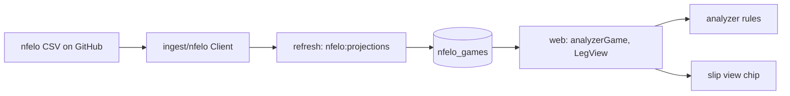

# Design: nfelo signals in the analyzer

## Context

The analyzer is `AnalyzeSlip(legs, games, stats)` in `internal/analyzer`. It is pure. `internal/web/analyzer.go` builds
its inputs from stored rows on every slip render. Outside data reaches SQLite through `internal/refresh`: one client
package per source under `internal/ingest/`, one `source{key, due, run}` per unit of work, keyed in `sync_state`, with
single-flight, a 5 minute backoff, and an archived copy of every 2xx response.

Read before starting:

- `docs/reference/data-sources.md`, `docs/concepts/data-refresh.md`: client conventions, source keys, staleness table.
- `docs/reference/analyzer-rules.md`, `docs/concepts/analyzer.md`: rule IDs, tone, inputs.
- `docs/reference/schema.md`: DDL conventions. The next migration is `0006`.
- `plan/analyzer.md`, `plan/data-sources.md`: both stay silent on nfelo. The docs step below adds it.

What nfelo publishes (read from the repo on 2026-11-08, not documented by the author):

- One file fits: `output_data/historic_projected_spreads.csv` on `main`, about 1,550 rows from 2021. It carries
  `season`, `week`, `away_team`, `home_team`, the model spread and win probability, both QB names, and both QB
  adjustments. `prediction_tracker.csv` has no season or week. `nfelo_games.csv` has no teams or QB names.
  `elo_snapshot.csv` adds nothing we use.
- Spreads are from the home side: negative means the home team is favored. This matches how a `SPREAD` leg's `Line`
  reads for its own team.
- Team codes differ from ESPN's. nfelo uses `OAK` and `WAS`; the scoreboard uses `LV` and `WSH`. `LAR`, `LAC`, and `JAX`
  agree.
- No file has a played flag. Played games keep their last pre-game projection.
- `output_data/projected_spreads.csv`, which the author's code writes, is not on `main`. Do not read it.

## Approach



**Client.** `internal/ingest/nfelo` follows the other clients: `NewClient(baseURL, httpClient)`, 10 second default
timeout, `User-Agent: parlay-club`, no database. `Projections(ctx)` returns `[]Projection`, one per CSV row:

```go
type Projection struct {
    Season, Week         int
    Home, Away           string  // ESPN abbreviations, after mapping
    HomeSpread           float64 // home perspective; negative = home favored
    HomeWinProb          float64
    HomeQB, AwayQB       string
    HomeQBAdj, AwayQBAdj float64 // Elo points
}
```

It reads columns by header name, never by position. The first column is a nameless pandas index; ignore it. A missing
required header is an error. An empty cell on a row drops that row; an unparseable number is an error. Team codes go
through a small map (`OAK`→`LV`, `WAS`→`WSH`) and the test checks every output code against the venue map's teams.

**Which spread column.** In both sampled week 9 rows, `home_closing_line_rounded_nfelo` equals the market line, so it
may already be pulled toward the market. `home_line_pre_regression` is the pure Elo number. The design uses
`home_line_pre_regression` for `HomeSpread` and `home_probability_nfelo` for `HomeWinProb`. Task 1 of Phase 1 confirms
the choice against the saved fixture before anything depends on it. If the two columns agree on every current row, keep
the pre-regression one anyway.

**Storage.** Migration `0006_nfelo_games.sql` adds `nfelo_games`, one row per game, keyed by `game_id` with
`ON DELETE CASCADE` to `games`. Columns: `home_spread`, `home_win_prob`, `home_qb`, `away_qb`, `home_qb_adj`,
`away_qb_adj`, `updated_at`. Rows are upserted. A rerun with the same CSV leaves every row, `updated_at` included,
unchanged, as `UpsertWeek` does.

**Refresh.** New source key `nfelo:projections` and a `ProjectionsClient` slice in `Deps`. A nil client turns the source
off, so older wiring and tests need no change. The source reads the latest week's games, fetches the CSV, and matches
rows to games on `season`, `week`, `home`, and `away`. It skips weeks that are not regular season (`season_type != 2`),
because playoff week numbers in the file are unverified. It is stale after 12 hours and is skipped when every game of
the week has kicked off. It spends no Odds API credits and has no floor. When rows change, it publishes `week:{id}` and
the slips in that week through the existing helper, after commit.

**Analyzer inputs.** `analyzer.Game` gains `Nfelo *Nfelo`, nil when unknown:

```go
type Nfelo struct {
    HomeSpread, HomeWinProb float64
    HomeQB, AwayQB          string
    HomeQBAdj, AwayQBAdj    float64
}
```

`internal/web` sets it only when the game is `SCHEDULED` and `sync_state` shows a successful `nfelo:projections` fetch
within the last 72 hours. Otherwise it stays nil. This is the whole fail-soft story: the rules never see stale or
missing data, and every existing test passes with `Nfelo` unset.

**Rules.** Rule IDs stay stable. Two existing rules grow a sentence and one rule is new. Every one is Info or Warn, and
none says "don't" or talks about expected value. Let `m` be the model spread for the leg's team, in the same sign as the
leg's line.

| Rule      | Change                                                                                                              |
| --------- | ------------------------------------------------------------------------------------------------------------------- |
| `hook`    | Same trigger and severity. Append one sentence from the cushion `L − m`. At or above +2: "nfelo has it nearer -10, so the hook matters less." At or below −2: "nfelo has it closer to -5, so this asks for more than the model does." Between: "nfelo sees it near the number too (-7), so the hook is live." |
| `chalk`   | Same trigger and severity. On an `ML` leg only, append "nfelo has BUF at about 76% to win." No sentence for other markets. |
| `qb_drag` | New, `Info`. A team whose QB adjustment is −30 Elo or lower (about 1.2 points at 25 Elo per point). Fires for that team's favorite `SPREAD` or `ML` legs and its passing, receiving, and team-total overs. One warning per game and team, naming the QB and every leg. |

`qb_drag` reads the level of the adjustment. nfelo has no feed of game-day changes, so the rule does not claim a QB is
out and does not detect a change. The message says "nfelo marks down MIN's QB, Carson Wentz, by about 1.4 points." This
narrows the proposal's "when a quarterback change moves the rating" to what the file can support.

**Slip view.** `LegView` gains `Model string`. A `SPREAD` leg shows "nfelo −5.0" from the leg team's side. An `ML` leg
shows "nfelo 76%". It renders beside the odds in the leg row, and is empty (renders nothing) when the analyzer would not
see nfelo data. Totals and props show nothing.

**Rejected.**

- Sending nfelo through `stats`. That map is per-player; nfelo is per-game.
- Reading the CSV on each render. It costs a GitHub fetch on a page load and breaks the pure-input rule.
- Parsing `nfelo_games.csv` for its larger history. It has no teams, so it needs a second join for nothing we use.
- A new rule for every signal. Appending to `hook` and `chalk` keeps one card per leg and the banner short.

## Verification

- `go test ./...` and `golangci-lint run ./...` pass; `good-vibes docs lint` and `good-vibes check nfelo-signals` pass.
- Client: a saved fixture of the real header parses; a reordered header parses the same; a missing required header, a
  non-numeric spread, and a 404 each return an error; a row with an empty cell is dropped; `OAK` and `WAS` map to `LV`
  and `WSH`.
- Sync: the same CSV twice writes no changed row and publishes once. A game with no matching row stays without an
  `nfelo_games` row. A playoff week, a nil client, and an all-kicked-off week do nothing. A failed fetch keeps the old
  rows, leaves `fetched_at`, and backs off five minutes.
- Rules, with a table test per branch: `hook` at cushions +2.5, 0, and −2.5 on a favorite and on an underdog spread;
  `chalk` on an `ML` leg shows the percentage and on a `SPREAD` leg does not; `qb_drag` at −29.9 stays quiet and at −30
  fires, names both owners when two people have legs on that team, and ignores an underdog `SPREAD` and an `UNDER`.
- With `Nfelo` nil, every existing analyzer test gives byte-identical warnings.
- Handler test: the week-9 style slip (BUF −7.5 and Josh Allen Over 245.5) with nfelo rows shows the model sentence on
  the hook card and the chip on the spread leg. The same slip with a 4 day old `sync_state` row, or a `LIVE` game, shows
  neither.
- Phone width: the chip wraps under the odds at 360 px without overflow.

## Risks

- **Column meaning is unverified.** The author documents nothing. A wrong spread column makes the model number echo the
  market and the rules say nothing new. The fixture check in Phase 1 is the guard; the symptom is a model spread that
  equals the market line on most games.
- **Format drift or removal.** The repo can rename columns or move files. Header-name parsing turns that into a logged
  sync failure, and after 72 hours the rules go quiet. We notice in the `refresh failed` log line and the archive.
- **No license.** The repo has none and the site says "All rights reserved." A person should ask the author for
  permission before this ships. The agent does not do this.
- **Archive growth.** The CSV is about 0.6 MB and changes about every two days. At a 12 hour window that is two fetches
  a day, with unchanged bodies stored once. Check the archive-size runbook after the first week.
- **Team code gaps.** An unmapped code means a game gets no row. Test every mapped code against the venue map; log
  unmatched rows at debug.
- **Elo to points.** The 25 Elo per point factor comes from the author's code, not a published rule. It only shapes a
  sentence and one threshold.

## TODO

Effort: medium (a new source, a migration, three rules, and a view change, all on patterns the repo already has)

### Phase 1: Sync nfelo projections

- [x] Add `internal/ingest/nfelo` with `Projections`, the team-code map, a saved fixture of the real CSV, and tests for
      header-name parsing and every error case; use the fixture to confirm the spread column and fix the Approach if it
      is wrong
- [ ] Add migration `0006_nfelo_games.sql`, the store read and upsert, and the `nfelo:projections` refresh source with a
  12 hour window, the regular-season and all-kicked-off skips, backoff, and a publish on change, with the sync tests
- [ ] Docs: add nfelo to `docs/reference/data-sources.md`, `docs/concepts/data-refresh.md`, and
      `docs/reference/schema.md`; add the source to `plan/data-sources.md` only if that file lists sources

### Phase 2: Rules and slip view

- [ ] Add `analyzer.Nfelo`, the web mapping with the `SCHEDULED` and 72 hour guards, the `hook` and `chalk` sentences,
      and the new `qb_drag` rule, with the table tests and the nil-input regression test
- [ ] Add `LegView.Model` and the leg row chip, with a handler test and a phone-width check
- [ ] Docs: add the three changes to `docs/reference/analyzer-rules.md` and nfelo as an input in
  `docs/concepts/analyzer.md`
