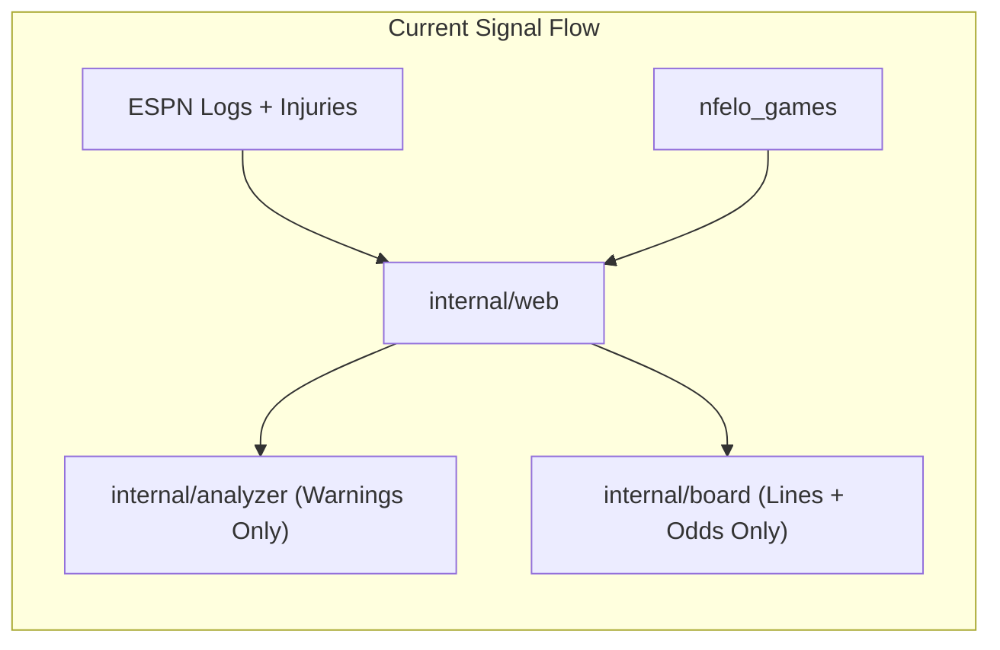
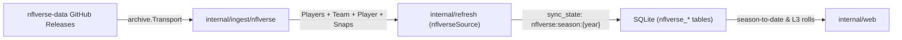
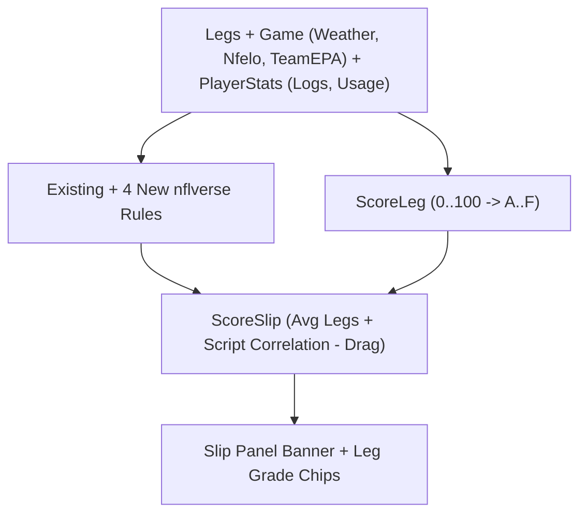
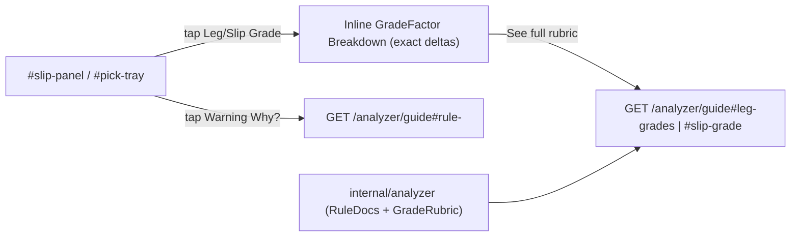

# Design: nflverse signals for leg suggestions and grading

## Context

The app already layers free external signals onto sportsbook lines without spending Odds API or Parlay API credits:

- `internal/ingest/nfelo` fetches `historic_projected_spreads.csv`, writes `nfelo_games` via `internal/refresh`, and attaches projections to `analyzer.Game` in `internal/web/analyzer.go` when `nfelo:projections` is under 72 hours old and the game is `SCHEDULED`.
- `internal/ingest/espn` fetches rosters, per-athlete season game logs (`player_gamelogs`), and `/summary` injury lists (`games.injuries_json`).
- `internal/analyzer` runs pure, deterministic rules in `AnalyzeSlip(legs, games, stats)` and renders cards in `#slip-panel` (`web/templates/partials.html`) and the pick dock tray (`internal/web/pick.go`).
- `internal/board` turns stored `db.Odds` rows into `GameCard`, `LineGroup`, and `PlayerGroup` views with `Sort` (`player`, `odds`, `line`) and `Category` tabs.
- `internal/ingest/archive` (`archive.Transport`) records every 2xx HTTP response up to 8 MiB in `api_bodies` / `api_responses`, and `internal/sandbox/registry.go` enforces a fail-closed replay registry in local sandbox mode.

Three constraints shape this design:

1. **8 MiB archive limit & zero Parquet/Python runtime.** Raw `nflverse` play-by-play CSVs exceed 8 MiB. Only current-season pre-aggregated CSVs (`stats_team_week`, `stats_player_week`, `snap_counts`, and `players`) fit cleanly in `encoding/csv` and `api_bodies`.
2. **Purity & single-instance SQLite.** `internal/analyzer` and `internal/board` must stay free of database, HTTP, and clock calls; `internal/web` queries SQLite and passes plain structs in.
3. **Product tone & non-blocking picks.** Every pick stays allowed, messages keep a sharp-friend tone without "+EV" lectures, and missing/stale `nflverse` data fails soft.

## Approach

### 1. Ingest & Storage (`internal/ingest/nflverse`, `internal/db`, `internal/refresh`)

Create `internal/ingest/nflverse` modeled on `internal/ingest/nfelo` (header-name CSV parsing, `User-Agent: parlay-club`, 30s timeout for larger weekly CSVs, injected `*http.Client` so `archive.Transport` and the sandbox registry cover every call):

- `TeamStats(ctx, season)` → `stats_team_week_{season}.csv` (from `nflverse/nflverse-data` `stats_team` release). Extracts regular/postseason weekly rows: `team`, `opponent_team`, `season`, `week`, `season_type`, `passing_epa`, `rushing_epa`, `attempts`, `carries`, `passing_yards`, `rushing_yards`, and opponent-allowed totals by joining each game's opponent row.
- `PlayerStats(ctx, season)` → `stats_player_week_{season}.csv` (`stats_player` release). Extracts `player_id` (GSIS ID), `team`, `season`, `week`, `season_type`, `target_share`, `air_yards_share`, `wopr`, `passing_epa`, `rushing_epa`, `receiving_epa`, `targets`, `carries`, `receptions`, `receiving_yards`, `rushing_yards`, `passing_yards`, `passing_tds`, `rushing_tds`, `receiving_tds`.
- `SnapCounts(ctx, season)` → `snap_counts_{season}.csv` (`snap_counts` release). Extracts `pfr_player_id` / `player`, `team`, `season`, `week`, `offense_snaps`, `offense_pct`.
- `Players(ctx)` → `players.csv` (`players` release). Extracts the crosswalk `gsis_id`, `pfr_id`, `espn_id`, `display_name`, `latest_team`, `position`.

Add migration `0012_nflverse_signals.sql`:

- `nflverse_player_ids (espn_id TEXT PRIMARY KEY, gsis_id TEXT NOT NULL, pfr_id TEXT NOT NULL DEFAULT '', updated_at TEXT NOT NULL)` with index on `gsis_id`.
- `nflverse_team_weeks (season INTEGER, season_type INTEGER, week_num INTEGER, team TEXT, off_pass_epa REAL, off_rush_epa REAL, def_pass_epa_allowed REAL, def_rush_epa_allowed REAL, plays_per_game REAL, pass_rate REAL, updated_at TEXT, PRIMARY KEY (season, season_type, week_num, team))`.
- `nflverse_player_weeks (espn_id TEXT, season INTEGER, season_type INTEGER, week_num INTEGER, team TEXT, offense_snaps INTEGER, offense_pct REAL, target_share REAL, air_yards_share REAL, wopr REAL, carries INTEGER, targets INTEGER, total_epa REAL, rz_opps INTEGER, updated_at TEXT, PRIMARY KEY (espn_id, season, season_type, week_num))`.

Team codes in `nflverse` (`WAS`, `LV`, `LA`, etc.) normalize to ESPN abbreviations (`WSH`, `LV`, `LAR`) via a small explicit map tested against all 32 ESPN teams.

**Sync cadence:** Add `nflverse:season:{year}` to `internal/refresh/rules.go`. `nflverse` updates weekly overnight after games end, so refresh syncs once every 24 hours on idle days and 6 hours on Tuesday/Wednesday/game days during the active season (skipped if all games are final and last sync is after the most recent final kickoff + 12h, or if body > 8 MiB fails cleanly without erasing cached rows). Only `Kick()` runs it; `RunPrefill` leaves it alone if already fresh.

**Player linking:** `Players(ctx)` populates `nflverse_player_ids` (`espn_id` ↔ `gsis_id` ↔ `pfr_id`). When `PlayerStats` or `SnapCounts` rows have a `gsis_id`/`pfr_id` present in `nflverse_player_ids`, they join directly onto the same ESPN `athlete_id` already stored on `roster_players`, `player_matches`, and `legs.player_id`. Unmatched players simply omit `nflverse` rows and fail soft.

### 2. Grading Chosen Legs & Overall Parlays (`internal/analyzer`, `internal/web`)

Keep `AnalyzeSlip(legs, games, stats)` backward-compatible for existing callers, and add `GradeSlip(legs, games, stats)` (or enrich `AnalyzeSlip` output + `SlipGrade` struct returned by `EvaluateSlip`) inside `internal/analyzer`:

**Input extensions (`internal/analyzer`):**

- `Game` gains `HomeEPA, AwayEPA *TeamDefenseProfile` (nil when stale > 7 days or missing): season-to-date and last-4-week `OffPassEPA`, `OffRushEPA`, `DefPassEPAAllowed`, `DefRushEPAAllowed`, `PlaysPerGame`, `PassRate`, plus league ranks (`1..32`, where `1` = toughest defense / highest offense).
- `PlayerStats` gains `Usage *PlayerUsage` (nil when missing or < 3 games): recent weeks (most recent first) of `OffensePct`, `TargetShare`, `AirYardsShare`, `WOPR`, `Carries`, `Targets`, `TotalEPA`, plus `Last3SnapAvg`, `SeasonSnapAvg`, `Last3TargetShare`, `SeasonTargetShare`.

**Four new deterministic analyzer rules (same sharp-friend tone):**

1. `tough_matchup` (`Warn`): yardage or TD `OVER` where the opposing defense ranks top 5 in the matching split (`DefPassEPAAllowed` rank ≤ 5 for `PASS_YDS`/`PASS_TDS`/`REC_YDS`/`RECEPTIONS`, `DefRushEPAAllowed` rank ≤ 5 for `RUSH_YDS`/`RUSH_ATT`).
2. `shrinking_role` (`Warn`): player prop `OVER` where last-2-game average `OffensePct` dropped ≥ 15 percentage points below season average (or `TargetShare` dropped ≥ 8 points), warning that recent volume is fading.
3. `pace_clash` (`Info` or `Warn`): `TOTAL` `OVER` when both teams sit bottom 8 in `PlaysPerGame` and bottom 10 in `PassRate`, or `TOTAL` `UNDER` when both sit top 8 in `PlaysPerGame` and `OffPassEPA`.
4. `td_spike_risk` (`Info`): `ANYTIME_TD` (`YES`) or `PASS_TDS` (`OVER`) where recent scoring outpaces opportunity (e.g., ≥ 3 TDs in last 3 games on < 15% `TargetShare` / < 8 carries/game).

**Per-leg quality grade (`LegGrade`: `A` / `B` / `C` / `D` / `F` + `Factors []GradeFactor`):**

Starts at `75` (`B`) for matched legs with a game and records every applied `GradeFactor{Rule, Label, Delta, Detail}`:

- **Form & usage (`-20` to `+15`):** `median_trap` (`-15`), strong L5 hit rate ≥ 4/5 (`+10`), rising usage (`+5`), `shrinking_role` (`-15`).
- **Matchup & environment (`-20` to `+15`):** favorable opposing EPA rank ≥ 25 (`+10`) or `tough_matchup` rank ≤ 5 (`-12`), `wind` Warn/Danger (`-8` / `-18`), `qb_drag` (`-8`), `fake_weather` (`-3`).
- **Line & price (`-20` to `+10`):** `hook` (`-10`, reduced to `-4` if `nfelo` cushion ≥ +2), `total_key_number` (`-5`), `chalk` (`-10` to `-18` scaling with odds), `nfelo` cushion ≥ +2 on spread (`+8`).
- Maps to letter grades: `≥ 85` → `A`, `73–84` → `B`, `60–72` → `C`, `48–59` → `D`, `< 48` → `F`. Legs skipped by the analyzer (`OTHER`, unmatched game) show no grade chip (`""`).

**Overall parlay grade (`SlipGrade`: `Letter`, `Score`, `Summary`, `Factors []GradeFactor`):**

- Weighted baseline of graded legs' numeric scores.
- **Correlation adjustment:** `+8` per positive stack (`stack_shootout`, `stack_clock_drain`), `-12` per `Warn` script conflict (`blowout_passing`), `-20` per `Danger` conflict (`trailing_rb`, `total_contradiction`).
- **Parlay drag:** `-3` per leg beyond 3 legs, plus `-5` per `chalk` leg beyond the first.
- Renders a compact summary line at the top of the Analyzer card in `web/templates/partials.html` (e.g., `Slip grade: B- · Good shootout correlation, dragged down by 1 hook and 1 tough run defense`) and a subtle grade pill beside `Model` on each `LegView`.

**Post-game grading untouched:** `internal/grader/grader.go` stays tied to ESPN final box scores so grading happens immediately at final whistle.

### 3. Pick-Board Leg Suggestions (`internal/board`, `internal/web/pick.go`, `internal/web/research.go`)

Extend `internal/board` with optional pure inputs (`BoardSignals{TeamEPA, PlayerUsage, Injuries, SlipLegs}`):

- **Prop & line badges (`Row.Badge` / `PlayerGroup.Tags`):**
  - `Smash matchup`: player `OVER` with ≥ 20% `TargetShare` or ≥ 12 carries/game vs. bottom-6 opposing defense (`DefPassEPAAllowed` / `DefRushEPAAllowed` rank ≥ 27).
  - `High volume`: player whose `WOPR` / `TargetShare` / `OffensePct` sits top-quartile for their position even if L5 yards median sits under the line ("buy-low volume").
  - `Role bump`: teammate with a key starter marked `Out` in `games.injuries_json` who posted ≥ 15% higher `OffensePct` in prior games this season.
  - `Fits slip`: line or prop that pairs positively with an already-added leg on the open slip (e.g., opposing WR `OVER` or same-team RB `OVER` when the slip holds a `-7.0` favorite spread; receiver `OVER` when the slip holds that team's QB `PASS_YDS` `OVER`).
- **Sort chip (`SortMatchup`):** Add `Matchup` to `DetailSorts` in `internal/board/board.go` so mobile users can sort props by signal strength (with `Player`, `Odds`, `Line` unchanged).
- **Research tab enrichment (`internal/web/research.go`):** Show `Snap % (L3)`, `Target share`, `WOPR`, and opponent defense EPA rank alongside the existing last-5 hit bars on `PlayerResearchView`.

### 4. In-App Grading & Analyzer Docs Page (`GET /analyzer/guide`, `internal/analyzer`, `internal/web`)

Expose the grading rubric and every warning rule on the site itself so friends can tap any warning or grade to see both **why this pick scored what it did** and **how the underlying rules work**:

- **Structured metadata in `internal/analyzer`:** Add `RuleDocs() []RuleDoc` and `GradeRubric() RubricDoc` (listing every rule ID, severity, category, threshold, rationale, and sharp-friend example, plus the `A`–`F` score bands and factor weights). Generating the guide page from Go structs guarantees the docs page cannot drift from the actual engine thresholds.
- **Docs route & page (`GET /analyzer/guide`):** Add `analyzerGuide` handler in `internal/web/analyzer.go`, template `web/templates/analyzer_guide.html` (registered in `pageFiles` in `internal/web/render.go`), and a `"How grading works"` link in the Analyzer section header (`web/templates/partials.html`). Sections carry stable anchor IDs: `#leg-grades`, `#slip-grade`, `#suggestions`, and `#rule-<id>` for every warning rule.
- **Clickable warnings & grades on `#slip-panel` and `#pick-tray`:**
  - Each warning card's rule label / `"Why?"` link navigates to `/analyzer/guide#rule-{{.Rule}}` (opening in the same flow with a back link to the slip when `?from=/slips/{id}` is passed).
  - Tapping a **leg's grade pill** or the **overall slip grade badge** toggles a compact inline `
` breakdown showing that leg's or slip's exact `GradeFactor` deltas (e.g., `L5 median trap -15 · Weak pass defense +10`) alongside a `"See full rubric"` link to `/analyzer/guide#leg-grades` or `/analyzer/guide#slip-grade`.

**Trade-offs & rejected alternatives:**

- *Rejected: Storing computed grades in SQLite.* Recomputing on render keeps grades automatically in sync when weather, odds, injuries, or `nflverse` rows update, matching `AnalyzeSlip`'s stateless invariant.
- *Rejected: Separate `/suggestions` screen.* Friends pick on the mobile game-detail board; putting badges and the `Matchup` sort chip inside `internal/board` avoids extra navigation and works inside the existing HTMX partial swaps.
- *Rejected: Rendering markdown files from `docs/` at runtime.* Generating `/analyzer/guide` from `internal/analyzer` structs keeps the guide phone-first, fast, and locked to the live thresholds in code without shipping a markdown parser or maintaining duplicate rule tables.

## Verification

- **Unit & table-driven tests:** `internal/ingest/nflverse` header-based CSV parsing, team-code mapping across all 32 ESPN codes, and missing-column/empty-cell behavior; `internal/db` upserts and idempotent re-syncs; `internal/analyzer` boundary tests for all 4 new rules, `ScoreLeg`, `ScoreSlip` (including `GradeFactor` sums), `RuleDocs` coverage of every active rule ID, and fail-soft nil inputs; `internal/board` tests for all 4 suggestion badges and `SortMatchup` ordering.
- **Integration & sandbox checks:** Add `nflverse` week-9 CSV fixtures to `internal/sandbox/registry.go`, update `internal/sandbox/reset.go` and `internal/db/migrate_test.go`, and verify `cmd/server` sandbox startup, `GET /analyzer/guide` anchor rendering, and HTMX slip/pick renders include grade badges, clickable breakdowns, warning `#rule-<id>` links, and suggestion tags when fresh while failing soft when stale/missing.
- **Phone-width UI check:** Verify `#slip-panel` leg grade pills, inline factor breakdowns, analyzer summary header, `/analyzer/guide`, and pick-board badges wrap cleanly at `375px` width without horizontal overflow.
- **Standard suite:** Run `go test ./...` and `golangci-lint run ./...` (plus `good-vibes docs lint` / `good-vibes docs index` after doc updates).

## Risks

- **Upstream CSV column or URL changes:** `nflverse` occasionally renames release asset names or columns across seasons. Parsing by header name and storing raw responses in `api_bodies` surfaces breakages in sync logs while leaving existing cached tables intact and signals silently disabled.
- **CSV payload size near 8 MiB:** `stats_player_week_{season}.csv` grows each week through Week 18 + playoffs. Use `.csv.gz` (or stream-decompress before archiving, or increase archive cap specifically for `nflverse` / filter to active-season rows on ingest) if late-season weekly player stats approach 8 MiB; test against full-season fixture sizes in Phase 1.
- **Over-noisy pick board on mobile:** Too many badges clutter phone screens. Cap badges to at most 1–2 concise pills per row/player card and require clear thresholds (top/bottom 6 defenses, ≥ 15% snap delta).
- **Guide drift from engine rules:** Adding a new analyzer rule without updating `RuleDocs()` would leave a dead `#rule-<id>` link. Enforce 1:1 rule-ID coverage in an `internal/analyzer` test.

## TODO

Effort: medium (coordinates across ingest, SQLite migrations, pure analyzer scoring, pick-board filtering, sandbox fixtures, and UI templates without subtle concurrency or state-machine hazards)

### Phase 1: Ingest, SQLite storage, refresh wiring, and sandbox fixtures

- [x] Build `internal/ingest/nflverse` CSV clients (`Players`, `TeamStats`, `PlayerStats`, `SnapCounts`) with ESPN team-code mapping and header-based parsing, plus tests against real saved CSV fixtures.
- [ ] Add `0012_nflverse_signals.sql`, `internal/db/nflverse.go` store queries/upserts, `internal/refresh` weekly sync source (`nflverse:season:{year}`), `internal/sandbox/registry.go` + `reset.go` + `migrate_test.go` wiring, and end-to-end refresh tests.
- [ ] Docs: update `docs/reference/data-sources.md`, `docs/reference/schema.md`, `docs/concepts/data-refresh.md`, and `docs/reference/sandbox-replay.md` for `nflverse` sources and tables.

### Phase 2: Analyzer `nflverse` rules, leg/parlay grades, and in-app docs page

- [ ] Extend `internal/analyzer` (`Game.HomeEPA`/`AwayEPA`, `PlayerStats.Usage`) with `tough_matchup`, `shrinking_role`, `pace_clash`, and `td_spike_risk` rules, deterministic `ScoreLeg` and `ScoreSlip` (`A`–`F` grades with `GradeFactor` breakdowns), and `RuleDocs`/`GradeRubric` metadata, plus boundary and 1:1 rule-coverage tests.
- [ ] Wire `nflverse` DB lookups into `internal/web/analyzer.go` and `internal/web/slips.go`, render clickable slip/leg grade pills with inline factor breakdowns and `#rule-<id>` links in `web/templates/partials.html` (and `#pick-tray`), and serve `GET /analyzer/guide` (`web/templates/analyzer_guide.html`) with handler render tests.
- [ ] Docs: update `docs/concepts/analyzer.md`, `docs/reference/analyzer-rules.md`, and `docs/reference/routes.md` with the new rules, leg/slip grade rubric, and `/analyzer/guide` route.

### Phase 3: Pick-board leg suggestions and research usage view

- [ ] Extend `internal/board` with `BoardSignals` (`Smash matchup`, `High volume`, `Role bump`, `Fits slip` badges) and `SortMatchup` sorting, with table-driven board tests.
- [ ] Wire `BoardSignals` into `internal/web/pick.go`, surface `Snap %`, `Target share`, `WOPR`, and opponent defense rank in `internal/web/research.go` and templates, and verify mobile-width rendering and HTMX partial swaps in web tests.
- [ ] Docs: update `docs/concepts/slips.md` for pick-board suggestion badges, `Matchup` sort, and research usage context.
