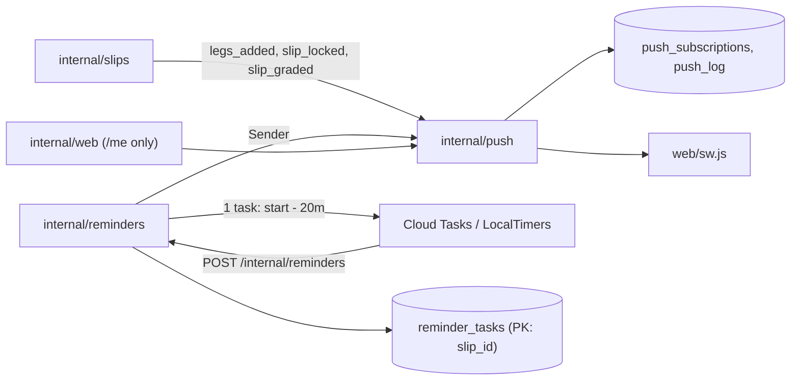
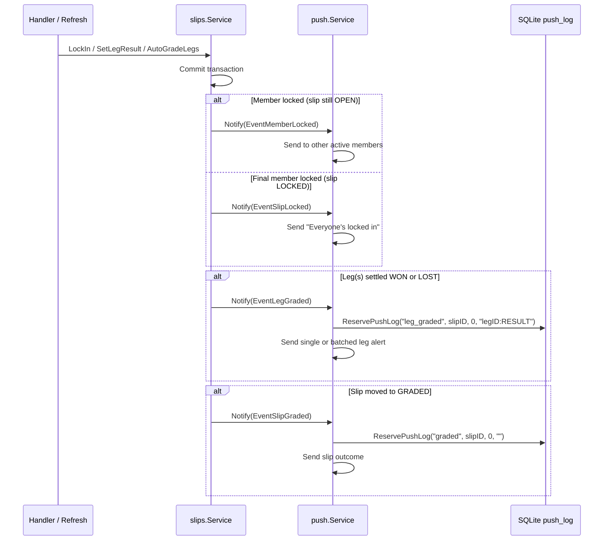
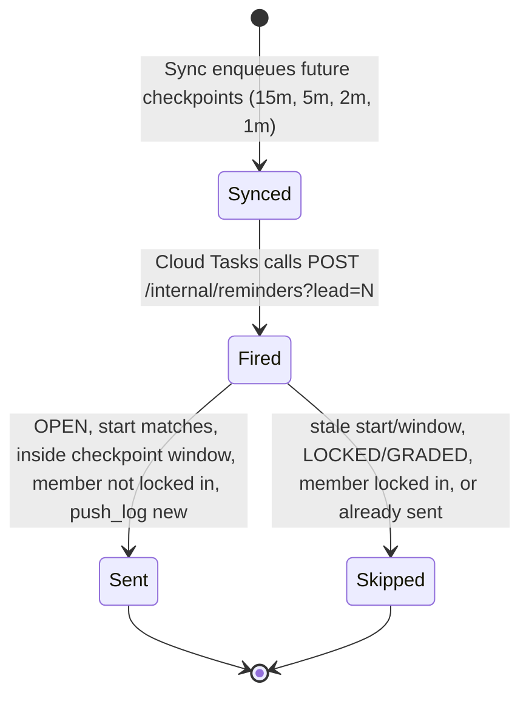
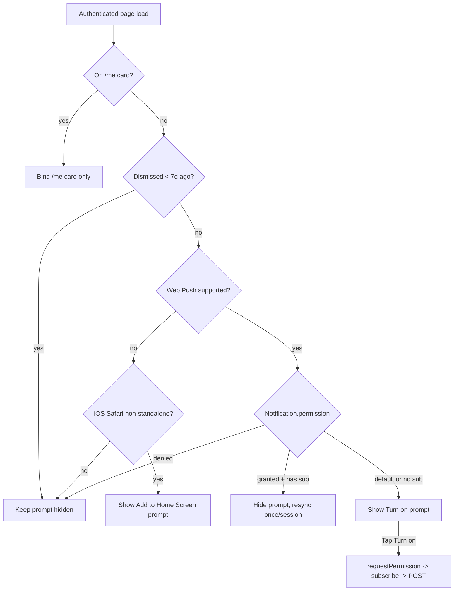

# Design: Mobile and desktop notification prompts and alerts

## Context

The existing notification stack spans five packages and two browser assets:

- `internal/slips` emits post-commit `Event` values through `Notifier` (`EventLegsAdded`, `EventSlipLocked`,
  `EventSlipGraded`). `LockIn` emits only when the final member locks in; `SetLegResult` and `AutoGradeLegs` emit only
  when the slip moves to `GRADED`.
- `internal/push` implements `slips.Notifier`, manages `push_subscriptions` (capped at 10 per user, host-allowlisted),
  dedupes sends via `push_log(kind, slip_id, user_id, key)`, and delivers Web Push through `webpush-go` with fixed
  `UrgencyNormal` and a 3-second deadline.
- `internal/reminders` schedules one Cloud Tasks job (or `LocalTimers` timer in dev) per open slip at
  `FirstKickoff - 20m`, tracked in `reminder_tasks(slip_id PRIMARY KEY, start_utc, scheduled_at)`, firing
  `POST /internal/reminders?slip=&start=`.
- `internal/web` serves `/manifest.webmanifest`, `/sw.js`, `/push/subscription`, `/push/test`, and renders the
  Notifications card exclusively on `/me`. `web.Page` does not carry the VAPID public key.
- `web/sw.js` registers `install` (`skipWaiting`), `push` (`showNotification` without `renotify`), and
  `notificationclick`. `web/static/app.js` binds `[data-push-card]` on `/me` only.



## Approach

### 1. Member lock-in and leg pass/fail events

Extend `slips.EventKind` and `slips.Event` so `internal/slips` emits after-commit events without knowing anything about
Web Push:

```go
const (
    EventLegsAdded    EventKind = "legs_added"
    EventMemberLocked EventKind = "member_locked"
    EventSlipLocked   EventKind = "slip_locked"
    EventLegGraded    EventKind = "leg_graded"
    EventSlipGraded   EventKind = "slip_graded"
)

type LegGradeEvent struct {
    LegID     int64
    Selection string
    Result    parlay.Result
}

type Event struct {
    Kind        EventKind
    SlipID      int64
    ActorID     int64 // 0 for automatic grader
    Count       int
    Selection   string
    LockedCount int             // EventMemberLocked
    MemberCount int             // EventMemberLocked
    LegGrades   []LegGradeEvent // EventLegGraded (WON or LOST only)
}
```

- **Member lock-in (`LockIn`):** When `changed && !lockedNow`, emit `EventMemberLocked` with `ActorID`, `LockedCount`,
  and `MemberCount`. `internal/push` sends to all other active slip members with body `"{name} locked in (2/4 ready)"`
  and tag `slip-{id}-lock`. When `lockedNow` is true, emit `EventSlipLocked` as today so the final lock does not double
  up with a member-lock push.
- **Leg pass/fail (`SetLegResult` and `AutoGradeLegs`):** Collect legs whose result transitioned to `parlay.Won` or
  `parlay.Lost` in the committed transaction. After commit, emit one `EventLegGraded` per affected slip (before
  `EventSlipGraded` when the slip also grades).
  - `internal/push` reserves one `push_log` row per leg outcome using `kind = db.PushLogLegGraded ("leg_graded")`,
    `slip_id = slip.ID`, `user_id = 0`, `key = fmt.Sprintf("%d:%s", legID, result)`. Only newly reserved legs are
    announced, so auto-grader retries and repeated identical manual grades stay quiet while a manual flip from `LOST` to
    `WON` still notifies once.
  - Recipients are all active slip members, minus `ActorID` when `ActorID != 0` (so someone manually tapping a leg
    result does not push themselves, while automatic grading with `ActorID == 0` notifies everyone).
  - Copy and tags:
    - One leg: `"{selection} passed!"` (for `WON`) or `"{selection} failed."` (for `LOST`), tag `slip-{id}-leg-{legID}`
      so separate games finishing minutes apart stay visible.
    - Multiple legs in one batch on the same slip: collapse into one message (`"2 legs passed!"`, `"2 legs failed."`, or
      `"2 legs passed, 1 failed."`), tag `slip-{id}-legs`.
  - Give `EventSlipGraded` its own tag `slip-{id}-graded` so a final slip grade never overwrites a leg result.



### 2. Staged 15m, 5m, 2m, and 1m kickoff reminders

Replace the single 20-minute lead time with four ordered `Checkpoint` definitions in `internal/reminders`:

| Checkpoint | Lead | Fire window (before slip start) | Web Push urgency |
| ---------- | ---- | ------------------------------- | ---------------- |
| `15m` | 15m | `20m` to `10m` | `normal` |
| `5m` | 5m | `7m` to `3m` | `high` |
| `2m` | 2m | `3m` to `1m30s` | `high` |
| `1m` | 1m | `1m30s` to `0s` | `high` |

- **Schema (`internal/db/migrations/0023_reminder_checkpoints.sql`):** Recreate `reminder_tasks` with
  `PRIMARY KEY (slip_id, lead_minutes)` (`slip_id`, `lead_minutes`, `start_utc`, `scheduled_at`, `updated_at`), dropping
  pre-migration 20-minute rows so the next `Sync` schedules the four checkpoints cleanly. `push_log` needs no schema
  change: reminders reserve `(PushLogReminder, slipID, userID, fmt.Sprintf("%dm", leadMinutes))`.
- **Scheduler contract:** Update `Scheduler.Enqueue(ctx, slipID, start, lead, at)` and
  `FireFunc(ctx, slipID, start, lead)`.
  - `CloudTasks` names tasks `{hash}-slip-{slipID}-{startUnix}-{leadMinutes}m` and targets
    `POST /internal/reminders?slip={id}&start={unix}&lead={minutes}`.
  - `LocalTimers` keys its in-memory `armed` map by `{slipID}-{startUnix}-{leadMinutes}m`.
- **Endpoint backward compatibility (`cmd/server/main.go`):** `newReminderHandler` reads `lead` (minutes). If `lead` is
  missing (an in-flight pre-deploy 20m task), return `200 {"skipped":"stale"}` so Cloud Tasks does not retry it. If
  `lead` is non-numeric or not a known checkpoint, return `400`.
- **Sync and Fire behavior:**
  - `Sync` loops over every open slip and every checkpoint in `Checkpoints`. Any checkpoint whose `at = start - lead` is
    after `now` and within `MaxHorizon` (30 days) is enqueued unless `Durable()` is true and `reminder_tasks` already
    has `(slipID, leadMinutes)` with matching `start`. A slip created 10 minutes before kickoff skips `15m` and still
    schedules `5m`, `2m`, and `1m`.
  - `Due` validates `slip.Status == db.SlipOpen`, `FirstKickoff == start`, and `now` inside the checkpoint's window,
    then includes every active member whose `NextStep` is `StepPick` or `StepLockIn`. Members who already locked in are
    automatically excluded from all remaining checkpoints.
  - Message copy uses exact minute text (`"Kickoff in 15 minutes..."`, `"Kickoff in 1 minute..."`), tag
    `slip-{id}-reminder`, and sets `push.Message.Urgency` (`high` for `5m`, `2m`, `1m`; `normal` for `15m`).
  - `SendNow` (sandbox button) fires the `15m` checkpoint with `checkWindow = false`.



### 3. Mobile + desktop opt-in prompt and Web Push reliability

- **Layout prompt (`internal/web/page.go`, `web/templates/layout.html`):**
  - Add `PushPublicKey string` to `web.Page`, populated by the shared page builder when `h.deps.Push.Enabled()` and a
    user is signed in.
  - Render a compact, phone-first `<aside data-push-prompt data-public-key="{{.PushPublicKey}}" hidden>` directly above
    `<main>` in `layout.html` when `.User` and `.PushPublicKey` are non-empty. It carries a short message, a **Turn on**
    button (`data-push-prompt-on`), an iOS Add to Home Screen hint (`data-push-prompt-ios`, hidden by default), and a
    **Not now** button (`data-push-prompt-dismiss`).
- **Client prompt and subscription health (`web/static/app.js`):**
  - On page load (and after HTMX swaps), `initPushPrompt` skips if `[data-push-card]` is already on the page (`/me`) or
    if the user dismissed the prompt within the last 7 days (`localStorage` key `pc_push_prompt_dismissed_until`).
  - If `!pushSupported`:
    - When `pushIsIOS && !pushIsStandalone()`, unhide the prompt in iOS install mode ("Add Parlay Club to your Home
      Screen via Share -> Add to Home Screen to turn on notifications.").
    - Otherwise stay hidden.
  - If `pushSupported`:
    - When `Notification.permission === "denied"`, stay hidden.
    - Check `registration.pushManager.getSubscription()`.
    - If a subscription exists and permission is `"granted"`, keep the prompt hidden and run a once-per-session
      background resync (`sessionStorage` key `pc_push_synced`) via `POST /push/subscription` so a server-pruned or
      re-signed-in device heals silently.
    - If no subscription exists, unhide the prompt. Clicking **Turn on** calls `Notification.requestPermission()` before
      any other `await` (preserving the user gesture required by iOS and Chrome), subscribes with
      `applicationServerKey`, posts to `POST /push/subscription`, hides the prompt, and shows a confirmation toast.
- **Service worker reliability (`web/sw.js`):**
  - Add `activate` listener calling `event.waitUntil(self.clients.claim())` so newly deployed workers take control of
    open tabs immediately.
  - In `push`, pass `renotify: Boolean(payload.tag)` to `showNotification` so replacing a tagged notification (such as
    `15m` -> `5m` -> `2m` -> `1m` reminders) still alerts, chimes, and wakes the lock screen on mobile and desktop.
  - Add `pushsubscriptionchange` listener: re-subscribe using `event.oldSubscription?.options` (falling back to
    `self.registration.pushManager.subscribe({ userVisibleOnly: true })` if options are unavailable) and
    `POST /push/subscription` with `credentials: "same-origin"` and `HX-Request: true` so browser-rotated endpoints stay
    registered without user action.



### Trade-offs and rejected options

- **Four Cloud Tasks vs. one task that re-enqueues the next:** Enqueuing all four checkpoints upfront in `Sync` keeps
  each task independent—if the `15m` fire fails or is skipped, `5m`, `2m`, and `1m` still fire on time—and reuses the
  existing `Sync` + `reminder_tasks` pattern cleanly.
- **7-day `localStorage` dismissal vs. server-side dismissal column:** Push subscriptions are per-device, not
  per-account, so dismissing a prompt on a work laptop should not suppress it on a phone. `localStorage` matches the
  per-device scope with zero schema overhead.
- **Session-scoped resync vs. every-page-load POST:** Checking `sessionStorage` avoids an extra
  `POST /push/subscription` on every navigation while still healing stale endpoints on the first visit of a session.

## Verification

- Standard Go checks: `go test -short ./...`, `go test -short -race ./...`, `golangci-lint run ./...`, and
  `good-vibes docs lint`.
- **Member lock-in and leg pass/fail (`internal/slips`, `internal/push`):**
  - Non-final `LockIn` raises `EventMemberLocked` with accurate `LockedCount`/`MemberCount`; final `LockIn` raises only
    `EventSlipLocked`; duplicate `LockIn` raises nothing.
  - `SetLegResult` raises `EventLegGraded` for `WON`/`LOST`, excludes the manual grader from recipients, ignores
    `PENDING`/`PUSH`/`VOID`/`NEEDS_GRADING`, and dedupes identical re-grades while allowing a `LOST` -> `WON` flip.
  - `AutoGradeLegs` raises `EventLegGraded` to every active member, collapses multi-leg slip batches into one summary,
    and emits distinct tags so `EventSlipGraded` does not overwrite leg alerts.
- **Staged reminders (`internal/db`, `internal/reminders`, `cmd/server`):**
  - Migration `0023` upgrades cleanly on an existing DB with legacy `reminder_tasks` rows.
  - `Sync` enqueues all four checkpoints (`15m`, `5m`, `2m`, `1m`), skips past checkpoints when a slip is created late
    (e.g. 10m before kickoff schedules `5m`, `2m`, `1m`), and re-schedules when `FirstKickoff` moves.
  - `Due` and `FireAt` verify each checkpoint's contiguous window, per-checkpoint `push_log` dedupe, excluding locked-in
    members, singular/plural copy (`1 minute` vs `5 minutes`), and `Urgency: high` on `5m`/`2m`/`1m`.
  - `POST /internal/reminders` accepts `lead=15|5|2|1`, returns `400` on invalid `lead`, and returns
    `200 {"skipped":"stale"}` when `lead` is omitted (pre-deploy task).
- **Prompt and service worker (`internal/web`):**
  - Authenticated pages render `[data-push-prompt]` with `data-public-key` only when push is enabled; unauthenticated
    pages and VAPID-off servers omit it.
  - `GET /sw.js` contains `clients.claim`, `renotify`, and `pushsubscriptionchange`.
- **Manual mobile + desktop check:** Verify prompt appearance, Turn on flow, dismissal persistence, iOS standalone
  guidance, and actual push delivery (including `renotify` sound/banner on back-to-back countdowns) on desktop Chrome
  and an installed iPhone/Android PWA.

## Risks

- **Tight 2m and 1m reminder delivery latency:** Cloud Run cold starts or Cloud Tasks dispatch jitter could delay a 1m
  fire past kickoff. Mitigation: contiguous fire windows (1m allows `[90s, 0s]` before kickoff) plus `Urgency: high` so
  mobile push services deliver immediately, and Cloud Tasks retry backoff still lands inside the `5m` and `15m` windows.
- **Notification noise on busy slates:** Four reminders plus individual leg results could feel chatty for someone who
  forgets to lock in. Mitigation: locked-in members stop receiving reminders immediately, batch auto-grades collapse per
  slip into one summary, and `slip-{id}-reminder` replaces earlier countdown notifications on the lock screen.
- **Browser differences in `pushsubscriptionchange`:** Safari/WebKit and Chromium differ in whether
  `event.oldSubscription` is populated during key rotation. Mitigation: treat `pushsubscriptionchange` as best-effort
  and pair it with the once-per-session client-side resync in `app.js`.
- **Legacy in-flight Cloud Tasks across deploy:** A 20-minute task queued before deploy lacks the `lead` query
  parameter. Mitigation: `POST /internal/reminders` returns `200 {"skipped":"stale"}` when `lead` is absent so Cloud
  Tasks drops it cleanly without error alerts or retries.

## TODO

### Phase 1: Member lock-in and leg pass/fail push events

Complexity: medium (coordinates new event payloads, recipient filtering, batch collapsing, and per-leg dedupe across
`internal/db`, `internal/slips`, and `internal/push`)

Risk: medium (modifies post-commit slip notification paths and dedupe keys; automated unit tests cover all transitions
and recipient rules)

- [ ] Add `PushLogLegGraded` in `internal/db`, emit `EventMemberLocked` on non-final `LockIn` and `EventLegGraded` on
  `SetLegResult`/`AutoGradeLegs` for `WON`/`LOST` legs in `internal/slips`, and deliver them in `internal/push` with
  per-leg outcome dedupe, batch collapsing, and distinct notification tags, with tests across `internal/db`,
  `internal/slips`, and `internal/push`.

### Phase 2: Staged 15m, 5m, 2m, and 1m kickoff reminders

Complexity: medium (migrates `reminder_tasks` to a composite key and updates `Scheduler`, `CloudTasks`, `LocalTimers`,
`reminders.Service`, `cmd/server`, and `push.Message` urgency in lockstep)

Risk: high (touches persistent SQLite schema migration, external Cloud Tasks task naming and URL contracts, and tight
time-window edge cases verified only via stand-in HTTP servers)

- [ ] Add `internal/db/migrations/0023_reminder_checkpoints.sql`, update `internal/db` reminder task storage to key by
  `(slip_id, lead_minutes)`, and add optional `Urgency` to `push.Message` in `internal/push`, with migration, store,
  and sender tests.
- [ ] Update `internal/reminders` to schedule and fire the four checkpoints (`15m`, `5m`, `2m`, `1m`) with contiguous
  windows, per-checkpoint `push_log` dedupe, high urgency for `5m`/`2m`/`1m`, and checkpoint-scoped `CloudTasks` and
  `LocalTimers` names; update `cmd/server` `POST /internal/reminders` (`lead` query param plus graceful `stale` skip
  when omitted), with full scheduler, reminder, and handler tests.

### Phase 3: Mobile and desktop opt-in prompt and service-worker reliability

Complexity: medium (threads VAPID public key through `web.Page` and layout templates, adds dismissible mobile/desktop
and iOS install prompt logic plus session resync in `app.js`, and extends `web/sw.js` lifecycle handlers)

Risk: high (browser permission gestures, iOS Safari standalone detection, `renotify` wake behavior, and
`pushsubscriptionchange` rotation cannot be fully exercised by Go HTTP and static tests)

- [ ] Add `PushPublicKey` to `web.Page` for signed-in users, render the phone-first dismissible `[data-push-prompt]`
  banner in `web/templates/layout.html`, and implement prompt state, 7-day `localStorage` dismissal, iOS Add to Home
  Screen guidance, and once-per-session subscription resync in `web/static/app.js`, with layout and handler tests.
- [ ] Update `web/sw.js` to call `clients.claim()` on `activate`, set `renotify` on tagged notifications, and re-sync
  rotated endpoints on `pushsubscriptionchange` via `POST /push/subscription`, with worker route tests.

### Phase 4: Architecture and living docs

Complexity: low (updates living docs and architecture diagrams to match the landed behavior)

Risk: low (documentation-only changes validated by `good-vibes docs lint` and `good-vibes check`)

- [ ] Docs: amend `ARCHITECTURE.md` (`Outbound push and timed reminders`), update the `AGENTS.md` free-tier guardrail
  for four reminder checkpoints, and update `docs/concepts/notifications.md`, `docs/reference/schema.md`, and
  `docs/reference/routes.md`, then run `good-vibes docs lint`.
