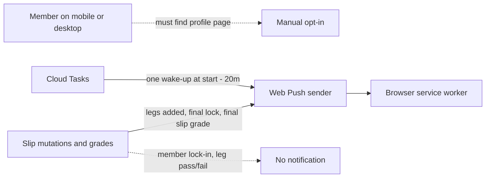
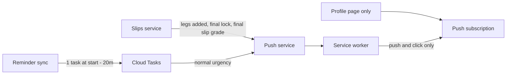
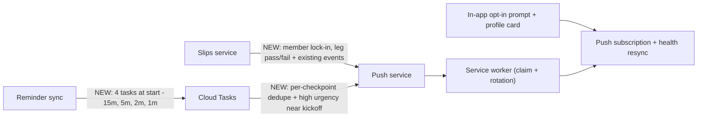

# Mobile and desktop notification prompts and alerts

## Context

Web Push already exists for mobile and desktop browsers, but most members never turn it on and the events it sends miss
the moments people care about most on game day.

Four gaps hurt the experience today:

1. **Opt-in is hidden.** The notification switch only lives on the profile page. People on desktop or phone never see a
   prompt to turn notifications on, and iPhone users browsing in Safari never get told to add the app to their Home
   Screen first.
2. **Subscriptions can go stale silently.** The service worker does not claim open tabs on activation or handle
   browser-initiated subscription rotations, and the app never checks whether an already-granted browser subscription is
   still registered with the server. A device can appear enabled while quietly dropping pushes.
3. **Only one 20-minute reminder fires.** Kickoff reminders run once per slip at 20 minutes before the slip starts.
   Anyone who gets distracted at 20 minutes gets no follow-up as kickoff closes in, and a slip created inside that
   20-minute window gets no reminder at all.
4. **Member lock-ins and leg results stay silent.** Locking in only sends a push when the final member finishes the
   whole slip, so no one hears as teammates lock in one by one. Grading only sends a push when the entire slip settles,
   so individual legs passing or failing during games go unannounced.

## Goals and non-goals

**Goals:**

- Prompt signed-in users on mobile and desktop to turn on notifications whenever this device does not have them enabled,
  with clear dismissal so it never nags, and show iPhone Safari users the Add to Home Screen step when needed.
- Keep mobile and desktop Web Push working reliably by claiming active clients on worker updates, handling browser
  subscription rotation, resyncing granted subscriptions when needed, and using high urgency for final-minute kickoff
  warnings.
- Notify other slip members whenever a member locks in their picks, while still announcing when the final member locks
  in and the slip is ready to place.
- Replace the single 20-minute reminder with four staged kickoff countdown reminders at 15 minutes, 5 minutes, 2
  minutes, and 1 minute before the slip's first game starts, reaching only active members who have not locked in yet.
- Notify slip members when any leg on their group's slip passes or fails, whether graded automatically or by hand,
  without double-sending on re-grades or spamming when the final leg settles the whole slip.
- Stay within the free-tier and single-instance guardrails: no polling loops, no paid services, and no Odds or Parlay
  API credit spend.

**Non-goals:**

- Per-category or per-group notification toggles. One on/off switch per device stays the model; fine-grained preferences
  wait until people ask for them.
- Background score-polling jobs to push leg results while nobody is using the app. Automatic leg pass/fail alerts fire
  when a refresh pass or manual grade settles a leg, keeping the instance able to scale to zero.
- Native mobile apps, SMS, email, or chat-bot integrations.
- Odds-movement, injury, or analyzer-warning push alerts.

## Decision

Keep the existing standard Web Push and Cloud Tasks architecture, and extend it in four coordinated places: add a
dismissible in-app opt-in prompt across authenticated screens (with iOS install guidance) plus service-worker
subscription self-healing; emit a member lock-in event on every lock-in; emit leg pass/fail events with per-leg
deduplication whenever a leg settles as won or lost; and schedule up to four Cloud Tasks checkpoints per open slip (at
15m, 5m, 2m, and 1m before slip start) with per-checkpoint deduplication and high-urgency delivery for tight countdowns.

### Before

### After

**Why this beats alternatives:**

- **Four discrete Cloud Tasks checkpoints over a cron or polling worker:** Four timed tasks per open slip keep Cloud Run
  scaling to zero and cost a few dozen tasks per month out of the 1,000,000/month free tier, whereas a minute-by-minute
  scheduler would wake the instance continuously and violate the zero-polling guardrail.
- **In-app dismissible prompt over immediate browser permission pop-ups:** Browsers block or penalize permission prompts
  fired without a tap, and iOS Safari requires Home Screen installation first. A friendly banner that triggers the
  browser prompt on tap (or explains iOS install) works reliably on both mobile and desktop.
- **Deduplicating leg pass/fail per leg outcome over suppressing all leg alerts:** Members want to follow each leg live
  as it hits or misses, not wait for the final game of the slate, while per-leg deduplication prevents noisy repeats on
  manual edits or retries.

**Ratings and high-level doc amendments:**

- `complexity: medium` fits because the work coordinates contracts and deduplication state across slips, reminders, push
  delivery, the service worker, and the web UI, requiring a model that holds multi-package invariants without deep
  concurrency or security redesigns.
- `risk: high` fits because it changes persistent reminder and push-dedupe state, external Cloud Tasks and Web Push
  interactions, and cross-browser mobile/desktop notification and service-worker behavior that automated tests only
  partially cover with mocks.
- `amends: [architecture]` is needed because the outbound push and timed reminders cross-cutting concern moves from a
  single 20-minute reminder task and three slip events to four staged countdown checkpoints, member lock-in and leg
  pass/fail events, and subscription self-healing.
