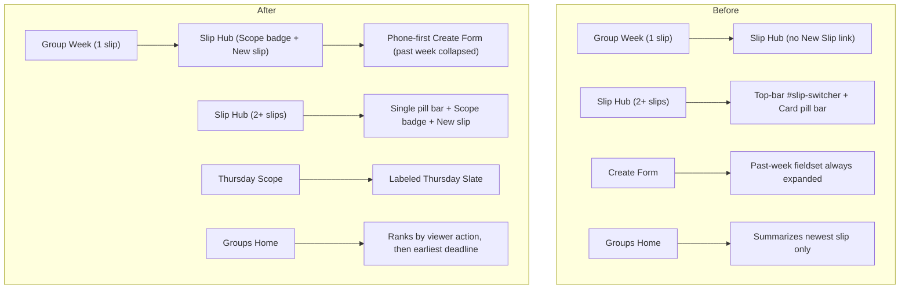

# Close-out

## Overview

## Consequences

- **Easier:** Members can start a one-off slip in one tap from any single-slip week, create-slip fields sit above the fold on phones, and open Sunday slips stay visible on Groups home after an earlier mid-week slip settles.
- **Harder:** `GET /` now evaluates `NextStep` across every slip in a group's latest week (adding per-slip member and leg queries alongside one shared `GamesForWeek` read) instead of inspecting only the newest slip.
- **Revisit:** Batch the per-slip queries in `groupWeekSummary` if groups ever run many slips in the same week, or revisit card copy if users want an explicit multi-slip count alongside the top action.

## Alternatives considered

- **Always show the multi-slip week hub even with one slip:** Rejected because most weeks have a single slip, and dropping the redirect would add an extra tap to the primary Sunday flow.
- **Keep both the top-bar dropdown and the card pill bar:** Rejected because two switchers crowd phone headers, and the pill bar already carries per-slip status summaries that a `<select>` cannot show cleanly.
- **Display a generic count such as `"2 slips"` on Groups home:** Rejected because the group card relies on actionable next-step copy, which priority ranking preserves across multiple slips.

## Implementation notes

- Implementation matched the design with no deviations.
- Groups home `GET /` issues `SlipMembers` and `LegsForSlip` queries per slip in the latest week; this stays sub-millisecond on local SQLite for a handful of slips but is not batched.
- `"Thursday Night"` still appears in test fixtures as user-chosen slip and schedule *names*; only the slate scope label changed to `"Thursday Slate"`.

## Follow-ups

None.
