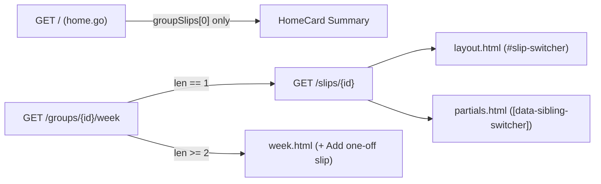
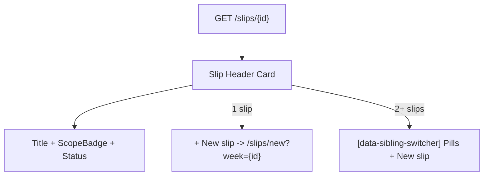
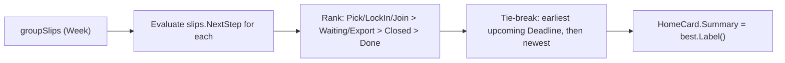

# Design: Smooth out one-off slip flow

## Context

The app already supports multiple slips per group per week (`internal/db/slips.go`, `internal/slips/slips.go`,
`internal/web/home.go`, `internal/web/slips.go`). Each slip has a `SlateScope` (`thursday`, `sunday_main`, or
`full_week`) that filters games on the pick board (`slips.FilterGamesByScope`), isolates deadlines (`slips.NextStep`),
and enforces pick boundaries (`slips.Service.AddLeg`).

Today's web navigation has four seams that break or clutter the optional one-off slip flow:

- **`GET /groups/{id}/week` (`internal/web/home.go`):** Calls `slips.EnsureWeekSlips`. When `len(groupSlips) == 1` (the
  default for groups with only `Main Sunday Slip`), it redirects to `/slips/{id}`. The multi-slip hub
  (`web/templates/week.html`), which hosts `+ Add one-off slip`, never renders until a second slip already exists.
- **`GET /slips/{id}` (`internal/web/slips.go`, `web/templates/partials.html`, `web/templates/layout.html`):** Renders
  two slip switchers when `len(groupSlips) > 1` (`#slip-switcher` in `layout.html` wired via `web/static/app.js`, plus
  `[data-sibling-switcher]` in `partials.html`), shows no scope badge in the slip header, and provides no link to
  `/slips/new` when only one slip exists.
- **`GET /slips/new` (`internal/web/slips.go`, `web/templates/slip.html`):** Always renders the empty-week copy
  (*"No slip for Week X yet"*) and shows the *"Or add a past week"* `<fieldset>` expanded above Name, Slate scope, and
  Members.
- **`GET /` (`internal/web/home.go`):** Summarizes `groupSlips[0]` (newest by `created_at DESC, id DESC`), so a
  finished one-off slip created after the recurring Sunday slip hides the open Sunday slip's next step.
- **`db.SlateScopeThursday.Label()` (`internal/db/slips.go`):** Returns `"Thursday Night"` even though `Matches` covers
  all Thursday Eastern kickoffs (including Thanksgiving afternoon games).

## Approach

### 1. Thursday scope label

Change `db.SlateScopeThursday.Label()` in `internal/db/slips.go` from `"Thursday Night"` to `"Thursday Slate"`. Update
the static fallback `<option value="thursday">` text in `web/templates/slip.html` and `web/templates/week.html` to
`"Thursday Slate"`, and update the schedule name placeholder in `web/templates/week.html` to `"e.g. Thursday Slip"`.
`SlateScopeThursday` values in SQLite (`"thursday"`) and `Matches()` behavior stay unchanged.

### 2. Slip hub header: scope badge, `+ New slip`, and single switcher

Extend `SlipView` in `internal/web/slips.go` with `WeekID int64` and `ScopeBadge string` (set from `slip.WeekID` and
`scopeBadge(slip.SlateScope)` in `slipPageData`).

In `web/templates/partials.html` (`slip-panel` `<header>`):

- Render `ScopeBadge` beside the slip title using the same compact badge style as `week.html`.
- Always provide a `+ New slip` link to `/slips/new?week={{.Slip.WeekID}}`:
  - When `len(.Siblings) > 1`, place `+ New slip` as a secondary pill at the end of `[data-sibling-switcher]` so
    switching slips and adding another share one horizontal row.
  - When `len(.Siblings) <= 1`, render a compact `+ New slip` link in the slip header metadata row so single-slip weeks
    stay uncluttered while giving every member a one-tap entry point.

Remove the redundant top-bar switcher:

- Remove `Slips []SlipOption` and `SlipOption` from `internal/web/page.go`.
- Remove `slipOptions` and its call in `renderSlip` (`internal/web/slips.go`).
- Remove the `#slip-switcher` `<select>` block and `gt (len .Slips) 1` header guard in `web/templates/layout.html`.
- Remove the `#slip-switcher` `change` listener in `web/static/app.js`.

### 3. Phone-first create-slip form

Add `HasExistingSlips bool` to `SlipCreateView` in `internal/web/slips.go`. In `createView`, load `SlipsForWeek` once
for the target week, set `HasExistingSlips = len(existing) > 0`, and reuse that slice in `nextSlipName` to avoid a
duplicate query.

In `web/templates/slip.html`:

- When `.Create.WeekID` is set and `.Create.HasExistingSlips` is true, render heading *"Add a slip for
  {{.Page.WeekLabel}}"* and subtitle *"Pick a slate, legs per member, and who's in."*
- Keep the existing *"Start {{.Page.WeekLabel}}'s slip"* / *"No slip for {{.Page.WeekLabel}} yet..."* copy when
  `!HasExistingSlips`.
- Wrap the *"Or add a past week"* `<fieldset>` inside a `
` element that renders `open` only when
  `len(.Create.Weeks) == 0` or `.Create.Season != 0 || .Create.WeekNum != 0`, and collapsed otherwise. This keeps Week,
  Name, Slate scope, Legs per member, and Members above the fold on phone screens.

### 4. Actionable Groups home summary

In `internal/web/home.go`, replace the `groupSlips[0]` lookup with a helper `groupWeekSummary` that evaluates
`slips.NextStep` for each slip in `groupSlips` (reusing one `GamesForWeek` query per week) and picks the highest-priority
step to display on the group card:

1. Needs viewer action: `StepPick`, `StepLockIn`, `StepJoin`
2. Active in progress: `StepWaiting`, `StepExport`
3. Closed without finishing: `StepClosed`
4. Graded: `StepDone`

Within the same priority tier, prefer the slip with the earliest upcoming `Deadline` (so on Wednesday/Thursday morning
when both Thanksgiving and Sunday are `StepPick`, Thanksgiving leads), falling back to `SlipsForWeek` order when neither
has an upcoming deadline.

### Trade-offs considered

- **Always showing the multi-slip week hub even with 1 slip:** Rejected because normal weeks have one slip and adding an
  extra tap every Sunday hurts the primary flow. Putting `+ New slip` on `/slips/{id}` keeps single-slip weeks fast.
- **Keeping both slip switchers:** Rejected because two switchers on one phone screen waste header space and duplicate
  functionality; the card pill bar carries status summaries (`(1/2 Picks)`, `(Locked)`, `(Won)`) that a `<select>`
  cannot show cleanly.
- **Showing `"2 slips"` on the Groups home card instead of a next-step label:** Rejected because the card already carries
  actionable copy (`"Pick 2 more"`, `"Ready to lock in"`); ranking by viewer action preserves that contract across
  multi-slip weeks.

## Verification

- Automated checks: `go generate ./... && golangci-lint run ./... && go test -short -race ./...` and `good-vibes docs lint`.
- Behavioral scenarios covered by tests:
  - **Single-slip week:** `GET /slips/{id}` renders the `ScopeBadge` (`Sunday Slate`), renders `+ New slip` linking to
    `/slips/new?week={weekID}`, and does not render `#slip-switcher` or `[data-sibling-switcher]`.
  - **Create form states:** `GET /slips/new` on an empty week shows *"No slip for Week X yet"* and collapsed past-week
    `
`; on a week with an existing slip it shows *"Add a slip for Week X"* and collapsed past-week `
`;
    with no stored weeks or after a past-week form error, `
` renders `open`.
  - **Thursday label:** `db.SlateScopeThursday.Label()` returns `"Thursday Slate"`, and `/slips/new` and
    `/groups/{id}/week` render `"Thursday Slate"` for `value="thursday"`.
  - **Multi-slip navigation:** `GET /slips/{id}` with 2+ slips renders `[data-sibling-switcher]` with sibling pills plus
    `+ New slip`, shows `ScopeBadge`, and omits `#slip-switcher` from the top bar.
  - **Groups home summary:** With a `GRADED` Thanksgiving slip created after an `OPEN` Sunday slip, `GET /` summarizes
    the open Sunday slip (`"Pick 2 more"`); when both are `OPEN` and need picks, the earlier-deadline Thanksgiving slip
    summarizes first; when Thanksgiving is `LOCKED` (`StepExport`) and Sunday still needs picks (`StepPick`), Sunday
    summarizes first.

## Risks

- **Existing tests asserting `"Thursday Night"` or `id="slip-switcher"`:** Several tests in `internal/db` and
  `internal/web` assert the old label or top-bar select ID. Updating them alongside the code in Phase 1 keeps the suite
  green; `go test -short ./...` catches any missed assertion immediately.
- **Extra queries on `GET /` for multi-slip groups:** Evaluating `NextStep` across all slips in the latest week adds
  `SlipMembers` and `LegsForSlip` queries per slip, while sharing one `GamesForWeek` read per week. Groups have at most
  a handful of slips per week on local SQLite, so latency stays sub-millisecond.
- **Phone header overflow on `/slips/{id}`:** Adding `ScopeBadge` and `+ New slip` to the slip header must wrap cleanly
  at 375px width without colliding with the status pill. Keeping `+ New slip` inside the sibling pill row (2+ slips) or
  below/beside the metadata line (1 slip) avoids horizontal overflow.

## TODO

### Phase 1: Scope label, slip hub entry point, and single switcher

Complexity: low (narrow template, view-model, and label updates following existing patterns across `internal/db`, `internal/web`, and `web`)
Risk: low (UI labels and navigation only, no schema or sync changes, verified by existing layout, db, and slip handler tests)

- [x] Rename `db.SlateScopeThursday.Label()` to `"Thursday Slate"` in `internal/db/slips.go`, update static option
  labels in `web/templates/slip.html` and `web/templates/week.html`, and update corresponding tests in
  `internal/db/slips_test.go`, `internal/web/home_test.go`, and `internal/web/slips_test.go`.
- [x] Add `WeekID` and `ScopeBadge` to `SlipView` (`internal/web/slips.go`), display `ScopeBadge` and a `+ New slip`
  link (`/slips/new?week=...`) in `web/templates/partials.html` for both single-slip and multi-slip weeks, remove the
  redundant top-bar `#slip-switcher` (`internal/web/page.go`, `internal/web/slips.go`, `web/templates/layout.html`,
  `web/static/app.js`), and update `internal/web/layout_test.go` and `internal/web/slips_test.go`.

### Phase 2: Create-slip form UX, Groups home summary, and docs

Complexity: low (localized view-model state and pure priority ranking in `internal/web`, plus concept doc refresh)
Risk: low (read-only display and form presentation changes with focused unit and handler test coverage)

- [x] Add `HasExistingSlips` to `SlipCreateView` (`internal/web/slips.go`), update `web/templates/slip.html` so
  existing-slip weeks show accurate copy and *"Or add a past week"* collapses inside a `
` unless no weeks exist
  or past-week fields were submitted, and add handler tests in `internal/web/slips_test.go` and
  `internal/web/home_test.go`.
- [x] Update `home` in `internal/web/home.go` to pick the highest-priority actionable slip summary across all slips in
  the latest week (actionable step > waiting/export > closed > done, tie-breaking by earliest upcoming deadline) and add
  multi-slip summary tests in `internal/web/home_test.go`.
- [ ] Docs: update `docs/concepts/slips.md` to document `"Thursday Slate"`, the slip hub's scope badge and `+ New slip`
  entry point, the single sibling pill switcher, the create-slip form's empty vs. existing-week states, and the
  multi-slip Groups home summary.
