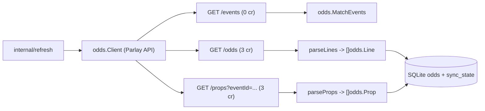

# Design: Parlay API for odds and props

## Context

`internal/ingest/odds` currently fetches NFL events (`GET /events`) and full-game lines (`GET /odds`) from The Odds API (`https://api.the-odds-api.com/v4/sports/americanfootball_nfl`). `internal/refresh` calls `odds.Client` through the `LinesClient` interface (`Events` + `Lines`), matches event IDs onto ESPN `games` rows via `odds.MatchEvents`, and replaces full-game rows (`SPREAD`, `ML`, `TOTAL`) in `odds` while recording `X-Requests-Remaining` and `X-Requests-Used` in `sync_state`. `internal/export` reads `odds.link`, `odds.sid`, and `odds.event_sid` to build combined or per-leg sportsbook URLs and falls back to manual checklist entries (`no link`) whenever `link` is `NULL`. `internal/ingest/archive` wraps the shared HTTP transport to record raw responses and maps unlabelled requests by hostname in `sourceForHost` (`internal/ingest/archive/labels.go`).

Read before starting:

- `docs/reference/data-sources.md` — external API catalog, market mappings, credit costs, and monthly budget
- `docs/concepts/data-refresh.md` — lazy sync keys (`odds:lines`, `odds:props:{game}`), TTLs, and credit floors
- `docs/concepts/export.md` — deep-link lookup (`link`, `sid`, `event_sid`) and manual fallback rules
- `docs/reference/schema.md` — `odds` table columns and market/side conventions
- `plan/data-sources.md` — prop market table and refresh budget notes

### What Parlay API publishes

Parlay API (`https://parlay-api.com/v1/sports/americanfootball_nfl`) is an Odds API-compatible feed with a 1,000-credit/month keyless-card free tier:

- **Auth and credit headers:** Accepts the `apiKey` query parameter (preserving `archive.redactURL`) and returns `X-Requests-Remaining`, `X-Requests-Used`, and `X-Requests-Last` on every response.
- **Events (`GET /events`):** Costs 0 credits (API key required). Returns the same JSON array of `{id, commence_time, home_team, away_team}` as The Odds API, except `commence_time` can be `null` on fixtures whose kickoff is not yet reported.
- **Game lines (`GET /odds`):** Costs `markets × regions` (3 credits for `regions=us&markets=h2h,spreads,totals&oddsFormat=american&includeLinks=true&includeSids=true`). Returns the same nested `bookmakers[].markets[].outcomes[]` JSON array as The Odds API, with two differences:
  1. `commence_time` can be `null` on unreported fixtures.
  2. `regions=us` includes exchanges and DFS books that may post only one side of a two-way market; unquoted sides arrive with `"price": null` (or missing `point` on spreads/totals).
- **Bulk props (`GET /props`):** Costs a flat **3 credits per call** regardless of how many markets or bookmakers are returned (`GET /props?eventId={id}&markets={keys}&oddsFormat=american&includeLinks=true&includeSids=true&limit=10000`). Unlike The Odds API's nested `/events/{id}/odds` response, `/props` returns a flat JSON array of prop quote objects:
  - `event_id` (`string`), `bookmaker` (`string`), `player` (`string`, with `player_name` as a legacy alias on some sandbox rows), `market_key` (`string`), `period` (`"FULL"`, `"1H"`, `"Q1"`, or `"UNKNOWN"`), `line` (`*float64`), `over_price` (`*int`), `under_price` (`*int`), `over_link` (`string`), `under_link` (`string`), `over_sid` (`string`), `under_sid` (`string`).
  - Querying a canonical `markets` filter (such as `player_pass_yds` or `player_anytime_td`) can return rows tagged with book-specific alias keys (`player_passing_yards`, `player_pass_yards`, `player_receiving_yds`, `player_anytime_touchdown_scorer`, `anytime_td`).
  - `team_totals` is served on `/props` (not `/odds`), with the team's full name in `player`.
- **Deep links (`includeLinks=true&includeSids=true`):** Costs 0 extra credits on both `/odds` and `/props`. Parlay API populates validated `link` and `sid` (`over_link`/`under_link` and `over_sid`/`under_sid` on `/props`) on eligible **FanDuel** outcomes when a matching native quote is open; DraftKings and other books omit link metadata. Because FanDuel's combiner in `internal/export` extracts `marketId` from each leg's `link` and pairs it with `sid` (it never uses `event_sid`), FanDuel single and combined links continue to work unchanged, while DraftKings legs store `NULL` links and render as manual checklist items (`no link`).

## Approach



### 1. Switch `internal/ingest/odds` to Parlay API and harden `/events` and `/odds` parsing

- Update `DefaultBaseURL` in `internal/ingest/odds/client.go` from `https://api.the-odds-api.com/v4/sports/americanfootball_nfl` to `https://parlay-api.com/v1/sports/americanfootball_nfl`. Keep `ODDS_API_KEY` and `ODDS_BASE_URL` env vars in `internal/config` so local overrides and existing deployment secrets need no rename.
- In `Client.Events` (`internal/ingest/odds/events.go`), skip wire events whose `commence_time` is empty (`""` or JSON `null`) instead of failing the entire slice. An event without a kickoff timestamp cannot match an ESPN game window in `MatchEvents`.
- In `parseLines` (`internal/ingest/odds/lines.go`), skip individual outcomes where `Price == nil`, and on `spreads`/`totals` skip outcomes where `Point == nil`, rather than aborting the whole sync when a one-sided exchange or DFS source in `regions=us` leaves a side unpriced. Also skip `h2h` outcomes whose `Name` is neither `ev.HomeTeam` nor `ev.AwayTeam` (such as `"Draw"` on 3-way feeds) so `refresh.oddsRow` never sees a non-team `ML` row.

### 2. Add bulk per-game prop fetching (`Client.Props`) in `internal/ingest/odds`

Add `internal/ingest/odds/props.go` with `Client.Props(ctx context.Context, eventID string) ([]Prop, Credits, error)`:

- **Type `Prop`:**
  ```go
  type Prop struct {
      EventID    string
      Book       string
      MarketType string   // PASS_YDS, PASS_TDS, RUSH_YDS, RUSH_ATT, REC_YDS, RECEPTIONS, ANYTIME_TD, KICKER_PTS, TEAM_TOTAL
      Team       string   // populated for TEAM_TOTAL (full team name); empty for player props
      PlayerName string   // populated for player props; empty for TEAM_TOTAL
      Side       string   // OVER, UNDER, or YES
      Line       *float64 // nil for ANYTIME_TD
      Price      int
      Link       string
      Sid        string
  }
  ```
- **Request:** `GET {baseURL}/props` with query parameters:
  - `apiKey={key}`
  - `eventId={eventID}` (return an error immediately if `strings.TrimSpace(eventID) == ""`)
  - `markets=team_totals,player_pass_yds,player_pass_tds,player_rush_yds,player_rush_attempts,player_reception_yds,player_receptions,player_anytime_td,player_kicking_points`
  - `oddsFormat=american`
  - `includeLinks=true`
  - `includeSids=true`
  - `limit=10000`
- **Normalization rules in `parseProps`:**
  1. **Event filter:** If a row carries a non-empty `event_id` that does not match the requested `eventID`, skip it.
  2. **Period filter:** Only accept rows where `period == ""` or `period == "FULL"`. Skip `"1H"`, `"Q1"`, `"UNKNOWN"`, and any other period tag so quarter/half lines never mix into full-game prop markets.
  3. **Subject extraction:** Read `player` and fall back to `player_name` if `player` is empty; trim whitespace and skip rows with an empty subject or empty `bookmaker`.
  4. **Market alias mapping:** Map both canonical and Parlay API alias `market_key` strings to our internal market constants:
     - `PASS_YDS`: `player_pass_yds`, `player_passing_yards`, `player_pass_yards`
     - `PASS_TDS`: `player_pass_tds`, `player_passing_tds`, `player_passing_touchdowns`
     - `RUSH_YDS`: `player_rush_yds`, `player_rushing_yards`, `player_rush_yards`
     - `RUSH_ATT`: `player_rush_attempts`, `player_rushing_attempts`
     - `REC_YDS`: `player_reception_yds`, `player_receiving_yds`, `player_receiving_yards`
     - `RECEPTIONS`: `player_receptions`
     - `ANYTIME_TD`: `player_anytime_td`, `player_anytime_touchdown_scorer`, `anytime_td`, `anytime_touchdown_scorer`
     - `KICKER_PTS`: `player_kicking_points`
     - `TEAM_TOTAL`: `team_totals`
     Skip any unmapped `market_key`.
  5. **Row expansion:**
     - For `ANYTIME_TD`: if `over_price != nil`, emit a single `Prop` with `Side: "YES"`, `Line: nil` (matching `docs/reference/schema.md`, even when Parlay API sets `line: 0.5`), `Price: *over_price`, `PlayerName: subject`, `Link: over_link`, `Sid: over_sid`.
     - For `TEAM_TOTAL` and the other 7 player prop markets: require `line != nil` (skip if `nil`). Set `Team: subject` for `TEAM_TOTAL` and `PlayerName: subject` for player props. When `over_price != nil`, emit an `OVER` row with `Price: *over_price`, `Link: over_link`, `Sid: over_sid`. When `under_price != nil`, emit an `UNDER` row with `Price: *under_price`, `Link: under_link`, `Sid: under_sid`.

### 3. Update archive hostname classification and living docs

- In `internal/ingest/archive/labels.go`, update `sourceForHost` so both `"parlay-api.com"` and `"the-odds-api.com"` map to `SourceOdds` (`"odds"`). That ensures unlabelled calls (such as `TestLiveEvents` or direct client checks) archive under `source = "odds"` with credit headers parsed.
- Update `internal/ingest/odds/testdata/README.md` and add a realistic `props_sample.json` fixture capturing Parlay API's `/props` response shape (including FanDuel `over_link`/`under_link`/`over_sid`/`under_sid`, market aliases, a non-`FULL` period row, an unpriced DFS row, `player_anytime_td`, and `team_totals`).
- Update living docs (`docs/reference/data-sources.md`, `docs/concepts/data-refresh.md`, `docs/concepts/export.md`, `docs/reference/config.md`) and `plan/data-sources.md` to reflect Parlay API, the 1,000-credit monthly budget, the 3-credit bulk `/props` cost (~72 credits/month for 6 games/week instead of ~216), and FanDuel deep-link coverage.

## Verification

- Standard unit tests and linters pass (`go test ./...`, `golangci-lint run ./...`, `good-vibes docs lint`, `good-vibes check parlay-api`).
- `Client.Events` skips events with null/empty `commence_time` while parsing valid RFC3339 events and credit headers.
- `Client.Lines` skips outcomes with `price: null`, spreads/totals with `point: null`, and non-team `h2h` outcomes (`Draw`) without failing valid bookmakers on the same event, and preserves FanDuel `link`/`sid` fields.
- `Client.Props` sends `eventId`, `markets`, `oddsFormat=american`, `includeLinks=true`, `includeSids=true`, and `limit=10000` to `/props`, parses `X-Requests-Remaining` and `X-Requests-Used`, expands `over_price`/`under_price` into `OVER`/`UNDER` rows with `over_link`/`under_link` and `over_sid`/`under_sid`, normalizes `ANYTIME_TD` to `Side: "YES"` with `Line: nil`, populates `Team` on `TEAM_TOTAL` and `PlayerName` on player props, maps market aliases (`player_passing_yards`, `player_receiving_yds`, `player_anytime_touchdown_scorer`), and filters out `period != "FULL"` and unpriced rows.
- `archive.Transport` labels unlabelled `parlay-api.com` requests as `SourceOdds` (`"odds"`), redacts `apiKey` in stored URLs, and extracts `X-Requests-Remaining` and `X-Requests-Used`.
- `TestLiveEvents` (`go test ./internal/ingest/odds -run TestLiveEvents` with `ODDS_API_KEY` set) succeeds against `https://parlay-api.com/v1/sports/americanfootball_nfl/events`.

## Risks

- **DraftKings deep links absent on Parlay API:** Parlay API currently populates outcome `link` and `sid` on FanDuel only. DraftKings legs in `odds` will have `link = NULL`, so `internal/export` will list them under manual legs (`no link`). This matches existing fallback behavior and requires no schema or export code change.
- **DFS and exchange noise in `regions=us` and `/props`:** Parlay API includes DFS and prediction-market books (`prizepicks`, `pick6`, `kalshi`, `polymarket`) that emit null prices, legacy `period: "UNKNOWN"` rows, or non-team `h2h` outcomes. Filtering out null prices, non-`FULL` periods, and non-team `h2h` names in `internal/ingest/odds` prevents those rows from breaking `refresh` transactions or polluting full-game props.
- **Single-game `/props` pagination cap:** `/props` defaults to `limit=500` and allows up to `limit=10000`. Passing `limit=10000` scoped to a single `eventId` and our 9 NFL markets comfortably fits an entire game's prop board (~500–2,000 rows across all books) in one 3-credit call.

## TODO

Effort: medium (normalizes a new flat `/props` wire format with market aliases and period filtering alongside hardening `/events` and `/odds` for Parlay API)

### Phase 1: Switch odds client to Parlay API and add bulk props ingest

- [x] Update `DefaultBaseURL` in `internal/ingest/odds/client.go` to `https://parlay-api.com/v1/sports/americanfootball_nfl`, update `sourceForHost` in `internal/ingest/archive/labels.go` to recognize `parlay-api.com`, and harden `Client.Events` and `Client.Lines` (`internal/ingest/odds/events.go`, `internal/ingest/odds/lines.go`) to skip null `commence_time`, null `price`/`point` outcomes, and non-team `h2h` outcomes
- [ ] Add `Prop` and `Client.Props(ctx, eventID)` in `internal/ingest/odds/props.go` with `/props` query building, `period == "FULL"` filtering, market alias mapping for all 9 prop markets, `ANYTIME_TD` (`YES`, nil line) and `TEAM_TOTAL` (`Team` set) normalization, and `over_link`/`under_link`/`over_sid`/`under_sid` extraction
- [ ] Add `internal/ingest/odds/testdata/props_sample.json` and unit tests in `internal/ingest/odds/props_test.go`, `events_test.go`, `lines_test.go`, and `internal/ingest/archive/transport_test.go` covering Parlay API edge cases and host labelling
- [ ] Docs: update `docs/reference/data-sources.md`, `docs/concepts/data-refresh.md`, `docs/concepts/export.md`, `docs/reference/config.md`, `plan/data-sources.md`, and `internal/ingest/odds/testdata/README.md` for Parlay API endpoints, 1,000-credit budget, 3-credit bulk `/props`, and FanDuel deep-link coverage
