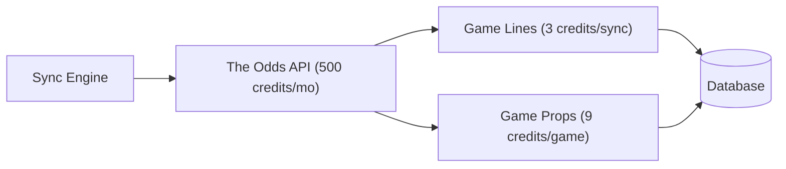
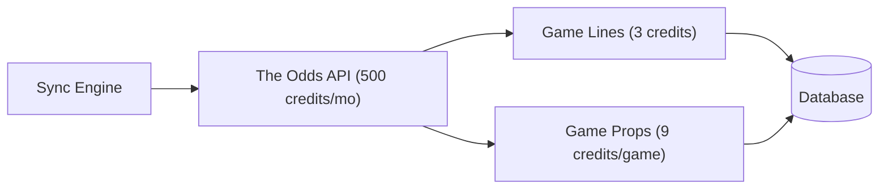
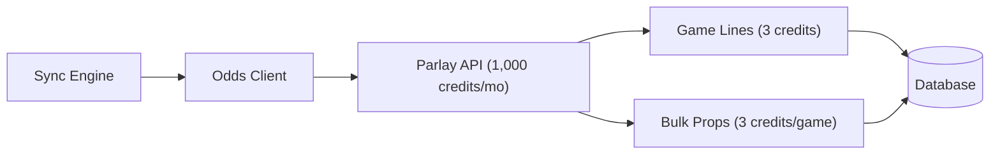

# Parlay API for odds and props

## Context

The app fetches NFL game lines and sportsbook deep links from The Odds API, and upcoming work (`props-research`) adds on-demand player props per game. The Odds API's free tier provides 500 credits per month.

Game lines consume 3 credits per sync (~240 credits/month). On The Odds API, per-game props charge 1 credit per market returned—9 credits per game across our 9 prop markets, or ~54 credits/week if the group opens 6 games (~216 credits/month). Combined with game lines, a normal month leaves almost no buffer for playoff weeks or extra refreshes.

Parlay API provides 1,000 monthly credits on its free tier without a credit card. It mirrors The Odds API's event and game-line endpoints, includes deep links and selection IDs on eligible FanDuel outcomes at zero extra credit cost, and serves all prop markets for a game in a single 3-credit bulk call.

## Goals and non-goals

**Goals:**

- Double the monthly free-tier odds budget from 500 to 1,000 credits.
- Switch game lines and deep-link ingest to Parlay API while keeping existing odds storage and export behavior unchanged.
- Add bulk per-game prop ingest at a flat 3 credits per game so `props-research` can fetch all 9 prop markets in one call.
- Keep external odds fetching behind the client seam so refresh and storage stay independent of the provider.

**Non-goals:**

- Pooling credits across both providers simultaneously at runtime.
- Upgrading to paid subscription tiers or requiring credit card billing.
- Changing stored odds schema, odds math, or sportsbook export behavior.
- Building the prop research UI or wiring on-demand prop refresh routes (covered in `props-research`).

## Decision

Switch the odds client from The Odds API to Parlay API and add bulk per-game prop fetching on the same client. Parlay API supplies validated deep links and selection IDs on eligible FanDuel outcomes; books without deep-link metadata store empty link fields and fall back to manual checklist entries in the existing export card.

### Before

### After

Switching primary ingest to Parlay API beats dual-provider credit pooling because it doubles the free budget and cuts per-game prop cost from 9 credits to 3 without managing two credit pools or reconciling event IDs across vendors.

The medium effort rating fits because game lines share the existing response shape, while bulk props return a flat row format with market aliases and period tags that the client normalizes into our internal market types.
