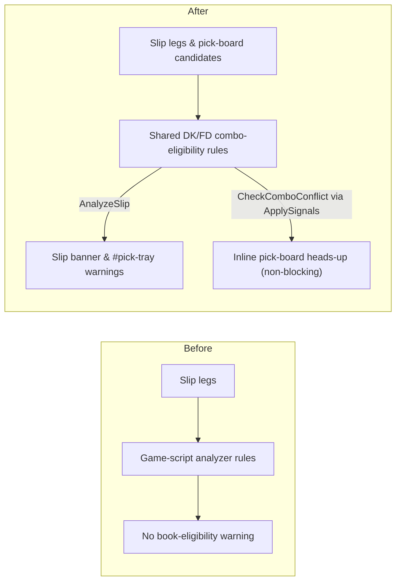

# Close-out

## Overview

## Consequences

- **Easier:** Groups spot DraftKings and FanDuel combination rejections while picking legs, before locking the slip.
- **Easier:** Adding newly observed sportsbook rejection pairs takes one predicate and test case, and updates both the slip analyzer and inline pick-board heads-up from a single source of truth.
- **Harder:** Writing synthetic same-game multi-leg test fixtures, since combinations that previously passed silently now trigger `book_combo_ineligible` or `book_combo_restricted`.
- **Revisit:** The `book_combo_restricted` pairs if DraftKings or FanDuel relax kicker or same-player inverse prop SGP restrictions, or if groups hit noisy false positives on live slates.

## Alternatives considered

- **Hard-blocking ineligible combinations in the slip service:** Rejected because it breaks the app's friendly, never-blocking rule and would block valid bets whenever a sportsbook relaxes an SGP restriction.
- **Warning only at slip lock or export:** Rejected because members would only learn about the conflict after building and locking the slip, instead of seeing it inline while picking.
- **Calling live sportsbook SGP or betslip APIs:** Rejected to keep analysis deterministic in plain Go with zero external API calls or sportsbook integrations.

## Implementation notes

- **Tap-to-switch exclusion:** `board.ApplySignals` identifies the sole picked leg in a line group so switching sides (such as Over to Under) excludes the leg being replaced from `CheckComboConflict` while still checking all other slip legs.
- **Static rule boundaries:** Rules are a deterministic approximation of DraftKings and FanDuel restrictions; slate-specific SGP exclusions outside the cataloged predicates are not caught, and `marketOther` legs or legs without a game ID are skipped.
- **One inline conflict per candidate:** `CheckComboConflict` short-circuits on the first `Danger` conflict (or returns the first `Warn` if no `Danger` exists), so an inline pick-board row displays at most one heads-up message at a time.

## Follow-ups

- Add newly observed DraftKings or FanDuel SGP prop restrictions to `internal/analyzer/combo_rules.go` with regression tests as groups encounter them on live slates.
- Evaluate book-specific restriction labels (DraftKings vs. FanDuel) if slip tracking ever records which sportsbook a group is using.
