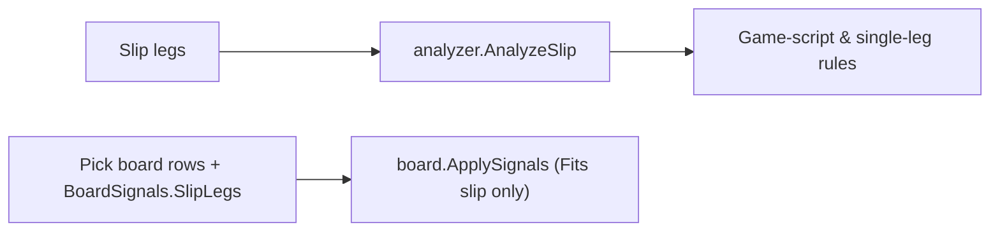
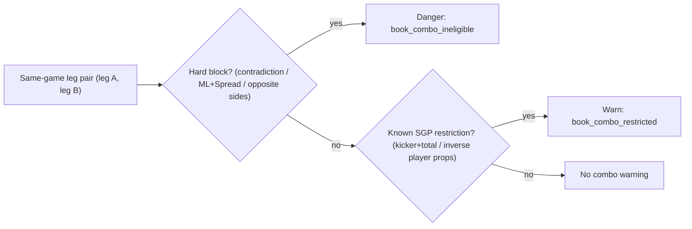

# Design: Warn on sportsbook-ineligible parlay combinations

## Context

`internal/analyzer` runs pure, deterministic checks over a slip's legs in `AnalyzeSlip`
(`internal/analyzer/analyzer.go`), registering rules in a fixed `rules` slice (`internal/analyzer/rules.go`) and
documenting each rule ID in `internal/analyzer/docs.go`. Warnings sort by `Severity` (`Danger`, `Warn`, `Info`) and
render on the slip page without ever blocking a leg or lock.

On the pick board, `internal/board/signals.go` (`ApplySignals`) already receives `BoardSignals.SlipLegs` (the current
open slip's legs as `[]analyzer.Leg`) and attaches row badges such as `Fits slip`. That same seam can surface inline
combination warnings while picking before the user even returns to the slip view.

Today, `rules.go` only contains game-script rules (`blowout_passing`, `trailing_rb`, `total_contradiction`,
`stack_clock_drain`, `stack_shootout`). None of them check whether DraftKings or FanDuel actually allow two legs to be
combined on the same parlay or SGP.

## Approach

### 1. Deterministic sportsbook combination-eligibility rules in `internal/analyzer`

Add a new rule file `internal/analyzer/combo_rules.go` and register two stable rules in `rules` (and `docs.go`):

1. **`book_combo_ineligible` (`Danger`)** — Hard blocks that DraftKings and FanDuel consistently reject on the same
   parlay/SGP:
   - **Opposite sides of the same market:** Same game `SPREAD` on both teams, `ML` on both teams, `TOTAL` Over + Under,
     `TEAM_TOTAL` Over + Under for the same team, or the same player's prop Over + Under in the same market.
   - **Duplicate selection:** Two legs targeting the exact same selection (`game`, `market`, `team`/`player`, `side`).
   - **Redundant or contradictory game lines:** Same game `ML` + `SPREAD` on the same team (FanDuel and DraftKings
     reject combining a team's moneyline with its own spread), or `ML` on Team A + `SPREAD` favorite (`< 0`) on Team B
     (mutually exclusive).
   - **Mutually exclusive team total vs. game total:** Both teams' `TEAM_TOTAL` Overs whose combined lines exceed a
     `TOTAL` Under (or vice versa where mathematically impossible).
2. **`book_combo_restricted` (`Warn`)** — Combinations that DraftKings or FanDuel frequently restrict or drop from SGP
   eligibility depending on book/slate:
   - **Same-player conflicting or closely tied prop markets:** Same player `PASS_YDS` Over + `PASS_TDS` Under (or
     strongly inverse stat pairs) and duplicate player-market milestones.
   - **Kicker / team-total SGP restrictions:** `KICKER_PTS` paired with `TEAM_TOTAL` or `TOTAL` in the same game (books
     frequently disallow kicker props in SGPs alongside totals/team totals).

Every warning uses the app's friendly, non-blocking voice (for example:
`"Heads up: DraftKings and FanDuel usually won't combine BUF ML with BUF -3.5 on the same slip."`) and lists both
involved `LegIDs`.

### 2. Shared single-candidate helper for inline pick-board heads-up

Export a pure helper `analyzer.CheckComboConflict(candidate Leg, existing []Leg) (Warning, bool)` that runs the same
combination rules between one candidate board row and `BoardSignals.SlipLegs` (short-circuiting on the highest-severity
conflict). In `internal/board/signals.go`, attach a non-blocking `ComboWarning` string (or conflict badge/note) on
`board.Row` whenever a candidate conflicts with an existing leg on the open slip, and render a compact warning pill on
the pick card (`web/templates/`) without disabling the add button.

Trade-off: Running `CheckComboConflict` over the open slip's 1–10 legs per game is O(N) in memory with zero DB queries
and keeps one single source of truth for combo rules across both the slip analyzer and the pick board.

## Verification

- `go test -short ./... && golangci-lint run ./...`
- `internal/analyzer/combo_rules_test.go`: table-driven tests covering every hard-block pair (same-team ML + spread,
  opposite spread/ML/total/prop sides, duplicate selections, mutually exclusive ML + opponent favorite spread, team
  total vs. game total contradiction), SGP-restricted pairs (`KICKER_PTS` + `TOTAL`/`TEAM_TOTAL`), and valid same-game
  combos (QB pass yds + WR rec yds, spread + total, two different games) confirming zero false positives.
- `internal/analyzer/analyzer_test.go`: verify `RuleIDs()` and `docs.go` include `book_combo_ineligible` and
  `book_combo_restricted`.
- `internal/board/signals_test.go` and `internal/web/pick_test.go`: verify a conflicting board option displays its
  inline heads-up note while remaining clickable/addable.

## Risks

- **False positives on valid SGPs:** Overly broad restriction rules could annoy users with warnings on combos DK/FD
  actually accept. Mitigated by keeping `Danger` (`book_combo_ineligible`) strictly to mathematically contradictory or
  universally rejected pairs, using softer `Warn` wording ("usually won't combine"), and never blocking any pick.
- **Undocumented book-specific SGP rules:** Books occasionally restrict niche prop combinations on specific slates.
  Mitigated by structuring `combo_rules.go` as a clean table of predicates so new observed rejections take a few lines
  and a test case to add.

## TODO

### Phase 1: Add sportsbook combination-eligibility rules to the analyzer

Complexity: medium (requires modeling deterministic same-game market pair predicates across all supported NFL markets
without false positives on valid SGPs).

Risk: low (pure deterministic Go logic with exhaustive unit tests and no persistent state or external calls).

- [x] Implement `book_combo_ineligible` (`Danger`) and `book_combo_restricted` (`Warn`) plus `CheckComboConflict` in
      `internal/analyzer/combo_rules.go`, register them in `internal/analyzer/analyzer.go` and
      `internal/analyzer/docs.go`, and add table-driven unit tests in `internal/analyzer/combo_rules_test.go`.

### Phase 2: Surface inline combo heads-up on the pick board

Complexity: low (extends existing `BoardSignals.SlipLegs` flow in `internal/board` and renders a non-blocking warning
note in pick templates).

Risk: low (non-blocking UI indicator backed by unit and handler tests).

- [x] Wire `analyzer.CheckComboConflict` into `internal/board/signals.go` (`Row.ComboWarning`) and render the compact
      non-blocking heads-up note on conflicting pick options in `web/templates/` and `internal/web/pick.go`, with tests
      in `internal/board/signals_test.go` and `internal/web/pick_test.go`.
- [x] Docs: update `docs/concepts/analyzer.md` to document the new combination-eligibility rules and their non-blocking
  behavior.

## Reviews

- [x] Final review: agy@gemini-4-neon-medium
