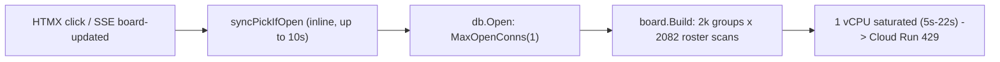
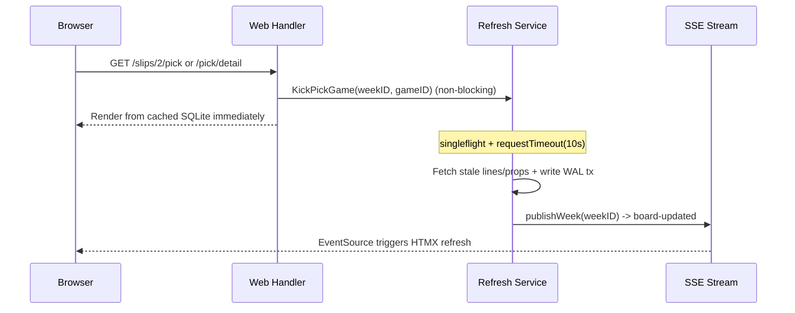

# Design: Speed up pick board and page loads

## Context

Every pick-board handler (`pickBoard`, `pickResults`, `pickDetail`, `pickSlate` in `internal/web/pick.go`) currently
runs `pickPageData`, which:

1. Loads all rows for the week (`OddsForWeek` — `15,543` rows in prod) and all team rosters (`RosterForTeams` — `2,082`
   rows).
2. Calls `board.Build` (`internal/board/board.go`), which groups odds into ~2,000+ selections and calls
   `matchPlayer(roster, group.player, group.team)` per group. `matchPlayer` loops over all `2,082` `RosterPlayer`
   structs and calls `normalize(player.FullName)` and `normalize(player.NormName)` (`foldAccents` +
   `db.NormalizePlayerName`) on every iteration (~8 million normalizations per request).
3. Calls `board.Slates` twice in `pickPageData` (`openCards` without `Q`, then `slateCards` with `Q`), each re-running
   `gameMatchesQuery` over `roster`.
4. Runs `dockFrom` even on `pickSlate` (which only renders `data.Body.Slate`), loading `nfelo`, `nflverse`, and
   `player_gamelogs`.
5. Calls `syncPickIfOpen` synchronously inside `pickBoard`, `pickResults`, and `pickDetail`, holding requests up to
   `requestTimeout` (`10s`) when odds are stale.
6. Shares one SQLite connection (`database.SetMaxOpenConns(1)` in `internal/db/db.go`) for both reads and background
   `Kick()` / `UpsertOdds` transactions.



## Approach

### 1. Pre-index roster lookups and scope `pickPageData`

In `internal/board/board.go`, build a `rosterIndex` once at the top of `Build` and `Slates`:

```go
type rosterEntry struct {
    player   db.RosterPlayer
    normFull string
    normAlt  string
}

type rosterIndex struct {
    byTeamAndName map[string]db.RosterPlayer // team + "\x00" + norm
    byName        map[string]db.RosterPlayer // first match when team == ""
    byGameTeam    map[string][]rosterEntry   // team -> normalized entries for search
}
```

- `matchPlayer` becomes an O(1) map lookup against `rosterIndex` instead of an O(M) scan.
- `gameMatchesQuery` iterates only `byGameTeam[game.AwayTeam]` and `byGameTeam[game.HomeTeam]` using pre-normalized
  `normFull`.
- In `internal/web/pick.go`, skip building `openCards` twice when `q.Q == ""` (`slateCards` already has all open games),
  let `pickSlate` skip `dockFrom` and `Detail`, and let `pickDetail` load `OddsForGame(ctx, q.GameID)` +
  `RosterForTeams([]string{game.AwayTeam, game.HomeTeam})` instead of loading all 14 games' odds when only
  `#pick-detail` is rendered.

### 2. Move automatic pick-time refreshes off the request path



- Replace synchronous `syncPickIfOpen` calls in `pickBoard`, `pickResults`, and `pickDetail` with non-blocking
  `KickPickLines(weekID)` / `KickPickGame(weekID, gameID)` on `web.Refresher` (implemented in
  `internal/refresh/refresh.go` using `s.wg.Go` + `s.flight.Do` deduplication and `s.stopping()` guard).
- Keep `ForcePickRefresh` (explicit "Refresh" button) and `gameHandlers.props` ("Load them" button) synchronous, backed
  by `singleflight` so rapid double-clicks share one upstream fetch.
- In `web/templates/partials.html` and `web/static/app.js`, add `hx-sync` / short debouncing on search input and SSE
  `board-updated` so simultaneous `pick/detail` + `pick/slate` refreshes do not stampede.

### 3. Split SQLite WAL read and write handles

In `internal/db`, keep WAL mode (`journal_mode(WAL)`) and split `Store` into a single-writer pool (`db`,
`SetMaxOpenConns(1)`, `_txlock=immediate`) and a concurrent reader pool (`readDB`, `SetMaxOpenConns(4)`,
`PRAGMA query_only=ON`). Read-only queries outside a transaction (`OddsForWeek`, `OddsForGame`, `RosterForTeams`,
`GamesForWeek`, etc.) use `s.readConn()`, while `Tx` and write methods use `s.db`. Inside `UpsertOdds`,
`Tx.conn().PrepareContext` prepares the upsert statement once per transaction instead of re-preparing 1,200+ times.

### 4. Benchmarks and ongoing performance observability

Right now the repo has no Go benchmarks and no application-level request, query, or phase timing logs (Cloud Run only
logs total wall time, hiding whether time went to SQLite, `board.Build`, template rendering, or inline syncs).

- **Prod-scale Go benchmarks (`-bench` / `-benchmem`):**
  - `internal/board/board_test.go`: `BenchmarkBuild`, `BenchmarkSlates`, and `BenchmarkDetail` seeded at prod scale
    (`14` games, `15,500` odds rows, `2,100` roster rows) to track ns/op and heap allocations.
  - `internal/db/sync_test.go`: `BenchmarkOddsForWeek`, `BenchmarkUpsertOdds` (1,200-row game prop batch), and
    `BenchmarkConcurrentReadsDuringWrite`.
  - `internal/web/pick_test.go`: `BenchmarkPickBoard`, `BenchmarkPickDetail`, and `BenchmarkPickSlate` covering full DB
    load + board build + HTML template execution.
- **Request phase timings and slow-path logging:**
  - Add lightweight HTTP timing middleware in `cmd/server` (skipping long-lived `/events` SSE streams) that tracks total
    `duration_ms` and per-phase breakdown (`db_ms`, `board_ms`, `render_ms`) via a tiny context struct populated by
    `internal/web/pick.go`.
  - Log requests >= `250ms` at `WARN` with phase timings (and all requests at `DEBUG`), and emit standard
    `Server-Timing` headers in dev/sandbox so browser DevTools shows DB vs board vs template time on every click.
  - Log slow SQLite operations (`>= 100ms` in `Store.Tx` / `UpsertOdds` / `OddsForWeek`) and `refresh` pass durations
    (`syncOdds`, `syncOddsProps`, `Kick`) with row counts in `zerolog`.
- **Local profiling (`pprof`):**
  - Mount `net/http/pprof` under `/debug/pprof/` only when `!cfg.IsProd()` (dev and sandbox), keeping prod unexposed
    while making CPU/heap flamegraphs against restored prod SQLite snapshots one `go tool pprof` command away.

**Trade-off:** Caching the full built board in memory was rejected because `homeBook` and `mine` legs vary per user and
SSE updates would still invalidate it; an O(1) `rosterIndex` makes fresh builds take single-digit milliseconds with zero
cache staleness bugs.

## Verification

- Run `go test -bench=. -benchmem ./internal/board ./internal/db ./internal/web` at prod-like row counts (`15,500` odds,
  `2,100` roster rows) and verify `board.Build` and `pickDetail` complete in low single-digit milliseconds with bounded
  allocations.
- Integration test in `internal/web/pick_test.go` verifying `pickBoard` / `pickDetail` return immediately with cached
  rows while a slow mock `Refresher` finishes asynchronously and publishes `board-updated`.
- Concurrency test in `internal/db` verifying parallel `OddsForWeek` reads complete without waiting while an
  `UpsertOdds` write transaction is open.
- Middleware and routing tests in `cmd/server/main_test.go` verifying slow requests emit structured `db_ms` / `board_ms`
  / `render_ms` fields, `Server-Timing` is set in non-prod, and `/debug/pprof/` returns `404` when `APP_ENV=prod`.
- Standard check: `go test -race ./...` and `golangci-lint run`.

## Risks

- **In-memory `:memory:` tests:** Split `readDB`/`writeDB` pools fail if pointed at `:memory:` (two pools see different
  databases). Guard by reusing the single `*sql.DB` handle when `path == ":memory:"` or in `Open` for memory DSNs.
- **Unbounded goroutines from async `KickPick*`:** Mitigate with `s.stopping()` check, `s.wg.Go` shutdown tracking, and
  `s.flight` (`singleflight`) keyed per `OddsLinesSource` / `OddsPropsSource(gameID)`.
- **Read-your-own-writes consistency:** Handlers that mutate legs (`addLeg`, `updateLeg`, `deleteLeg`) commit through
  `writeDB` before returning; in SQLite WAL on one machine, subsequent `readDB` connections immediately see committed
  transactions.

## TODO

Effort: medium (coordinates board indexing, async refresh signaling, HTMX concurrency, and split WAL read/write handles
while keeping single-instance and credit invariants)

### Phase 1: Pre-index roster lookups and scope `pickPageData`

- [x] Replace the linear roster scan in `internal/board/board.go` (`Build`, `Slates`, `matchPlayer`, `gameMatchesQuery`)
      with a pre-normalized `rosterIndex` built once per call, with a prod-scale benchmark in
      `internal/board/board_test.go`.
- [x] Trim redundant work in `internal/web/pick.go` (`pickSlate` skips `dockFrom`/`Detail`, `pickDetail` loads only the
      open game's odds/roster, `pickPageData` avoids calling `board.Slates` twice when `q.Q == ""`), with handler tests
      in `internal/web/pick_test.go`.

### Phase 2: Separate SQLite WAL read pool and batch `UpsertOdds`

- [x] Update `internal/db/db.go` and `internal/db/store.go` to open a multi-connection `query_only=ON` read pool
      alongside the single-writer handle (falling back to one handle for `:memory:` DBs), prepare statements once in
      `UpsertOdds`, and test concurrent read-during-write in `internal/db/db_test.go`.

### Phase 3: Move automatic pick-time refreshes off the request path

- [ ] Add non-blocking `KickPickLines` and `KickPickGame` methods in `internal/refresh/refresh.go` (deduplicated via
      `singleflight`, tracked in `s.wg`, publishing `publishWeek` on change) and wire `internal/web/pick.go` to trigger
      them without blocking responses, with async tests in `internal/refresh/pick_test.go` and
      `internal/web/pick_test.go`.
- [ ] Add HTMX `hx-sync` / search debounce guards in `web/templates/partials.html` and `web/static/app.js` so SSE
      `board-updated` and rapid typing do not stack redundant partial requests.
- [ ] Docs: update `docs/reference/schema.md` (WAL read/write connection pools) and `docs/concepts/data-refresh.md`
      (async pick-time refresh flow).

### Phase 4: Benchmarks and performance observability

- [ ] Add prod-scale `Benchmark*` tests across `internal/board/board_test.go` (`Build`, `Slates`, `Detail`),
      `internal/db/sync_test.go` (`OddsForWeek`, `UpsertOdds`, concurrent read-during-write), and
      `internal/web/pick_test.go` (`pickBoard`, `pickDetail`, `pickSlate`), plus a `mise` task (`bench`) in `mise.toml`.
- [ ] Add slow-request and phase-timing middleware (`db_ms`, `board_ms`, `render_ms`, `Server-Timing` in non-prod), slow
      SQLite/refresh `zerolog` timing logs, and non-prod-only `/debug/pprof/` routes in `cmd/server`, with tests in
      `cmd/server/main_test.go`.
- [ ] Docs: update `docs/guides/local-dev.md` with benchmark and `pprof` / `Server-Timing` debugging commands.
