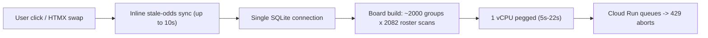
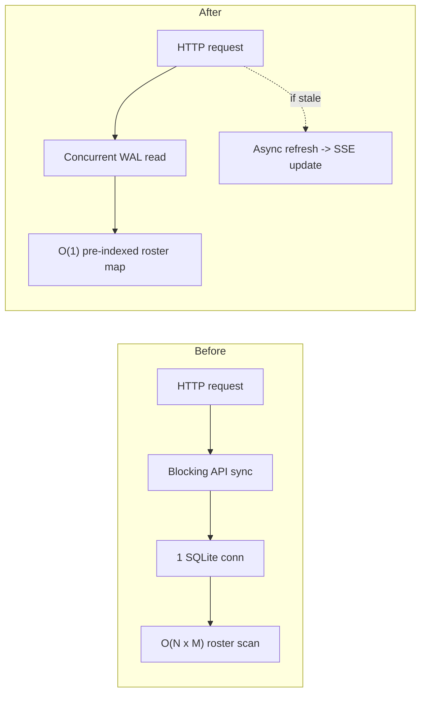

# Speed up pick board and page loads

## Context

During Sunday launch, clicking links to explore parlays on the pick board took 5–22 seconds per request, stacked into
multi-minute stalls, and caused 13 Cloud Run `429` aborts ("waiting too long for an available instance").

Production logs and a restored copy of the prod database (`15,543` odds rows, `2,082` roster rows) show three causes
piling up on the single `1` vCPU Cloud Run instance:

1. **O(N × M) normalization per request:** Building the pick board groups `15,543` odds rows into ~2,000+ selections and
   linearly scans all `2,082` roster players for every selection, normalizing player names ~8 million times on every
   page or HTMX partial load. Even `pick/slate` (zero external network calls) took `5.1s` solo and `11.1s–11.5s`
   alongside `pick/detail`. Four users loading `/pick` together took `20.9s–22.7s` each.
2. **Synchronous external syncs on clicks:** Opening the board, clicking a game, or switching tabs runs stale-odds
   refreshes inline on the HTTP request (blocking up to `10s` per timeout).
3. **Single-connection SQLite contention:** All reads and background sync writes share one pooled SQLite connection, so
   background refreshes stall page reads.

## Goals and non-goals

**Goals:**

- Make pick-board page loads, game switches, tab changes, and search respond in tens of milliseconds under multi-user
  Sunday traffic.
- Never block user navigation on external API calls or background sync writes.
- Eliminate Cloud Run `429` queue aborts caused by CPU saturation on the single instance.

**Non-goals:**

- Scaling out to multiple Cloud Run instances (single-instance SQLite and SSE hub remain the architecture).
- Introducing external caches such as Redis or Memcached.
- Changing API credit floors or Sunday pre-fill rules.

## Decision

Pre-index roster lookups once per board build instead of scanning and normalizing the full roster for every selection,
move pick-time odds refreshes off the synchronous request path so clicks always render from stored data and push live
updates over SSE, and allow concurrent SQLite WAL readers so reads do not stall behind background sync writes.

Raising Cloud Run CPU/instance limits or adding a full-page cache alone would either break the single-instance SQLite
design or hide an O(N × M) hotspot that worsens as the week's odds grow. Fixing the algorithmic scan and separating
reads from syncs solves the root cause within the free-tier footprint.

The `effort` rating is `medium` because the work spans board indexing, request-path/async refresh coordination, SSE
triggers, and SQLite read/write connection behavior across multiple packages while preserving credit and single-instance
invariants.
