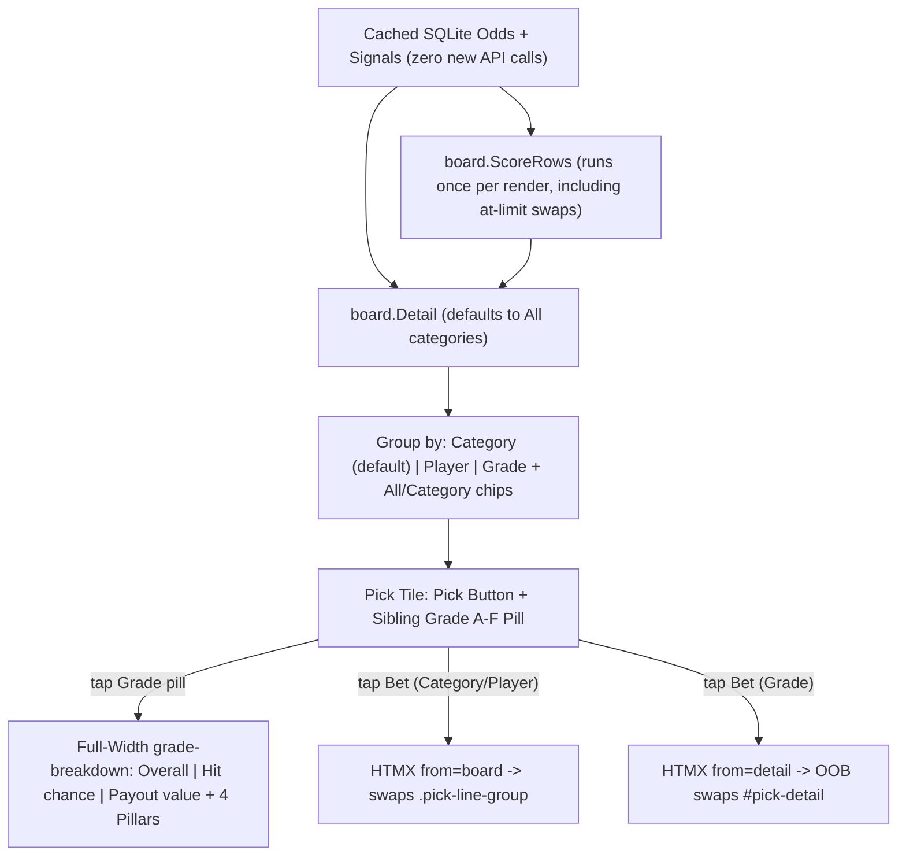

# Close-out

## Overview

## Consequences

- **Easier:** Browsing all bets in an open game in one scroll across `Category` (default with `All` + category chips), `Player` (all props for a player on one card plus `Game lines`), or `Grade` (`A`–`F` single-side buckets) without tab-hopping.
- **Easier:** Checking a bet's A–F grade before picking and distinguishing how often it hits (`Hit chance` from `CalibratedProb`) from how well it pays (`Payout value` from `Price & Vig`) across the pick board, tray, slip, and highlights without `+EV %` jargon.
- **Harder:** Maintaining pick-board HTMX mutations and 375px phone layout. `GroupByGrade` splits Over/Under pairs into single-side rows that require a `from=detail` OOB `#pick-detail` swap instead of `.pick-line-group` swaps, and pre-pick grade popovers must stay sibling `
` elements anchored to `.pick-line-group` / `.pick-grade-row` so they neither trigger form submits nor squeeze into half-width columns.
- **Revisit:** If friends consistently switch to `Player` or `Grade` on every visit, consider persisting the `group` choice instead of keeping it URL-query-only.

## Alternatives considered

- **Single-category tabs with a Grade sort:** Rejected because friends would still have to tap across six separate tabs to compare a game's best plays or view one player's full prop menu.
- **Three badges (Overall, Hit chance, Payout value) on each bet tile:** Rejected because triple meters on every tile crowd 375px phone screens. Keeping one `Grade A–F` pill on the tile and placing the 3-column summary strip inside the breakdown popover keeps the board scannable.
- **Inline accordion inside the 2-column bet grid:** Rejected because expanding inline inside `grid-cols-2` squeezes text to ~155px at 375px width and misaligns paired Over/Under buttons. Anchoring the `
` panel across the full `.pick-line-group` width gives ~319px width without shifting buttons.
- **Ad-hoc UI math or raw `+EV %` copy for payout value:** Rejected in favor of reusing v2's `CalibratedProb` and `Price & Vig` thresholds (`Strong value`, `Fair value`, `Slight juice`, `Steep juice`) so pre-pick and post-pick grades never drift and tone stays friendly.
- **Removing category chips when grouping shipped:** Rejected because keeping an `All` + category filter strip alongside the `Group by` switcher preserves one-tap narrowing to a single market like `TDs` or `Kicking`.

## Implementation notes

- Adding `relative` directly to `class="pick-line-group"` in `web/templates/partials.html` would have broken existing exact-class HTML assertions, so `.pick-line-group { position: relative; }` was added in `web/tailwind/input.css` and compiled into `web/static/app.css`.
- `GroupByGrade` renders individual sides outside `.pick-line-group`, so `from=board` could not update the row in place; `from=detail` was added to `POST`, `PUT`, and `DELETE` leg handlers to OOB-swap `#pick-detail` while keeping `?group=grade` and active filters.
- `pickDetailData` previously skipped loading board signals when `remainingSlots == 0`; it now loads signals whenever an open slip has rows so swap options at the leg limit still carry pre-pick grades.
- Under `EngineV1` (which sets `CalibratedProb == 0` and omits pillars), `HitChance` and `PayoutLabel` stay empty and the breakdown falls back to the overall grade and reasons.
- Legacy `Lines` and `Players` fields on `board.GameDetail` remain populated alongside `Sections` for compatibility with existing callers and tests.

## Follow-ups

- Remove the legacy `GameDetail.Lines` and `GameDetail.Players` fields (and migrate any remaining test assertions to `DetailSection` / `PickDetailView.Sections`) once no callers depend on them.
- Propose persisting the user's preferred `group` mode (`category`, `player`, or `grade`) in a cookie or SQLite setting if usage shows people repeatedly switching away from the `Category` default.
