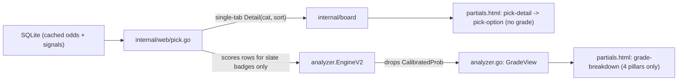
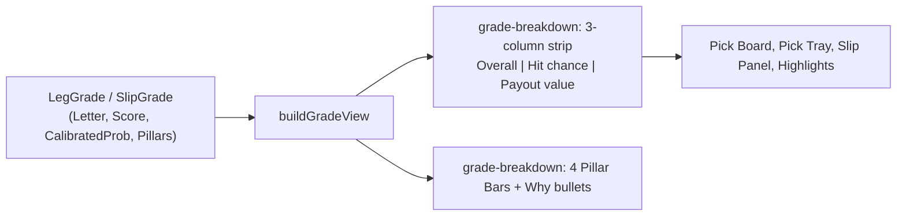
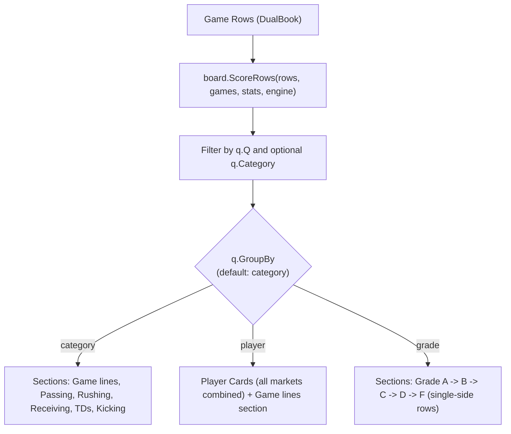

# Design: Pick board grouping, pre-pick grades, and grade breakdown

## Context

The slip pick board lives across three layers:

- `internal/board` turns cached `db.Game`, `db.Odds`, and `db.RosterPlayer` rows into pure, clock-injected `Row`,
  `Slate`, and `GameDetail` models (`board.go`, `signals.go`, `highlights.go`). Today `board.Detail` folds rows into a
  single active category tab (`Lines`, `Passing`, `Rushing`, `Receiving`, `TDs`, or `Kicking`) and returns either flat
  `Lines []LineGroup` (for `Lines`) or `Players []PlayerGroup` (for one prop category). `DetailSorts` supports `player`,
  `odds`, `line`, and `matchup`, with no grade sort and no grouping mode.
- `internal/analyzer` runs `EngineV2` (`grade_v2.go`) deterministically over cached SQLite signals (`LoadBoardSignals`
  and `LoadSlipSignals`). Both `LegGrade` and `SlipGrade` already populate `Letter`, `Score`, `CalibratedProb`,
  `MarketProb`, `Pillars` (`Price & Vig`, `Script Fit`, `Stability & Tail Risk`, `Context & Traps`), and `Uncertain`.
- `internal/web` (`pick.go`, `analyzer.go`, `slips.go`) and `web/templates/partials.html` render `#pick-body`,
  `#pick-slate`, `#pick-detail`, `pick-line-group`, `pick-option`, and the shared `grade-breakdown` partial.
  - `pickPageData` already loads `boardGames`/`boardStats` and scores every unpicked row to build the slate's game-card
    grade badges, but discards those scores before building `PickDetailView`.
  - `pickDetailData` currently skips loading board signals when `remainingSlots == 0`, so users at their leg limit
    swapping picks have no board signals.
  - `pick-option` wraps the entire bet tile in a `<button>` inside a `<form>` (or swap button), so interactive grade
    dropdowns cannot be nested inside it without breaking HTML validity and triggering accidental picks.
  - `buildGradeView` in `internal/web/analyzer.go` ignores `CalibratedProb` and does not expose a top-level
    **Overall / Hit chance / Payout value** summary in `grade-breakdown`.



Invariants to preserve:

- **Zero new external API calls:** Pre-pick grades and grouping read only cached SQLite rows and signals.
- **Friendly, never blocking:** Low grades never disable or block picks, and grade copy stays free of raw `+EV %`
  lectures.
- **Phone-first 375px layout:** All pick controls, two-column line pairs, and grade breakdown popovers must stay
  readable and tappable without horizontal overflow at 375px width.
- **Single-popover behavior:** Every grade dropdown uses `<details data-help-popover>` so `app.js`'s `closeHelpPopovers`
  closes open popovers on outside taps.

## Approach

### 1. Three-way summary in `GradeView` and `grade-breakdown`

Extend `GradeView` in `internal/web/analyzer.go` to carry the calibrated hit probability and a plain-language payout
value read alongside the existing `Letter`, `Score`, and `Pillars`:

```go
type GradeView struct {
    // existing fields...
    HitChance       string // e.g. "~61%" or "<1%"; empty when CalibratedProb <= 0
    PayoutLabel     string // "Strong value" | "Fair value" | "Slight juice" | "Steep juice"
    PayoutToneClass string // matches Price & Vig pillar tone
}
```

- `LegGradeView` passes `lg.CalibratedProb`; `SlipGradeView` passes `sg.CalibratedProb` (the copula-adjusted joint
  probability for multi-leg slips, or the single leg's calibrated probability for 1-leg slips).
- `formatHitChance(prob float64) string` formats `prob` in `(0, 1)` as `~%d%%` (or `<1%` below `0.005`, `>99%` above
  `0.995`), returning `""` when `prob <= 0` (such as under `EngineV1`).
- `payoutValueFromPillars(pillars []analyzer.PillarScore)` reads the `PillarPriceVig` pillar (`>= 85` ->
  `"Strong value"`, `>= 73` -> `"Fair value"`, `>= 58` -> `"Slight juice"`, `< 58` -> `"Steep juice"`) and reuses its
  semantic tone class. No `+EV %` numbers are exposed; the existing `Price & Vig` pillar summary below still names the
  fair vs. book price in plain language.
- In `web/templates/partials.html` (`grade-breakdown`), render a compact 3-column summary strip (`data-grade-summary`,
  `grid-cols-3 gap-1.5`) above the pillar bars whenever `HitChance` or `PayoutLabel` is present:
  - **Overall:** `{{.Grade.Letter}} ({{.Grade.Score}})` styled with `.Grade.Class`
  - **Hit chance:** `{{.Grade.HitChance}}` (with muted label `"Hit chance"`)
  - **Payout value:** `{{.Grade.PayoutLabel}}` styled with `.Grade.PayoutToneClass` (with muted label `"Payout value"`)



### 2. Grouping modes and pre-pick scoring in `internal/board`

Add first-class grouping and pre-pick row grades to `internal/board`:

- **Types (`internal/board/board.go`):**
  - `type GroupBy string` with `GroupByCategory = "category"` (default), `GroupByPlayer = "player"`,
    `GroupByGrade = "grade"`, and `DetailGroupBys = []GroupBy{GroupByCategory, GroupByPlayer, GroupByGrade}`.
  - Add `SortGrade Sort = "grade"` to `DetailSorts` (`[]Sort{SortGrade, SortPlayer, SortOdds, SortLine, SortMatchup}`).
  - Add `Grade analyzer.LegGrade` to `board.Row`.
  - Add `GroupBy GroupBy` to `board.Query`.
  - Add `DetailSection` to `board.GameDetail`:

```go
type DetailSection struct {
    Key     string        // "lines", "passing", ..., "players", "grade_a", ...
    Label   string        // "Game lines", "Passing", "Grade A", ...
    Badge   string        // optional grade letter ("A".."F") for grade sections
    Count   int           // number of selectable options in this section
    Lines   []LineGroup   // paired game lines (Category: Lines, Player: Game lines)
    Players []PlayerGroup // player cards (Category: prop sections, Player: all props)
    Options []Row         // single-side rows (Grade mode, where Over/Under can differ)
}
```

- **Pure scoring pass:** Add `board.ScoreRows` taking `(rows, games, stats, engine)` to return a copy with `Row.Grade`
  populated for every non-`OTHER` row when its game is present in `games`, defaulting `engine` to
  `analyzer.ActiveEngine`.
- **Grouping behavior in `board.Detail`:**
  - Normalize `GroupBy`: empty or unknown defaults to `GroupByCategory`.
  - **Optional category filter (`q.Category`):** Unlike today (which forces `q.Category == ""` to `CategoryLines`), an
    empty `q.Category` now means **All categories**. The category chip bar gains a leading `"All"` chip alongside the
    non-empty categories (`Lines`, `Passing`, `Rushing`, `Receiving`, `TDs`, `Kicking`) so users can browse everything
    grouped by default or narrow to one category with one tap.
  - **`GroupByCategory` (default):** Emits one `DetailSection` per non-empty folded category in `tabCategories` order.
    `Lines` populates `section.Lines`; prop categories populate `section.Players`.
  - **`GroupByPlayer`:** Splits visible rows into player-market rows and game-line rows. Player-market rows fold into
    one `PlayerGroup` per canonical player across **all** categories (so a QB's Passing Yards, Passing TDs, Rushing
    Yards, and Anytime TD live on one card), ordered by the active sort (`SortGrade` sorts players by their highest
    `Row.Grade.Score`). Game-line rows sit in a `"Game lines"` section.
  - **`GroupByGrade`:** Buckets each visible row individually by `Row.Grade.Letter` into `Grade A`, `Grade B`,
    `Grade C`, `Grade D`, `Grade F`, plus `Ungraded` if any rows lack a grade. Empty buckets are omitted. Within each
    bucket, rows sort by `Grade.Score` descending, then active sort tiebreakers. Because Over and Under on the same prop
    can earn different grades, `GroupByGrade` renders single-side rows (`section.Options`) with full selection text
    (`Josh Allen Over 245.5 Pass Yds`).



### 3. Pick board handlers, pre-pick grade pills, and HTMX swaps

- **Query and hidden state (`internal/web/pick.go`):**
  - Parse `?group=` in `pickQuery`, preserve it in `pickHref`, `detailHref`, `swapURL`, `PickBodyView`, `PickSlateView`,
    `PickDetailView`, `PickSwapView`, and `#pick-group` hidden input (with OOB swap on `#pick-detail` updates).
  - Always load `boardGames` and `boardStats` in `pickDetailData` when `slip.Status == db.SlipOpen && len(rows) > 0`
    (even when `remainingSlots == 0`), so users at their leg limit see grades when swapping.
  - In `pickPairRow` (used by `from=board` add/update/delete), load signals for that single game and score its rows so
    the returned `pick-line-group` partial retains pre-pick grade pills.
- **Separating pick action from grade dropdown (`web/templates/partials.html`):**
  - Refactor `pick-option` into a card wrapper (`div`) with two sibling controls:
    1. The pick `<form><button type="submit">` (or swap `<button>`) covering the selection label, odds, implied chance,
       action hint, split-line badge, and matchup badge.
    2. A sibling grade pill `<details data-leg-grade data-help-popover>` when `.Grade.Letter != ""` showing
       `Grade {{.Grade.Letter}}` and expanding `{{template "grade-breakdown" ...}}`.
  - Anchor the expanded breakdown panel (`absolute left-0 right-0 z-30 mt-1`) against `relative` `.pick-line-group` (or
    `.pick-grade-row` in `GroupByGrade`) so at 375px phone width the popover spans the full card width (~319px) rather
    than squeezing into a half-width 155px grid column.
- **HTMX swap in `GroupByGrade`:**
  - In `GroupByCategory` and `GroupByPlayer`, options remain inside `.pick-line-group` and continue using `from=board`
    with `hx-target="closest .pick-line-group"`.
  - In `GroupByGrade`, where a single side sits in its grade bucket without its opposite side, options submit with
    `from=pick` (and include `#pick-q, #pick-cat, #pick-win, #pick-sort, #pick-group, #pick-game`) targeting
    `#pick-body` (or `#pick-detail` via a `from=detail` branch if we want zero slate flicker—using `from=pick` already
    works for `POST /slips/{id}/legs`, and adding `from=detail` for `POST`/`PUT`/`DELETE` lets all three mutations
    refresh only `#pick-detail` cleanly while keeping `Hx-Trigger: tray-updated, slip-updated`).

```mermaid
sequenceDiagram
  participant User
  participant Tile as Pick Option Card
  participant Server as slipHandlers
  User->>Tile: Tap "Grade A" pill (sibling <details>)
  Tile-->>User: Opens full-width grade-breakdown (Overall | Hit chance | Payout value + 4 pillars)
  Note over Tile: No form submit; outside tap closes via app.js
  User->>Tile: Tap bet button (add/remove/switch)
  alt Category or Player grouping
    Tile->>Server: HTMX from=board
    Server-->>Tile: Swaps closest .pick-line-group (with preserved Grade pills) + tray-updated
  else Grade grouping
    Tile->>Server: HTMX from=detail (with group=grade & filters)
    Server-->>Tile: Swaps #pick-detail (preserves grade buckets & filters) + tray-updated
  end
```

**Trade-offs considered:**

- **Inline accordion vs. popover for pre-pick grade details:** An inline accordion inside a 2-column `grid-cols-2` line
  pair would compress to ~155px at 375px and misalign the paired buttons. Anchoring the `<details>` panel across the
  full `.pick-line-group` width keeps both buttons aligned and gives the breakdown the same ~319px width it gets on the
  slip.
- **Grouping by default with optional category chips vs. removing category chips:** Removing category chips would make
  jumping straight to `TDs` or `Kicking` require extra scrolling. Keeping an `All` + category filter strip alongside the
  `Group by` switcher gives both full grouped scanning by default and one-tap narrowing.

## Verification

- Standard Go checks:
  `go generate ./... && golangci-lint run ./... && go test -short ./... && go test -short -race ./...` plus
  `good-vibes docs lint` after doc edits.
- **Grade breakdown summary (`internal/web/analyzer_test.go`, `internal/web/slips_test.go`):**
  - Verify `LegGradeView` and `SlipGradeView` populate `HitChance`, `PayoutLabel`, and `PayoutToneClass` from v2
    `CalibratedProb` and `Price & Vig` pillar, omit them cleanly under v1 (`CalibratedProb == 0`, no pillars), and never
    emit raw `+EV` strings.
  - Verify `grade-breakdown` renders `[data-grade-summary]` on slip legs, slip banner, pick tray, highlights, and
    pre-pick board options.
- **Board grouping and scoring (`internal/board/board_test.go`):**
  - Default `Detail` (`GroupBy == ""`, `Category == ""`) returns `GroupByCategory` with sections for all non-empty
    categories (`Lines`, `Passing`, `Rushing`, `Receiving`, `TDs`, `Kicking`), and `Category != ""` narrows to that
    category.
  - `GroupByPlayer` merges a player's props across multiple categories into one `PlayerGroup` card while keeping game
    lines in a `Game lines` section.
  - `GroupByGrade` buckets individual sides by `A`–`F` (splitting Over/Under when they earn different grades), omits
    empty buckets, and orders by descending score.
  - `SortGrade` orders rows, line groups, and player cards by descending grade score with deterministic tiebreaks.
- **Pick board handlers and HTMX flows (`internal/web/pick_test.go`):**
  - Opening `/slips/{id}/pick?game=<id>` renders `Group by` controls (`Category` active by default), grouped sections,
    and pre-pick grade pills on every gradable option—with zero calls to the external odds/props refresher beyond
    existing pick-time kick rules.
  - Switching `?group=player` and `?group=grade` via `/slips/{id}/pick/detail` returns valid grouped markup and OOB
    `#pick-group` hidden input.
  - Pre-pick `<details data-leg-grade data-help-popover>` sits outside `<button>` so tapping a grade pill cannot submit
    the pick form.
  - `POST`/`PUT`/`DELETE` with `from=board` returns `pick-line-group` with grade pills preserved; `from=detail` in
    `GroupByGrade` returns `#pick-detail` preserving `?group=grade` and active filters.
  - At-limit users (`remainingSlots == 0`) still see pre-pick grade pills on swap options.

## Risks

- **Nested interactive DOM or form submission bugs:** If a `<details>` element is accidentally placed inside a
  `<button>` or `<form>` submit area, tapping a grade pill on mobile will add or remove the bet. Mitigated by keeping
  `<details data-leg-grade>` as a sibling outside `<form>` and asserting the structure in `pick_test.go`.
- **Phone-width popover clipping or overflow:** Inside `lg:overflow-y-auto` or narrow 375px containers, an
  absolutely-positioned popover near the bottom or edges could clip horizontally. Mitigated by spanning `left-0 right-0`
  within `.pick-line-group` (bounded to the card width) and keeping `max-w-full` on the panel.
- **Render latency on large games:** Scoring all rows in a game happens once per open-game render; v2 scoring is
  sub-millisecond per game (~3.25ms for a full 16-game slate per `adr-grade-highlights`), so scoring one game adds
  negligible latency. Noticeable slowdowns would appear in `TestEngineV2FullSlateLatencyBudget` and server timing
  headers.
- **Existing test expectations on default `cat=lines`:** Existing unit tests in `internal/board/board_test.go` and
  `internal/web/pick_test.go` may assert that an omitted `cat` parameter defaults to `lines`. Updating those tests
  explicitly alongside the new default-all grouped behavior keeps coverage accurate without silently weakening checks.

## TODO

### Phase 1: Overall, hit chance, and payout value in the grade dropdown

Complexity: low (extends existing `GradeView` and `grade-breakdown` partial using values `EngineV2` already computes,
with no model or schema changes)

Risk: low (read-only presentation over existing analyzer outputs, verified directly by unit and template rendering
tests)

- [x] Extend `GradeView`, `LegGradeView`, and `SlipGradeView` in `internal/web/analyzer.go` to compute `HitChance` (from
      `CalibratedProb`) and `PayoutLabel`/`PayoutToneClass` (from the `Price & Vig` pillar, free of `+EV %` copy),
      render the 3-column **Overall / Hit chance / Payout value** summary strip in `grade-breakdown`
      (`web/templates/partials.html`), and cover v2 legs, v2 multi-leg slips, and v1 fallback in
      `internal/web/analyzer_test.go` and `internal/web/slips_test.go`.
- [x] Docs: update `docs/concepts/analyzer.md` to document the Overall, Hit chance, and Payout value summary strip
  inside the grade breakdown popover.

### Phase 2: Board grouping modes and pre-pick row scoring

Complexity: medium (adds `GroupBy` modes, `SortGrade`, `DetailSection`, and `ScoreRows` to `internal/board`,
coordinating default-all grouped sections, cross-category player merging, and per-side grade bucketing while keeping
existing category filtering and sorting consistent)

Risk: low (pure in-memory board transformations over cached data with deterministic unit tests in
`internal/board/board_test.go`)

- [x] Add `GroupBy` (`category`, `player`, `grade`), `SortGrade`, `Row.Grade`, `DetailSection`, and `ScoreRows` to
  `internal/board/board.go`, updating `board.Detail` so empty `GroupBy` defaults to `GroupByCategory` across all
  non-empty categories (with optional `Category` narrowing), `GroupByPlayer` merges each player's props across
  categories alongside a `Game lines` section, and `GroupByGrade` buckets individual sides by `A`–`F` with tests in
  `internal/board/board_test.go`.

### Phase 3: Slip pick board grouped UI, pre-pick grade pills, and HTMX wiring

Complexity: medium (wires `?group=` query state, cached signal loading for all open-slip pick views including at-limit
swaps, `from=detail` HTMX mutation responses for Grade mode, and mobile-safe sibling grade popovers across
`internal/web/pick.go`, `internal/web/slips.go`, and `web/templates/partials.html`)

Risk: medium (modifies primary pick-board templates and HTMX swap targets where phone-width popover layout and
button/popover separation are only partially verified by HTML/handler tests)

- [x] Wire `GroupBy`, `SortGrade`, and `board.ScoreRows` through `internal/web/pick.go` and `internal/web/slips.go`
      (including at-limit `pickDetailData`, `pickPairRow`, and `from=detail` add/update/delete swaps for
      `GroupByGrade`), with handler and zero-extra-refresh tests in `internal/web/pick_test.go`.
- [x] Update `pick-detail`, `pick-line-group`, and `pick-option` in `web/templates/partials.html` (and regenerate
      Tailwind CSS if needed) to render the `Group by` switcher (`Category` default, `Player`, `Grade`), `All` +
      category filter chips, grouped sections, and sibling pre-pick `Grade A–F` popovers anchored to full card width at
      375px, with template/DOM assertions in `internal/web/pick_test.go`.
- [ ] Docs: update `docs/concepts/slips.md` (staying within its line budget) and `docs/reference/routes.md` to document
  default pick-board grouping (`?group=`), pre-pick grades, and `from=detail`.
