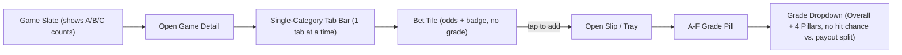
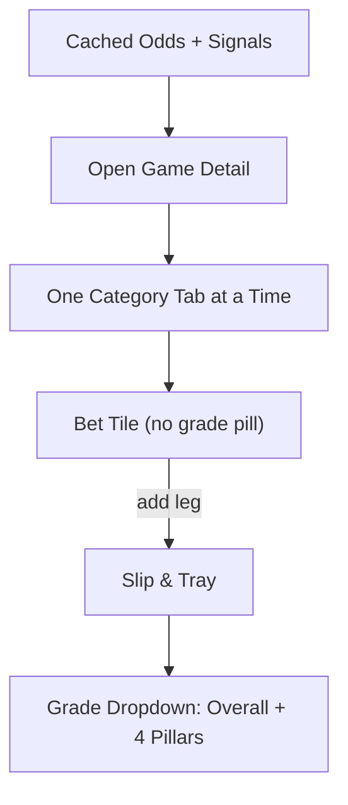
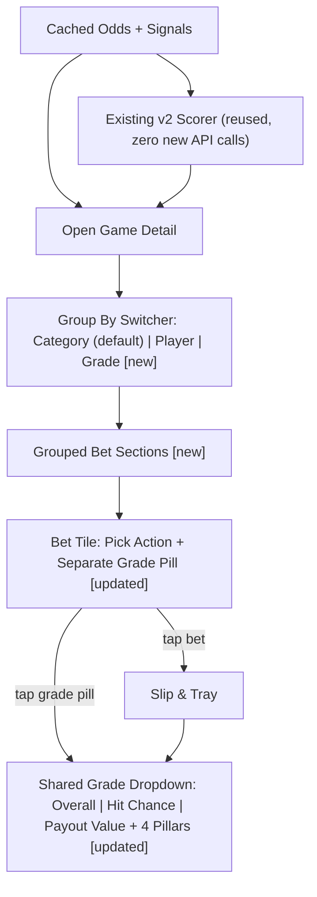

# Pick board grouping, pre-pick grades, and grade breakdown

## Context

Picking bets inside an open slip has three friction points today:

1. **Fragmented single-tab browsing.** Opening a game on the slip pick board forces a single-category tab bar (`Lines`,
   `Passing`, `Rushing`, `Receiving`, `TDs`, `Kicking`). You can only view one category at a time. A quarterback's
   passing, rushing, and touchdown props live on three separate tabs, and there is no way to scan all of a game's bets
   grouped by category, by player, or by grade in one scroll.
2. **Grades stay hidden until after you pick.** Game cards on the slate already score cached rows to display grade-count
   pills (`3A`, `5B`), and the top of a game shows up to three A-grade highlights. Yet the individual bet buttons
   themselves show only odds, implied chance, and optional matchup badges—never the bet's A–F grade. You have to add a
   leg to the slip (or leave for Research) to see how it grades.
3. **Grade details blur hit chance and payout value.** When you tap a grade pill on a slip or tray, the breakdown shows
   the overall letter, 0–100 score, and four pillar bars, but omits the calibrated hit probability that the v2 engine
   already computes. A safe `-140` volume prop (~61% fair hit chance) and a `+220` touchdown swing (~35% fair hit chance
   with strong payout value) can both earn an `A` without clearly separating how likely they are to hit from how well
   they pay.

## Goals and non-goals

**Goals:**

- Enable grouping by default inside an open game on the slip pick board, with three switchable modes: **By Category**
  (default: Game Lines, Passing, Rushing, Receiving, TDs, Kicking), **By Player** (all of a player's props across
  categories in one card, plus Game Lines), and **By Grade** (A through F, strongest plays first).
- Show each bet's A–F grade pill directly on the pick board before picking, scored from already-cached SQLite odds and
  signals with zero extra external API calls.
- Let a user tap any pre-pick grade pill to inspect its breakdown without accidentally adding, removing, or swapping the
  bet.
- Differentiate **Overall grade**, **Hit chance** (calibrated fair win probability), and **Payout value**
  (plain-language return/value read vs. fair odds) inside the grade breakdown dropdown across the pick board, pick tray,
  and slip views—free of raw "+EV %" lectures.
- Keep grouped views, pre-pick grade pills, and grade breakdowns fast to scan and easy to tap at 375px phone width.

**Non-goals:**

- Changing the v2 grading model, pillar weights, or A–F band cutoffs.
- Triggering paid odds or prop API calls to populate pre-pick grades.
- Replacing the standalone Research Explorer tab or blocking any low-grade pick.
- Persisting per-user grouping preferences in SQLite.

## Decision

Default the slip pick board's open-game view to grouped sections (`Category`, `Player`, or `Grade`), add clickable A–F
grade pills to every gradable bet before picking via the cached v2 scorer, and surface an
**Overall / Hit chance / Payout value** summary strip at the top of the shared grade breakdown dropdown.

### Before

### After

**Why this shape:**

- **Grouping by default beats single-category tabs with a grade sort.** Adding a "Sort by Grade" chip inside the
  existing tabs would still force friends to tap across six tabs to compare a game's best plays or see a player's full
  prop menu. Defaulting to grouped sections with `Category` (default), `Player`, and `Grade` modes makes every browsing
  pattern one tap away while keeping search and sort intact.
- **One grade pill on the tile + three-way split in the dropdown beats triple badges on every bet.** Showing separate
  Overall, Hit Chance, and Payout ROI meters directly on every bet tile would crowd 375px phone screens. Keeping one
  compact A–F pill on the tile and placing the **Overall / Hit chance / Payout value** strip inside the grade dropdown
  keeps the board scannable and gives full clarity on tap.
- **Reusing v2's existing calibrated probability and Price & Vig outputs beats ad-hoc UI math.** The v2 engine already
  computes calibrated fair hit probabilities (for both individual legs and copula-adjusted slips) and evaluates offered
  odds against fair value in the Price & Vig pillar. Surfacing those exact values in plain language—such as fair hit
  chance alongside a plain payout-value read ("Good value · fair -120 vs. -110")—means zero model drift and no "+EV %"
  lecture copy, and keeps pre-pick grades identical to post-pick slip grades.

**Complexity (`medium`):** Coordinates across new grouping modes in the board layer, pre-pick leg scoring in the
pick-board handlers and partials without triggering API fetches, nested interactive grade toggles inside pickable bet
tiles, and surfacing calibrated hit chance and payout value in the shared grade breakdown across pick, tray, and slip
views.

**Risk (`medium`):** Changes the primary slip pick-board DOM, HTMX partial swaps for add/remove/switch/swap actions, and
shared grade dropdowns where phone-width layout issues or accidental form submissions from tapping a grade pill are only
partially caught by Go unit and HTML tests; scoring and grouping stay read-only over cached SQLite data with strong
deterministic test coverage.
