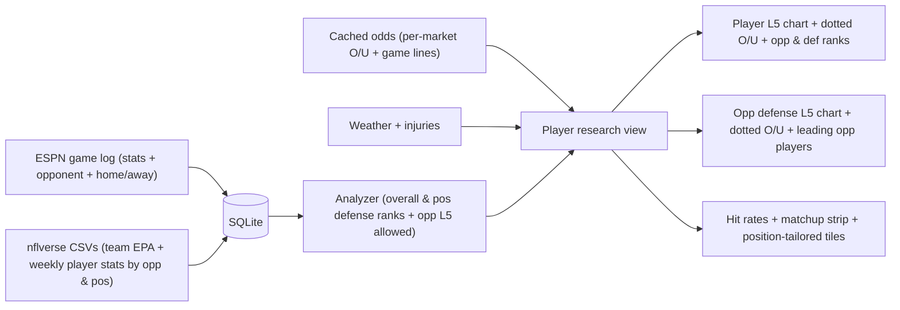

# Close-out

## Overview

## Consequences

- **Easier:** Judging a player's Last-5 form in context with per-game opponent labels, overall and position-specific defense ranks, and a dotted O/U line on both charts.
- **Easier:** Comparing a prop line against what the leading opposing player at the same position put up against this week's defense over its last 5 games.
- **Easier:** Switching market tabs without carrying over the previous market's O/U line, and reading role-fit usage tiles for QBs, RBs, WRs/TEs, and Ks on phone screens.
- **Harder:** Maintaining wider schemas and upsert/scan mappings across `player_gamelogs` and `nflverse_player_weeks` whenever new weekly stats are added.
- **Revisit:** Selecting only the single leading opposing player per game for the opposing-defense Last-5 chart if users later want position-room totals or multi-player breakdowns.

## Alternatives considered

- **New external stats provider:** Rejected because retaining unused fields from already-fetched ESPN game logs and nflverse CSVs costs zero API credits and works offline in local dev.
- **Position-group sums for opposing defense L5:** Rejected because combined WR or RB room totals dwarf a single player's prop line and make the shared dotted O/U line unreadable; using the leading opposing player per game keeps the scale directly comparable.
- **Changing `player_gamelogs.stats_json` structure:** Rejected because altering `stats_json` would break existing analyzer callers and pre-sync cached rows; adding `games_json` kept backward compatibility intact.
- **Client-side JS charting library:** Rejected to keep zero JS bundle overhead, preserve HTMX partial swaps, and maintain predictable 375px phone-width layout.

## Implementation notes

- Cached `player_gamelogs` rows written before migration `0015` have empty `games_json` until their next 6-hour refresh, so those players temporarily fall back to `L5`–`Last` labels without per-bar opponent badges.
- Players missing an `espn_id` in the nflverse `players.csv` crosswalk are absent from `nflverse_player_weeks`, which can leave opposing-defense L5 bars or usage tiles sparse for rookies, backups, or early-season weeks (`<5` games).
- Phone-width (375px) five-bar charts rely on compact, truncated footers (`@OPP`, defense rank badges, abbreviated player names) to fit without horizontal scrolling.

## Follow-ups

None.
