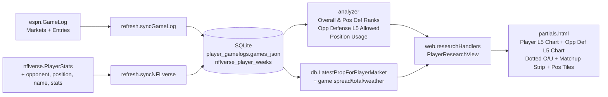
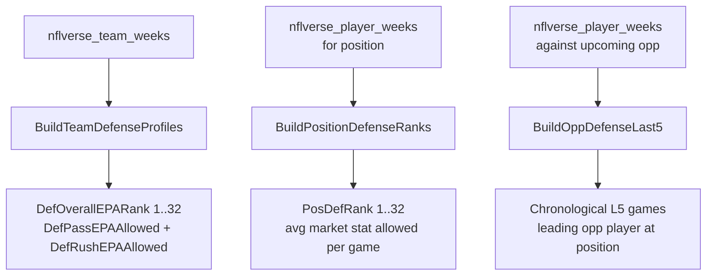

# Design: Player research charts and matchup context

## Context

The player research flow spans four packages today:

- `internal/ingest/espn` (`gamelog.go`) fetches ESPN's athlete gamelog endpoint and extracts only `Markets map[string][]float64` (most recent first), discarding the top-level `events` map that already contains each game's `week`, `atVs` (`@`/`vs`), `opponent.abbreviation`, `gameResult`, and `score`.
- `internal/ingest/nflverse` (`player_stats.go`, `team_stats.go`) fetches free weekly season CSVs from `nflverse-data`. `stats_player_week_{season}.csv` already includes `opponent_team`, `player_display_name`, `position`, `attempts`, `passing_yards`, `passing_tds`, `rushing_yards`, `rushing_tds`, `receptions`, `receiving_yards`, `receiving_tds`, `fg_made`, and `pat_made`, but `internal/refresh/nflverse.go` currently persists only usage and total EPA into `nflverse_player_weeks`.
- `internal/analyzer/signals.go` aggregates `nflverse_team_weeks` into `TeamDefenseProfile` (pass/rush EPA ranks `1..32`, no overall defense rank) and exposes `LoadPlayerResearchSignals` (L3 snap %, target share, WOPR, and one season-level opponent pass/rush rank).
- `internal/web/research.go` and `web/templates/partials.html` (`research-player`) render one Last-5 bar chart (`L5`..`Last` labels, no dotted O/U line), four fixed WR-centric usage tiles, and resolve `LatestPropForPlayer` without filtering by the selected market (while `buildMarketOptions` carries the old market's `line` query parameter across market tabs).

Key invariants to preserve:
- Zero additional paid odds API calls; all new stats come from already-fetched ESPN, nflverse, Open-Meteo, and cached `odds` rows.
- Existing `player_gamelogs.stats_json` (`map[string][]float64`) remains backward-compatible so `internal/analyzer/signals.go` and cached rows before re-sync keep working.
- Single SQLite database (`internal/db/migrations/0015_research_context.sql` additive migration only), phone-first server-rendered HTML/Tailwind with no JS charting library.

## Approach

### Data flow and package seams

### 1. Game log opponent metadata (`internal/ingest/espn`, `internal/db`, `internal/refresh`)

- Extend `espn.rawGamelogResponse` with `Events map[string]rawGamelogEvent` (`week`, `atVs`, `gameResult`, `score`, `opponent.abbreviation`).
- Add `GameLogEntry{EventID, Week, Opponent, AtVs, Result, Score}` and `Entries []GameLogEntry` to `espn.GameLog`, populated in lockstep with `Markets` (most recent regular/postseason games first).
- Migration `0015_research_context.sql` adds `games_json TEXT NOT NULL DEFAULT '[]'` to `player_gamelogs` without altering `stats_json`.
- `db.PlayerGameLog` gains `GamesJSON string`, written by `refresh.syncGameLog` and read by `internal/web/research.go`. Missing or shorter `games_json` (pre-sync rows) degrades cleanly to `L5`..`Last` labels.

### 2. nflverse weekly opponent & position stats (`internal/ingest/nflverse`, `internal/db`, `internal/refresh`)

- Extend `nflverse.PlayerWeek` and `playerStatsColumns` to parse `opponent_team` (mapped through `mapTeam`), `player_display_name` (falling back to `player_name`), `position`, `attempts`, `fg_made`, and `pat_made`.
- Migration `0015_research_context.sql` adds additive columns to `nflverse_player_weeks`:
  - `opponent TEXT NOT NULL DEFAULT ''`, `player_name TEXT NOT NULL DEFAULT ''`, `position TEXT NOT NULL DEFAULT ''`
  - `pass_att`, `pass_yds`, `pass_tds`, `rush_yds`, `rush_tds`, `receptions`, `rec_yds`, `rec_tds`, `kicker_pts` (all `INTEGER NOT NULL DEFAULT 0`)
  - Index `idx_nflverse_player_weeks_opp_pos ON nflverse_player_weeks (season, season_type, opponent, position, week_num DESC)`
- Update `db.NFLversePlayerWeek` and `UpsertNFLversePlayerWeeks` (including the `WHERE ... IS NOT excluded...` diff clause so unchanged rows keep `updated_at`).
- Add store queries:
  - `NFLversePlayerWeeksAgainstOpponent(ctx, opponent, position string, season int, seasonTypes ...int)`
  - `NFLversePlayerWeeksForPositionTypes(ctx, position string, season int, seasonTypes ...int)`
- Position normalization maps `FB`/`HB` to `RB` and preserves `QB`, `RB`, `WR`, `TE`, `K`.

### 3. Overall & position defense ranks and Opponent L5 Allowed (`internal/analyzer`)

- **Overall defense rank (`1..32`, `#1` toughest):** `BuildTeamDefenseProfiles` computes `DefOverallEPAAllowed = DefPassEPAAllowed + DefRushEPAAllowed` (both are per-game EPA totals in nflverse team stats) and ranks ascending (`DefOverallEPARank`).
- **Position defense rank (`1..32`, `#1` toughest):** `BuildPositionDefenseRanks(rows, position, market)` groups rows for the normalized position by `(opponent, season_type, week_num)`, sums the active market stat allowed per game, averages across games played by each defense, and ranks ascending (`1` = fewest allowed). When `market` is empty, falls back to the position's primary market (`QB`→`PASS_YDS`, `RB`→`RUSH_YDS`, `WR`/`TE`→`REC_YDS`, `K`→`KICKER_PTS`).
- **Opposing defense Last 5 (`BuildOppDefenseLast5`):** Groups rows against this week's opponent for the player's position by `(season_type, week_num)`, takes the 5 most recent games, orders chronologically, and selects the leading opposing player at that position for each game (highest active market value, tie-broken by usage then player name). Using the leading opposing player (e.g., opposing WR1/RB1/TE1/QB1) makes each bar directly comparable to a single player's O/U prop line rather than inflating bars by summing an entire WR room.
- **Expanded `PlayerResearchSignals`:** `LoadPlayerResearchSignals` returns overall and position defense rank maps (`TeamDefProfiles`, `PosDefRanks`), `OppOverallDefRank`, `OppPosDefRank`, `OppDefenseL5`, plus L3 per-game averages (`CarriesPerGame`, `TargetsPerGame`, `PassAttPerGame`, `AirYardsShare`, `RZOppsPerGame`, `EPAPerGame`) from the player's already-loaded `nflverse_player_weeks`.

### 4. Market-specific O/U resolution, shared dotted-line chart, and phone-first view (`internal/db`, `internal/web`, `web/templates`)

- **Market-specific O/U lookup:** Add `Store.LatestPropForPlayerMarket(ctx, athleteID, playerName, team, market)` filtering `market_type = ?` when `market != ""`. In `buildMarketOptions`, omit `&line=...` from tab links so switching markets loads that market's own current O/U line; explicit `?line=` or `?leg_id=` on initial load still overrides.
- **Shared bar chart model (`BarChartView`) & dotted O/U line:**
  - Both the player's Last-5 chart and the opposing defense's Last-5 chart use the same chart scale (`maxVal = max(bars..., line, 1)`) inside an explicit relative plot container (`h-40`).
  - Each bar's height is a true percentage `round((val / maxVal) * 100)` (with `min-height: 2px` so zero games stay visible), and the horizontal dotted O/U line sits at `bottom: {{.LinePct}}%` (`border-t-2 border-dashed border-amber-300/80`) with an inline `O/U {{.LineStr}}` label.
  - Bar colors: emerald (`OVER`), rose (`UNDER`), amber (`PUSH`), sky (no line).
- **Player L5 bar annotations:** Below each bar, show `@OPP` / `vs OPP`, overall defense badge (`Def #N`), and position defense badge (`vs POS #N`), tinted by tier (`#1–#10` tough/rose, `#11–#22` neutral/slate, `#23–#32` soft/emerald).
- **Opposing defense L5 chart:** Rendered below the player L5 chart with header `{OPP} Defense · Last 5 vs {POS} · {Market}`, overall + position rank pills, the same dotted O/U line, and per-bar labels showing abbreviated player name (e.g. `J. Chase`), team, and week (`W8`).
- **Digestible extra stats:**
  - **Hit rates & range:** `L5 Hit` (`4/5`), `Season Hit` (`6/9`), and `L5 Range` (`Min–Max`) in the summary grid.
  - **Matchup context strip:** This week's opponent (`vs BAL` / `@ KC` + logo), cached Vegas spread and game total (`Spread -3.5 · O/U 48.5`), `Indoor` or outdoor weather (`temp · wind`), and a player injury badge when `roster_players.injury_status` is non-empty.
  - **Position-tailored usage tiles:**
    - `QB`: Pass Att/g (L3), EPA/g (L3), Rush Att/g (L3), Opp Def
    - `RB`: Snap % (L3), Carries/g (L3), Targets/g (L3), RZ Opps/g
    - `WR` / `TE`: Snap % (L3), Target share, Air Yards %, WOPR
    - Other / `K`: fallback to available tiles without showing zeroed WR metrics.

### Trade-offs & rejected options

- **Leading opposing player vs. position-group sum for Opp Defense L5:** Summing all WRs against a defense produces 150–250 yards/game, which dwarfs a single player's 65.5 O/U line and makes the dotted O/U comparison meaningless. Picking the leading opposing player at that position per game keeps the chart directly comparable to the active player's O/U line.
- **Additive `games_json` column vs. changing `stats_json` format:** Changing `stats_json` from `map[string][]float64` to a nested object would break existing cached rows, `internal/analyzer/signals.go`, and fixture tests. Keeping `stats_json` untouched and adding `games_json` is zero-risk and backward-compatible.
- **Server-rendered CSS/HTML bars vs. JS chart library:** Pure Tailwind/HTML keeps bundle size zero, works seamlessly with HTMX partial swaps (`hx-get="/research/players/{id}?market=..."`), and renders predictably at 375px phone width.

## Verification

- Standard checks: `go generate ./... && golangci-lint run ./... && go test -short -race ./...`
- **Ingest & storage:** Parse real ESPN fixtures (`gamelog_chase.json`, `gamelog_burrow.json`, `gamelog_mcpherson.json`) and verify `Entries` align 1:1 with `Markets` (opponent, `@`/`vs`, week, score). Parse `stats_player_week_2026.csv` and verify `opponent_team`, `player_display_name`, `position`, `attempts`, and kicker points round-trip through `0015_research_context.sql` and `UpsertNFLversePlayerWeeks` idempotently.
- **Analyzer rankings & opp L5:** Verify `DefOverallEPARank` (`1..32`), `BuildPositionDefenseRanks` (tie-breaking, multi-game averages, `FB`→`RB` normalization), and `BuildOppDefenseLast5` (chronological order, leading player selection per game, `<5` games early season, zero-value games).
- **Web handler & templates:** Test `GET /research?player_id=...` and `GET /research/players/{id}?market=...` for:
  - Dotted O/U line positioning (`LinePct`) and over/under/push bar classes on both charts.
  - Opponent + overall & position defense badges under each player L5 bar, and graceful fallback when `games_json` is empty or nflverse is stale.
  - Opposing defense L5 chart rendering similar players against this week's opponent.
  - Market tab switching resolving each market's own current O/U line (not carrying the prior market's line).
  - Position-tailored tiles for QB, RB, WR/TE, and matchup strip (spread, total, weather/indoor, injury status).

## Risks

- **Pre-existing cached `player_gamelogs` rows have empty `games_json` until next sync:** Handled by falling back to `L5`..`Last` labels and omitting per-bar opponent badges when `games_json` is empty; normal 6-hour gamelog staleness refreshes them automatically.
- **nflverse crosswalk gaps (`espn_id` missing for a rookie/backup):** A player without an `espn_id` in `players.csv` is omitted from `nflverse_player_weeks`. Mitigated because starters and prop-listed skill players are present in `players.csv`, and charts degrade cleanly when fewer than 5 games exist.
- **Phone-width overflow on 5-bar charts with defense badges:** Five columns at 375px have ~60px per column. Mitigated by keeping bar footers compact (`@BAL`, `D#4`, `WR#8`, `J. Chase`) with `truncate` and `text-[10px]` typography, and verifying in HTML tests and local dev.

## TODO

### Phase 1: Persist ESPN game-log opponents and nflverse weekly matchup stats

Complexity: low (follows existing ingest, migration, and store upsert patterns across ESPN and nflverse)
Risk: low (additive schema columns with safe defaults; existing `stats_json` contract unchanged and covered by fixture tests)

- [x] Extend `internal/ingest/espn/gamelog.go` to decode the `events` map into `GameLog.Entries` (aligned with `Markets`), add migration `internal/db/migrations/0015_research_context.sql` with `player_gamelogs.games_json` and the new `nflverse_player_weeks` columns and opponent/position index, and update `internal/db/players.go` and `internal/refresh/research.go` to store `games_json`, with unit tests against saved ESPN fixtures.
- [x] Extend `internal/ingest/nflverse/player_stats.go`, `internal/db/nflverse.go`, and `internal/refresh/nflverse.go` to parse, upsert, and query weekly opponent, player name, position, passing/rushing/receiving/kicking stats (`NFLversePlayerWeeksAgainstOpponent`, `NFLversePlayerWeeksForPositionTypes`), with fixture and store round-trip tests.
- [x] Docs: update `docs/reference/schema.md` and `docs/reference/data-sources.md` for migration `0015_research_context.sql`, `player_gamelogs.games_json`, and the expanded `nflverse_player_weeks` columns.

### Phase 2: Compute defense ranks, opponent L5 history, and market-specific O/U lookup

Complexity: medium (coordinates position normalization, overall and position-level 1..32 rankings, opposing-defense L5 aggregation, and market-filtered prop lookup across `internal/analyzer` and `internal/db`)
Risk: low (pure deterministic aggregation and read-only SQL query with thorough unit tests and soft-fail behavior when data is missing or stale)

- [x] Add `DefOverallEPAAllowed` and `DefOverallEPARank` to `analyzer.TeamDefenseProfile`, implement `BuildPositionDefenseRanks` and `BuildOppDefenseLast5` in `internal/analyzer/signals.go`, and expand `LoadPlayerResearchSignals` with defense rank maps, opposing defense L5 games, and position-relevant L3 usage averages, with unit tests covering edge cases (`<5` games, ties, `FB`→`RB`, stale nflverse).
- [ ] Add `Store.LatestPropForPlayerMarket` in `internal/db/odds.go` so player research resolves the current week's O/U line for a specific market without bleeding lines across market tabs, with unit tests in `internal/db/players_test.go`.

### Phase 3: Render dotted O/U charts, opposing defense L5 chart, and matchup context

Complexity: medium (reshapes `PlayerResearchView`, proportional dotted-line chart math, position-tailored stat tiles, and phone-first Tailwind markup across `internal/web/research.go` and `web/templates/partials.html`)
Risk: low (read-only research page with HTMX partial coverage and full handler/HTML assertions in `internal/web/research_test.go`)

- [ ] Update `internal/web/research.go` to resolve per-market O/U lines on tab switches, build proportional `BarChartView` data (including `LinePct`, hit rates, L5 min/max, player L5 opponent + overall/position defense badges, and opposing defense L5 bars), load this week's matchup context (opponent, cached spread/total, weather/indoor, player injury status), and assemble position-tailored usage tiles.
- [ ] Update `web/templates/partials.html` (`research-player`) with the phone-first matchup strip, hit-rate/range tiles, position-tailored usage row, horizontal dotted O/U reference line on both Last-5 charts, opponent and defense-rank badges on player bars, and the opposing-defense Last-5 chart; run `go generate ./...` and add comprehensive tests in `internal/web/research_test.go`.
