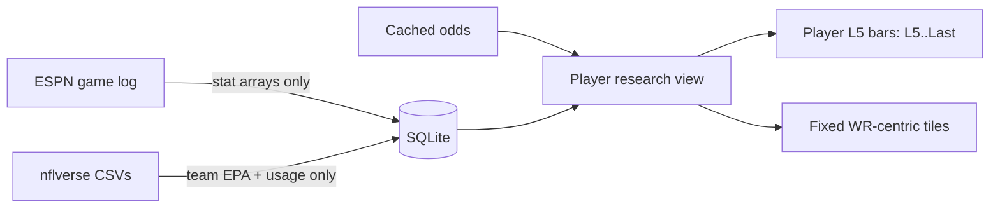
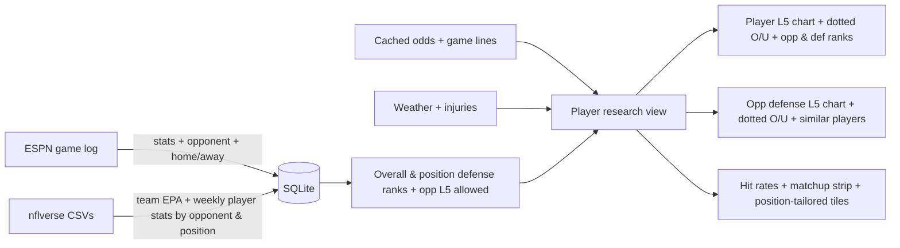

# Player research charts and matchup context

## Context

Today, the player research view shows a single Last-5 bar chart with generic `L5`–`Last` labels, four summary tiles (Line, L5 Median, Season Mean, Games), and four fixed tiles (L3 Snap %, Target share, WOPR, and one season-level opponent pass/rush rank). That leaves four gaps when researching a prop:

1. **No opponent context on past games.** Game logs drop each game's opponent and home/away indicator during ingest, so you cannot tell whether a hot streak came against bottom-tier defenses or top units, overall or at the player's position.
2. **No recent opposing-defense history.** You see one season-average rank for this week's opponent, not what opposing players at the same position actually put up against that defense over its last 5 games.
3. **No visual O/U line and sticky market lines.** Bars turn green or red, but there is no horizontal dotted O/U threshold to show how close each game was to the line. Switching market tabs also carries the previous market's line instead of resolving the new market's current O/U.
4. **WR-centric tiles and missing game context.** QBs and RBs see Target share and WOPR tiles that do not fit their role, while useful data we already store—L5/season hit rates, game total and spread, weather, player injury status, red-zone opportunities, carries, targets, and air-yards share—is absent.

## Goals and non-goals

**Goals:**

- Show each past game's opponent (home/away), overall defense rank, and position-specific defense rank on the player's Last-5 chart.
- Add an opposing-defense Last-5 chart showing how the leading opposing player at the same position performed in the active market over that defense's last 5 games, labeled with player and team.
- Draw a horizontal dotted O/U reference line on every player-research bar chart, with green bars over the line, red bars under, and amber on push, and resolve the current week's O/U line automatically when switching markets.
- Surface compact, phone-first context already available from free and cached feeds: L5 and season hit rates, recent floor/ceiling range, this week's matchup strip (opponent, spread, total, weather/indoor, injury status), and position-tailored usage tiles.
- Spend zero extra paid odds credits and add no new external providers or scheduled jobs.

**Non-goals:**

- Adding a client-side JavaScript charting library or interactive zoom/hover widgets.
- Changing analyzer warning rules, slip grading, or the game-research injury/matching view.
- Adding new paid data sources, extra scheduled syncs, or LLM summaries.

## Decision

Keep every new signal inside the existing free ingest and server-rendered research flow: retain per-game opponent metadata from ESPN game logs, retain weekly opponent, position, and market stats from the already-fetched nflverse player CSV, compute overall and position-specific defense ranks in the analyzer layer, and render both Last-5 charts with a shared dotted O/U threshold and position-aware stat tiles.

**Before:**

**After:**

Reusing the ESPN and nflverse feeds we already fetch beats adding a new stats API because it costs zero extra credits, works offline in the local sandbox, and keeps server-rendered charts fast at phone width without a JS charting library.

`complexity: medium` fits because the work coordinates contracts across four seams—game-log parsing, nflverse weekly storage, defense/position ranking logic, and server-rendered chart and market-line views—without concurrency risks or architectural redesign. `risk: low` fits because the changes stay confined to the read-only player research view and additive cached fields, with fixture-backed unit and handler tests covering every parser, ranking, and template path.
