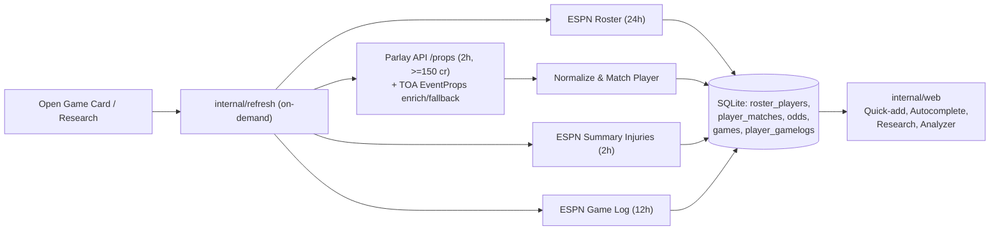

# Design: Props and research

## Context

`internal/ingest/odds` already parses Parlay API bulk props (`Client.Props`), The Odds API per-event props
(`Client.EventProps`), and cross-provider prop merging (`odds.MergeProps`), and the `odds` table already stores
`player_name`, `line`, `price`, `link`, `sid`, and `event_sid`. `0001_init.sql` also created `player_matches` and
`games.injuries_json`, and `internal/analyzer.AnalyzeSlip` already accepts `stats map[string]PlayerStats`. None of those
seams are wired into `internal/refresh`, `internal/db`, or `internal/web` yet.

Read before starting:

- `plan/data-sources.md`: Sources (`espn:summary:{game}`, `odds:props:{game}`, `espn:roster:{team}`,
  `espn:gamelog:{id}`), ESPN Summary/Roster/Game log, Parlay API and The Odds API props, and Player matching.
- `plan/analyzer.md`: `median_trap` rule and table tests.
- `plan/product.md`: Grading market-to-stat mapping and Screens (Research tab, 3-column `lg` layout).
- `plan/architecture.md`: Research routes (`GET /research/players/{espnID}`, `GET /research/games/{id}`).
- `docs/reference/data-sources.md`, `docs/concepts/data-refresh.md`, `docs/reference/schema.md`,
  `docs/concepts/analyzer.md`, `docs/reference/analyzer-rules.md`, `docs/concepts/slips.md`,
  `docs/reference/routes.md`.

## Approach



### ESPN ingest (`internal/ingest/espn`)

Add three methods on `*espn.Client`:

- `Roster(ctx, espnTeamID)` fetches `GET /teams/{espnTeamID}/roster` and flattens the position groups into
  `[]RosterPlayer{ID, FullName, Position}` (skipping athletes without an `id` or `fullName`).
- `SummaryInjuries(ctx, eventID)` fetches `GET /summary?event={eventID}` and returns the raw `injuries` JSON array (or
  `"[]"` when absent) plus a helper `ParseInjuries(rawJSON)` that extracts per-team injuries filtered to key positions
  (`QB`, `RB`, `WR`, `TE`, `LT`, `OT`, `C`, `CB`, `S`).
- `GameLog(ctx, athleteID)` fetches
  `GET https://site.web.api.espn.com/apis/common/v3/sports/football/nfl/athletes/{athleteID}/gamelog`. `espn.Client`
  stores a `webBaseURL` that defaults to `https://site.web.api.espn.com/apis/common/v3/sports/football/nfl`, or uses
  `baseURL` when a custom base URL is passed so `httptest.NewServer` works with one URL. The parser reads `labels`/`names`
  by header name (never by positional index), walks the current season's regular-season and postseason event rows most
  recent first, counts `GamesPlayed`, and populates `Markets map[string][]float64` for `PASS_YDS`, `PASS_TDS`,
  `RUSH_YDS`, `RUSH_ATT`, `REC_YDS`, `RECEPTIONS`, `ANYTIME_TD` (rushing + receiving + return TDs), and `KICKER_PTS`
  (`FG made * 3 + XP made`).

### Storage and player matching (`internal/db`)

Add migration `0007_props_research.sql` creating two tables:

```sql
CREATE TABLE roster_players (
  athlete_id   TEXT PRIMARY KEY,
  team         TEXT NOT NULL,
  espn_team_id TEXT NOT NULL,
  full_name    TEXT NOT NULL,
  norm_name    TEXT NOT NULL,
  position     TEXT NOT NULL DEFAULT '',
  updated_at   TEXT NOT NULL
);
CREATE INDEX roster_players_team_norm ON roster_players(team, norm_name);

CREATE TABLE player_gamelogs (
  athlete_id   TEXT PRIMARY KEY,
  games_played INTEGER NOT NULL DEFAULT 0,
  stats_json   TEXT NOT NULL DEFAULT '{}',
  updated_at   TEXT NOT NULL
);
```

- `NormalizePlayerName(name string) string`: lowercases, strips `.`, `'`, `-`, and `,`, collapses whitespace, and drops
  a trailing generational suffix (`jr`, `sr`, `ii`, `iii`, `iv`, `v`) when preceded by a space.
- `ResolvePlayerMatch(ctx, oddsName, homeTeam, awayTeam)`:
  1. Normalizes `oddsName`. If empty, returns unmatched.
  2. Checks `player_matches` for `(norm, homeTeam)` and `(norm, awayTeam)`. If a `manual = 1` row exists, it wins
     immediately. If one unambiguous cached row exists, returns its `(espn_athlete_id, team)`.
  3. On a miss, queries `roster_players` for `team IN (homeTeam, awayTeam) AND norm_name = norm`.
  4. If exactly one athlete matches across both teams, upserts `player_matches(odds_name, team, espn_athlete_id, manual=0)`
     and returns `(athlete_id, team)`. If zero or multiple athletes match, leaves `player_id` empty so the user can
     resolve it on the research view without guessing.
- `SaveManualPlayerMatch(ctx, oddsName, team, athleteID)` writes `manual = 1` in `player_matches`, removes any
  conflicting non-manual row for the other team in that matchup if needed, and backfills `team` and `player_id` on
  matching `odds` and `legs` rows.

### On-demand refresh (`internal/refresh`)

Props, rosters, injuries, and game logs are synced lazily through `singleflight` and the 5-minute failure backoff:

- `OddsPropsSource(gameID)` (`odds:props:{game}`): stale after 2 hours, skipped once `now >= game.Kickoff`.
  - Runs `SyncRoster` for both teams (`espn:roster:{home_espn_id}` and `espn:roster:{away_espn_id}`, stale after 24 h)
    before matching prop players.
  - Checks Parlay API credit floor `OddsPropsFloor = 150` (using the game's `OddsEventID`, or refreshing `/events` first
    when `OddsEventID` is nil or `odds:lines` has no recorded balance). Calls `Props(ctx, eventID)`.
  - When The Odds API is configured: if Parlay API bought props and The Odds API has `>= TheOddsAPIEnrichFloor` (100),
    calls `EventProps` and merges via `odds.MergeProps` so DraftKings prop deep links populate. If Parlay API is
    unconfigured, errors, returns no props, or sits below 150 credits, falls back to The Odds API `EventProps` when at
    least `TheOddsAPIFallbackFloor` (25) credits remain.
  - Maps `TEAM_TOTAL` subjects from full team display name to the game's ESPN abbreviation (`HomeTeam`/`AwayTeam`), and
    resolves player props via `ResolvePlayerMatch` to fill `Team` on each `db.Odds` row.
  - Upserts the prop rows into `odds` and records `odds:props:{game}` in `sync_state`.
- `SummarySource(gameID)` (`espn:summary:{game}`): stale after 2 hours, skipped when `game.Status == db.GameFinal`.
  Stores raw `injuries_json` on `games`.
- `GameLogSource(athleteID)` (`espn:gamelog:{id}`): stale after 12 hours. Upserts `player_gamelogs`.
- Synchronous on-demand entry points on `*refresh.Service` (`SyncGameProps(ctx, gameID)`, `SyncGameResearch(ctx, gameID)`,
  `SyncPlayerResearch(ctx, athleteID)`) wait up to a short request timeout (10 s) so opening a game card or research
  partial returns freshly fetched data on the first open, while `Kick()` also refreshes stale game logs for any matched
  `player_id` on the current week's slips.

### Analyzer (`internal/analyzer` and `internal/web/analyzer.go`)

Add `medianTrap` to `rules` in `internal/analyzer`:

- Fires `Warn` with rule ID `"median_trap"` on `PASS_YDS`, `RUSH_YDS`, or `REC_YDS` legs where `Side == "OVER"`,
  `Line != nil`, `PlayerID != ""`, and `stats[leg.PlayerID].Games[leg.Market]` has at least 3 games.
- Computes the median of `games[:min(5, len(games))]` and the mean of all `games` in the slice.
- Triggers when `*leg.Line > median`.
- Message: `"{Player}'s last-5 median is {median} yards, so {line} is a stretch."` When `*leg.Line < mean`, appends
  `" His {mean}-yard average is propped up by one big game."`
- `internal/web/analyzer.go` loads `player_gamelogs` for every distinct `leg.PlayerID` on the slip and passes the
  resulting `map[string]analyzer.PlayerStats` into `analyzer.AnalyzeSlip`.

### Web routes and views (`internal/web`, `web/templates/`)

- **Expanded game card props (`GET /games/{id}/props`):** Expanding a game card on `/games` keep-alive loads
  `GET /games/{id}/props` via HTMX (`hx-trigger="toggle once"` on the card's `<details>`). The handler calls
  `SyncGameProps`, reads the game's current prop `odds` rows (home book else median, matching game lines), and renders
  quick-add pills for `TEAM_TOTAL` and player props alongside links to `/research?game_id={id}` and each matched
  player's research view.
- **Leg form player autocomplete:** `GET /slips/{id}/legs/new` and `GET /legs/{id}/edit` populate a `<datalist>` of
  roster and prop player names for the week's games. `legFromForm` resolves `player_id` (and `team` when blank) through
  `ResolvePlayerMatch` when a player market leg is saved.
- **Research tab and partials:**
  - `GET /research`: full page with a week game selector and player search/picker, pre-loading `?game_id=` or
    `?player_id=` (`&leg_id=`, `&market=`, `&line=`) when linked from a game card or slip leg.
  - `GET /research/games/{id}`: syncs game research (injuries, rosters, props), renders key injuries per team filtered
    to `QB`, `RB`, `WR`, `TE`, `LT`, `OT`, `C`, `CB`, `S`, and shows a player-match section where any unmatched (or matched)
    prop player can be linked to an ESPN roster athlete via `POST /research/matches`.
  - `GET /research/players/{espnID}`: syncs `espn:gamelog:{espnID}`, resolves the active market and comparison line
    (from `?leg_id=`, `?market=`/`?line=`, or the player's latest prop in `odds`), and renders last-5 vertical/horizontal
    hit bars (green over the line, red under), the L5 median and season mean callouts, and season games played.
  - **Responsive layout:** On phone width, Slip, Games, Research, and Record Book remain bottom-nav tabs. At `lg` width
    and up, the workspace widens and links/embeds Game and Research panels cleanly beside the slip.

## Verification

- `go test ./...` and `golangci-lint run ./...` pass; each `TestLive*` skips under `-short`.
- Player matching unit tests cover suffixes (`Jr.`, `II`, `III`, `IV`, `V`), punctuation (`A.J. Brown`,
  `De'Von Achane`, `Amon-Ra St. Brown`), manual override persistence (`manual = 1` never overwritten by auto-match), and
  a same-name player on another team not in the game vs ambiguous same-name players on the game's teams.
- `median_trap` table tests verify both sides of every threshold: `line > L5 median` triggers; `line <= L5 median`,
  `< 3` games, `UNDER` side, non-yardage markets (`RECEPTIONS`, `PASS_TDS`), and unmatched players (`PlayerID == ""`) do
  not trigger; the season-mean sentence appears only when `line < mean`.
- Refresh tests with a fake clock and stubbed odds clients verify that opening the same game twice within the 2-hour
  cache window spends Parlay API credits only once, skips props after kickoff or below the 150-credit floor, and falls
  back or enriches with The Odds API per the credit floors.
- Handler tests verify `GET /games/{id}/props`, `GET /research`, `GET /research/games/{id}`,
  `GET /research/players/{espnID}?leg_id=`, `POST /research/matches`, leg-form `<datalist>` autocomplete, and phone-first
  rendering.

## Risks

- **ESPN gamelog and summary JSON structures:** ESPN's `site.web.api.espn.com` gamelog and `site.api.espn.com` summary
  endpoints are unofficial and deeply nested. Saving real responses into `internal/ingest/espn/testdata/` in Phase 1 and
  parsing stat columns by `labels`/`names` rather than index guards against field shifts.
- **Credit drain from repeated HTMX triggers:** If expanding/collapsing a `<details>` card fired a request on every
  toggle, users could hammer the endpoint. Using `hx-trigger="toggle once"` on the card and enforcing the 2-hour
  `odds:props:{game}` cache window + `singleflight` in `internal/refresh` ensures at most one 3-credit fetch per game per
  2 hours.
- **Unmatched sportsbook player names:** Sportsbooks occasionally use nicknames (`Gabe Davis` vs `Gabriel Davis`).
  Unmatched props still render as quick-add pills using the sportsbook `player_name`, and the manual match form on the
  game research view lets anyone in the group link the player once (`manual = 1`).

## TODO

Effort: hard (spans three new ESPN endpoints, a schema migration, player normalization and matching, metered on-demand prop refresh, the `median_trap` analyzer rule, and the Research UI)

### Phase 1: ESPN rosters, game logs, injuries, and player matching

- [x] Save real ESPN `roster`, `gamelog`, and `summary` fixtures under `internal/ingest/espn/testdata/`, and add
      `Client.Roster`, `Client.GameLog`, `Client.SummaryInjuries`, and `ParseInjuries` in `internal/ingest/espn` with
      fixture unit tests and `TestLive*` tests that skip under `-short`
- [x] Add migration `0007_props_research.sql` (`roster_players` and `player_gamelogs`), Store methods for rosters, game
      logs, `games.injuries_json`, and `player_matches`, plus `NormalizePlayerName`, `ResolvePlayerMatch`, and
      `SaveManualPlayerMatch` with unit tests for suffixes, punctuation, manual overrides, and same-name players across
      teams

### Phase 2: On-demand prop refresh and ESPN research syncs

- [x] Add `SyncGameProps`, `SyncGameResearch`, and `SyncPlayerResearch` (plus background gamelog sync for matched slip
      legs) in `internal/refresh` for `odds:props:{game}` (2 h window, 150-credit Parlay API floor, The Odds API
      `EventProps`/`MergeProps` enrichment and fallback, skipped after kickoff), `espn:roster:{team}` (24 h),
      `espn:gamelog:{id}` (12 h), and `espn:summary:{game}` (2 h, non-final), with fake-clock tests proving that opening
      the same game twice within the cache window spends credits once
- [x] Docs: update `docs/reference/data-sources.md`, `docs/concepts/data-refresh.md`, and `docs/reference/schema.md`
      with ESPN rosters, game logs, summary injuries, `odds:props:{game}`, and player matching, and delete those built
      sections from `plan/data-sources.md`

### Phase 3: `median_trap` analyzer rule

Effort: medium (self-contained pure rule in `internal/analyzer` and store-to-analyzer wiring in `internal/web`)

- [x] Add the `median_trap` rule in `internal/analyzer` with table-driven threshold tests (`line > L5 median`,
      `line <= median`, `< 3` games, unmatched player, and the `line < mean` sentence) and wire stored
      `player_gamelogs` into `internal/web/analyzer.go` with handler tests
- [x] Docs: update `docs/reference/analyzer-rules.md` and `docs/concepts/analyzer.md` with `median_trap` and live player
      stats, and remove the built `median_trap` section from `plan/analyzer.md`

### Phase 4: Prop quick-add, player autocomplete, and Research tab

- [ ] Add `GET /games/{id}/props` for on-demand prop quick-add pills on expanded game cards, player `<datalist>`
      autocomplete in the leg form, and automatic `player_id`/`team` resolution when saving a leg in `internal/web`,
      with handler tests
- [ ] Build `GET /research`, `GET /research/games/{id}`, `GET /research/players/{espnID}`, and `POST /research/matches`
      (last-5 hit bars with median and mean marked, season games played, position-filtered key injuries, manual match
      fixes, and links from game cards and slip legs), with handler and template tests
- [ ] Docs: update `docs/concepts/slips.md` and `docs/reference/routes.md` with prop quick-add, player autocomplete, and
      the research routes, and delete the built Research tab and route rows from `plan/product.md` and
      `plan/architecture.md`
