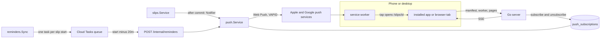

# Close-out

## Overview

The app now installs like an app and can reach a phone that is not looking at it. A manifest, generated icons, and a
worker with no `fetch` handler make it installable. Per-device subscriptions are stored in SQLite, and the server sends
Web Push signed with its own VAPID key. Slip events leave after the commit through a `Notifier` seam beside the existing
publisher. Kickoff reminders come from `reminders.Sync`, which puts one Cloud Tasks task per open slip at its fixed
first kickoff minus 20 minutes; the fire rechecks SQLite, so a stale task skips instead of guessing.

Production push is a Secret Manager concern now: the deploy workflow mounts the VAPID pair and the reminder token when
each has an enabled version, and passes `REMINDER_QUEUE` from a repository variable. Nothing sensitive sits in plain
text in the revision config.

## Consequences

- **Easier:** A leg added, a lock, or a grade now reaches the people who were not in the app. The "Ben, pick already"
  side chat stops being the only channel.
- **Easier:** The app gets a home-screen icon, a full-screen window, and safe-area padding on the notch and home bar.
- **Easier:** Reminders are one timed task per slip instead of a polling job, and they cost no metered credits. Turning
  them on or off is a matter of which secrets and variables exist at deploy time.
- **Easier:** New notification types have a home. The `Notifier` seam carries an event, and `push.Service` owns
  recipients, text, and delivery, so a future event does not need new push plumbing.
- **Harder:** A slip mutation can now take up to 3 seconds longer, because the send runs before the handler answers.
  Push-service trouble becomes request trouble.
- **Harder:** Production push has several pieces to get right: a key pair, three secrets, a queue, an IAM grant, and a
  repository variable. A fresh project needs the runbook, and there is no single command that provisions all of it.
- **Harder:** Real-device behavior stays outside the test suite. Permission prompts, iOS install, safe areas, and a
  dropped subscription can only be checked by hand.
- **Harder:** Every deploy now carries more optional-secret logic. A missing version is quiet, which is right for
  rollback but makes a half-configured push setup look healthy.
- **Revisit:** The 3 second send cap if latency shows up in request times. The cap is the single dial.
- **Revisit:** Notification volume on a busy pick night. The switch is one tap per device, but per-category settings
  were explicitly deferred.
- **Revisit:** Grade pushes still wait for a page-load refresh, so a "cashed" message can lag. Fixing that needs a
  scheduled grading job and a guardrail change of its own.

## Alternatives considered

- **FCM or OneSignal.** Rejected: it adds an SDK, a vendor account, and a second identity system. Plain Web Push reaches
  Android and installed iOS apps with no third party beyond the browser's push service.
- **A native app or Capacitor wrapper.** Rejected: app store review and two build pipelines are a poor trade for a
  small group app that already works in a browser.
- **A background queue for sends, or always-on CPU.** Rejected: Cloud Run throttles CPU after the response, so a
  background send stalls until the next request, and always-on CPU costs money all week. Sending inside the request was
  the cheap, honest choice.
- **In-process timers in production.** Rejected: the instance scales to zero, so the timer dies with it.
- **A polling Cloud Scheduler job.** Rejected: it wakes the app all day for a handful of useful moments, spends more
  requests, and makes the reminder time fuzzy.
- **Cloud Scheduler rewritten to the next slip start.** Rejected: one mutable job shared by every slip, group, and week,
  where a missed rewrite silently stops all reminders.
- **One task per person.** Rejected: per-slip tasks plus a fire-time recheck handle membership and progress changes with
  fewer tasks to keep in sync.
- **A checked-in manifest JSON file.** Rejected in favor of marshaling it in Go, so icon URLs carry the existing static
  content hash and a new icon reaches installed clients.
- **Per-category notification settings.** Deferred by the proposal. One device switch was enough to start.

## Implementation notes

- The design put push SQL and the `push_log` reservation in `internal/push`. They landed in `internal/db` beside the
  other stores, with policy in the service packages. That keeps the repo's one place for SQL.
- The design wired the notifier through the constructor. Build order made that impossible: the slip service is built
  before the push service, so wiring goes through `SetNotifier` in both the prod and sandbox branches.
- The design assumed `Sync` could trust `reminder_tasks` for any scheduler. A dev restart proved otherwise, so
  `Scheduler` gained `Durable()`: `CloudTasks` is trusted, `LocalTimers` re-arms from open slips and drops repeat calls.
  This was a round-one review fix.
- The design left production keys to a manual `gcloud run services update`. Round one moved the VAPID pair and reminder
  token onto the deploy workflow's existing optional-secret mount and added a `REMINDER_QUEUE` shape check, so a
  rotation is "add a version and redeploy."
- `SendToUsers` had to give each concurrent send its own payload copy. `webpush-go` grows the caller's byte slice, so a
  shared slice raced across devices; the design's `-race` check caught it.
- `CloudTasks` validates its queue path, `BASE_URL`, and token at boot and logs one error, leaving reminders off rather
  than failing the service. The 30-day horizon lives in `Sync`, because the scheduler has no clock to judge it.
- `Sync` reads open slips, task rows, and one set of games per week rather than literally one query. The property that
  matters held: constant reads, no per-slip work, and no API call when a start has not moved.
- The manifest and worker stay deliberately dumb. No `fetch` handler means a bad deploy cannot serve a stale page, but
  it also means there is no offline mode and no cache to fall back on.
- Limits a maintainer will hit: rotated VAPID keys leave rows behind because only `404`/`410` prune, and every device
  must re-subscribe; a shared phone keeps the last subscriber's pushes after cookie-expiry sign-out; a send failure is
  dropped by design; `reminder_tasks` rows and superseded tasks are never deleted, so old tasks fire and skip; and
  `/push/test` answers `204` even when the caller has no stored device.

## Follow-ups

- **Run the real-device checks.** Android Chrome install, Turn on, Send test, and a leg push from a second account;
  iPhone Safari install hint, standalone safe area, Turn on, Send test, and tap; sandbox **Send reminders now** with one
  persona short a leg.
- **Run the first-week reminder check** from the push runbook during the first production game week: one task per open
  slip at start minus 20 minutes, delivery inside 15–30 minutes, and no second reminder before a later kickoff.
- **Clean up subscriptions invalidated by a VAPID rotation.** Either treat `401`/`403` as prune-eligible or record a key
  id per subscription, so rotation does not require every device to turn notifications off and on.
- **Provision push in one step.** Have `deploy/setup.sh` create the VAPID and reminder secrets, the queue, and the
  `REMINDER_QUEUE` repository variable, or add a small provisioning command, so a fresh project is not runbook-only.
- **Age out reminder state.** Delete `reminder_tasks` rows for closed slips and add a delete path for superseded
  starts, so the table and the queue do not grow without bound.
- **Make `/push/test` honest.** Answer a distinct status (and a card message) when the caller has no stored device, so
  a stale browser does not see a success toast for a message nobody got.
- **Decide on per-category notifications** if the volume gets old. The current shape is one switch per device, and the
  tags already group per slip.
- **Consider scheduled grading.** A scheduled grading pass would let "cashed" pushes go out without waiting for someone
  to open the app, but it changes the free-tier guardrail and deserves its own proposal.
