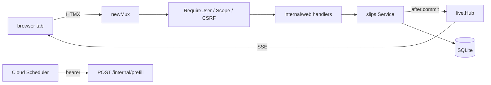
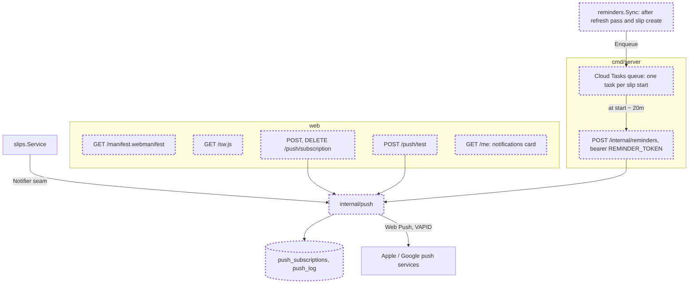
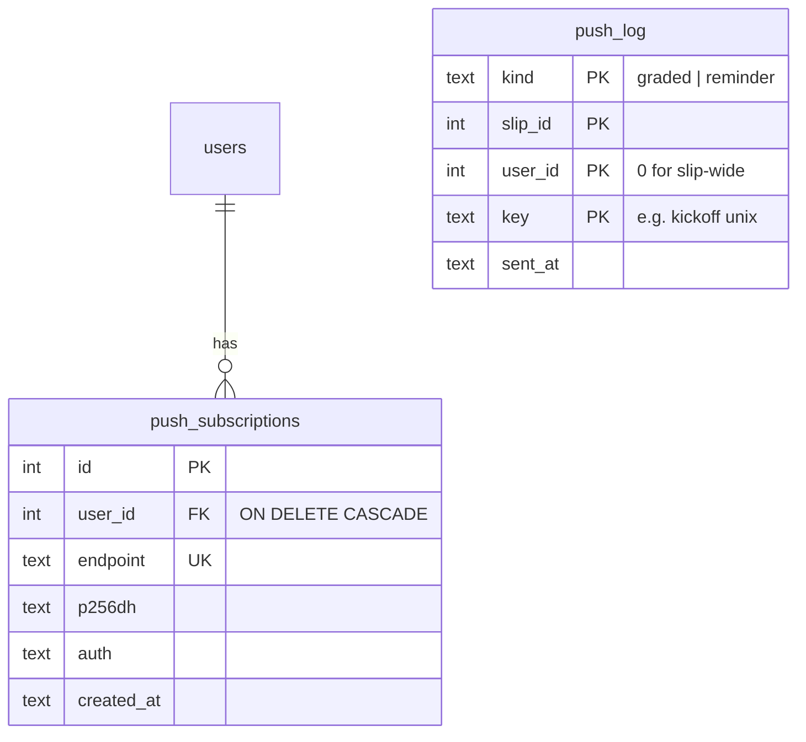
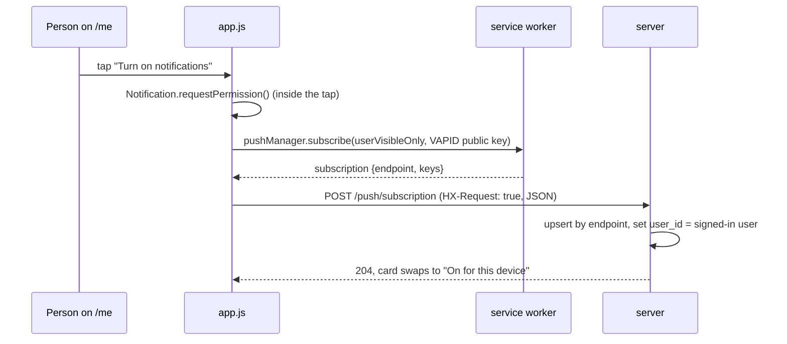
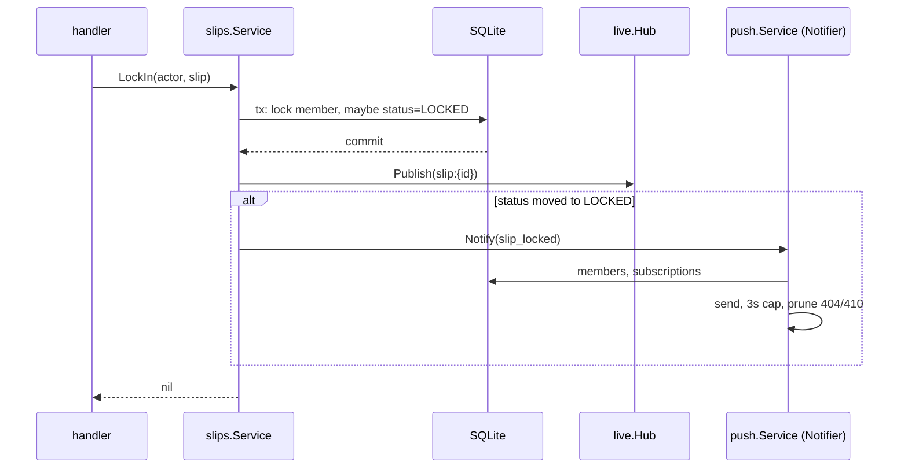
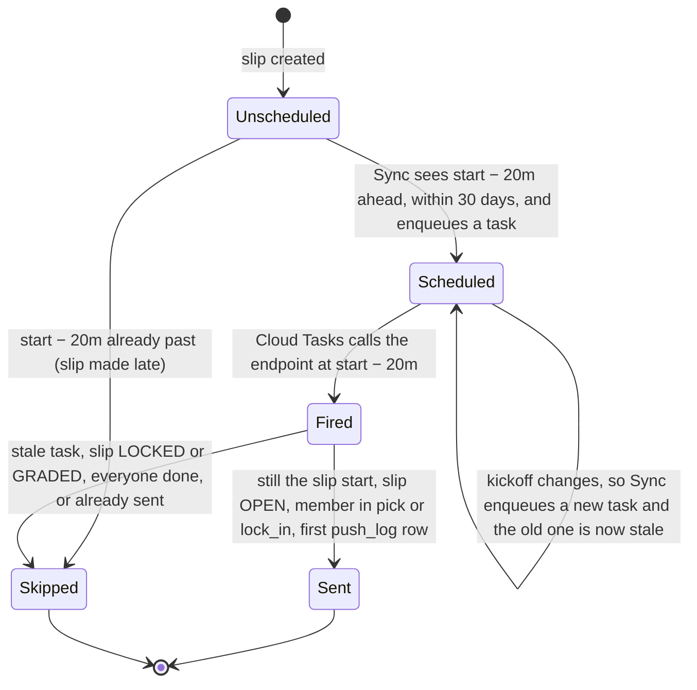
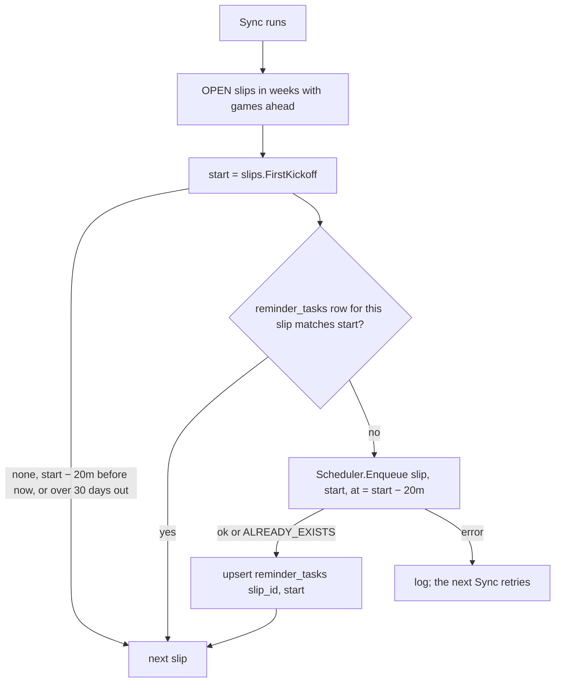
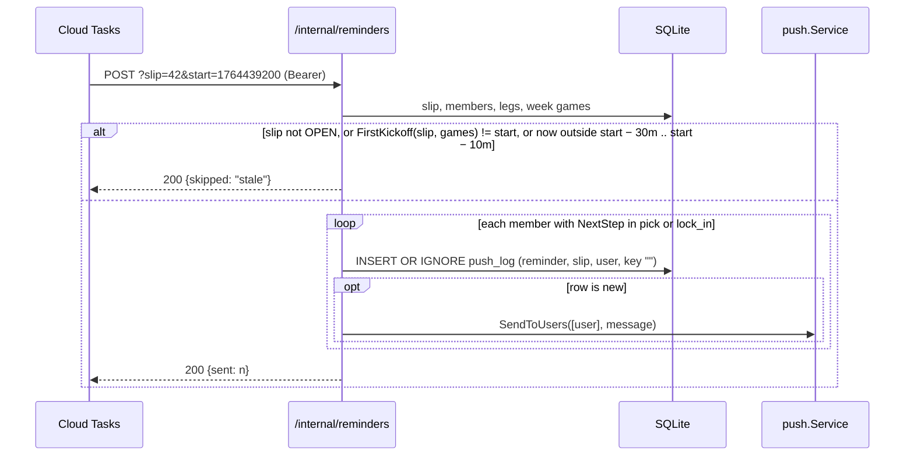

# Design: Installable app with push notifications

## Context

The app is server-rendered Go with HTMX. It runs as one Cloud Run instance over SQLite.

- **Routes.** `cmd/server` `newMux` puts health, `/static/`, and sign-in outside auth. Everything else sits behind
  `RequireUser`, `Scope`, and `CSRF`. `POST /internal/prefill` sits outside all three and checks a bearer token
  (`PREFILL_TOKEN`). It fails closed with a 404 when the token is empty.
- **Static files.** `web/static` is embedded and served at `/static/` with a one-year immutable cache. `AssetURL` adds a
  content hash. A service worker can only control pages under its own path, so it cannot live in `/static/`.
- **Layout.** `web/templates/layout.html` already sets `viewport-fit=cover` and `theme-color`. It has no manifest, no
  icons, and no service worker.
- **Slip mutations.** `internal/slips` `Service` commits each change in one transaction, then calls `notify`. That
  method publishes `slip:{id}` on the `Publisher` seam (`*live.Hub`). The transitions this change cares about live in:
  - `AddLeg` and `AddLegs`, which add legs.
  - `LockIn`, which sets the slip to `LOCKED` when the last member locks.
  - `SetLegResult` (by hand) and `AutoGradeLegs` (from refresh), which can set the slip to `GRADED`.
- **Next step.** `slips.NextStep` is a pure function of the slip, members, legs, games, viewer, and `now`. It returns
  the viewer's step (`pick`, `lock_in`, ...) and the first kickoff still ahead, after `FilterGamesForSlip`.
- **Profile.** `GET /me` is the person's settings screen, which makes it the natural home for a notifications switch.
- **Cloud Run CPU.** Deploys use request-based billing. CPU is throttled outside a request, so work done after the
  response can stall until the next request.
- **Shutdown.** Cloud Run allows 8 seconds. SSE streams close before the HTTP drain, and the refresh drain runs after
  it.



## Approach

### Parts



**PWA shell.** Two new public routes sit next to `/static/`, outside auth:

- `GET /manifest.webmanifest` serves `name`, `short_name`, `start_url: "/"`, `display: "standalone"`, the theme colors,
  and 192 and 512 icons, including a maskable 512.
- `GET /sw.js` is served with `Cache-Control: no-cache`, so a new deploy's worker is picked up.

The service worker has three listeners: `install` (call `skipWaiting`), `push`, and `notificationclick`. It has no
`fetch` handler and keeps no cache. That keeps offline behavior out of scope, and a stale page can never be served.
`layout.html` gains the manifest link, `apple-touch-icon` (180 PNG), and `apple-mobile-web-app-capable`.
`apple-mobile-web-app-status-bar-style` is set to `black-translucent`, with safe-area padding on the sticky header and
the bottom bar. `app.js` registers `/sw.js` on load.

Icons are PNGs made by a small committed Go generator. It draws a simple mark from the default theme's colors with the
standard library `image/png`, so the art can be swapped later without code changes.

**Push config.** Three new variables:

- `VAPID_PUBLIC_KEY` and `VAPID_PRIVATE_KEY` hold the key pair. The private key is a Secret Manager secret in prod.
- `REMINDER_TOKEN` and `REMINDER_QUEUE` drive reminders; see [Reminders](#reminders).

The VAPID subject is `BASE_URL`; Apple accepts an `https:` URL. Push is on only when both keys are set. Otherwise the
notifications card is hidden, the subscription routes return 404, and `slips.Service` gets a nil `Notifier`. A one-shot
`go run ./cmd/vapidkeys` prints a fresh pair for local use and for the runbook. Local dev works because browsers treat
`localhost` as a secure context.

**Schema (migration `0020_push.sql`).**



`push_log` exists only to dedupe. The send path inserts a row with `INSERT OR IGNORE` and sends only when the row is
new. The reservation is made before the send, so a failed send is not retried. A missed nudge is fine; a doubled one is
not.

### Subscribing



- The card reads its state from the browser (`Notification.permission`, `pushManager.getSubscription()`), not from the
  server, because it is a per-device setting.
- iPhone Safari outside standalone mode has no `PushManager`. The card shows a short hint instead of the button: tap
  Share, then Add to Home Screen.
- Permission `denied` shows a hint about the browser's site settings.
- **Turn off** calls `subscription.unsubscribe()` and then `DELETE /push/subscription` with the endpoint.
- `POST /push/test` sends "Notifications are on" to the caller's own devices, so people can check it works.
- The upsert reassigns an existing endpoint to the current user. On a shared phone, the last person to subscribe owns
  it. The `/me` sign-out form's submit handler also unsubscribes and deletes, so a signed-out device stops getting the
  previous person's slips.
- `CSRF` requires `HX-Request: true` on non-GET requests, so `app.js` sets that header on its `fetch` calls. With the
  header set, an expired session gets `RequireUser`'s 200 plus `HX-Redirect: /login`. The client checks for that header
  and goes to sign-in, so the card never shows "On" by mistake.
- The server accepts only `https` endpoints on known push-service hosts: `fcm.googleapis.com`, `*.push.apple.com`,
  `*.push.services.mozilla.com`, and `*.notify.windows.com`. Without that list, a signed-in person could make the server
  POST to any URL (SSRF). Each user may have at most 10 subscriptions; a new one past that replaces the oldest.

### Sending

`internal/push` owns the subscriptions, the message text, and the send. It wraps `github.com/SherClockHolmes/webpush-go`
(pinned to the current release), which does the RFC 8291 encryption and VAPID signing. A hand-rolled ECE encryption
would be more code with more ways to be subtly wrong.

```go
// internal/push (sketch)
type Message struct {
  Title, Body string
  URL         string // path to open on tap, e.g. /slips/42
  Tag         string // same tag replaces the older notification on the device
}

func (s *Service) SendToUsers(ctx context.Context, userIDs []int64, m Message)
```

- `SendToUsers` loads each user's subscriptions and sends them all at once, under one 3 second deadline.
- Each send sets `TTL` to 6 hours, `Urgency: normal`, and a `Topic` taken from the tag. The push service replaces an
  undelivered message that has the same topic.
- A `404` or `410` response deletes that subscription. Any other error is logged and dropped.
- Recipients are filtered to active users (`users.active = 1`).
- The payload is JSON `{title, body, url, tag}`. The service worker shows it with the app icon, and `notificationclick`
  focuses an open app window on `url` or opens a new one.

**Sends run inside the request.** Because of request-based CPU, a send that starts after the response may not finish
until the next request. So `Notify` sends before the mutation's handler returns. It runs under
`context.WithoutCancel(ctx)` with the 3 second cap. With a few members and a couple of devices each, that adds a few
hundred milliseconds to the request that caused the event. Rejected options:

- A background queue would stall under throttled CPU and would need a shutdown drain.
- Always-on CPU costs money all week.

`AutoGradeLegs` runs inside the refresh pass that a page load starts. Its grade pushes therefore run with that work and
can stall like the rest of it.

### Events

`slips` gains a seam next to `Publisher`. It knows nothing about push:

```go
// internal/slips (sketch)
type EventKind string
const (
  EventLegsAdded  EventKind = "legs_added"
  EventSlipLocked EventKind = "slip_locked"
  EventSlipGraded EventKind = "slip_graded"
)
type Event struct {
  Kind      EventKind
  SlipID    int64
  ActorID   int64  // 0 for the auto grader
  Count     int    // legs added
  Selection string // the leg, when Count == 1
}
type Notifier interface { Notify(ctx context.Context, e Event) }
```

Each mutation sets a flag inside its transaction and calls `Notify` after the commit, right beside `notify`. Nothing is
sent when the transaction rolls back.

| Event         | Raised when                                                       | Goes to               | Text (friendly, no lectures)                                |
| ------------- | ----------------------------------------------------------------- | --------------------- | ----------------------------------------------------------- |
| `legs_added`  | `AddLeg`, or an `AddLegs` that inserted at least one leg           | members but the actor | "Ben added Bills -3.5" / "Ben added 3 legs"                 |
| `slip_locked` | `LockIn` moves the slip to `LOCKED`                                | members but the actor | "Everyone's locked in. Time to place it."                   |
| `slip_graded` | `SetLegResult` or `AutoGradeLegs` moves the slip to `GRADED`       | every member          | WON "Sunday Slate cashed!" / LOST "Sunday Slate came up short." / PUSH or VOID "Sunday Slate pushed. Stakes back."      |

- Every title is the slip's name, every URL is `/slips/{id}`, and every tag is `slip-{id}`. A burst of leg adds
  collapses to the newest one on the device.
- `slip_graded` is deduped through `push_log` (`kind=graded`, `user_id=0`, `key=""`). A later manual correction
  re-grades without a second push.
- Recipients are always members of that slip, so a message never shows one group's data to someone outside it.
- An unlock and re-lock sends `slip_locked` again. That is rare and still true news, so it is not deduped.
- `cmd/server` passes an untyped `nil` `Notifier` when push is off, never a nil `*push.Service`, because a typed nil
  inside an interface is not `== nil`.



### Reminders

Each person gets one reminder per slip, 20 minutes before the slip's first kickoff, and only if they still owe legs or
have not locked in. Nothing polls. Every open slip gets exactly one timed wake-up, created ahead of time with Cloud
Tasks. When the wake-up fires, the handler rechecks everything from SQLite, so the task never has to be right — only on
time.

#### The slip start

The reminder targets the **slip start**: `slips.FirstKickoff(slip, games)`, the earliest kickoff among the slip's scoped
games (`FilterGamesForSlip`), whether it has passed or not. A Thursday slip starts Thursday night. A Sunday-main slip
starts at the 1:00 PM kickoff, or 9:30 AM on a London week. A custom one-game slip starts at that game.

This is not `NextStep.Deadline`. That one rolls forward to the next kickoff still ahead, because picking stays open
until every game has kicked off. A reminder keyed to it would fire again before each kickoff wave. Keying to the fixed
slip start, and deduping per person per slip, keeps it to once.

The reminder fires at `start − 20m`. The handler accepts a fire anywhere from 30 to 10 minutes before the start. That
covers the 15–30 minute target with slack for Cloud Tasks delivery and one retry. Once a slip has started, nothing new
is scheduled for it.

#### Lifecycle of one reminder



#### Scheduling: `reminders.Sync`

`Sync(ctx, now)` makes sure every open slip whose start is ahead has a task for that start. It does not delete tasks. A
stale task fires harmlessly and skips.



`Sync` runs in two places:

- After each refresh pass. `refresh.Service` gains `SetAfterPass(func(ctx))`, like `slips.Service.SetOnGradeChange`. The
  slate refresh is what changes kickoff times, and every full-page load already starts a pass. A schedule-made slip
  appears through `EnsureWeekSlips` on a page load, so the pass that load starts schedules it too.
- After `POST /slips` creates a slip by hand, so a one-off slip gets its task before the person leaves the page.

The `reminder_tasks` row keeps `Sync` cheap. A normal pass is one SQLite query and no API call. The Cloud Tasks API is
called only when a slip is new or its start moved. That happens a few times a week per group.

A pass started from a page load runs in the background, so request-based CPU can slow it down. That is fine here: the
task only has to exist 20 minutes before kickoff, and any later page load retries.

#### The `Scheduler` seam

```go
// internal/reminders (sketch)
type Scheduler interface {
  // Enqueue asks for one POST /internal/reminders?slip={id}&start={unix} at at.
  // Enqueuing the same slip and start twice is not an error.
  Enqueue(ctx context.Context, slipID int64, start, at time.Time) error
}
```

- **`CloudTasks` (prod).** A plain `net/http` call to the Cloud Tasks REST API
  (`projects.locations.queues.tasks.create`). It authenticates with the runtime service account's token from the
  metadata server, so it needs no new client library. The task:
  - Name: `{hash4}-slip-{id}-{startUnix}`. The short hash prefix spreads names, as Cloud Tasks recommends for named
    tasks. Cloud Tasks rejects a duplicate name with a 409, which counts as success and is a second guard against double
    scheduling.
  - Cloud Tasks will not schedule more than 30 days out, so `Sync` skips a start beyond that, and a later pass picks it
    up.
  - `scheduleTime` is `at`.
  - The HTTP target is `POST {BASE_URL}/internal/reminders?slip={id}&start={unix}`, with header
    `Authorization: Bearer {REMINDER_TOKEN}`.
- **`LocalTimers` (dev).** `time.AfterFunc` calls the same handler logic in-process. A local server stays up, so a timer
  is enough. It uses the wall clock.
- **None (sandbox).** Sandbox mode wires no `Scheduler`; the sandbox button below stands in for it.
- **Off.** When `REMINDER_TOKEN` or push is unset, or when prod has no `REMINDER_QUEUE`, `Sync` is a no-op.

Config adds `REMINDER_TOKEN` (secret) and `REMINDER_QUEUE` (the full queue path,
`projects/{p}/locations/{r}/queues/{q}`).

#### Firing: `POST /internal/reminders?slip=&start=`

The handler follows the prefill handler's shape: constant-time bearer auth, a 404 when the token is empty, and a
synchronous JSON report. Since this is a request, Cloud Run gives it full CPU for the sends.



- The rule is a pure function, `reminders.Due(slip, members, legs, games, start, now) []Reminder`. Tests drive it with a
  fixed clock. The handler only loads rows, reserves `push_log` rows, and sends.
- Status codes control retries. A stale or no-op fire returns 200, so Cloud Tasks stops. A database error returns 500,
  and Cloud Tasks retries. The queue allows up to 3 attempts with a 30 second minimum backoff, and `push_log` keeps a
  retry from sending twice.
- The `push_log` key is empty, so each person gets at most one reminder per slip, even if the start moves and a second
  task fires.
- Recipients are active users only, like every other push.
- Messages, titled with the slip name:
  - `pick`: "Kickoff in 20 minutes. You still need 2 legs." (it counts the legs needed)
  - `lock_in`: "Kickoff in 20 minutes. Your legs are in; lock them in."
- Each reminder has tag `slip-{id}-reminder` and opens `/slips/{id}`.
- Someone in two slips with the same start gets two notifications, one per slip, each opening its own slip.

#### Edge cases

| Case                                          | What happens                                                                      |
| --------------------------------------------- | --------------------------------------------------------------------------------- |
| Kickoff flexed later                          | Next `Sync` enqueues a new task; the old one fires early, sees a mismatch, skips. |
| Kickoff moved earlier                         | Same, if a page load runs `Sync` before the new fire time; otherwise no reminder. |
| Slip created under 20 minutes before its start, or after | No task. The creator is in the app.            |
| Everyone locked in before the fire time       | Slip is `LOCKED`; handler skips.                                                  |
| Member removed after scheduling               | Handler reads members at fire time; they get nothing.                             |
| Deploy or cold start at fire time             | Cloud Tasks waits for the instance; a cold start is a few seconds.                |
| Cloud Tasks retries after a partial send      | `push_log` rows reserved before each send stop duplicates.                        |

#### Sandbox

The sandbox clock is a frozen scenario time, so wall-clock timers never fire there. `/dev/sandbox` gains a
**Send reminders now** button. It calls the handler logic with the slip start and the scenario clock, skipping the
fire-window check. A tester can then switch personas and watch who gets a push. It is mounted only in sandbox mode, like
the other sandbox controls.

#### Deploy

`deploy/setup.sh` enables `cloudtasks.googleapis.com`. It creates the queue
(`gcloud tasks queues create {service}-reminders --max-attempts=3 --min-backoff=30s`) and grants the runtime service
account `roles/cloudtasks.enqueuer` on that queue. Cloud Tasks' free tier is 1 million operations a month. This uses a
few dozen, and the instance wakes once per slip instead of 56 times a day.

### Rejected options

- **FCM or OneSignal.** Adds an SDK, a vendor account, and a second identity system. Plain Web Push reaches both
  platforms.
- **In-process timers in prod.** The instance scales to zero, so a timer dies with it.
- **A polling Cloud Scheduler job.** Waking every 15 minutes all day spends dozens of requests for one useful fire, and
  its window makes the reminder time fuzzy.
- **Cloud Scheduler rewritten to the next slip start.** It needs one mutable job shared by every slip and group, and a
  missed rewrite silently stops all reminders.
- **One task per person.** Per-slip tasks plus a fire-time recheck handle membership and progress changes with fewer
  tasks to keep in sync.
- **Per-category settings.** Out of scope per the proposal; one switch per device.

## Verification

- `go generate ./...`, `golangci-lint run ./...`, `go test ./...`, and `go test -race -short ./...` pass.

- **Manifest and service worker.** Route tests check that both are public (no session cookie), have the right content
  types, and that `sw.js` sends `no-cache`. A layout test checks for the manifest link and the Apple tags.

- **Subscription routes.**
  - POST upserts and reassigns an existing endpoint to the caller.
  - DELETE removes only the caller's own endpoint.
  - Both return 404 when VAPID is unset.
  - A non-HTMX POST gets 403.
  - Bad JSON, a non-`https` endpoint, or a host off the push-service list gets 400.
  - An 11th subscription replaces the oldest.
  - An expired session gets `HX-Redirect`, and the card does not show "On".

- **Send.** An `httptest` server stands in for the push service. Tests assert one request per subscription, the `TTL`,
  `Topic`, and `Urgency` headers, and the 3 second cap (a hanging endpoint does not block past it). They also check that
  a `410` deletes the row and a `500` keeps it.

- **Events.** A recording `Notifier` in `internal/slips` tests checks each case:
  - `AddLeg` raises `legs_added` once. An `AddLegs` with only duplicates raises nothing.
  - `LockIn` by a non-final member raises nothing. The final lock raises `slip_locked`.
  - A rolled-back transaction raises nothing.
  - `SetLegResult` and `AutoGradeLegs` raise `slip_graded` only on the move to `GRADED`.
  - `push.Service` tests check that the actor is left out, every recipient is a slip member, and `slip_graded` goes out
    once across two grade passes.

- **Reminders.**
  - `Due` table tests with a fixed clock:
    - A fire at start − 20m reminds `pick` and `lock_in` members, and not `waiting`, `export`, or `closed` members.
    - A fire at start − 35m or start − 5m sends nothing.
    - A start that no longer matches the slip sends nothing.
    - A weekend slip whose first game has passed gets no second reminder before later kickoffs.
    - A `LOCKED` slip sends nothing.
    - A scoped slip ignores games outside its scope.
  - `Sync` tests with a recording `Scheduler`:
    - A new slip enqueues once at start − 20m, and a second `Sync` makes no call.
    - A moved first kickoff enqueues again with the new start, and each person still gets one reminder.
    - A start more than 30 days out is not enqueued.
    - A slip within 20 minutes of kickoff is not enqueued.
    - `ALREADY_EXISTS` counts as success.
    - An enqueue error leaves no row, so the next `Sync` retries.
  - `CloudTasks` tests against an `httptest` server standing in for the metadata server and the Cloud Tasks API. They
    check the task name, `scheduleTime`, the URL, the bearer header, and that 409 is treated as success.
  - Handler tests check:
    - A missing or wrong token gets 401, and an empty token gets 404.
    - A stale fire returns 200 and sends nothing.
    - A DB error returns 500.
    - Two fires send once.
  - The sandbox button sends to the right personas.

- **On real phones (manual, before close).**
  - **Android Chrome:** Install from the menu and check that it opens standalone with the icon. Turn on notifications
    and use Send test. Then add a leg from a second account and check the notification arrives and opens the slip.
  - **iPhone (iOS 16.4+):** Safari shows the install hint. After Add to Home Screen, the app opens standalone and the
    notch and home bar do not cover the header or the bottom bar. Turn on notifications, use Send test, and tap the
    notification.
  - **Reminder (sandbox):** with one persona short a leg, press Send reminders now and confirm only that persona's phone
    buzzes.
  - **Reminder (prod, first game week):** confirm the queue shows one task per open slip at start − 20m, and that the
    reminder arrives in the 15–30 minute window, and that no second one comes before later kickoffs.

## Risks

- **iOS quirks.** Push needs a home-screen install, permission needs a tap, and iOS can drop a subscription after
  updates. We would notice when people report silence, or when `410` prunes spike in the logs. The card reads live
  browser state, so a dropped subscription shows "Off", and one tap fixes it.
- **Too many notifications.** A busy pick night could buzz phones often. `Tag` and `Topic` collapse bursts per slip, and
  the switch is one tap. If people still find it noisy, per-category settings are the follow-up.
- **SSRF through a forged endpoint.** Closed by the push-host allowlist, and a route test covers it. A browser with a
  new push host fails to subscribe with a 400 and a log line until the list is updated.
- **Wrong person on a shared device.** Handled by reassign-on-subscribe and unsubscribe-on-logout. A device signed out
  some other way (cookie expiry) keeps getting the last subscriber's slip pushes until they sign in again or turn it
  off. This is accepted: the content is slip names and picks, not money or credentials.
- **Request latency.** Up to 3 seconds in the worst case, when a push service hangs on a mutation request. Logs carry
  send time. If it bites, the cap drops to 1 second.
- **Late grade pushes.** Auto-grading happens on page-load refresh, so a "cashed" push can lag until someone opens the
  app. That is the same staleness people see today. Running a grading sync from a scheduled job would change the
  `Kick()` guardrail and belongs to its own change.
- **Service worker breaks the app.** Without a `fetch` handler it cannot intercept requests, and `no-cache` on `/sw.js`
  lets a fix ship on the next deploy. The worst case is notifications not showing.
- **No task for a slip.** If no page load runs `Sync` between a slip's creation and kickoff, no task exists. This is
  rare, because every way of creating a slip runs `Sync`. `Sync` logs each enqueue, and the queue's console lists the
  pending tasks.
- **Kickoff moved earlier with no page load since.** The old task fires after kickoff and skips, so there is no
  reminder. Accepted: flexes are announced days ahead, and someone visits in between.
- **Queue misconfigured or no IAM.** Enqueue fails and logs on every `Sync`, and reminders stop. Events still work. The
  runbook's first-week check catches it.

## TODO

### Phase 1: Installable app

Complexity: low (static manifest, service worker shell, and layout tags follow the existing static-route pattern)

Risk: medium (install and standalone layout depend on real-phone browser behavior that Go tests cannot exercise)

- [x] Serve `GET /manifest.webmanifest` and `GET /sw.js` (no-cache, with only `install`, `push`, and `notificationclick`
      listeners and no `fetch` handler) outside auth in `newMux`. Add an icon generator that writes the 180, 192, 512,
      and maskable 512 PNGs into `web/static`. Add the manifest link, `apple-touch-icon`, Apple standalone meta tags,
      and safe-area padding to `layout.html`. Register the worker from `app.js`. Add route and layout tests.
- [x] Docs: add `docs/concepts/notifications.md` with an "Installing the app" section. Note the public routes in
      `docs/concepts/access.md`. Run `good-vibes docs lint` and `good-vibes docs index`.

### Phase 2: Push opt-in per device

Complexity: medium (adds a config seam, a migration, a new package, CSRF-guarded JSON routes, and client permission flow
across server and browser)

Risk: medium (new persistent table and an external push integration; real-device permission flows are manual-only)

- [x] Add `VAPID_PUBLIC_KEY` and `VAPID_PRIVATE_KEY` to config, with push off unless both are set. Add `cmd/vapidkeys`,
      migration `0020_push.sql` (`push_subscriptions`, `push_log`), and `internal/push` with subscription storage and
      `SendToUsers` over `webpush-go`, using the 3 second cap, TTL, Urgency, Topic, and 404/410 pruning. Cover it with
      an `httptest` push endpoint.
- [x] Add `POST /push/subscription`, `DELETE /push/subscription`, and `POST /push/test`. Add the notifications card on
      `/me`: browser-driven state, the iPhone install hint, the denied hint, on/off/test, and unsubscribe on logout. Add
      the `push` and `notificationclick` handlers to `sw.js`. Add route tests for auth, CSRF, reassign, the push-host
      allowlist, the 10-subscription cap, the expired-session redirect, and the VAPID-off 404.
- [ ] Docs: extend `docs/concepts/notifications.md` with opt-in and sending. Update `docs/reference/config.md` and
      `docs/reference/schema.md`. Add `docs/runbooks/push-setup.md` (generate keys, store the private key in Secret
      Manager, set env, and verify with Send test). Add the glossary term "Push subscription" to `GLOSSARY.md`.

### Phase 3: Slip event notifications

Complexity: medium (new Notifier seam across every relevant slip mutation, keeping the after-commit rule and exact
status-transition detection)

Risk: medium (wrong transition detection sends wrong or duplicate pushes; covered by recording-notifier tests, but real
delivery is manual)

- [ ] Add the `slips.Notifier` seam and `Event`. Raise `legs_added` from `AddLeg` and `AddLegs`, `slip_locked` from the
      final `LockIn`, and `slip_graded` from `SetLegResult` and `AutoGradeLegs`, each only after commit. Implement
      `Notify` in `internal/push`: recipients, message text in the app's voice, tag and URL, and graded dedupe through
      `push_log`. Wire it in `cmd/server`, as an untyped nil when push is off. Filter recipients to active users. Test
      with a recording notifier and push service tests.
- [ ] Docs: add the events table to `docs/concepts/notifications.md` and the Notifier seam beside `Publisher` in
      `docs/concepts/slips.md`.

### Phase 4: Kickoff reminders

Complexity: medium (slip-start rule over slate scopes, a scheduling seam with a reconcile loop, stale-task handling, and
a new bearer-auth endpoint across refresh, web, and cmd/server)

Risk: high (a new external Cloud Tasks integration and IAM that tests cover only through an httptest stand-in, plus new
persistent scheduling state)

- [ ] Add `slips.FirstKickoff(slip, games)`, the fixed slip start (not the rolling `NextStep.Deadline`). Add migration
      `0021_reminder_tasks.sql`, `internal/reminders` (`Due`, `Sync`, the `Scheduler` seam, and `LocalTimers`),
      `REMINDER_TOKEN` config, and `POST /internal/reminders?slip=&start=` beside prefill in `newMux`, with the
      fire-window and stale checks and once-per-person-per-slip `push_log` dedupe. Call `Sync` from a new
      `refresh.Service.SetAfterPass` hook and after `POST /slips`. Add the sandbox **Send reminders now** button. Cover
      it with `Due`, `Sync`, and handler tests.
- [ ] Add the `CloudTasks` scheduler (REST plus a cached metadata-server token, hash-prefixed task names, the 30-day
      horizon, and no new client library) and `REMINDER_QUEUE` config. In `deploy/setup.sh`, enable the API, create the
      queue, and grant `roles/cloudtasks.enqueuer`. Amend `ARCHITECTURE.md` "Cross-cutting concerns" with an "Outbound
      push and timed reminders" subsection, including a diagram of `Sync`, the Cloud Tasks queue, the reminder endpoint,
      the after-commit Notifier, and the Apple and Google push services. Update the free-tier guardrail in `AGENTS.md`
      and the scheduled-jobs guardrail in `docs/concepts/data-refresh.md` so both allow per-slip reminder tasks on Cloud
      Tasks next to the optional prefill job. Cover it with `httptest` tests.
- [ ] Docs: add reminders, including the lifecycle and edge cases, to `docs/concepts/notifications.md`. Add
      `REMINDER_TOKEN` and `REMINDER_QUEUE` to `docs/reference/config.md` and `reminder_tasks` to
      `docs/reference/schema.md`. Add the queue setup and the first-week check to `docs/runbooks/push-setup.md`. Add the
      glossary term "Slip start" to `GLOSSARY.md`.
