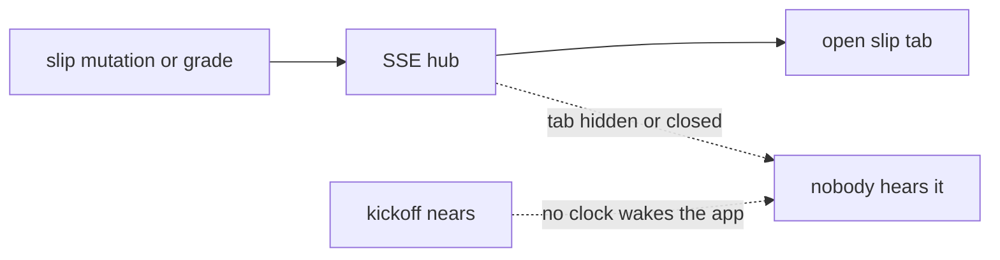
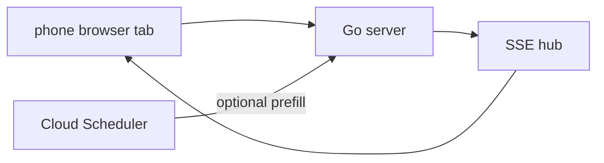
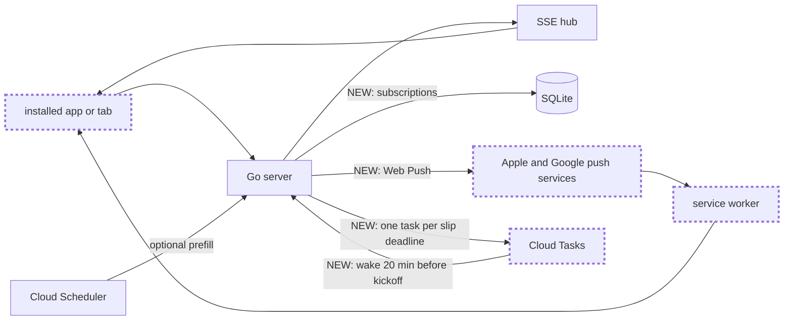

# Installable app with push notifications

## Context

The app is phone first, but it only lives in a browser tab. On a phone that means no home-screen icon, browser chrome
eating the screen, and a tab that gets lost between Thursday and Sunday.

The app also has no way to reach someone who is not looking at it. Live updates only reach an open slip page, and the
SSE stream closes when the tab hides or goes idle. So the things that need a person go unseen until they happen to check
back:

- A slip is waiting on their leg, and kickoff is close.
- Someone added a leg or locked the slip.
- The slip got graded.

Today a group covers this with a side chat ("Ben, pick already").

## Goals and non-goals

**Goals:**

- People can add the app to their home screen on Android and iPhone and open it full screen, with its own icon and name.
- People can opt in to push notifications per device, from a clear button, and turn them off again.
- A small fixed set of notifications, written in the app's friendly voice:
  - **Events:** a leg is added, the slip locks, the slip is graded.
  - **Reminders:** once per slip, 15–30 minutes before the slip's first game, for anyone still short legs or not locked
    in.
- Tapping a notification opens the slip it is about.
- Nothing new costs money. No new paid service, no Odds API or Parlay API credits.

**Non-goals:**

- A native app, an app store listing, or a wrapper like Capacitor.
- Offline use. The service worker exists for install and push, not to cache pages or data.
- Per-category notification settings. One switch per device to start; categories can come later if people ask.
- Email, SMS, or chat-bot notifications.
- Notifications about odds moves, injuries, or analyzer warnings. Those need product thought of their own.

## Decision

Make the app a standard PWA (a web manifest, icons, and a tiny service worker) and send standard Web Push straight from
the Go server, signed with the server's own VAPID key. Events go out from the same after-commit points that already
publish hub signals. Reminders come from one timed Cloud Tasks wake-up per slip, set for 20 minutes before its first
kickoff.

### Before

### After

### Why this shape

**Why this way.** Web Push is the one path that works on both platforms with no third party: Android Chrome supports it
in the browser, and iPhone supports it (iOS 16.4 and later) once the app is added to the home screen. The server calls
Apple's and Google's push endpoints directly, which are free and need no account beyond a key pair the app generates.
Firebase Cloud Messaging or a service like OneSignal would add an SDK, a vendor, and a second identity system for no
gain. A native wrapper would add app store review and two build pipelines to a small group app.

**Why timed tasks.** Cloud Run scales to zero, so an in-process timer cannot fire a reminder. A polling cron would wake
the app all day for a handful of useful moments. Instead, the server puts one Cloud Tasks task on a queue for each open
slip, timed for 20 minutes before that slip's first kickoff. Each person gets one reminder in the 15–30 minute window,
and the app wakes only then. When the task fires, the server rechecks the slip from SQLite: who still owes legs or a
lock, and whether kickoff moved. That way a stale task does nothing. This stays well inside Cloud Tasks' free tier and
calls no metered API. This change is the plan change the free-tier guardrails ask for before adding scheduled work, and
that work is the reason it amends `architecture`: it changes the invariant that the only scheduled job is the optional
pre-fill, and it adds outbound push as a cross-cutting concern.

**iPhone caveats we accept.** Push only works on iPhone after "Add to Home Screen," and permission must come from a tap.
The app will show a short, friendly install hint on iPhone Safari instead of a broken button.

**Ratings.** `complexity` is medium: the work spans the web layer, new SQLite tables, the slip service's after-commit
hooks, a new internal endpoint, timed reminder scheduling, and deploy config, and it must hold the existing rules
(publish only after commit, no per-person data leaking between people, idempotent reminders) across those seams. `risk`
is high mainly because of the new Cloud Tasks integration and its IAM setup, which tests can only fake; beyond that, a
bug can send duplicate or wrong notifications, or break install on one platform, and service worker and permission
behavior on real phones is not covered by Go tests. But no slip data, money, or metered credits are at stake, and
turning notifications off stops any damage.
