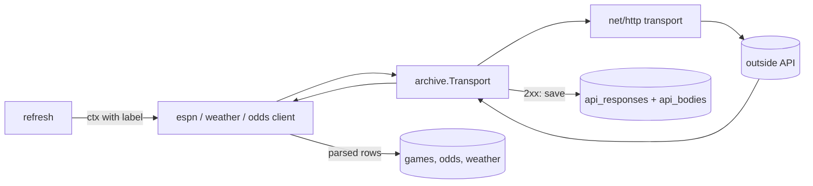

# Design: Archive every external response

## Context

`slate-and-lines` builds three clients in `internal/ingest/{espn,weather,odds}`. Each takes a base URL and an
`*http.Client`, and `internal/refresh` drives them and writes parsed rows through the `Store`. That change is the
dependency: this one adds the archive underneath those clients, not into them. Read before starting:

- `plan/data-sources.md`: source keys, the Odds API headers, and "Sources and staleness".
- `plan/architecture.md`: Refresh, and the Litestream notes (the archive rides the replicated DB file).
- `docs/reference/schema.md`: migrations and conventions.
- `changes/slate-and-lines/design.md`: client and refresh shape.

Invariants:

- One SQLite file, one Cloud Run instance. The archive lives in that file.
- Clients never touch the DB. The archive must not change that, so it sits in the HTTP transport.
- Google OAuth uses its own client in `internal/auth`. It stays unwrapped, so its tokens never reach the archive.

## Approach

A new package `internal/ingest/archive` holds a `RoundTripper` that wraps the ingest `*http.Client`'s transport. Each
outside call goes through it. The clients and `refresh` change in one line each.



**Transport.** `archive.NewTransport(base http.RoundTripper, sink Sink, now func() time.Time)`. On a 2xx response it
reads the body into memory (capped at 8 MB), restores `resp.Body` from the bytes, and hands one `Record` to the sink.
Non-2xx responses and transport errors pass through unrecorded; they hold no market data. The sink call is synchronous.
A sink error is logged and dropped, so a failed save never changes what the client sees. A body over the cap is passed
through unrecorded with a warning.

**Labels.** The round tripper can't tell `odds:props:{game}` from `odds:lines`, so `refresh` puts the key in the request
context with `archive.WithKey(ctx, "odds:props:401")`. The key is the same string `sync_state.source` uses. With no key
set, the transport falls back to `host + path`, so a client that forgets the label is still archived and findable.
`source` (`espn`, `weather`, `odds`) comes from the key's prefix, or from the host in the fallback.

**Redaction.** The URL is stored with the `apiKey` query value replaced by `REDACTED`. The key never reaches the DB. The
archive keeps the other query params, since `markets`, `regions`, and `week` are what make a response meaningful.

**Schema.** One migration adds two tables.

```sql
CREATE TABLE api_bodies (
  sha256   TEXT PRIMARY KEY,     -- hex of the uncompressed body
  encoding TEXT NOT NULL,        -- 'gzip'
  size     INTEGER NOT NULL,     -- uncompressed bytes
  body     BLOB NOT NULL
);
CREATE TABLE api_responses (
  id                INTEGER PRIMARY KEY,
  source            TEXT NOT NULL,       -- espn | weather | odds
  key               TEXT NOT NULL,       -- sync_state source key, or host+path
  method            TEXT NOT NULL,
  url               TEXT NOT NULL,       -- apiKey redacted
  status            INTEGER NOT NULL,
  fetched_at        TEXT NOT NULL,
  duration_ms       INTEGER NOT NULL,
  body_sha256       TEXT NOT NULL REFERENCES api_bodies(sha256),
  credits_remaining INTEGER,             -- x-requests-remaining, odds only
  credits_used      INTEGER,             -- x-requests-last, odds only
  CHECK (status BETWEEN 200 AND 299)
);
CREATE INDEX api_responses_key ON api_responses(key, fetched_at);
CREATE INDEX api_responses_source ON api_responses(source, fetched_at);
```

Bodies live in their own table, keyed by hash, so a scoreboard that polls every 10 minutes and returns the same JSON
stores the body once and a small row each time. That also keeps the metadata table fast to scan. Bodies are gzipped;
JSON compresses roughly 10x. Rows are never updated or deleted by the app.

**Writes.** The sink is a `Store` method that inserts the body with `INSERT OR IGNORE` and the response row in one
transaction. It uses the same `*sql.DB` as the rest of the app, so SQLite's single writer serializes it with sync
writes. The inserts are tiny next to a network call.

**Reads.** A small read API on the same package serves later modeling work and the tests: list responses by key prefix
and time range, and fetch one decompressed body by hash. No page, route, or request path calls it. Modeling code can
also open a Litestream restore of the DB and use plain SQL.

Rejected:

- Files or a bucket: splits the data off the single SQLite file and adds a second thing to back up.
- A `Sink` call inside each client: every future client has to remember it. The transport makes forgetting impossible.
- Parsed history tables: guess what a model needs and drop fields we haven't learned to want.
- An in-app switch or retention job: more config and code for a problem we don't have yet.

## Verification

`go test ./...` and `golangci-lint run ./...` pass.

- A 200 response is saved once with the right source, key, URL, status, time, and body; the client still reads the full,
  identical body.
- A 500, a timeout, and a body over the cap save nothing, and the client sees the original result.
- A sink that returns an error is logged, and the client still gets its response.
- The `apiKey` value appears nowhere in `api_responses`, including after a redirect or in other query params.
- Two identical bodies store one `api_bodies` row and two `api_responses` rows; a changed body stores a second row.
- Odds headers fill `credits_remaining` and `credits_used`; non-odds sources leave them NULL.
- With no label in the context, the key falls back to `host + path`. With one, the key matches `sync_state.source`.
- The read API returns a stored body byte-for-byte after the gzip round trip, and filters by key prefix and time.
- End to end with fake servers: a refresh pass over all three sources leaves one archive row per call, `sync_state` and
  the parsed rows are unchanged from before this change, and opening the same game twice inside the cache window adds
  one props row, not two.
- The auth package's HTTP client is not wrapped: an OAuth token exchange test leaves `api_responses` empty.

## Risks

- **DB growth.** Litestream replicates the whole file, and Cloud Run disk is small. Lines, props, and weather are a few
  hundred MB per season at worst, with dedupe and gzip. Watch `SELECT sum(size) FROM api_bodies` and the DB file size at
  the end of the first season; the runbook notes the number to act at.
- **Write contention.** An archive insert on the sync path adds a short write. It's small and the app has one instance,
  but a slow disk shows up as slower syncs. Log the sink duration at debug level.
- **Lost writes on deploy.** The two-writer risk in `plan/architecture.md` applies. A few seconds of archive rows can be
  lost, which is acceptable for research data.
- **Fallback labels.** A client that skips the label gets host + path keys. Rows are still kept, but harder to join with
  `sync_state`. The wiring test checks every client sets one.
- **One Odds key covers two calls.** The free event list and the paid lines call both archive under `odds:lines`, because
  that is the one `sync_state` key and credit balance for the pass. Rows are distinguishable by URL path; a later change
  can split them into `odds:events` and `odds:lines` if modeling needs that.
- **Secrets in bodies.** None of the three sources echo credentials today. If one does, the redaction step must extend
  to bodies; the test above covers the known case only.

## TODO

Effort: medium (a small package, but the seam must sit under every client and fail without side effects)

### Phase 1: Archive transport and store

- [x] Add the migration and the archive package: the `RoundTripper`, URL redaction, label context helpers, the gzip and
      hash body store, and the sink as a `Store` method, tested against a fake server and a temp DB for success,
      failure, oversize, dedupe, redaction, and credit headers
- [x] Add the read API (list by key prefix and time, fetch body by hash) and test the byte-for-byte round trip
- [x] Docs: add the tables to `docs/reference/schema.md` and write `docs/concepts/archive.md` covering what is kept, the
  labels, and how to query it

### Phase 2: Wire it under the clients

- [x] Build the ingest `*http.Client` in `cmd/server` with `archive.Transport` as its transport, set the key label in
      `refresh` for every source, and test with fake servers that one pass over ESPN, weather, and Odds API archives one
      row per call, leaves parsed rows and `sync_state` unchanged, and leaves OAuth traffic unrecorded
- [x] Docs: note the archive in `plan/data-sources.md` (or `docs/reference/data-sources.md` if `slate-and-lines` moved
      it), the Refresh section of `plan/architecture.md`, and add a size-check note to the runbooks
