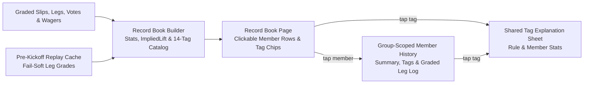

# Close-out

## Overview

## Consequences

- **Easier:** Adding or tuning Record Book tags in one pure, table-driven catalog with deterministic boundary tests and zero database migrations or external API spend.
- **Easier:** Keeping leaderboard and member history consistent by sharing season resolution, fail-soft grade loading, and group-scoping helpers across both screens.
- **Harder:** Maintaining interactive tag chips alongside clickable member rows requires keeping tag `<button>` elements outside `<a>` links and keeping `#tag-explain-dialog` element IDs aligned with `app.js`.
- **Revisit:** Cold-cache `/record` and `/record/members/{id}` visits run pre-kickoff replay on demand; if season slip volume grows, consider pre-warming `eval.Cache` or tuning the 14 tag thresholds after a full season of live play.

## Alternatives considered

- **Persisting leg grades in SQLite:** Rejected because adding a grade column requires a migration, leaves historical slips ungraded, and drifts when grading rubrics change. Reusing `eval.Cache` works retroactively and stays aligned with Grading Results.
- **Inline `
` popovers for tag explanations:** Rejected because positioned popovers clip near phone screen edges and inside `overflow-x-auto` desktop tables. A shared native bottom-sheet `<dialog>` works at every viewport width.
- **Relative "best/worst in group" awards:** Rejected because small groups or average weeks would get hollow praise or unearned roasts. Strict minimum-sample and performance thresholds leave average seasons untagged.
- **Inline accordion bet logs on the leaderboard:** Rejected because expanding pick histories inside leaderboard rows crowds phone viewports; a dedicated member history screen keeps the leaderboard scannable.

## Implementation notes

- All three phases shipped without deviations from the design.
- **Unarchived legacy slips:** Older or seeded slips lacking archived pre-kickoff odds snapshots yield `ungraded` legs; grade-dependent tags (`Natural`, `Film Room God`, `Glue Eater`) ignore ungraded legs, and the member history omits blank grade pills.
- **Fail-soft grade loading:** When `eval.Cache` is unavailable or errors during replay, Record Book routes log a warning and still render all non-grade stats and tags.
- **Cross-group isolation:** Member history checks group-and-season membership up front and returns `404` for users outside the active group.

## Follow-ups

None.
