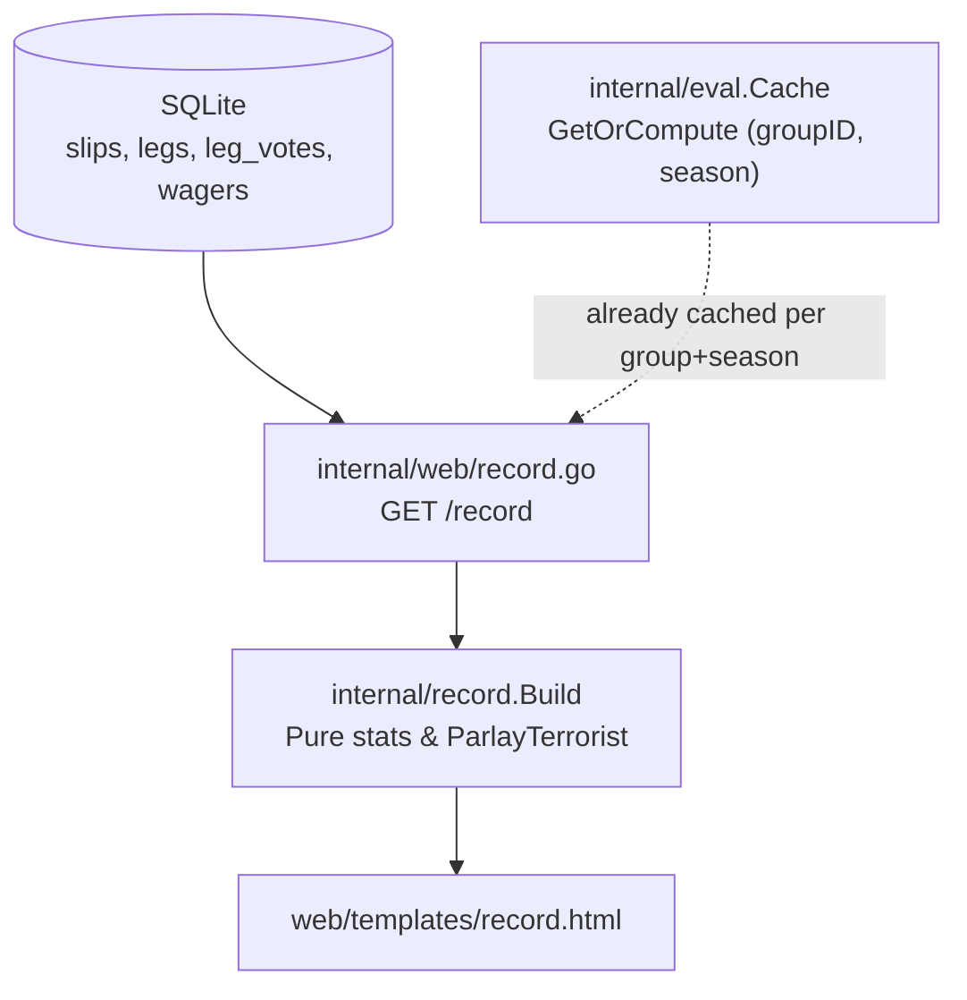
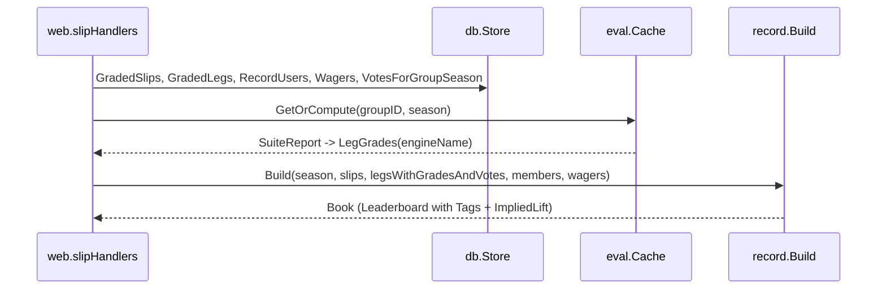
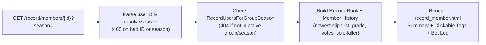

# Design: Record Book member tags and bet history

## Context

The Record Book is a server-rendered Go + HTML template screen (`GET /record?season=`) backed by three packages:

- **`internal/record`:** Pure, deterministic aggregation (`record.Build`) over `[]Slip`, `[]Leg`, `[]Member`, and
  `[]Wager`. No DB, HTTP, or clock dependencies. Currently outputs `Book` with `Leaderboard []MemberRow` carrying
  `HitPct`, `AvgLegOdds`, `TerroristCount`, `ParlayTerrorist`, and `DollarPL`.
- **`internal/db/record.go` & `internal/db/votes.go`:** Group- and season-scoped read queries (`SeasonsForGroup`,
  `GradedSeasonsForGroup`, `GradedSlipsForGroupSeason`, `GradedLegsForGroupSeason`, `RecordUsersForGroupSeason`,
  `WagersForGroupSeason`). Votes are stored in `leg_votes (leg_id, user_id, value IN (-1, 1))`, currently queried only
  per slip (`VotesForSlip`).
- **`internal/eval`:** Leak-free pre-kickoff historical replay (`eval.Cache.GetOrCompute(ctx, store, groupID, season)`).
  `SuiteReport` holds per-engine `Report` entries whose unexported `legOutcomes` already record each replayed leg's
  `legID` and normalized grade band (`A`–`F` or `ungraded`). `slips.Service` already calls
  `EvalCache.InvalidateGroup(groupID)` whenever a leg or slip settles.
- **`internal/web/record.go` & `web/templates/record.html`:** Renders the season selector, 4 summary cards, and the
  member leaderboard (cards below `sm:`, table at `sm:+`). Modal/sheet UI across the app uses native
  `<dialog class="leg-sheet">` (bottom sheet on phones, centered modal on desktop) styled with semantic CSS tokens.



## Approach

### 1. Pre-kickoff leg grades and season vote tallies

Reuse `eval.Cache` instead of adding a new grade column or table:

- **`internal/eval/metrics.go`:** Add `func (s SuiteReport) LegGrades(engineName string) map[int64]string`:
  - Selects the `Report` matching `engineName` (falling back to `s.ActiveRubric`, then `s.Reports[0]`).
  - Scans `report.legOutcomes` for non-market entries with `legID > 0` and `band != ""` and `band != ungradedBand`,
    returning `map[int64]string{legID: band}`.
- **`internal/db/record.go`:** Add `VotesForGroupSeason(ctx, groupID, season)` returning `map[int64]int`:
  - Aggregates `SUM(v.value)` grouped by `v.leg_id` for legs on `GRADED` slips in `groupID` and `season`.
- **`internal/web/record.go`:** Load `votes` via `VotesForGroupSeason` and load `legGrades` via
  `h.deps.EvalCache.GetOrCompute(ctx, h.deps.Store, group.ID, selectedSeason)` using `h.deps.GradingEngine.Name()` when
  non-nil. Fail soft on replay error or nil cache (log a warning and pass `nil` grades so `/record` still renders all
  non-grade stats and tags).



### 2. Pure tag engine and stats in `internal/record`

Extend `record.Leg` with `ID int64`, `Grade string` (`"A"`–`"F"` or `""`), and `NetVotes int`.

Add `internal/record/tags.go` with typed tag models:

```go
type TagTone string

const (
    TagTonePraise TagTone = "praise"
    TagToneInsult TagTone = "insult"
)

type Tag struct {
    Key         string  // stable identifier, e.g. "natural"
    Label       string  // display name, e.g. "Natural"
    Tone        TagTone // praise or insult
    Rule        string  // plain-English qualification rule
    Explanation string  // member-specific stats that earned the tag
}
```

Extend `MemberRow` with:

- `ImpliedLift *float64` (actual `HitPct` minus mean sportsbook implied win probability across decided legs with valid
  odds, in percentage points; `nil` below `MinDecidedLegs` or without valid odds).
- `CurrentWinStreak int` and `CurrentLossStreak int` (active consecutive decided leg streak in chronological slip/leg
  order; `PUSH`/`VOID` legs are skipped without resetting the streak).
- `Tags []Tag` (deterministic order: praise tags in catalog order, then insult tags with `parlay_terrorist` first).

Keep `ParlayTerrorist bool` and `TerroristCount int` intact for existing callers.

#### Tag catalog and thresholds

Every tag requires both a minimum sample size and a clear performance threshold so average seasons stay clean:

| Key | Label | Tone | Qualification rule |
| --- | --- | --- | --- |
| `natural` | Natural | Praise | Decided `D`/`F` legs >= 3, wins >= 3, win rate >= 60.0% |
| `ball_knower` | Ball Knower | Praise | Decided legs >= 6 with valid odds, `ImpliedLift >= +12.0` pts |
| `film_room_god` | Film Room God | Praise | Decided `A`/`B` legs >= 4, win rate >= 75.0% |
| `sniper` | Sniper | Praise | Decided legs with `Odds >= +120` >= 3, wins >= 2, win rate >= 50.0% |
| `the_backpack` | The Backpack | Praise | Decided legs >= 8, `HitPct >= 65.0%`, `TerroristCount == 0` |
| `heater` | Heater | Praise | Active consecutive decided leg win streak >= 5 |
| `told_you_so` | Told You So | Praise | Decided legs with `NetVotes < 0` >= 3, wins >= 2, win rate >= 60.0% |
| `parlay_terrorist` | Parlay Terrorist | Insult | Tied for group max `TerroristCount > 0` (sole losing leg on lost slip) |
| `certified_donkey` | Certified Donkey | Insult | Decided legs >= 6 with valid odds, `ImpliedLift <= -12.0` pts |
| `glue_eater` | Glue Eater | Insult | Decided `A`/`B` legs >= 4, win rate <= 35.0% |
| `vegas_favorite_idiot` | Vegas's Favorite Idiot | Insult | Decided legs with `Odds >= +120` >= 4, win rate <= 20.0% |
| `scared_money` | Scared Money | Insult | Decided legs >= 6, `AvgLegOdds <= -220` |
| `stinker` | Stinker | Insult | Active consecutive decided leg loss streak >= 5 |
| `fraud` | Fraud | Insult | Decided legs with `NetVotes > 0` >= 3, win rate <= 35.0% |

Each earned `Tag` populates `Explanation` with the member's actual counts/percentages (e.g.,
`"Won 4 of 5 D/F-graded picks (80.0%)."`, `"Sole losing leg on 3 lost slips."`,
`"Hit 75.0% vs 56.2% implied odds (+18.8 pts across 8 legs)."`).

### 3. Clickable tag explanations and leaderboard UX

Replace the static Parlay Terrorist `<span>` in `web/templates/record.html` with interactive tag chips rendered from
`.Tags`:

- Each tag renders as a `<button type="button" data-tag-explain class="ui-stamp ...">` carrying `data-tag-label`,
  `data-tag-tone`, `data-tag-rule`, and `data-tag-explanation` attributes, styled with
  `bg-positive-soft text-positive-ink` for praise and `bg-danger-soft text-danger-ink` for insult.
- Both `record.html` and `record_member.html` include a shared `<dialog id="tag-explain-dialog" class="leg-sheet">`
  partial (`tag-explain-dialog` in `web/templates/partials.html`).
- `web/static/app.js` binds a delegated click listener on `[data-tag-explain]` that populates the dialog's tone pill,
  title, member-specific explanation, and plain-English rule, then calls `dialog.showModal()`. Backdrop click and a
  close button dismiss it cleanly without clipping on phone viewports or inside `overflow-x-auto` tables.
- Keep `<button data-tag-explain>` as a sibling outside the member's `<a>` link so tapping a tag never triggers
  navigation to the member page.
- On the desktop table, keep the Member cell clean (avatar + clickable name + wrapping tag chip row) and keep the
  existing numeric columns (`Legs`, `Hit %`, `Avg odds`, `Terrorist`, `Dollar P/L`). On phone cards, wrap tag chips
  below the member header so 2–4 tags never squash the member's name.

### 4. Member bet history drill-down (`GET /record/members/{id}?season=`)

Mount `GET /record/members/{id}` on `slipHandlers.Routes(mux)` (behind `RequireUser` and `groups.Scope`):



- **Group privacy:** Look up `userID` in `RecordUsersForGroupSeason(ctx, group.ID, selectedSeason)`. If absent, return
  `404 Not Found` so a caller cannot probe users from other groups.
- **View model (`RecordMemberPage` in `internal/web/record.go`):**
  - Back link to `/record?season={Season}` and season selector posting to `/record/members/{id}`.
  - Member identity, leaderboard rank (when present), 4-stat summary strip (`Legs`, `Hit %` with implied-odds lift
    sub-label, `Avg odds`, `Dollar P/L`), and full clickable `Tags` strip.
  - `Bets []RecordMemberBetView`: every leg authored by `userID` on `GRADED` slips in `group.ID` and `selectedSeason`,
    ordered newest week/slip first (`Season DESC, SeasonType DESC, WeekNum DESC, CreatedAt DESC, SlipID DESC`,
    `LegID ASC`).
  - Each `RecordMemberBetView` carries: `WeekLabel` (e.g. `Week 9` or `Wild Card`), `SlipID`, `SlipName`, `SlipResult`,
    `Selection`, `MarketLabel`, `Odds` (formatted), `Grade` (`A`–`F` or `""`), `GradeClass`, `Result`
    (`WON`/`LOST`/`PUSH`/`VOID`), `ResultClass`, `SoleKiller bool` (true when this leg was the sole losing leg on a lost
    slip), and `NetVotes int` (formatted `+N`/`-N` when non-zero).
- **Template (`web/templates/record_member.html`, registered as `"record-member"` in `pageFiles`):**
  - Phone-first cards for each graded leg linking to `/slips/{SlipID}`, widening into a clean structured layout at
    `sm:+`. Includes `{{template "tag-explain-dialog"}}` so tapping any tag on the member page opens the exact same
    explanation sheet.

### Trade-offs and rejected options

- **Bottom-sheet `<dialog>` over `<details>` popovers for tags:** Rejected `<details>` absolute popovers because they
  clip horizontally near phone screen edges and vertically inside `overflow-x-auto` desktop tables. Reusing
  `dialog.leg-sheet` matches existing app sheets and works identically at every viewport width.
- **Reusing `eval.Cache` over persisting leg grades in SQLite:** Rejected adding a `legs.grade` column because it would
  need a migration, leave older graded legs ungraded, and drift when rubrics update. `eval.Cache` already computes
  leak-free pre-kickoff grades per `(groupID, season)` and invalidates on settlement.

## Verification

- Run `go test ./...` and `golangci-lint run` (plus `good-vibes docs lint`) after changes.
- Unit tests in `internal/record`:
  - Every one of the 14 tags fires when above threshold and stays off one leg/point below threshold (minimum-sample and
    boundary checks).
  - Chronological leg streaks skip `PUSH`/`VOID` legs and reset on the opposite decided result.
  - `ImpliedLift` matches `HitPct - mean(100 / AmericanToDecimal(odds))` and stays `nil` below `MinDecidedLegs`.
  - Deterministic tag ordering (praise first, then insult with `parlay_terrorist` first).
- Unit tests in `internal/eval` and `internal/db`:
  - `SuiteReport.LegGrades` returns per-`LegID` bands for the requested engine, skipping `ungraded` and market legs.
  - `VotesForGroupSeason` sums net votes scoped strictly to `groupID`, `season`, and `GRADED` slips.
- Handler and HTML tests in `internal/web/record_test.go`:
  - `GET /record` renders earned tags with `data-tag-explain` attributes, `#tag-explain-dialog`, and links to
    `/record/members/{id}?season=`.
  - `GET /record/members/{id}?season=` returns `200` with member summary, tags, and graded legs (including grade badges,
    sole-killer markers, and slip links), `400` on invalid ID/season, and `404` for a user outside the active group.
  - Layout/JS check confirms `#tag-explain-dialog` IDs referenced in `app.js` exist in rendered record pages and never
    break `layout_test.go`.

## Risks

- **First-load latency on `/record` after cache invalidation:** Calling `EvalCache.GetOrCompute` on a cold cache runs
  pre-kickoff replay for the group's season. Mitigated by `eval.Cache` memoization per `(groupID, season)` (warm for all
  subsequent `/record` and `/record/members/{id}` visits until a slip settles) and fail-soft handling if replay errors.
- **Archived pre-kickoff data missing for seeded/legacy slips:** Older imported slips without archived game/odds
  snapshots have no pre-kickoff grade (`ungraded`). Grade-dependent tags (`Natural`, `Film Room God`, `Glue Eater`)
  simply require graded legs and never misfire on ungraded picks; the member history view omits the grade pill cleanly
  when blank.
- **Leaderboard clutter on phones:** A member earning several tags could crowd a narrow card. Mitigated by placing
  compact wrapping tag chips on their own flex-wrap row below the member header and keeping the tap-to-explain detail
  inside `#tag-explain-dialog`.

## TODO

### Phase 1: Pure Record Book tag engine and season data wiring

Complexity: medium (coordinates leg-grade extraction in `internal/eval`, season vote aggregation in `internal/db`, and
14 deterministic tag rules plus streak and implied-lift math in `internal/record`)

Risk: low (pure read-only logic with no schema changes and full unit-test coverage of every tag boundary and query)

- [x] Add `SuiteReport.LegGrades(engineName string) map[int64]string` in `internal/eval/metrics.go` and
      `Store.VotesForGroupSeason(ctx, groupID, season)` in `internal/db/record.go`, with unit tests covering engine
      selection, ungraded/market filtering, and group/season/graded-slip vote scoping.
- [x] Extend `internal/record` (`record.go` and new `tags.go`) with `Leg.ID`, `Leg.Grade`, `Leg.NetVotes`,
      `MemberRow.ImpliedLift`, active leg streaks, and the 14 deterministic praise/insult tags with plain-English rules
      and member-specific explanations; add boundary and streak unit tests in `internal/record/record_test.go`.

### Phase 2: Record Book leaderboard tags, clickable explanations, and member links

Complexity: low (follows existing handler, template, and `dialog.leg-sheet` patterns in `internal/web` and `web/`)

Risk: low (read-only view updates on `/record` covered by handler HTML tests and `layout_test.go`)

- [x] Wire `EvalCache.GetOrCompute` leg grades (fail-soft) and `VotesForGroupSeason` into `GET /record` in
      `internal/web/record.go`, populate `RecordMemberView.UserID`, `ImpliedLift`, and `Tags`, and link each member row
      to `/record/members/{id}?season=` without nesting tag buttons inside links.
- [ ] Render interactive praise/insult tag chips in `web/templates/record.html`, add the shared `tag-explain-dialog`
      bottom sheet in `web/templates/partials.html` with its delegated click handler in `web/static/app.js`, and add
      handler tests in `internal/web/record_test.go`.

### Phase 3: Member bet history screen and living docs

Complexity: medium (adds a new group-scoped route, member bet-history view assembly with week, slip, grade, vote, and
sole-killer details, and a phone-first template)

Risk: low (read-only route behind `RequireUser` and `groups.Scope` with explicit 400/404/200 privacy tests)

- [ ] Add `GET /record/members/{id}` in `internal/web/slips.go` and `internal/web/record.go`, register `"record-member"`
      in `internal/web/render.go`, build `web/templates/record_member.html` with summary strip, clickable tags, and
      newest-first graded leg history, and add scoping and rendering tests in `internal/web/record_test.go`.
- [ ] Docs: update `docs/concepts/record-book.md` (including fixing its stale front-matter fields) and
      `docs/reference/routes.md` to document the expanded tag catalog, clickable tag explanations, and
      `GET /record/members/{id}?season=`.
