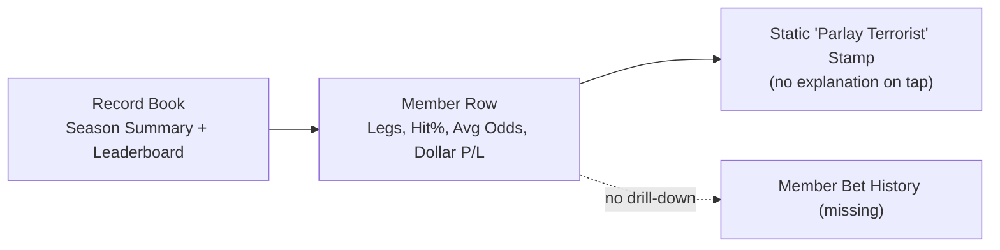
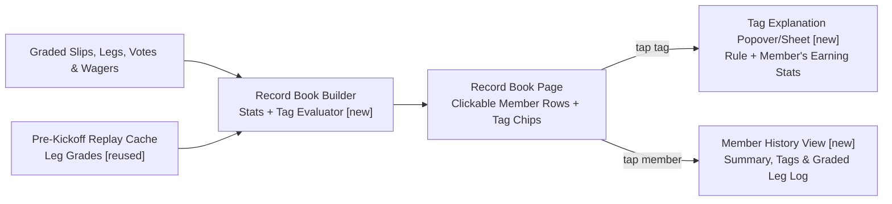

# Record Book member tags and bet history

## Context

The Record Book currently shows a flat season summary and one leaderboard row per member: legs record, Hit%, average
odds, Dollar P/L, and a single static **Parlay Terrorist** stamp.

That leaves three gaps when friends review a season together:

1. **No member drill-down.** You cannot tap a member to inspect the actual picks behind their numbers—which legs hit,
   which ones sold the slip, what odds they took, or how the analyzer graded those picks before kickoff.
2. **One tag cannot tell the story.** Parlay Terrorist only captures who blew up the most slips solo. It misses
   genuinely impressive traits (like beating the analyzer on low-graded picks or cashing plus-money dogs) and genuinely
   awful ones (like bricking heavy chalk or tanking well below implied odds).
3. **Tags are mute.** Even the existing Parlay Terrorist stamp does not explain how it was earned when tapped.

## Goals and non-goals

### Goals

- **Earned, informative, playful member tags.** Expand Record Book tags with a tight, deterministic set of earned
  badges—highly praising for genuinely impressive betting patterns (including **Natural** for winning low-graded picks)
  and juvenile, playful insults for genuinely bad ones. Every tag requires a real minimum sample and strict threshold so
  average seasons stay untagged.
- **Tap-to-explain tags.** Tapping or clicking any tag opens a concise explanation of what the tag means and the exact
  season stats that earned it for that member.
- **Member bet history drill-down.** Tapping any member on the Record Book opens a group- and season-scoped member
  history view showing their summary stats, earned tags, and every graded leg they picked (with week, slip link,
  selection, odds, pre-kickoff analyzer grade when available, and outcome).
- **Zero extra API spend and leak-free grades.** Compute pre-kickoff leg grades from existing cached/archived data via
  the in-memory replay layer, respecting single-instance and free-tier guardrails.
- **Phone-first layout.** Keep the leaderboard scannable at phone width when a member has multiple tags, and design both
  tag explanations and member history for thumbs first.

### Non-goals

- Giving out participation tags or firing insults on small samples; no member is guaranteed a tag.
- Changing analyzer grading formulas, warning tone on live pick screens, or auto-grading rules.
- Persisting derived tags or historical leg grades in new database tables.
- Fetching external APIs or spending Odds API / Parlay API credits.
- Exposing a member's bets from other groups; member history stays strictly scoped to the active group.

## Decision

### Before

### After

### Tag direction

Every tag measures a distinct, informative betting signal and fires only when a member clears both a minimum sample size
and a clear performance bar (exact numeric thresholds will be locked in the design):

**Praise tags (legit impressive):**

- **Natural** — Wins low-graded (`D`/`F`) picks at a strong clip despite the analyzer warning them off.
- **Ball Knower** — Beats sportsbook implied probability by a wide margin across qualified legs.
- **Film Room God** — Picks high-graded (`A`/`B`) legs and cashes them at an elite rate.
- **Sniper** — Consistently cashes plus-money longshots.
- **The Backpack** — Posts a strong Hit% with zero Parlay Terrorist solo kills across a meaningful slate.
- **Heater** — Currently riding a long active consecutive-win leg streak.
- **Told You So** — Cashes picks that the rest of the group actively downvoted.

**Juvenile insult tags (legit bad):**

- **Parlay Terrorist** *(existing)* — Leads the group in killing slips as the sole losing leg.
- **Certified Donkey** — Underperforms sportsbook implied probability by a wide margin across qualified legs.
- **Glue Eater** — Picks high-graded (`A`/`B`) spots and still bricks them at an awful rate.
- **Vegas's Favorite Idiot** — Spams plus-money longshots and bricks almost all of them.
- **Scared Money** — Farms steep negative chalk to pad Hit% without taking real odds risk.
- **Stinker** — Currently stuck in a brutal active consecutive-loss leg streak.
- **Fraud** — Gets the group to upvote their picks and then bricks them.

### Why this approach

- **Reusing leak-free pre-kickoff replay for leg grades** beats storing grade snapshots in SQLite because it avoids
  schema migrations, works retroactively on past graded slips already in the archive, and stays consistent with the
  Grading Results page.
- **Strict sample and performance gates** beat awarding "best/worst in group" for every category because small groups or
  average weeks should stay clean rather than handing out hollow praise or unearned roasts.
- **Dedicated member history view with inline tap-to-explain tags** beats cramming full pick logs into accordion rows on
  the main leaderboard because phone viewports stay fast and scannable while still making every pick and tag one tap
  away.

### Complexity and risk

- `complexity: medium` fits because the work coordinates across the pure Record Book tag evaluator, pre-kickoff
  leg-grade replay integration, a new group-scoped member history view, and phone-first interactive tag explanations
  while preserving group privacy and single-instance caching invariants.
- `risk: low` fits because every new path is read-only with no schema migrations, external API calls, or changes to live
  picking and grading, and deterministic unit and handler tests cover tag qualification, explanation rendering, and
  group-scoped member history.
