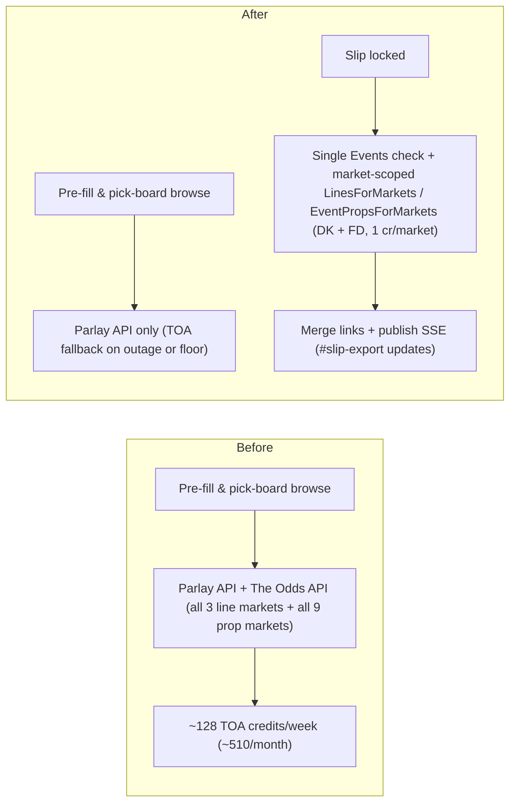

# Close-out

## Overview

## Consequences

- **Easier:** Staying within the 500/month Odds API credit limit, since browsing and pre-fill spend zero Odds API credits and locked slips only pay for missing markets on DraftKings and FanDuel.
- **Easier:** Extending market-scoped Odds API queries without duplicating market-key mappings or query-string logic.
- **Harder:** Diagnosing missing deep links right after lock, since DraftKings and US FanDuel links now arrive asynchronously after lock via background enrichment and SSE rather than during browsing.
- **Revisit:** Parlay-only browsing if Parlay API coverage drops for key markets, or if DraftKings deep links are ever needed before a slip locks.

## Alternatives considered

- **Raising Odds API staleness windows:** Rejected because even infrequent browsing calls still burn 9 credits per opened game across all prop markets, whether or not any pick is made.
- **Dropping DraftKings links altogether:** Rejected because lock-only, market-scoped calls preserve DraftKings and valid US (`42.*`) FanDuel links at roughly 1 credit per missing market on locked slips.
- **Requiring scoped methods on the core client interfaces:** Rejected in favor of optional `marketLinesClient` and `marketPropsClient` interfaces, keeping existing test fakes working while letting `*odds.Client` use the scoped endpoints.

## Implementation notes

- Beyond the test suites named in the design, existing browse-time assertions in the pre-fill and refresh tests also had to be updated once Parlay-only browsing stopped calling The Odds API.
- Unscoped `enrichWeekLines` and `enrichGameProps` helpers remain for direct callers, while lock-time enrichment runs through the market-scoped path.
- Per-market lock-time enrichment stamps are compared against the newer of the per-market key and the coarse fallback key so disjoint locked slips do not suppress each other while full-slate fallbacks still satisfy freshness.
- Props quoted only by The Odds API and not by Parlay API no longer appear on the pick board during normal browsing.

## Follow-ups

None.
