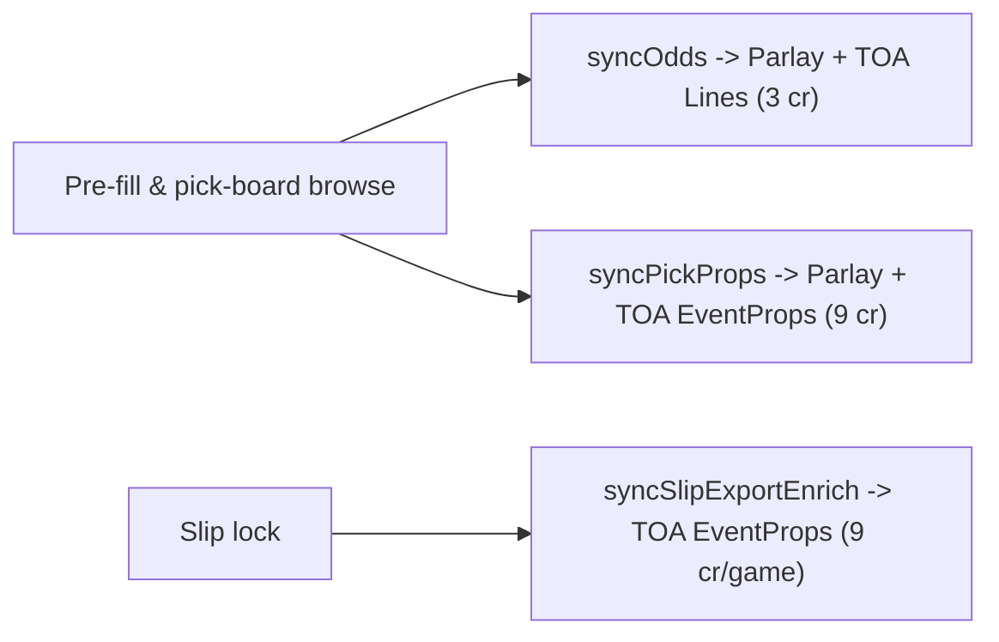
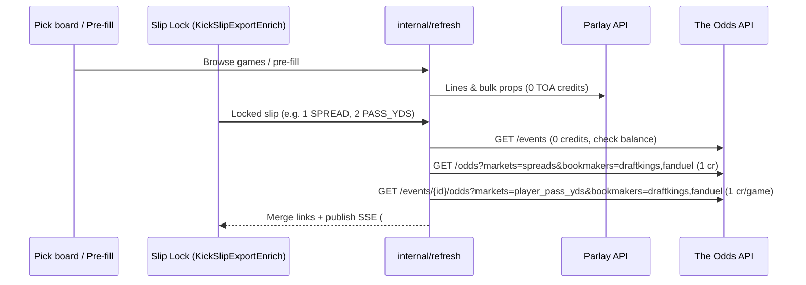

# Design: Cut The Odds API spend with lock-only, market-scoped enrichment

## Context

The Odds API is wired into `internal/refresh` as `fallbackLines` (`LinesClient`) and `fallbackProps`
(`FallbackPropsClient`). Today it runs on three hot paths even when Parlay API is healthy:

1. `syncOdds` (`internal/refresh/sources.go`) always calls `s.fallbackLines.Lines(ctx)` (3 credits for
   `h2h,spreads,totals`) alongside Parlay API on every pre-fill, midweek, and 15-minute pick-time refresh.
2. `syncOddsProps` (`internal/refresh/research.go`) always calls `fetchFallbackProps` (`EventProps`, 9 credits for all 9
   prop markets) alongside Parlay API whenever a user opens a game whose props are stale.
3. `SyncGameProps` and `syncPickProps` (`internal/refresh/refresh.go`) also invoke `oddsPropsEnrichSource` (9 credits)
   when `odds:props:{gameID}` is already fresh from Parlay-only pre-fill.

In November 2026, those paths spent 297 credits on `EventProps` (33 calls × 9 markets) and 87 credits on `Lines` (29
calls × 3 markets)—384 of 500 monthly credits in 2.5 weeks. Meanwhile, Parlay API already provides full game lines,
props, and sharp books for browsing, picking, and grading; The Odds API is only needed for DraftKings deep links, US
(`42.*`) FanDuel links on locked slips, and outage/floor fallback.

## Approach

### 1. Market-scoped and book-scoped Odds API queries in `internal/ingest/odds`

Add market- and bookmaker-scoped query methods on `*odds.Client` while keeping `Lines(ctx)` and
`EventProps(ctx, eventID)` unchanged for full-slate fallback:

- `LinesForMarkets(ctx context.Context, markets []string, bookmakers []string) ([]Line, Credits, error)` — calls `/odds`
  with the requested `markets` (subset of `h2h`, `spreads`, `totals`) and `bookmakers` (e.g. `draftkings,fanduel`,
  falling back to `regions=us` when `bookmakers` is empty), plus `includeLinks=true&includeSids=true`.
- `EventPropsForMarkets(ctx context.Context, eventID string, markets []string, bookmakers []string) ([]Prop, Credits, error)`
  — calls `/events/{id}/odds` with only the requested prop market keys and `bookmakers=draftkings,fanduel`.
- Export a pure mapping helper `odds.APIMarketKey(marketType string) (string, bool)` that translates app market types
  (`SPREAD` → `spreads`, `ML` → `h2h`, `TOTAL` → `totals`, `PASS_YDS` → `player_pass_yds`, etc.) so `internal/refresh`
  never duplicates API market strings.

The Odds API bills 1 credit per market returned per call, so requesting `markets=player_pass_yds` for one game costs 1
credit instead of 9, and `bookmakers=draftkings,fanduel` keeps payloads small.

### 2. Parlay-only browsing, pre-fill, and pick-time syncs

Change `internal/refresh` so The Odds API is never called during browsing or pre-fill when Parlay API succeeds:

- **`syncOdds` (`sources.go`):** Only call `fallbackLines` when Parlay API is unconfigured, returned an error, was
  skipped below `OddsLinesFloor`, or returned zero rows.
- **`syncOddsProps` (`research.go`):** Only call `fetchFallbackProps` when Parlay API is unconfigured, returned an
  error, was skipped below `OddsPropsFloor`, or returned zero props.
- **`SyncGameProps` and `syncPickProps` (`refresh.go`):** Remove the browse-time `oddsPropsEnrichSource` tail call so
  opening a game on the pick board never triggers a 9-credit Odds API fetch.

### 3. Lock-only, market-scoped enrichment in `syncSlipExportEnrich`

Update `syncSlipExportEnrich` (`internal/refresh/refresh.go`) to inspect every upcoming leg on a locked slip that lacks
a DraftKings link or a valid US (`42.*`) FanDuel link, then group only the missing markets:

- **Game-line legs (`SPREAD`, `ML`, `TOTAL`):** Collect the deduplicated set of missing game-line markets across the
  slip and run one `LinesForMarkets(ctx, markets, ["draftkings", "fanduel"])` call (1–3 credits for the whole week),
  merging the returned links into existing current game-line rows at a unified `FetchedAt`.
- **Prop legs:** Group missing prop markets by `gameID` and run one
  `EventPropsForMarkets(ctx, eventID, markets, ["draftkings", "fanduel"])` call per affected game (1 credit per distinct
  market on that game), merging into that game's existing current prop rows at a unified `FetchedAt`.
- Reuse one free `Events(ctx)` call per enrichment pass to map all affected games to Odds API event IDs and verify
  `credits.Remaining >= TheOddsAPIEnrichFloor` before spending any credits. Publish the week topic after commit so
  `#slip-export` refreshes via SSE.

Trade-off: Using optional market-scoped interfaces (`marketLinesClient`, `marketPropsClient`) on `Service` (implemented
by `*odds.Client`) avoids breaking existing test fakes that only implement `LinesClient` / `FallbackPropsClient`,
falling back to the full methods when a fake does not implement the scoped interface.

## Verification

- `go test -short ./... && golangci-lint run ./...`
- `internal/ingest/odds/lines_test.go` and `internal/ingest/odds/props_test.go`: verify `LinesForMarkets`,
  `EventPropsForMarkets`, and `APIMarketKey` send exact `markets` and `bookmakers` query params with `includeLinks=true`
  and `includeSids=true`.
- `internal/refresh/sources_test.go` and `internal/refresh/research_test.go`: verify `syncOdds` and `syncOddsProps` make
  **zero** calls to The Odds API when Parlay API succeeds, and still fall back cleanly when Parlay API fails or is below
  its credit floor.
- `internal/refresh/pick_test.go`: verify `SyncPickGame` / `SyncGameProps` make zero Odds API calls on browse, and
  `KickSlipExportEnrich` fetches only the exact missing markets on a locked slip (1 credit per market) using one shared
  `Events` lookup and publishes SSE on change.

## Risks

- **Export card briefly shows unlinked DraftKings legs right after lock:** Because DraftKings links are fetched on lock
  instead of during browsing, there is a ~1–2 second window after locking before the background enrichment commits and
  SSE swaps `#slip-export`. Mitigated because `#slip-export` already subscribes to `slip-updated` and swaps in place
  without a reload.
- **Unquoted props on Parlay API:** If Parlay API does not carry a prop that only The Odds API quoted, it will no longer
  appear during browsing. Mitigated by `dk-fd-board-and-lines` (only showing DK ∩ FD selections) and keeping Parlay API
  bulk props as the single consistent board source.

## TODO

### Phase 1: Add market- and bookmaker-scoped Odds API queries

Complexity: low (extends existing `internal/ingest/odds` query builders and pure market-key mapping with direct unit
tests).

Risk: low (additive methods on `*odds.Client`; existing `Lines` and `EventProps` signatures remain unchanged).

- [x] Add `APIMarketKey`, `LinesForMarkets`, and `EventPropsForMarkets` in `internal/ingest/odds/lines.go` and
  `internal/ingest/odds/props.go` (supporting `markets` and `bookmakers` query params), with unit tests in
  `internal/ingest/odds/lines_test.go` and `internal/ingest/odds/props_test.go`.

### Phase 2: Switch browsing to Parlay-only and lock-time enrichment to market-scoped calls

Complexity: medium (coordinates `syncOdds`, `syncOddsProps`, `syncPickProps`, and `syncSlipExportEnrich` across lines
and props while preserving Parlay-outage fallback and unified `FetchedAt` merging).

Risk: medium (changes when The Odds API runs; fallback and lock-time SSE refresh must be thoroughly verified in refresh
tests).

- [x] Update `syncOdds` (`internal/refresh/sources.go`), `syncOddsProps` (`internal/refresh/research.go`), and
  `SyncGameProps` / `syncPickProps` (`internal/refresh/refresh.go`) to skip The Odds API enrichment when Parlay API
  succeeds while preserving outage and credit-floor fallback, updating `sources_test.go`, `research_test.go`, and
  `pick_test.go`.
- [x] Update `syncSlipExportEnrich` in `internal/refresh/refresh.go` to batch one free `Events` check and run
  market-scoped `LinesForMarkets` and per-game `EventPropsForMarkets` calls (`draftkings,fanduel` only) for missing
  locked-slip links, with unit tests in `internal/refresh/pick_test.go`.
- [ ] Docs: update `docs/concepts/data-refresh.md`, `docs/concepts/export.md`, and `docs/reference/data-sources.md` to
  document Parlay-only browsing and lock-only, market-scoped Odds API enrichment.
