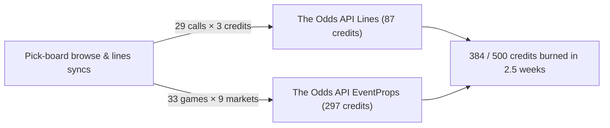
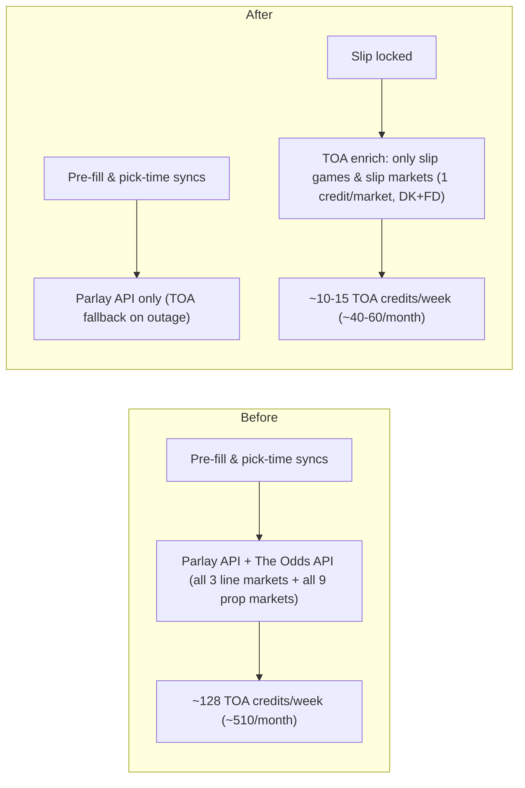

# Cut The Odds API spend with lock-only, market-scoped enrichment

## Context

In November 2026 (Nov 13–27), the app spent **384 of 500** free-tier credits on The Odds API (~128/week, or ~510+/month)
and hit `99` credits remaining right before Thanksgiving—tripping the `100` enrichment floor and disabling DraftKings
links. Meanwhile, Parlay API used only **306 of 1,000** credits (~102/week, ~67% remaining).

Production archive data (`backups/parlay-2026-11-27.db`) shows exactly where The Odds API credits went:

| Endpoint | Calls | Credits used | Avg cost | Share |
| --- | ---: | ---: | ---: | ---: |
| Per-game props (`EventProps`) | 33 | **297** | 9.0 | **77%** |
| Week game lines (`Lines`) | 29 | **87** | 3.0 | **23%** |
| Event list (`Events`) | 136 | 0 | 0.0 | 0% |

Two habits cause almost all of that burn:

1. **Browsing triggers 9-credit prop enrichment:** Opening any game on the pick board calls The Odds API `EventProps`
   for **all 9 prop markets** (9 credits per game), even when the user is just browsing and picks nothing—or picks only
   one market in that game.
2. **Every game-lines refresh calls The Odds API:** Every Parlay API game-lines sync (pre-fill, midweek, and 15-minute
   pick-time refreshes) also calls The Odds API `/odds` (3 credits), even though deep links are never used until a slip
   is locked.

## Goals and non-goals

**Goals:**

- Cut monthly The Odds API spend by **80–90%** (from ~510/month down to ~30–60/month) so the 500/month free tier always
  has large headroom.
- Stop calling The Odds API during normal browsing, pre-fill, and pick-time refreshes whenever Parlay API is healthy;
  use Parlay API alone for browsing, picking, and grading.
- Run The Odds API enrichment **only when a slip locks** (for legs missing a DraftKings link or a valid US FanDuel
  link), requesting **only the exact markets** present on the locked slip (1 credit per market instead of 9) and scoping
  requests to DraftKings and FanDuel.
- Keep The Odds API as an automatic fallback for lines and props if Parlay API is unavailable or below its credit floor.

**Non-goals:**

- Removing The Odds API completely (it is still needed for DraftKings deep links, valid US FanDuel links, and Parlay API
  outage fallback).
- Paying for a higher API tier or adding a third odds provider.
- Changing Parlay API staleness windows or morning pre-fill behavior.

## Decision

Make Parlay API the sole provider for browsing, pre-fill, and pick-time refreshes, and restrict The Odds API enrichment
to lock-time, market-scoped calls for the exact games and markets on a locked slip (retaining The Odds API only as an
outage/floor fallback otherwise).

This beats simply raising staleness windows on The Odds API, which still wastes 9 credits per browsed game on unpicked
markets. It also beats dropping DraftKings links altogether, since lock-only market-scoped calls deliver full DraftKings
and US FanDuel links for roughly 4–6 credits per locked slip instead of 100+ credits per week.

- **Complexity: medium** — Spans odds client market-scoped query support, separating browsing syncs from lock-time
  enrichment, and preserving fallback behavior when Parlay API is unavailable.
- **Risk: medium** — Shifting enrichment strictly to lock time means export links depend on the background lock-time
  enrichment completing promptly (with SSE refresh), and fallback paths must still work if Parlay API fails.
