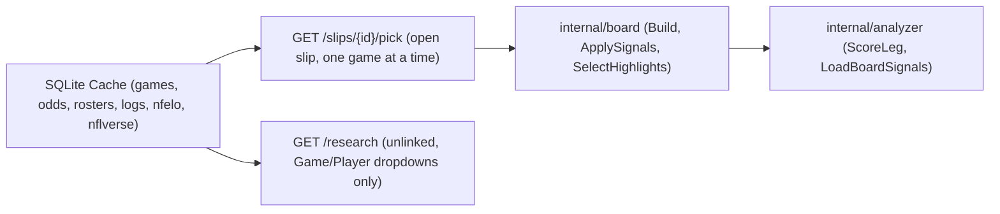
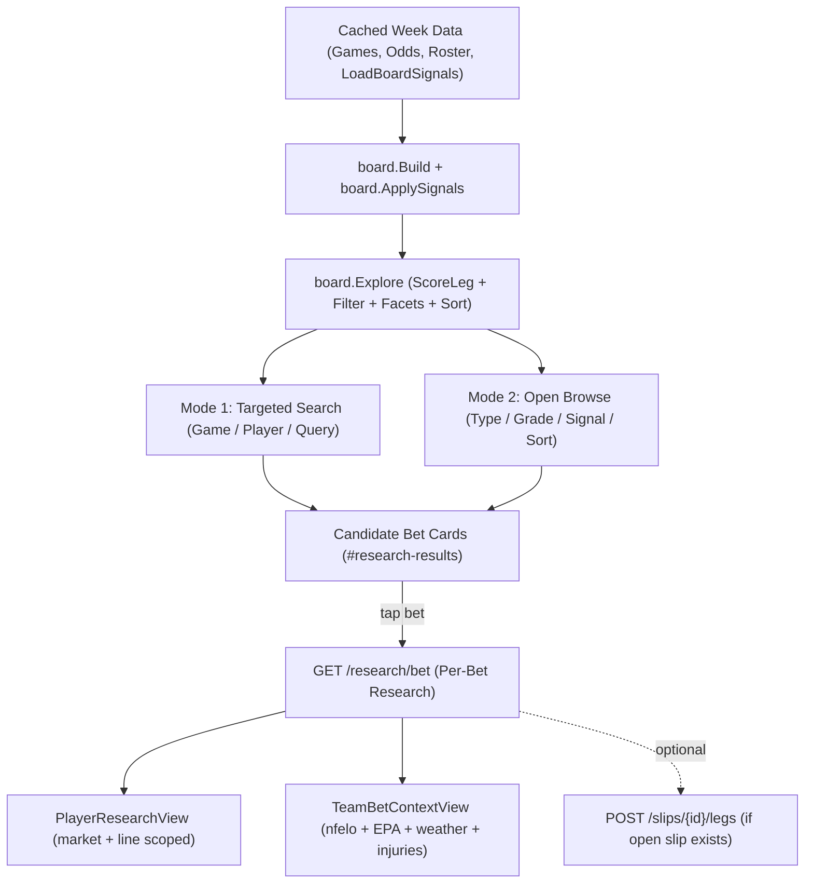
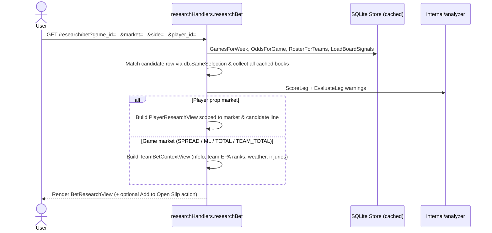

# Design: Dedicated research view for picking legs

## Context

Today, bet discovery and research are split across two unconnected screens:

- `internal/web/research.go` (`GET /research`, `GET /research/games/{id}`, `GET /research/players/{espnID}`,
  `POST /research/matches`) renders `web/templates/research.html` with `page.Tab = ""` (not in the bottom nav). It
  offers two `<select>` dropdowns (Game and Player) that load `GameResearchView` (injuries and manual prop matching) or
  `PlayerResearchView` (L5 bar chart, season hit rate, opponent defense ranks, matchup context, usage tiles, market
  switcher). It has no bet list, filtering, sorting, or per-bet research view.
- `internal/web/pick.go` (`GET /slips/{id}/pick`) uses `internal/board` (`board.Build`, `board.ApplySignals`,
  `board.BuildSlate`, `board.SelectHighlights`) and `internal/analyzer` (`analyzer.LoadBoardSignals`,
  `analyzer.ScoreLeg`) over cached SQLite odds, but is locked behind an open slip and forces a single-game drilldown.



Constraints and invariants:

- **Free-tier credit guardrail:** Browsing, searching, filtering, and sorting across the week's slate must read cached
  SQLite data only (`Store.OddsForWeek`, `analyzer.LoadBoardSignals`) and make zero external Odds API or Parlay API
  calls. On-demand prop fetches (`Refresher.SyncGameProps`) may only run when a user explicitly requests props for a
  single game that lacks them.
- **Selection identity:** Matching a candidate bet to cached book odds or an open slip leg must use `db.SameSelection`
  (`internal/db/odds.go`) so sportsbook, line drift, and price differences stay consistent across Research and the Pick
  Board.
- **Phone-first & friendly:** Every filter bar, candidate card, and per-bet research sheet must work at 375px width, and
  no leg is ever blocked.

## Approach

### 1. Primary navigation tab (`TabResearch`)

Add `TabResearch Tab = "research"` (`Label: "Research"`, `Href: "/research"`) to `navTabs` in `internal/web/page.go` and
set `page.Tab = TabResearch` in `researchHandlers.page`. Ensure the bottom `<nav>` in `web/templates/layout.html` uses
`grid-flow-col auto-cols-fr` so it adapts cleanly alongside other primary tabs.

### 2. Pure slate-wide candidate explorer (`internal/board/explorer.go`)

Keep candidate scoring, filtering, facet counting, and sorting out of HTTP handlers by adding a pure seam in
`internal/board`:

```go
type ExploreSort string

const (
    ExploreSortGrade   ExploreSort = "grade"   // highest analyzer score, then best price
    ExploreSortMatchup ExploreSort = "matchup" // strongest signal + softest opp def EPA
    ExploreSortOdds    ExploreSort = "odds"    // shortest American odds first
    ExploreSortLine    ExploreSort = "line"    // highest line first
    ExploreSortKickoff ExploreSort = "kickoff" // earliest kickoff first
    ExploreSortPlayer  ExploreSort = "player"  // alphabetical player/team
)

type ExploreQuery struct {
    Q        string   // case/accent-insensitive search (player, team, matchup, market)
    GameID   string   // optional targeted game filter
    PlayerID string   // optional targeted player filter
    Category Category // lines, team_totals, passing, rushing, receiving, tds, kicking
    Grades   []string // e.g. ["A"], ["A", "B"]
    Signal   string   // smash, volume, role_bump, fits_slip
    Window   Window   // kickoff window
    Sort     ExploreSort
    Limit    int      // default 50 for fast phone rendering
    Signals  BoardSignals // optional; fills in every badge a row matches
}

type ScoredRow struct {
    Row        Row
    Grade      analyzer.LegGrade
    Reason     string // concise top positive/negative factor
    ImpliedPct int
}

type ExploreResult struct {
    Rows           []ScoredRow
    TotalMatched   int
    CategoryCounts map[Category]int
    GradeCounts    map[string]int
    SignalCounts   map[string]int
    HasMore        bool
}
```

`board.Explore(rows []Row, games map[string]analyzer.Game, stats map[string]analyzer.PlayerStats, q ExploreQuery) ExploreResult`:

1. Filters out kicked-off games (already excluded by `board.Build`) and `OTHER` markets.
2. Scores each candidate with `analyzer.ScoreLeg(RowToAnalyzerLeg(row), games, stats)` and attaches `Reason` and
   `ImpliedPct` (`parlay.ImpliedProb`).
3. Applies targeted (`GameID`, `PlayerID`, `Q`) and open-exploration (`Category`, `Grades`, `Signal`, `Window`) filters
   while tallying facet counts before the corresponding facet's own filter is applied (so chip counts stay accurate when
   toggling). Signal chips use the full badge set from `ExploreQuery.Signals`, falling back to a row's applied `Badge`.
4. Sorts deterministically with tie-breakers (`GameID`, `Market`, `PlayerName`, `Side`, then team, line, and price) and
   slices to `Limit` (with `HasMore` for a "Show more" HTMX load). An unknown or empty sort reads as `grade`.



### 3. Dual-mode Research page (`GET /research`, `GET /research/explore`)

Redesign `web/templates/research.html` around the two user workflows while preserving existing `?game_id=`,
`?player_id=`, and `?player=` deep links:

- **Targeted search bar:** A single debounced search input (`q`) with quick-pick game and player selectors (and a
  `<datalist>` / quick-jump links) so users who already have a game or player in mind can focus immediately on that
  game's or player's candidate bets, or toggle to the full **Game Sheet** (`research-game`) or **Player Sheet**
  (`research-player`).
- **Open exploration bar:** Horizontally scrollable phone-first filter chips for **Bet Type** (`All`, `Lines`,
  `Passing`, `Rushing`, `Receiving`, `TDs`, `Kicking`, `Team totals`), **Grade** (`All`, `A`, `A–B`, `C+`), **Signals**
  (`Smash matchup`, `High volume`, `Role bump`), and **Sort** (`Best grade`, `Matchup`, `Odds`, `Line`, `Kickoff`,
  `Player`).
- **HTMX partial swap:** Filter, search, and sort changes call `GET /research/explore?...`, swap `#research-results`,
  and set `Hx-Push-Url` to `/research?...` so filters survive refreshes and shared links.
- **Candidate cards:** Each card shows the player headshot or team logo, selection text, odds + implied %, grade badge
  with top reason, signal pills, game matchup/kickoff, and a primary tap target to open **Per-Bet Research**
  (`/research/bet?...`).
- **Unloaded props safeguard:** When a user targets a specific game whose cached odds have lines but zero props, show a
  subtle `"Load props for this game"` button (`POST /research/games/{id}/props`, calling `Refresher.SyncGameProps` with
  existing credit-floor checks) rather than ever auto-fetching props across the slate.

### 4. Dedicated Per-Bet Research view (`GET /research/bet`)

Add `GET /research/bet` accepting selection identity parameters (`game_id`, `market`, `side`, `team`, `player_id`, plus
optional `from` / `slip_id`):



`BetResearchView` renders four focused sections at phone width:

1. **Bet summary & pricing:** Media badge, selection title, home-book / consensus odds + implied %, book-by-book cached
   line/price comparison (showing best/consensus price and de-vigged edge when both sides are cached), and an optional
   **+ Add to slip** action when the viewer has an open slip in the `pick` step whose slate scope includes that game
   (posting to existing `POST /slips/{id}/legs` or offering a slip picker if multiple open slips qualify).
2. **Grade & analyzer breakdown:** Full A–F grade badge, score, every factor and point delta from `analyzer.ScoreLeg`,
   and any triggered leg-level warnings.
3. **Dedicated bet research data:**
   - **Player props:** Reuses `buildPlayerResearch` (`PlayerResearchView`) pre-scoped to the bet's `market` and
     `ComparisonLine` (L5 bar chart with dotted line, L5 & season hit rates, opponent overall & position defense ranks,
     usage tiles, matchup spread/total/weather), plus a link to the full Player Sheet.
   - **Game markets (`SPREAD`, `ML`, `TOTAL`, `TEAM_TOTAL`):** Renders a new `TeamBetContextView` built from cached
     `analyzer.Game` and `GameResearchView` data: nfelo projected spread/win probability vs. market line, both teams'
     offensive & defensive EPA ranks (pass/rush/overall), weather/wind/dome conditions, and key injuries for both teams,
     plus a link to the full Game Sheet.
4. **Related bets in this game:** A compact list of top-graded or correlated legs in the same game (e.g., same player's
   other markets or stack partners) so the user can pivot smoothly.

### Trade-offs

- **Scoring over cached `Store.OddsForWeek` in memory vs. a precomputed SQLite table:** A week's cached odds fold down
  to a few hundred unique `board.Row` entries, which `board.Build` + `analyzer.ScoreLeg` already evaluates in a few
  milliseconds on every slip hub render (`SelectHighlights`). Computing in memory avoids schema migrations and cache
  invalidation bugs while staying well within single-instance latency budgets.
- **Dedicated `GET /research/bet` page instead of an inline accordion on the explorer list:** Per-bet research includes
  charts, book pricing tables, defense ranks, weather, and injuries—too dense for an accordion on a 375px phone screen.
  A dedicated page (with a clean `← Back to Research` link preserving explorer filters via `?from=`) keeps both scanning
  and deep research readable.

## Verification

- Run `go test ./...` and `good-vibes docs lint` to verify compilation, unit tests, template rendering, and doc
  validity.
- **Explorer filtering, sorting, and facets:** Unit-test `board.Explore` across targeted search (`Q`, `GameID`,
  `PlayerID`), multi-facet filters (`Category`, `Grades`, `Signal`, `Window`), all `ExploreSort` modes, facet counts,
  and `Limit`/`HasMore` pagination.
- **Zero-credit browse invariant:** Integration-test `GET /research`, `GET /research/explore`, and `GET /research/bet`
  with a spy/nil `Refresher` to prove browsing, filtering, sorting, and viewing per-bet research make zero external Odds
  API or Parlay API calls; verify explicit `POST /research/games/{id}/props` is the only path that triggers an on-demand
  prop fetch.
- **Backward compatibility:** Verify existing `GET /research?game_id=...`, `GET /research?player_id=...`,
  `GET /research?player=...`, `GET /research/games/{id}`, `GET /research/players/{espnID}`, and `POST /research/matches`
  continue to work.
- **Per-bet research & slip handoff:** Verify `GET /research/bet` renders player prop charts/defense ranks for player
  markets, renders `TeamBetContextView` (nfelo, EPA, weather, injuries) for game markets, returns a clean
  empty/not-found state for unknown selections, and shows `+ Add to slip` only when the viewer has an eligible open slip
  in the `pick` step.

## Risks

- **Accidental paid API fan-out on slate-wide browse:** If any helper called `Refresher.SyncGameProps` inside a loop
  over the week's games, a single `/research` visit could burn a month's Parlay API credits. Mitigate by keeping
  `research` and `researchExplore` strictly read-only against SQLite (`Store.OddsForWeek`, `analyzer.LoadBoardSignals`)
  and enforcing this in tests with a failing `Refresher` stub.
- **Latency on full-slate scoring:** Scoring every row on a busy 16-game Sunday slate could grow if repeated per-row
  lookups hit SQLite. Mitigate by batch-loading games, odds, rosters, and `analyzer.LoadBoardSignals` once per request
  before passing maps into pure `board.Explore`.
- **Stale or unmatched selection URLs on `/research/bet`:** Lines can move between syncs, so exact line matching in URLs
  would break shared links. Mitigate by keying `/research/bet` on `db.SameSelection` fields (`game_id`, `market`,
  `side`, `team`, `player_id`) rather than `line` or `odds_id`.

## TODO

### Phase 1: Pure slate-wide candidate explorer in `internal/board`

Complexity: medium (coordinates `board.Row`, `analyzer.ScoreLeg`, multi-facet count calculation, and deterministic
multi-key sorting) Risk: low (pure functions with zero I/O or external side effects; thoroughly verifiable with unit
tests)

- [x] Implement `ExploreQuery`, `ScoredRow`, `ExploreResult`, and `Explore` in `internal/board/explorer.go`, supporting
      targeted search (`Q`, `GameID`, `PlayerID`), open-exploration filters (`Category`, `Grades`, `Signal`, `Window`),
      facet counts, all `ExploreSort` orders, and `Limit`/`HasMore`, with comprehensive unit tests in
      `internal/board/explorer_test.go`.

### Phase 2: Primary Research nav tab and dual-mode explorer UI

Complexity: medium (updates primary nav, redesigns `research.html` around targeted + open-browse HTMX workflows, and
preserves existing game/player sheets) Risk: medium (touches primary navigation and full-slate cached odds loading; must
enforce zero paid API calls on browse via automated tests)

- [ ] Add `TabResearch` (`Research`, `/research`) to `internal/web/page.go` (using `grid-flow-col auto-cols-fr` in
      `web/templates/layout.html`) and set `page.Tab = TabResearch` in `internal/web/research.go`, updating nav/layout
      tests.
- [ ] Redesign `GET /research` and add `GET /research/explore` (HTMX partial + `Hx-Push-Url`) in
      `internal/web/research.go`, `web/templates/research.html`, and `web/templates/partials.html` to support targeted
      game/player search and open-exploration filter/sort chips over cached data (plus an explicit
      `POST /research/games/{id}/props` button when a targeted game has no props yet), preserving existing `?game_id=`,
      `?player_id=`, and `?player=` views with integration and zero-refresher-call tests in
      `internal/web/research_test.go`.

### Phase 3: Dedicated per-bet research view and open-slip handoff

Complexity: medium (assembles cached book pricing, analyzer grade/warnings, market-scoped player research or game/team
matchup context, and optional slip-scope eligibility) Risk: low (read-only research view reusing existing
`POST /slips/{id}/legs` validation and `db.SameSelection` matching)

- [ ] Implement `GET /research/bet` (`BetResearchView`, `TeamBetContextView`, book pricing comparison, grade/warning
      breakdown, market-scoped `PlayerResearchView` for props, nfelo/EPA/weather/injury context for game markets, and
      optional `+ Add to slip` for eligible open slips) in `internal/web/research.go`,
      `web/templates/research_bet.html`, and `internal/web/render.go`, with tests covering player props, game markets,
      missing selections, and open-slip eligibility.
- [ ] Docs: update `docs/reference/routes.md` and `docs/concepts/slips.md` to document the Research primary view,
      explorer filters/sorts, and per-bet research route.
